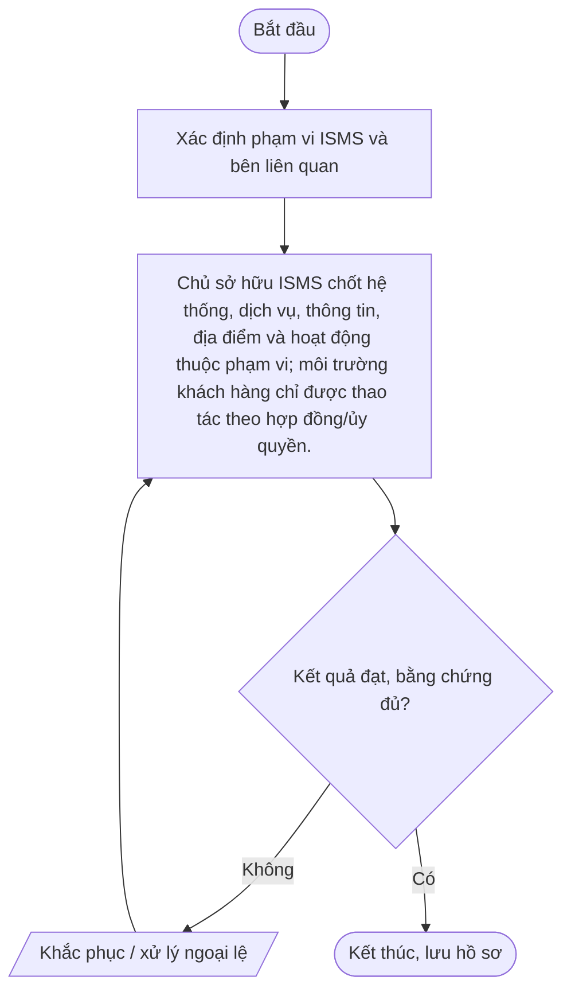
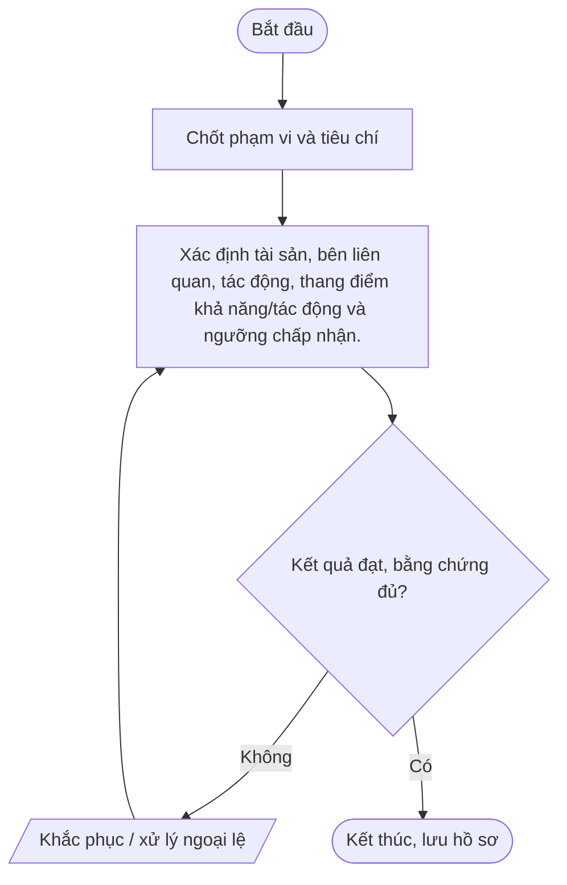
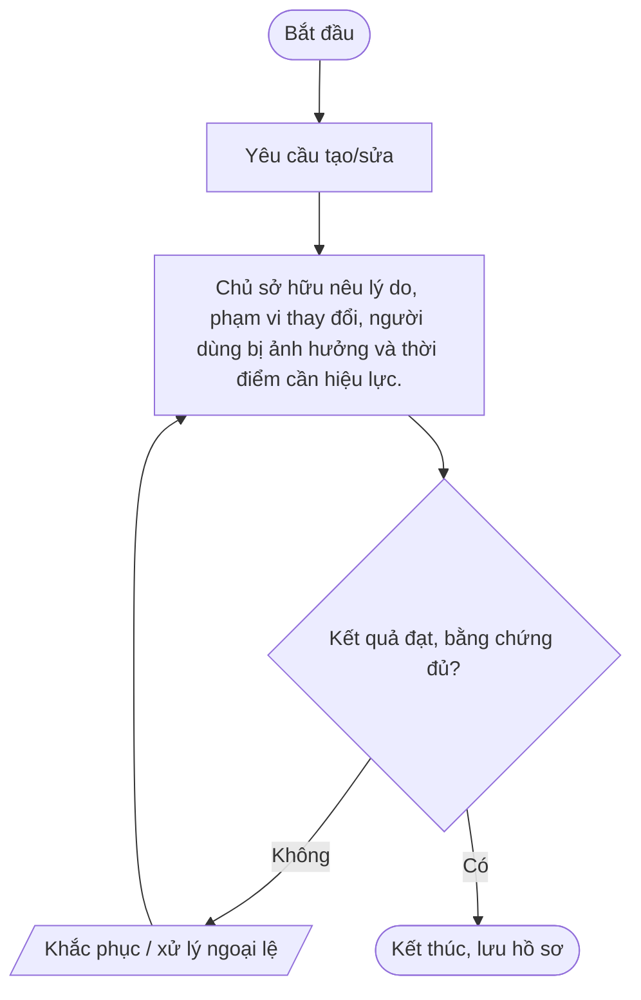
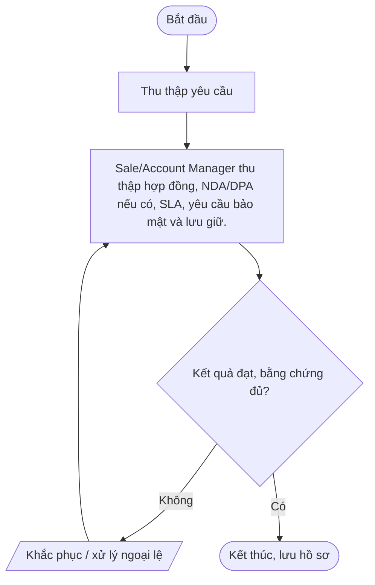
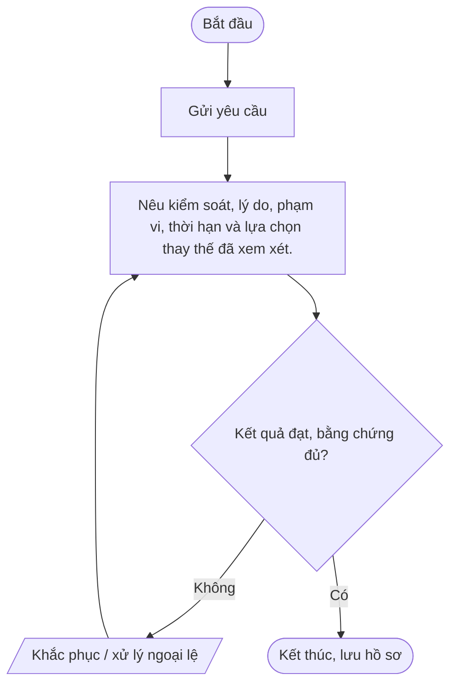
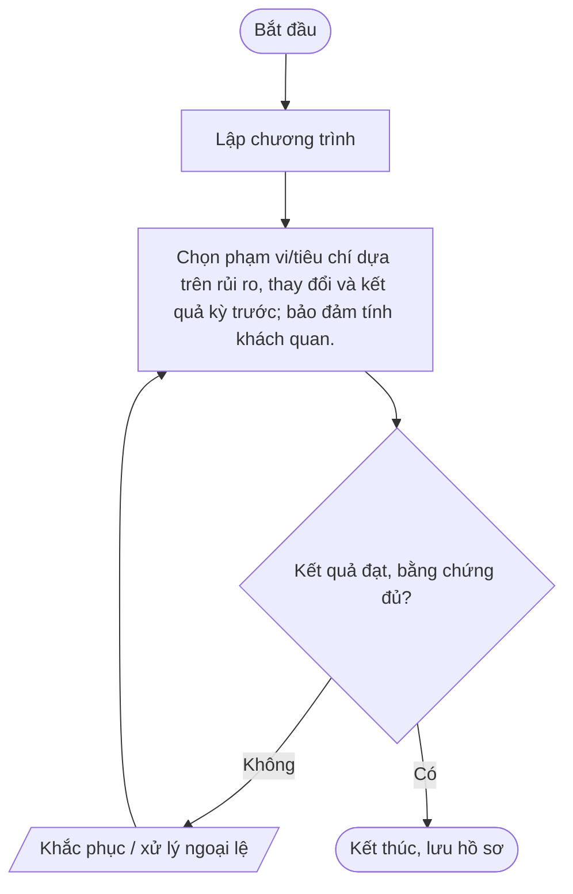
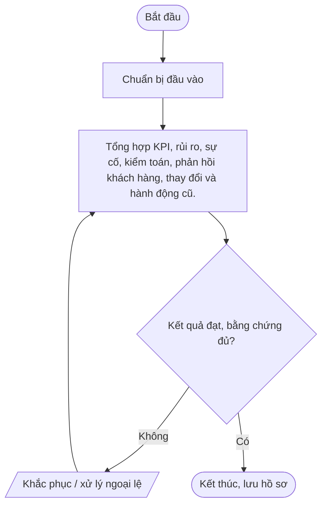

# Nhóm A — Quản trị hệ thống quản lý an toàn thông tin

Bộ quy trình chuẩn Mstar — bản dự thảo ngày 2026-10-14. Tài liệu được thiết kế dùng chung cho dịch vụ IT Outsourcing; các yêu cầu cụ thể được cấu hình trong phụ lục khách hàng.

## Quy tắc áp dụng

- Quy trình lõi dùng chung; phụ lục khách hàng xác định phạm vi, SLA, đầu mối, quyền, retention, thông báo sự cố và yêu cầu phục hồi.
- Mọi thao tác trên hệ thống khách hàng phải được hợp đồng/ủy quyền cho phép.
- Bằng chứng phải có thể truy nguyên: ticket, phê duyệt, log, biên bản, kết quả kiểm tra.
- Không lưu mật khẩu, token, API key hoặc secret dạng rõ trong ticket/repository thông thường.
- Quy trình chỉ có hiệu lực sau khi được rà soát và phê duyệt; đây không phải tuyên bố Mstar đã được chứng nhận ISO.
- Tham chiếu: ISO/IEC 27001:2022 và ISO/IEC 27002:2022; mapping cuối cùng cần căn cứ risk assessment và SoA.

## Danh mục trong nhóm

| Mã | Quy trình | Mục đích |
|---|---|---|
| [POL-ISMS-01](#pol-isms-01) | Chính sách an toàn thông tin tổng thể | Thiết lập cam kết lãnh đạo, nguyên tắc CIA, trách nhiệm, quản lý rủi ro và tuân thủ cho Mstar. |
| [QT-ISMS-01](#qt-isms-01) | Đánh giá và xử lý rủi ro ATTT | Nhận diện, phân tích, đánh giá, xử lý và theo dõi rủi ro với tài sản, dữ liệu, dịch vụ và hoạt động Mstar/khách hàng trong phạm vi. |
| [QT-ISMS-02](#qt-isms-02) | Quản lý tài liệu và hồ sơ | Đảm bảo tài liệu đúng phiên bản, được phê duyệt, dễ truy xuất, phân quyền và lưu/hủy theo yêu cầu. |
| [QT-ISMS-03](#qt-isms-03) | Quản lý nghĩa vụ pháp lý, quy định và hợp đồng | Theo dõi nghĩa vụ pháp lý, quyền riêng tư, bảo mật, SLA, thông báo sự cố và các cam kết hợp đồng. |
| [QT-ISMS-04](#qt-isms-04) | Quản lý ngoại lệ an toàn thông tin | Kiểm soát trường hợp tạm thời không đáp ứng chính sách/kiểm soát bằng đánh giá rủi ro, bù trừ và thời hạn. |
| [QT-ISMS-05](#qt-isms-05) | Kiểm tra tuân thủ và kiểm toán nội bộ | Xác minh quy trình được thực hiện và có bằng chứng; ghi nhận phát hiện và theo dõi khắc phục. |
| [QT-ISMS-06](#qt-isms-06) | Xem xét của lãnh đạo và cải tiến | Đánh giá định kỳ hiệu lực ISMS, mục tiêu, rủi ro, sự cố, kiểm toán và nhu cầu nguồn lực. |

---
## POL-ISMS-01 — Chính sách an toàn thông tin tổng thể

**Mục đích:** Thiết lập cam kết lãnh đạo, nguyên tắc CIA, trách nhiệm, quản lý rủi ro và tuân thủ cho Mstar.

**Kích hoạt:** Khi có yêu cầu/sự kiện thuộc phạm vi; khi thay đổi đáng kể; theo chu kỳ; hoặc khi hợp đồng/khách hàng yêu cầu.

**Phạm vi:** Hoạt động Mstar và dịch vụ IT Outsourcing thuộc hợp đồng/ủy quyền. Chi tiết hệ thống, SLA, đầu mối, quyền, retention, thông báo và RTO/RPO phải được cấu hình trong phụ lục khách hàng.

**Vai trò:** Người yêu cầu; người thực hiện; người kiểm tra/chủ sở hữu hệ thống; chủ sở hữu quy trình; IT Lead; người phê duyệt theo ma trận thẩm quyền; đầu mối khách hàng khi hợp đồng yêu cầu. Người thực hiện không tự phê duyệt thay đổi/rủi ro trọng yếu của chính mình.

**Đầu vào:** Yêu cầu/ticket; hợp đồng/phụ lục; danh mục hệ thống/tài sản; quyền được ủy quyền; quy trình liên quan; dữ liệu/bằng chứng hiện có.

**Đầu ra:** Hồ sơ xử lý; kết quả đã xác minh; phê duyệt; ticket/biên bản đóng; việc tồn có owner và hạn.

### Các bước thực hiện

| Bước | Hoạt động | Vai trò chính | Hướng dẫn và kiểm soát | Bằng chứng cần lưu |
|---:|---|---|---|---|
| 1 | Xác định phạm vi ISMS và bên liên quan | Người yêu cầu/đầu mối | Xác định phạm vi ISMS và bên liên quan | Hồ sơ/ticket/log/phê duyệt tương ứng |
| 2 | Chủ sở hữu ISMS chốt hệ thống, dịch vụ, thông tin, địa điểm và hoạt động thuộc phạm vi; môi trường khách hàng chỉ được thao tác theo hợp đồng/ủy quyền. | Chủ sở hữu quy trình/IT Lead | Chủ sở hữu ISMS chốt hệ thống, dịch vụ, thông tin, địa điểm và hoạt động thuộc phạm vi; môi trường khách hàng chỉ được thao tác theo hợp đồng/ủy quyền. | Hồ sơ/ticket/log/phê duyệt tương ứng |

### Lưu đồ

### Biểu mẫu/hồ sơ

Soạn chính sách và mục tiêu|Quy định trách nhiệm, quyền tối thiểu, phân loại dữ liệu, sự cố, nhà cung cấp, backup, tuân thủ và cải tiến.

### KPI và giám sát

Thẩm định và phê duyệt|IT Lead rà soát khả thi; Ban Giám đốc/người được ủy quyền phê duyệt chính sách và nguồn lực.

### Ngoại lệ và an toàn thông tin

Truyền thông và triển khai|Công bố phiên bản hiệu lực, đào tạo theo vai trò và lưu xác nhận đã đọc khi cần.

- Xác minh thẩm quyền/phạm vi trước khi thao tác; không tự mở rộng quyền.
- Không ghi mật khẩu, API key, token, khóa riêng hoặc mã khôi phục dạng rõ trong ticket, README, email thường hay tài liệu bàn giao.
- Thay đổi hệ thống phải theo QT-IT-13; nghi ngờ sự cố ATTT phải theo QT-ATTT-04; ngoại lệ phải theo QT-ISMS-04.
- Lưu hồ sơ ở kho được Mstar phê duyệt, phân quyền tối thiểu và giữ theo yêu cầu hợp đồng/pháp luật.
- Chỉ đóng việc khi kết quả được kiểm tra và bằng chứng cần thiết đã lưu.

### Phụ lục khách hàng cần cấu hình

| Trường | Giá trị cần xác nhận |
|---|---|
| Khách hàng/mã hợp đồng | Điền theo hợp đồng |
| Phạm vi hệ thống/dịch vụ | Hệ thống, tenant, site, tài sản, loại dịch vụ |
| SLA/lịch hỗ trợ | Theo hợp đồng/phụ lục |
| Đầu mối yêu cầu/phê duyệt | Chức danh, kênh và người thay thế |
| Quyền/kênh kỹ thuật | Phạm vi ủy quyền, MFA, VPN, thời hạn |
| Dữ liệu/lưu giữ | Phân loại, nơi lưu, thời hạn, trả/xóa |
| Thông báo sự cố | Kênh, người nhận, thời hạn |
| Ngoại lệ/rủi ro tồn dư | Mã hồ sơ, phê duyệt, biện pháp bù trừ, ngày hết hạn |

> **Trạng thái:** Dự thảo v0.1 — chờ Mstar rà soát, thử nghiệm và phê duyệt. Tham chiếu ISO chỉ là định hướng; cần xác nhận theo phạm vi ISMS, đánh giá rủi ro và SoA.

---

## QT-ISMS-01 — Đánh giá và xử lý rủi ro ATTT

**Mục đích:** Nhận diện, phân tích, đánh giá, xử lý và theo dõi rủi ro với tài sản, dữ liệu, dịch vụ và hoạt động Mstar/khách hàng trong phạm vi.

**Kích hoạt:** Khi có yêu cầu/sự kiện thuộc phạm vi; khi thay đổi đáng kể; theo chu kỳ; hoặc khi hợp đồng/khách hàng yêu cầu.

**Phạm vi:** Hoạt động Mstar và dịch vụ IT Outsourcing thuộc hợp đồng/ủy quyền. Chi tiết hệ thống, SLA, đầu mối, quyền, retention, thông báo và RTO/RPO phải được cấu hình trong phụ lục khách hàng.

**Vai trò:** Người yêu cầu; người thực hiện; người kiểm tra/chủ sở hữu hệ thống; chủ sở hữu quy trình; IT Lead; người phê duyệt theo ma trận thẩm quyền; đầu mối khách hàng khi hợp đồng yêu cầu. Người thực hiện không tự phê duyệt thay đổi/rủi ro trọng yếu của chính mình.

**Đầu vào:** Yêu cầu/ticket; hợp đồng/phụ lục; danh mục hệ thống/tài sản; quyền được ủy quyền; quy trình liên quan; dữ liệu/bằng chứng hiện có.

**Đầu ra:** Hồ sơ xử lý; kết quả đã xác minh; phê duyệt; ticket/biên bản đóng; việc tồn có owner và hạn.

### Các bước thực hiện

| Bước | Hoạt động | Vai trò chính | Hướng dẫn và kiểm soát | Bằng chứng cần lưu |
|---:|---|---|---|---|
| 1 | Chốt phạm vi và tiêu chí | Người yêu cầu/đầu mối | Chốt phạm vi và tiêu chí | Hồ sơ/ticket/log/phê duyệt tương ứng |
| 2 | Xác định tài sản, bên liên quan, tác động, thang điểm khả năng/tác động và ngưỡng chấp nhận. | Chủ sở hữu quy trình/IT Lead | Xác định tài sản, bên liên quan, tác động, thang điểm khả năng/tác động và ngưỡng chấp nhận. | Hồ sơ/ticket/log/phê duyệt tương ứng |

### Lưu đồ

### Biểu mẫu/hồ sơ

Nhận diện kịch bản rủi ro|Ghi tài sản, mối đe dọa, lỗ hổng, nguyên nhân, hậu quả, kiểm soát hiện hữu và bằng chứng.

### KPI và giám sát

Phân tích và xếp hạng|Chấm điểm theo phương pháp được phê duyệt; ưu tiên rủi ro cao và ghi rõ căn cứ.

### Ngoại lệ và an toàn thông tin

Chọn phương án xử lý|Tránh, giảm thiểu, chuyển giao hoặc chấp nhận; gán owner, biện pháp, hạn và rủi ro tồn dư.

- Xác minh thẩm quyền/phạm vi trước khi thao tác; không tự mở rộng quyền.
- Không ghi mật khẩu, API key, token, khóa riêng hoặc mã khôi phục dạng rõ trong ticket, README, email thường hay tài liệu bàn giao.
- Thay đổi hệ thống phải theo QT-IT-13; nghi ngờ sự cố ATTT phải theo QT-ATTT-04; ngoại lệ phải theo QT-ISMS-04.
- Lưu hồ sơ ở kho được Mstar phê duyệt, phân quyền tối thiểu và giữ theo yêu cầu hợp đồng/pháp luật.
- Chỉ đóng việc khi kết quả được kiểm tra và bằng chứng cần thiết đã lưu.

### Phụ lục khách hàng cần cấu hình

| Trường | Giá trị cần xác nhận |
|---|---|
| Khách hàng/mã hợp đồng | Điền theo hợp đồng |
| Phạm vi hệ thống/dịch vụ | Hệ thống, tenant, site, tài sản, loại dịch vụ |
| SLA/lịch hỗ trợ | Theo hợp đồng/phụ lục |
| Đầu mối yêu cầu/phê duyệt | Chức danh, kênh và người thay thế |
| Quyền/kênh kỹ thuật | Phạm vi ủy quyền, MFA, VPN, thời hạn |
| Dữ liệu/lưu giữ | Phân loại, nơi lưu, thời hạn, trả/xóa |
| Thông báo sự cố | Kênh, người nhận, thời hạn |
| Ngoại lệ/rủi ro tồn dư | Mã hồ sơ, phê duyệt, biện pháp bù trừ, ngày hết hạn |

> **Trạng thái:** Dự thảo v0.1 — chờ Mstar rà soát, thử nghiệm và phê duyệt. Tham chiếu ISO chỉ là định hướng; cần xác nhận theo phạm vi ISMS, đánh giá rủi ro và SoA.

---

## QT-ISMS-02 — Quản lý tài liệu và hồ sơ

**Mục đích:** Đảm bảo tài liệu đúng phiên bản, được phê duyệt, dễ truy xuất, phân quyền và lưu/hủy theo yêu cầu.

**Kích hoạt:** Khi có yêu cầu/sự kiện thuộc phạm vi; khi thay đổi đáng kể; theo chu kỳ; hoặc khi hợp đồng/khách hàng yêu cầu.

**Phạm vi:** Hoạt động Mstar và dịch vụ IT Outsourcing thuộc hợp đồng/ủy quyền. Chi tiết hệ thống, SLA, đầu mối, quyền, retention, thông báo và RTO/RPO phải được cấu hình trong phụ lục khách hàng.

**Vai trò:** Người yêu cầu; người thực hiện; người kiểm tra/chủ sở hữu hệ thống; chủ sở hữu quy trình; IT Lead; người phê duyệt theo ma trận thẩm quyền; đầu mối khách hàng khi hợp đồng yêu cầu. Người thực hiện không tự phê duyệt thay đổi/rủi ro trọng yếu của chính mình.

**Đầu vào:** Yêu cầu/ticket; hợp đồng/phụ lục; danh mục hệ thống/tài sản; quyền được ủy quyền; quy trình liên quan; dữ liệu/bằng chứng hiện có.

**Đầu ra:** Hồ sơ xử lý; kết quả đã xác minh; phê duyệt; ticket/biên bản đóng; việc tồn có owner và hạn.

### Các bước thực hiện

| Bước | Hoạt động | Vai trò chính | Hướng dẫn và kiểm soát | Bằng chứng cần lưu |
|---:|---|---|---|---|
| 1 | Yêu cầu tạo/sửa | Người yêu cầu/đầu mối | Yêu cầu tạo/sửa | Hồ sơ/ticket/log/phê duyệt tương ứng |
| 2 | Chủ sở hữu nêu lý do, phạm vi thay đổi, người dùng bị ảnh hưởng và thời điểm cần hiệu lực. | Chủ sở hữu quy trình/IT Lead | Chủ sở hữu nêu lý do, phạm vi thay đổi, người dùng bị ảnh hưởng và thời điểm cần hiệu lực. | Hồ sơ/ticket/log/phê duyệt tương ứng |

### Lưu đồ

### Biểu mẫu/hồ sơ

Soạn và kiểm tra|Dùng mẫu chuẩn, mã, phiên bản; kiểm tra tính đúng, liên kết, an toàn và biểu mẫu.

### KPI và giám sát

Phê duyệt và phát hành|Phê duyệt theo ma trận thẩm quyền; ghi ngày hiệu lực; đánh dấu phiên bản cũ hết hiệu lực.

### Ngoại lệ và an toàn thông tin

Lưu trữ và cấp quyền|Lưu ở kho chính thức, phân quyền tối thiểu, bảo vệ khỏi sửa/xóa trái phép và sao lưu phù hợp.

- Xác minh thẩm quyền/phạm vi trước khi thao tác; không tự mở rộng quyền.
- Không ghi mật khẩu, API key, token, khóa riêng hoặc mã khôi phục dạng rõ trong ticket, README, email thường hay tài liệu bàn giao.
- Thay đổi hệ thống phải theo QT-IT-13; nghi ngờ sự cố ATTT phải theo QT-ATTT-04; ngoại lệ phải theo QT-ISMS-04.
- Lưu hồ sơ ở kho được Mstar phê duyệt, phân quyền tối thiểu và giữ theo yêu cầu hợp đồng/pháp luật.
- Chỉ đóng việc khi kết quả được kiểm tra và bằng chứng cần thiết đã lưu.

### Phụ lục khách hàng cần cấu hình

| Trường | Giá trị cần xác nhận |
|---|---|
| Khách hàng/mã hợp đồng | Điền theo hợp đồng |
| Phạm vi hệ thống/dịch vụ | Hệ thống, tenant, site, tài sản, loại dịch vụ |
| SLA/lịch hỗ trợ | Theo hợp đồng/phụ lục |
| Đầu mối yêu cầu/phê duyệt | Chức danh, kênh và người thay thế |
| Quyền/kênh kỹ thuật | Phạm vi ủy quyền, MFA, VPN, thời hạn |
| Dữ liệu/lưu giữ | Phân loại, nơi lưu, thời hạn, trả/xóa |
| Thông báo sự cố | Kênh, người nhận, thời hạn |
| Ngoại lệ/rủi ro tồn dư | Mã hồ sơ, phê duyệt, biện pháp bù trừ, ngày hết hạn |

> **Trạng thái:** Dự thảo v0.1 — chờ Mstar rà soát, thử nghiệm và phê duyệt. Tham chiếu ISO chỉ là định hướng; cần xác nhận theo phạm vi ISMS, đánh giá rủi ro và SoA.

---

## QT-ISMS-03 — Quản lý nghĩa vụ pháp lý, quy định và hợp đồng

**Mục đích:** Theo dõi nghĩa vụ pháp lý, quyền riêng tư, bảo mật, SLA, thông báo sự cố và các cam kết hợp đồng.

**Kích hoạt:** Khi có yêu cầu/sự kiện thuộc phạm vi; khi thay đổi đáng kể; theo chu kỳ; hoặc khi hợp đồng/khách hàng yêu cầu.

**Phạm vi:** Hoạt động Mstar và dịch vụ IT Outsourcing thuộc hợp đồng/ủy quyền. Chi tiết hệ thống, SLA, đầu mối, quyền, retention, thông báo và RTO/RPO phải được cấu hình trong phụ lục khách hàng.

**Vai trò:** Người yêu cầu; người thực hiện; người kiểm tra/chủ sở hữu hệ thống; chủ sở hữu quy trình; IT Lead; người phê duyệt theo ma trận thẩm quyền; đầu mối khách hàng khi hợp đồng yêu cầu. Người thực hiện không tự phê duyệt thay đổi/rủi ro trọng yếu của chính mình.

**Đầu vào:** Yêu cầu/ticket; hợp đồng/phụ lục; danh mục hệ thống/tài sản; quyền được ủy quyền; quy trình liên quan; dữ liệu/bằng chứng hiện có.

**Đầu ra:** Hồ sơ xử lý; kết quả đã xác minh; phê duyệt; ticket/biên bản đóng; việc tồn có owner và hạn.

### Các bước thực hiện

| Bước | Hoạt động | Vai trò chính | Hướng dẫn và kiểm soát | Bằng chứng cần lưu |
|---:|---|---|---|---|
| 1 | Thu thập yêu cầu | Người yêu cầu/đầu mối | Thu thập yêu cầu | Hồ sơ/ticket/log/phê duyệt tương ứng |
| 2 | Sale/Account Manager thu thập hợp đồng, NDA/DPA nếu có, SLA, yêu cầu bảo mật và lưu giữ. | Chủ sở hữu quy trình/IT Lead | Sale/Account Manager thu thập hợp đồng, NDA/DPA nếu có, SLA, yêu cầu bảo mật và lưu giữ. | Hồ sơ/ticket/log/phê duyệt tương ứng |

### Lưu đồ

### Biểu mẫu/hồ sơ

Phân tích nghĩa vụ|Tách yêu cầu pháp lý, hợp đồng, kỹ thuật, thông báo, quyền kiểm tra và điều kiện exit.

### KPI và giám sát

Đánh giá khả năng đáp ứng|IT Lead xác minh năng lực, quy trình, nhân lực, công cụ và khoảng trống.

### Ngoại lệ và an toàn thông tin

Phê duyệt cam kết|Người có thẩm quyền phê duyệt điều khoản; không cam kết vượt năng lực khi chưa có phương án.

- Xác minh thẩm quyền/phạm vi trước khi thao tác; không tự mở rộng quyền.
- Không ghi mật khẩu, API key, token, khóa riêng hoặc mã khôi phục dạng rõ trong ticket, README, email thường hay tài liệu bàn giao.
- Thay đổi hệ thống phải theo QT-IT-13; nghi ngờ sự cố ATTT phải theo QT-ATTT-04; ngoại lệ phải theo QT-ISMS-04.
- Lưu hồ sơ ở kho được Mstar phê duyệt, phân quyền tối thiểu và giữ theo yêu cầu hợp đồng/pháp luật.
- Chỉ đóng việc khi kết quả được kiểm tra và bằng chứng cần thiết đã lưu.

### Phụ lục khách hàng cần cấu hình

| Trường | Giá trị cần xác nhận |
|---|---|
| Khách hàng/mã hợp đồng | Điền theo hợp đồng |
| Phạm vi hệ thống/dịch vụ | Hệ thống, tenant, site, tài sản, loại dịch vụ |
| SLA/lịch hỗ trợ | Theo hợp đồng/phụ lục |
| Đầu mối yêu cầu/phê duyệt | Chức danh, kênh và người thay thế |
| Quyền/kênh kỹ thuật | Phạm vi ủy quyền, MFA, VPN, thời hạn |
| Dữ liệu/lưu giữ | Phân loại, nơi lưu, thời hạn, trả/xóa |
| Thông báo sự cố | Kênh, người nhận, thời hạn |
| Ngoại lệ/rủi ro tồn dư | Mã hồ sơ, phê duyệt, biện pháp bù trừ, ngày hết hạn |

> **Trạng thái:** Dự thảo v0.1 — chờ Mstar rà soát, thử nghiệm và phê duyệt. Tham chiếu ISO chỉ là định hướng; cần xác nhận theo phạm vi ISMS, đánh giá rủi ro và SoA.

---

## QT-ISMS-04 — Quản lý ngoại lệ an toàn thông tin

**Mục đích:** Kiểm soát trường hợp tạm thời không đáp ứng chính sách/kiểm soát bằng đánh giá rủi ro, bù trừ và thời hạn.

**Kích hoạt:** Khi có yêu cầu/sự kiện thuộc phạm vi; khi thay đổi đáng kể; theo chu kỳ; hoặc khi hợp đồng/khách hàng yêu cầu.

**Phạm vi:** Hoạt động Mstar và dịch vụ IT Outsourcing thuộc hợp đồng/ủy quyền. Chi tiết hệ thống, SLA, đầu mối, quyền, retention, thông báo và RTO/RPO phải được cấu hình trong phụ lục khách hàng.

**Vai trò:** Người yêu cầu; người thực hiện; người kiểm tra/chủ sở hữu hệ thống; chủ sở hữu quy trình; IT Lead; người phê duyệt theo ma trận thẩm quyền; đầu mối khách hàng khi hợp đồng yêu cầu. Người thực hiện không tự phê duyệt thay đổi/rủi ro trọng yếu của chính mình.

**Đầu vào:** Yêu cầu/ticket; hợp đồng/phụ lục; danh mục hệ thống/tài sản; quyền được ủy quyền; quy trình liên quan; dữ liệu/bằng chứng hiện có.

**Đầu ra:** Hồ sơ xử lý; kết quả đã xác minh; phê duyệt; ticket/biên bản đóng; việc tồn có owner và hạn.

### Các bước thực hiện

| Bước | Hoạt động | Vai trò chính | Hướng dẫn và kiểm soát | Bằng chứng cần lưu |
|---:|---|---|---|---|
| 1 | Gửi yêu cầu | Người yêu cầu/đầu mối | Gửi yêu cầu | Hồ sơ/ticket/log/phê duyệt tương ứng |
| 2 | Nêu kiểm soát, lý do, phạm vi, thời hạn và lựa chọn thay thế đã xem xét. | Chủ sở hữu quy trình/IT Lead | Nêu kiểm soát, lý do, phạm vi, thời hạn và lựa chọn thay thế đã xem xét. | Hồ sơ/ticket/log/phê duyệt tương ứng |

### Lưu đồ

### Biểu mẫu/hồ sơ

Đánh giá rủi ro|Xác định tác động, khả năng, dữ liệu/hệ thống và nghĩa vụ khách hàng bị ảnh hưởng.

### KPI và giám sát

Xác định biện pháp bù trừ|Giới hạn phạm vi, giám sát bổ sung, phương án khắc phục và ngày hết hạn.

### Ngoại lệ và an toàn thông tin

Phê duyệt hoặc từ chối|Người có thẩm quyền đánh giá rủi ro tồn dư; lấy chấp thuận khách hàng khi cần.

- Xác minh thẩm quyền/phạm vi trước khi thao tác; không tự mở rộng quyền.
- Không ghi mật khẩu, API key, token, khóa riêng hoặc mã khôi phục dạng rõ trong ticket, README, email thường hay tài liệu bàn giao.
- Thay đổi hệ thống phải theo QT-IT-13; nghi ngờ sự cố ATTT phải theo QT-ATTT-04; ngoại lệ phải theo QT-ISMS-04.
- Lưu hồ sơ ở kho được Mstar phê duyệt, phân quyền tối thiểu và giữ theo yêu cầu hợp đồng/pháp luật.
- Chỉ đóng việc khi kết quả được kiểm tra và bằng chứng cần thiết đã lưu.

### Phụ lục khách hàng cần cấu hình

| Trường | Giá trị cần xác nhận |
|---|---|
| Khách hàng/mã hợp đồng | Điền theo hợp đồng |
| Phạm vi hệ thống/dịch vụ | Hệ thống, tenant, site, tài sản, loại dịch vụ |
| SLA/lịch hỗ trợ | Theo hợp đồng/phụ lục |
| Đầu mối yêu cầu/phê duyệt | Chức danh, kênh và người thay thế |
| Quyền/kênh kỹ thuật | Phạm vi ủy quyền, MFA, VPN, thời hạn |
| Dữ liệu/lưu giữ | Phân loại, nơi lưu, thời hạn, trả/xóa |
| Thông báo sự cố | Kênh, người nhận, thời hạn |
| Ngoại lệ/rủi ro tồn dư | Mã hồ sơ, phê duyệt, biện pháp bù trừ, ngày hết hạn |

> **Trạng thái:** Dự thảo v0.1 — chờ Mstar rà soát, thử nghiệm và phê duyệt. Tham chiếu ISO chỉ là định hướng; cần xác nhận theo phạm vi ISMS, đánh giá rủi ro và SoA.

---

## QT-ISMS-05 — Kiểm tra tuân thủ và kiểm toán nội bộ

**Mục đích:** Xác minh quy trình được thực hiện và có bằng chứng; ghi nhận phát hiện và theo dõi khắc phục.

**Kích hoạt:** Khi có yêu cầu/sự kiện thuộc phạm vi; khi thay đổi đáng kể; theo chu kỳ; hoặc khi hợp đồng/khách hàng yêu cầu.

**Phạm vi:** Hoạt động Mstar và dịch vụ IT Outsourcing thuộc hợp đồng/ủy quyền. Chi tiết hệ thống, SLA, đầu mối, quyền, retention, thông báo và RTO/RPO phải được cấu hình trong phụ lục khách hàng.

**Vai trò:** Người yêu cầu; người thực hiện; người kiểm tra/chủ sở hữu hệ thống; chủ sở hữu quy trình; IT Lead; người phê duyệt theo ma trận thẩm quyền; đầu mối khách hàng khi hợp đồng yêu cầu. Người thực hiện không tự phê duyệt thay đổi/rủi ro trọng yếu của chính mình.

**Đầu vào:** Yêu cầu/ticket; hợp đồng/phụ lục; danh mục hệ thống/tài sản; quyền được ủy quyền; quy trình liên quan; dữ liệu/bằng chứng hiện có.

**Đầu ra:** Hồ sơ xử lý; kết quả đã xác minh; phê duyệt; ticket/biên bản đóng; việc tồn có owner và hạn.

### Các bước thực hiện

| Bước | Hoạt động | Vai trò chính | Hướng dẫn và kiểm soát | Bằng chứng cần lưu |
|---:|---|---|---|---|
| 1 | Lập chương trình | Người yêu cầu/đầu mối | Lập chương trình | Hồ sơ/ticket/log/phê duyệt tương ứng |
| 2 | Chọn phạm vi/tiêu chí dựa trên rủi ro, thay đổi và kết quả kỳ trước; bảo đảm tính khách quan. | Chủ sở hữu quy trình/IT Lead | Chọn phạm vi/tiêu chí dựa trên rủi ro, thay đổi và kết quả kỳ trước; bảo đảm tính khách quan. | Hồ sơ/ticket/log/phê duyệt tương ứng |

### Lưu đồ

### Biểu mẫu/hồ sơ

Chuẩn bị mẫu|Chọn hồ sơ, ticket, log, phỏng vấn và kiểm soát cần kiểm tra.

### KPI và giám sát

Thực hiện kiểm tra|Quan sát, phỏng vấn, lấy mẫu; lưu bằng chứng truy nguyên và bảo vệ dữ liệu.

### Ngoại lệ và an toàn thông tin

Phân loại và báo cáo|Đối chiếu tiêu chí; phân biệt không phù hợp, quan sát và cơ hội cải tiến; giao owner/hạn.

- Xác minh thẩm quyền/phạm vi trước khi thao tác; không tự mở rộng quyền.
- Không ghi mật khẩu, API key, token, khóa riêng hoặc mã khôi phục dạng rõ trong ticket, README, email thường hay tài liệu bàn giao.
- Thay đổi hệ thống phải theo QT-IT-13; nghi ngờ sự cố ATTT phải theo QT-ATTT-04; ngoại lệ phải theo QT-ISMS-04.
- Lưu hồ sơ ở kho được Mstar phê duyệt, phân quyền tối thiểu và giữ theo yêu cầu hợp đồng/pháp luật.
- Chỉ đóng việc khi kết quả được kiểm tra và bằng chứng cần thiết đã lưu.

### Phụ lục khách hàng cần cấu hình

| Trường | Giá trị cần xác nhận |
|---|---|
| Khách hàng/mã hợp đồng | Điền theo hợp đồng |
| Phạm vi hệ thống/dịch vụ | Hệ thống, tenant, site, tài sản, loại dịch vụ |
| SLA/lịch hỗ trợ | Theo hợp đồng/phụ lục |
| Đầu mối yêu cầu/phê duyệt | Chức danh, kênh và người thay thế |
| Quyền/kênh kỹ thuật | Phạm vi ủy quyền, MFA, VPN, thời hạn |
| Dữ liệu/lưu giữ | Phân loại, nơi lưu, thời hạn, trả/xóa |
| Thông báo sự cố | Kênh, người nhận, thời hạn |
| Ngoại lệ/rủi ro tồn dư | Mã hồ sơ, phê duyệt, biện pháp bù trừ, ngày hết hạn |

> **Trạng thái:** Dự thảo v0.1 — chờ Mstar rà soát, thử nghiệm và phê duyệt. Tham chiếu ISO chỉ là định hướng; cần xác nhận theo phạm vi ISMS, đánh giá rủi ro và SoA.

---

## QT-ISMS-06 — Xem xét của lãnh đạo và cải tiến

**Mục đích:** Đánh giá định kỳ hiệu lực ISMS, mục tiêu, rủi ro, sự cố, kiểm toán và nhu cầu nguồn lực.

**Kích hoạt:** Khi có yêu cầu/sự kiện thuộc phạm vi; khi thay đổi đáng kể; theo chu kỳ; hoặc khi hợp đồng/khách hàng yêu cầu.

**Phạm vi:** Hoạt động Mstar và dịch vụ IT Outsourcing thuộc hợp đồng/ủy quyền. Chi tiết hệ thống, SLA, đầu mối, quyền, retention, thông báo và RTO/RPO phải được cấu hình trong phụ lục khách hàng.

**Vai trò:** Người yêu cầu; người thực hiện; người kiểm tra/chủ sở hữu hệ thống; chủ sở hữu quy trình; IT Lead; người phê duyệt theo ma trận thẩm quyền; đầu mối khách hàng khi hợp đồng yêu cầu. Người thực hiện không tự phê duyệt thay đổi/rủi ro trọng yếu của chính mình.

**Đầu vào:** Yêu cầu/ticket; hợp đồng/phụ lục; danh mục hệ thống/tài sản; quyền được ủy quyền; quy trình liên quan; dữ liệu/bằng chứng hiện có.

**Đầu ra:** Hồ sơ xử lý; kết quả đã xác minh; phê duyệt; ticket/biên bản đóng; việc tồn có owner và hạn.

### Các bước thực hiện

| Bước | Hoạt động | Vai trò chính | Hướng dẫn và kiểm soát | Bằng chứng cần lưu |
|---:|---|---|---|---|
| 1 | Chuẩn bị đầu vào | Người yêu cầu/đầu mối | Chuẩn bị đầu vào | Hồ sơ/ticket/log/phê duyệt tương ứng |
| 2 | Tổng hợp KPI, rủi ro, sự cố, kiểm toán, phản hồi khách hàng, thay đổi và hành động cũ. | Chủ sở hữu quy trình/IT Lead | Tổng hợp KPI, rủi ro, sự cố, kiểm toán, phản hồi khách hàng, thay đổi và hành động cũ. | Hồ sơ/ticket/log/phê duyệt tương ứng |

### Lưu đồ

### Biểu mẫu/hồ sơ

Xác minh dữ liệu|Chủ sở hữu quy trình xác nhận số liệu, xu hướng và vấn đề cần quyết định.

### KPI và giám sát

Xem xét của lãnh đạo|Đánh giá phù hợp/đầy đủ/hiệu lực, mục tiêu, nguồn lực và cơ hội cải tiến.

### Ngoại lệ và an toàn thông tin

Ra quyết định và giao việc|Phê duyệt ưu tiên, nguồn lực, mục tiêu; gán owner, hạn và tiêu chí hoàn tất.

- Xác minh thẩm quyền/phạm vi trước khi thao tác; không tự mở rộng quyền.
- Không ghi mật khẩu, API key, token, khóa riêng hoặc mã khôi phục dạng rõ trong ticket, README, email thường hay tài liệu bàn giao.
- Thay đổi hệ thống phải theo QT-IT-13; nghi ngờ sự cố ATTT phải theo QT-ATTT-04; ngoại lệ phải theo QT-ISMS-04.
- Lưu hồ sơ ở kho được Mstar phê duyệt, phân quyền tối thiểu và giữ theo yêu cầu hợp đồng/pháp luật.
- Chỉ đóng việc khi kết quả được kiểm tra và bằng chứng cần thiết đã lưu.

### Phụ lục khách hàng cần cấu hình

| Trường | Giá trị cần xác nhận |
|---|---|
| Khách hàng/mã hợp đồng | Điền theo hợp đồng |
| Phạm vi hệ thống/dịch vụ | Hệ thống, tenant, site, tài sản, loại dịch vụ |
| SLA/lịch hỗ trợ | Theo hợp đồng/phụ lục |
| Đầu mối yêu cầu/phê duyệt | Chức danh, kênh và người thay thế |
| Quyền/kênh kỹ thuật | Phạm vi ủy quyền, MFA, VPN, thời hạn |
| Dữ liệu/lưu giữ | Phân loại, nơi lưu, thời hạn, trả/xóa |
| Thông báo sự cố | Kênh, người nhận, thời hạn |
| Ngoại lệ/rủi ro tồn dư | Mã hồ sơ, phê duyệt, biện pháp bù trừ, ngày hết hạn |

> **Trạng thái:** Dự thảo v0.1 — chờ Mstar rà soát, thử nghiệm và phê duyệt. Tham chiếu ISO chỉ là định hướng; cần xác nhận theo phạm vi ISMS, đánh giá rủi ro và SoA.
