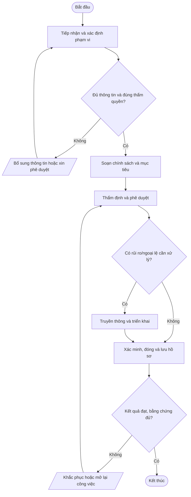
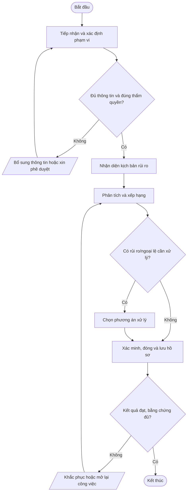
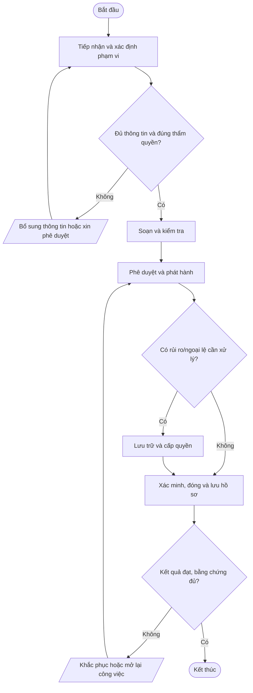
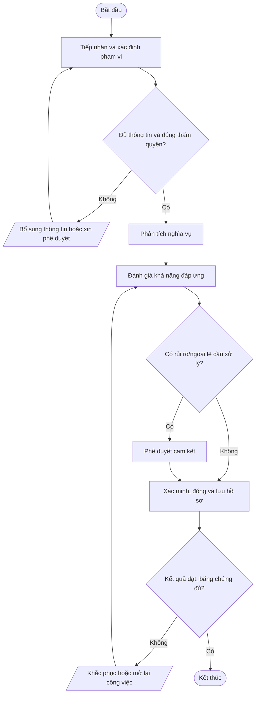
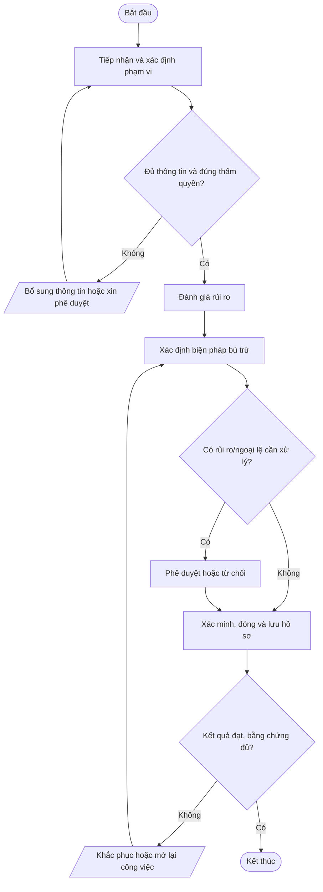
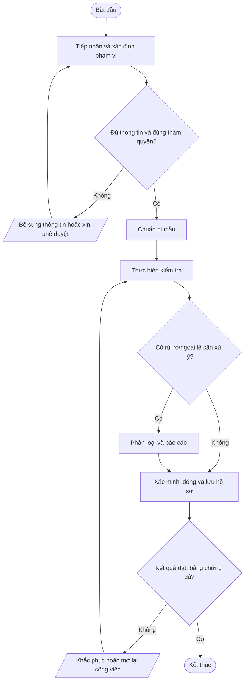
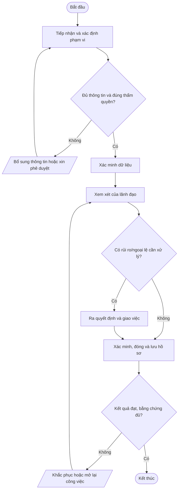

# Nhóm A — Quản trị hệ thống quản lý an toàn thông tin

Bộ quy trình chuẩn Mstar — bản dự thảo ngày 2026-10-14. Tài liệu được thiết kế dùng chung cho dịch vụ IT Outsourcing; các yêu cầu cụ thể được cấu hình trong phụ lục khách hàng.

## Quy tắc áp dụng

- Quy trình lõi dùng chung; phụ lục khách hàng xác định phạm vi, SLA, đầu mối, quyền, retention, thông báo sự cố và yêu cầu phục hồi.
- Mọi thao tác trên hệ thống khách hàng phải được hợp đồng/ủy quyền cho phép.
- Bằng chứng phải có thể truy nguyên: ticket, phê duyệt, log, biên bản, kết quả kiểm tra.
- Không lưu mật khẩu, token, API key hoặc secret dạng rõ trong ticket/repository thông thường.
- Quy trình chỉ có hiệu lực sau khi được rà soát và phê duyệt; đây không phải tuyên bố Mstar đã được chứng nhận ISO.
- Tham chiếu: ISO/IEC 27001:2022 và ISO/IEC 27002:2022; mapping cuối cùng cần căn cứ risk assessment và SoA.

## Danh mục trong nhóm

| Mã | Quy trình | Mục đích |
|---|---|---|
| [POL-ISMS-01](#pol-isms-01) | Chính sách an toàn thông tin tổng thể | Thiết lập cam kết lãnh đạo, nguyên tắc CIA, trách nhiệm, quản lý rủi ro và tuân thủ cho Mstar. |
| [QT-ISMS-01](#qt-isms-01) | Đánh giá và xử lý rủi ro ATTT | Nhận diện, phân tích, đánh giá, xử lý và theo dõi rủi ro với tài sản, dữ liệu, dịch vụ và hoạt động Mstar/khách hàng trong phạm vi. |
| [QT-ISMS-02](#qt-isms-02) | Quản lý tài liệu và hồ sơ | Đảm bảo tài liệu đúng phiên bản, được phê duyệt, dễ truy xuất, phân quyền và lưu/hủy theo yêu cầu. |
| [QT-ISMS-03](#qt-isms-03) | Quản lý nghĩa vụ pháp lý, quy định và hợp đồng | Theo dõi nghĩa vụ pháp lý, quyền riêng tư, bảo mật, SLA, thông báo sự cố và các cam kết hợp đồng. |
| [QT-ISMS-04](#qt-isms-04) | Quản lý ngoại lệ an toàn thông tin | Kiểm soát trường hợp tạm thời không đáp ứng chính sách/kiểm soát bằng đánh giá rủi ro, bù trừ và thời hạn. |
| [QT-ISMS-05](#qt-isms-05) | Kiểm tra tuân thủ và kiểm toán nội bộ | Xác minh quy trình được thực hiện và có bằng chứng; ghi nhận phát hiện và theo dõi khắc phục. |
| [QT-ISMS-06](#qt-isms-06) | Xem xét của lãnh đạo và cải tiến | Đánh giá định kỳ hiệu lực ISMS, mục tiêu, rủi ro, sự cố, kiểm toán và nhu cầu nguồn lực. |

---
## POL-ISMS-01 — Chính sách an toàn thông tin tổng thể

**Mục đích:** Thiết lập cam kết lãnh đạo, nguyên tắc CIA, trách nhiệm, quản lý rủi ro và tuân thủ cho Mstar.

**Kích hoạt:** Khi có yêu cầu/sự kiện thuộc phạm vi, khi có thay đổi đáng kể hoặc theo chu kỳ được quy định.

**Phạm vi:** Mstar và hoạt động IT Outsourcing trong phạm vi hợp đồng/ủy quyền. Phụ lục từng khách hàng phải xác định hệ thống, SLA, đầu mối, quyền truy cập, retention, thông báo và yêu cầu phục hồi riêng.

**Vai trò:** Người yêu cầu/đầu mối khách hàng; người thực hiện; người kiểm tra/chủ sở hữu hệ thống; chủ sở hữu quy trình; IT Lead; người phê duyệt theo ma trận thẩm quyền. Người thực hiện không tự phê duyệt rủi ro trọng yếu do chính mình tạo ra.

**Đầu vào:** Yêu cầu/ticket; hợp đồng/phụ lục; danh mục hệ thống/tài sản; quyền được ủy quyền; quy trình liên quan; dữ liệu/bằng chứng hiện có.

**Đầu ra:** Hồ sơ xử lý; kết quả đã xác minh; phê duyệt; ticket/biên bản đóng; việc tồn có owner và hạn.

### Trình tự thực hiện

| Bước | Hoạt động | Vai trò chính | Hướng dẫn và kiểm soát | Bằng chứng cần lưu |
|---:|---|---|---|---|
| 1 | Tiếp nhận và xác định phạm vi | Người tiếp nhận | Ghi nhận yêu cầu/sự kiện, xác minh khách hàng/hệ thống liên quan, mục tiêu, phạm vi hợp đồng, đầu mối và thông tin tối thiểu. Nếu thiếu thông tin hoặc thẩm quyền thì chưa thực hiện bước rủi ro. | Ticket, log, phê duyệt hoặc biên bản tương ứng |
| 2 | Soạn chính sách và mục tiêu | Người thực hiện và người kiểm tra | Quy định trách nhiệm, quyền tối thiểu, phân loại dữ liệu, sự cố, nhà cung cấp, backup, tuân thủ và cải tiến. | Ticket, log, phê duyệt hoặc biên bản tương ứng |
| 3 | Thẩm định và phê duyệt | Người thực hiện và người kiểm tra | IT Lead rà soát khả thi; Ban Giám đốc/người được ủy quyền phê duyệt chính sách và nguồn lực. | Ticket, log, phê duyệt hoặc biên bản tương ứng |
| 4 | Truyền thông và triển khai | Người thực hiện và người kiểm tra | Công bố phiên bản hiệu lực, đào tạo theo vai trò và lưu xác nhận đã đọc khi cần. | Ticket, log, phê duyệt hoặc biên bản tương ứng |
| 5 | Xác minh, đóng và lưu hồ sơ | Chủ sở hữu quy trình/IT Lead | Người kiểm tra xác nhận kết quả, quyền và phạm vi; ghi thời gian, bằng chứng, quyết định, thông báo và việc tồn. Chỉ đóng khi đủ hồ sơ hoặc có ngoại lệ được duyệt. | Ticket, log, phê duyệt hoặc biên bản tương ứng |

### Lưu đồ

### Biểu mẫu và hồ sơ

- FR-POLISMS01-01: Phiếu yêu cầu/checklist khởi tạo.
- FR-POLISMS01-02: Hồ sơ đánh giá, phê duyệt hoặc xác minh.
- FR-POLISMS01-03: Nhật ký thực hiện/biên bản/báo cáo.
- FR-POLISMS01-04: Xác nhận hoàn tất và theo dõi việc tồn.

*Mã biểu mẫu là mã đề xuất; khi ban hành cần đưa vào danh mục tài liệu, xác định chủ sở hữu, nơi lưu, quyền truy cập và thời hạn lưu giữ.*

### KPI và giám sát

- Tỷ lệ hồ sơ có đủ thông tin đầu vào và phê duyệt.
- Tỷ lệ bước/công việc hoàn thành đúng hạn theo quy trình hoặc hợp đồng.
- Số lỗi, ngoại lệ, sự cố hoặc hồ sơ phải làm lại.
- Tỷ lệ hành động khắc phục đóng đúng hạn.

Chủ sở hữu quy trình phải xác định nguồn dữ liệu, công thức, chu kỳ đo và ngưỡng cảnh báo trước khi áp dụng.

### Ngoại lệ và an toàn thông tin

Công bố phiên bản hiệu lực, đào tạo theo vai trò và lưu xác nhận đã đọc khi cần.

- Không thao tác ngoài phạm vi hợp đồng/ủy quyền; khi thiếu quyền hoặc phê duyệt phải tạm dừng bước có rủi ro.
- Không ghi mật khẩu, API key, token, khóa riêng hoặc mã khôi phục dạng rõ trong ticket, README, email thường hay tài liệu bàn giao.
- Thay đổi hệ thống phải theo QT-IT-13; nghi ngờ sự cố ATTT phải theo QT-ATTT-04; ngoại lệ phải theo QT-ISMS-04.
- Mọi ngoại lệ phải có lý do, đánh giá rủi ro, biện pháp bù trừ, người phê duyệt, owner và hạn hết hiệu lực.

### Phụ lục cần cấu hình theo khách hàng

| Trường | Nội dung xác nhận |
|---|---|
| Khách hàng/mã hợp đồng | Theo hợp đồng đang hiệu lực |
| Phạm vi hệ thống/dịch vụ | Hệ thống, tenant, site, tài sản và loại dịch vụ |
| SLA/lịch hỗ trợ | Theo hợp đồng/phụ lục, không dùng mặc định chung |
| Đầu mối yêu cầu/phê duyệt | Chức danh, kênh liên hệ và người thay thế |
| Quyền/kênh kỹ thuật | Phạm vi ủy quyền, MFA, VPN, thời hạn |
| Dữ liệu/lưu giữ | Phân loại, nơi lưu, thời hạn, trả/xóa |
| Thông báo sự cố | Kênh, người nhận và thời hạn |
| Ngoại lệ/rủi ro tồn dư | Mã hồ sơ, phê duyệt, bù trừ, ngày hết hạn |

**Trạng thái:** Dự thảo v0.1 — chờ rà soát, thử nghiệm và phê duyệt. Mapping ISO chỉ mang tính định hướng; cần xác nhận theo phạm vi ISMS, đánh giá rủi ro và SoA.

---

## QT-ISMS-01 — Đánh giá và xử lý rủi ro ATTT

**Mục đích:** Nhận diện, phân tích, đánh giá, xử lý và theo dõi rủi ro với tài sản, dữ liệu, dịch vụ và hoạt động Mstar/khách hàng trong phạm vi.

**Kích hoạt:** Khi có yêu cầu/sự kiện thuộc phạm vi, khi có thay đổi đáng kể hoặc theo chu kỳ được quy định.

**Phạm vi:** Mstar và hoạt động IT Outsourcing trong phạm vi hợp đồng/ủy quyền. Phụ lục từng khách hàng phải xác định hệ thống, SLA, đầu mối, quyền truy cập, retention, thông báo và yêu cầu phục hồi riêng.

**Vai trò:** Người yêu cầu/đầu mối khách hàng; người thực hiện; người kiểm tra/chủ sở hữu hệ thống; chủ sở hữu quy trình; IT Lead; người phê duyệt theo ma trận thẩm quyền. Người thực hiện không tự phê duyệt rủi ro trọng yếu do chính mình tạo ra.

**Đầu vào:** Yêu cầu/ticket; hợp đồng/phụ lục; danh mục hệ thống/tài sản; quyền được ủy quyền; quy trình liên quan; dữ liệu/bằng chứng hiện có.

**Đầu ra:** Hồ sơ xử lý; kết quả đã xác minh; phê duyệt; ticket/biên bản đóng; việc tồn có owner và hạn.

### Trình tự thực hiện

| Bước | Hoạt động | Vai trò chính | Hướng dẫn và kiểm soát | Bằng chứng cần lưu |
|---:|---|---|---|---|
| 1 | Tiếp nhận và xác định phạm vi | Người tiếp nhận | Ghi nhận yêu cầu/sự kiện, xác minh khách hàng/hệ thống liên quan, mục tiêu, phạm vi hợp đồng, đầu mối và thông tin tối thiểu. Nếu thiếu thông tin hoặc thẩm quyền thì chưa thực hiện bước rủi ro. | Ticket, log, phê duyệt hoặc biên bản tương ứng |
| 2 | Nhận diện kịch bản rủi ro | Người thực hiện và người kiểm tra | Ghi tài sản, mối đe dọa, lỗ hổng, nguyên nhân, hậu quả, kiểm soát hiện hữu và bằng chứng. | Ticket, log, phê duyệt hoặc biên bản tương ứng |
| 3 | Phân tích và xếp hạng | Người thực hiện và người kiểm tra | Chấm điểm theo phương pháp được phê duyệt; ưu tiên rủi ro cao và ghi rõ căn cứ. | Ticket, log, phê duyệt hoặc biên bản tương ứng |
| 4 | Chọn phương án xử lý | Người thực hiện và người kiểm tra | Tránh, giảm thiểu, chuyển giao hoặc chấp nhận; gán owner, biện pháp, hạn và rủi ro tồn dư. | Ticket, log, phê duyệt hoặc biên bản tương ứng |
| 5 | Xác minh, đóng và lưu hồ sơ | Chủ sở hữu quy trình/IT Lead | Người kiểm tra xác nhận kết quả, quyền và phạm vi; ghi thời gian, bằng chứng, quyết định, thông báo và việc tồn. Chỉ đóng khi đủ hồ sơ hoặc có ngoại lệ được duyệt. | Ticket, log, phê duyệt hoặc biên bản tương ứng |

### Lưu đồ

### Biểu mẫu và hồ sơ

- FR-QTISMS01-01: Phiếu yêu cầu/checklist khởi tạo.
- FR-QTISMS01-02: Hồ sơ đánh giá, phê duyệt hoặc xác minh.
- FR-QTISMS01-03: Nhật ký thực hiện/biên bản/báo cáo.
- FR-QTISMS01-04: Xác nhận hoàn tất và theo dõi việc tồn.

*Mã biểu mẫu là mã đề xuất; khi ban hành cần đưa vào danh mục tài liệu, xác định chủ sở hữu, nơi lưu, quyền truy cập và thời hạn lưu giữ.*

### KPI và giám sát

- Tỷ lệ hồ sơ có đủ thông tin đầu vào và phê duyệt.
- Tỷ lệ bước/công việc hoàn thành đúng hạn theo quy trình hoặc hợp đồng.
- Số lỗi, ngoại lệ, sự cố hoặc hồ sơ phải làm lại.
- Tỷ lệ hành động khắc phục đóng đúng hạn.

Chủ sở hữu quy trình phải xác định nguồn dữ liệu, công thức, chu kỳ đo và ngưỡng cảnh báo trước khi áp dụng.

### Ngoại lệ và an toàn thông tin

Tránh, giảm thiểu, chuyển giao hoặc chấp nhận; gán owner, biện pháp, hạn và rủi ro tồn dư.

- Không thao tác ngoài phạm vi hợp đồng/ủy quyền; khi thiếu quyền hoặc phê duyệt phải tạm dừng bước có rủi ro.
- Không ghi mật khẩu, API key, token, khóa riêng hoặc mã khôi phục dạng rõ trong ticket, README, email thường hay tài liệu bàn giao.
- Thay đổi hệ thống phải theo QT-IT-13; nghi ngờ sự cố ATTT phải theo QT-ATTT-04; ngoại lệ phải theo QT-ISMS-04.
- Mọi ngoại lệ phải có lý do, đánh giá rủi ro, biện pháp bù trừ, người phê duyệt, owner và hạn hết hiệu lực.

### Phụ lục cần cấu hình theo khách hàng

| Trường | Nội dung xác nhận |
|---|---|
| Khách hàng/mã hợp đồng | Theo hợp đồng đang hiệu lực |
| Phạm vi hệ thống/dịch vụ | Hệ thống, tenant, site, tài sản và loại dịch vụ |
| SLA/lịch hỗ trợ | Theo hợp đồng/phụ lục, không dùng mặc định chung |
| Đầu mối yêu cầu/phê duyệt | Chức danh, kênh liên hệ và người thay thế |
| Quyền/kênh kỹ thuật | Phạm vi ủy quyền, MFA, VPN, thời hạn |
| Dữ liệu/lưu giữ | Phân loại, nơi lưu, thời hạn, trả/xóa |
| Thông báo sự cố | Kênh, người nhận và thời hạn |
| Ngoại lệ/rủi ro tồn dư | Mã hồ sơ, phê duyệt, bù trừ, ngày hết hạn |

**Trạng thái:** Dự thảo v0.1 — chờ rà soát, thử nghiệm và phê duyệt. Mapping ISO chỉ mang tính định hướng; cần xác nhận theo phạm vi ISMS, đánh giá rủi ro và SoA.

---

## QT-ISMS-02 — Quản lý tài liệu và hồ sơ

**Mục đích:** Đảm bảo tài liệu đúng phiên bản, được phê duyệt, dễ truy xuất, phân quyền và lưu/hủy theo yêu cầu.

**Kích hoạt:** Khi có yêu cầu/sự kiện thuộc phạm vi, khi có thay đổi đáng kể hoặc theo chu kỳ được quy định.

**Phạm vi:** Mstar và hoạt động IT Outsourcing trong phạm vi hợp đồng/ủy quyền. Phụ lục từng khách hàng phải xác định hệ thống, SLA, đầu mối, quyền truy cập, retention, thông báo và yêu cầu phục hồi riêng.

**Vai trò:** Người yêu cầu/đầu mối khách hàng; người thực hiện; người kiểm tra/chủ sở hữu hệ thống; chủ sở hữu quy trình; IT Lead; người phê duyệt theo ma trận thẩm quyền. Người thực hiện không tự phê duyệt rủi ro trọng yếu do chính mình tạo ra.

**Đầu vào:** Yêu cầu/ticket; hợp đồng/phụ lục; danh mục hệ thống/tài sản; quyền được ủy quyền; quy trình liên quan; dữ liệu/bằng chứng hiện có.

**Đầu ra:** Hồ sơ xử lý; kết quả đã xác minh; phê duyệt; ticket/biên bản đóng; việc tồn có owner và hạn.

### Trình tự thực hiện

| Bước | Hoạt động | Vai trò chính | Hướng dẫn và kiểm soát | Bằng chứng cần lưu |
|---:|---|---|---|---|
| 1 | Tiếp nhận và xác định phạm vi | Người tiếp nhận | Ghi nhận yêu cầu/sự kiện, xác minh khách hàng/hệ thống liên quan, mục tiêu, phạm vi hợp đồng, đầu mối và thông tin tối thiểu. Nếu thiếu thông tin hoặc thẩm quyền thì chưa thực hiện bước rủi ro. | Ticket, log, phê duyệt hoặc biên bản tương ứng |
| 2 | Soạn và kiểm tra | Người thực hiện và người kiểm tra | Dùng mẫu chuẩn, mã, phiên bản; kiểm tra tính đúng, liên kết, an toàn và biểu mẫu. | Ticket, log, phê duyệt hoặc biên bản tương ứng |
| 3 | Phê duyệt và phát hành | Người thực hiện và người kiểm tra | Phê duyệt theo ma trận thẩm quyền; ghi ngày hiệu lực; đánh dấu phiên bản cũ hết hiệu lực. | Ticket, log, phê duyệt hoặc biên bản tương ứng |
| 4 | Lưu trữ và cấp quyền | Người thực hiện và người kiểm tra | Lưu ở kho chính thức, phân quyền tối thiểu, bảo vệ khỏi sửa/xóa trái phép và sao lưu phù hợp. | Ticket, log, phê duyệt hoặc biên bản tương ứng |
| 5 | Xác minh, đóng và lưu hồ sơ | Chủ sở hữu quy trình/IT Lead | Người kiểm tra xác nhận kết quả, quyền và phạm vi; ghi thời gian, bằng chứng, quyết định, thông báo và việc tồn. Chỉ đóng khi đủ hồ sơ hoặc có ngoại lệ được duyệt. | Ticket, log, phê duyệt hoặc biên bản tương ứng |

### Lưu đồ

### Biểu mẫu và hồ sơ

- FR-QTISMS02-01: Phiếu yêu cầu/checklist khởi tạo.
- FR-QTISMS02-02: Hồ sơ đánh giá, phê duyệt hoặc xác minh.
- FR-QTISMS02-03: Nhật ký thực hiện/biên bản/báo cáo.
- FR-QTISMS02-04: Xác nhận hoàn tất và theo dõi việc tồn.

*Mã biểu mẫu là mã đề xuất; khi ban hành cần đưa vào danh mục tài liệu, xác định chủ sở hữu, nơi lưu, quyền truy cập và thời hạn lưu giữ.*

### KPI và giám sát

- Tỷ lệ hồ sơ có đủ thông tin đầu vào và phê duyệt.
- Tỷ lệ bước/công việc hoàn thành đúng hạn theo quy trình hoặc hợp đồng.
- Số lỗi, ngoại lệ, sự cố hoặc hồ sơ phải làm lại.
- Tỷ lệ hành động khắc phục đóng đúng hạn.

Chủ sở hữu quy trình phải xác định nguồn dữ liệu, công thức, chu kỳ đo và ngưỡng cảnh báo trước khi áp dụng.

### Ngoại lệ và an toàn thông tin

Lưu ở kho chính thức, phân quyền tối thiểu, bảo vệ khỏi sửa/xóa trái phép và sao lưu phù hợp.

- Không thao tác ngoài phạm vi hợp đồng/ủy quyền; khi thiếu quyền hoặc phê duyệt phải tạm dừng bước có rủi ro.
- Không ghi mật khẩu, API key, token, khóa riêng hoặc mã khôi phục dạng rõ trong ticket, README, email thường hay tài liệu bàn giao.
- Thay đổi hệ thống phải theo QT-IT-13; nghi ngờ sự cố ATTT phải theo QT-ATTT-04; ngoại lệ phải theo QT-ISMS-04.
- Mọi ngoại lệ phải có lý do, đánh giá rủi ro, biện pháp bù trừ, người phê duyệt, owner và hạn hết hiệu lực.

### Phụ lục cần cấu hình theo khách hàng

| Trường | Nội dung xác nhận |
|---|---|
| Khách hàng/mã hợp đồng | Theo hợp đồng đang hiệu lực |
| Phạm vi hệ thống/dịch vụ | Hệ thống, tenant, site, tài sản và loại dịch vụ |
| SLA/lịch hỗ trợ | Theo hợp đồng/phụ lục, không dùng mặc định chung |
| Đầu mối yêu cầu/phê duyệt | Chức danh, kênh liên hệ và người thay thế |
| Quyền/kênh kỹ thuật | Phạm vi ủy quyền, MFA, VPN, thời hạn |
| Dữ liệu/lưu giữ | Phân loại, nơi lưu, thời hạn, trả/xóa |
| Thông báo sự cố | Kênh, người nhận và thời hạn |
| Ngoại lệ/rủi ro tồn dư | Mã hồ sơ, phê duyệt, bù trừ, ngày hết hạn |

**Trạng thái:** Dự thảo v0.1 — chờ rà soát, thử nghiệm và phê duyệt. Mapping ISO chỉ mang tính định hướng; cần xác nhận theo phạm vi ISMS, đánh giá rủi ro và SoA.

---

## QT-ISMS-03 — Quản lý nghĩa vụ pháp lý, quy định và hợp đồng

**Mục đích:** Theo dõi nghĩa vụ pháp lý, quyền riêng tư, bảo mật, SLA, thông báo sự cố và các cam kết hợp đồng.

**Kích hoạt:** Khi có yêu cầu/sự kiện thuộc phạm vi, khi có thay đổi đáng kể hoặc theo chu kỳ được quy định.

**Phạm vi:** Mstar và hoạt động IT Outsourcing trong phạm vi hợp đồng/ủy quyền. Phụ lục từng khách hàng phải xác định hệ thống, SLA, đầu mối, quyền truy cập, retention, thông báo và yêu cầu phục hồi riêng.

**Vai trò:** Người yêu cầu/đầu mối khách hàng; người thực hiện; người kiểm tra/chủ sở hữu hệ thống; chủ sở hữu quy trình; IT Lead; người phê duyệt theo ma trận thẩm quyền. Người thực hiện không tự phê duyệt rủi ro trọng yếu do chính mình tạo ra.

**Đầu vào:** Yêu cầu/ticket; hợp đồng/phụ lục; danh mục hệ thống/tài sản; quyền được ủy quyền; quy trình liên quan; dữ liệu/bằng chứng hiện có.

**Đầu ra:** Hồ sơ xử lý; kết quả đã xác minh; phê duyệt; ticket/biên bản đóng; việc tồn có owner và hạn.

### Trình tự thực hiện

| Bước | Hoạt động | Vai trò chính | Hướng dẫn và kiểm soát | Bằng chứng cần lưu |
|---:|---|---|---|---|
| 1 | Tiếp nhận và xác định phạm vi | Người tiếp nhận | Ghi nhận yêu cầu/sự kiện, xác minh khách hàng/hệ thống liên quan, mục tiêu, phạm vi hợp đồng, đầu mối và thông tin tối thiểu. Nếu thiếu thông tin hoặc thẩm quyền thì chưa thực hiện bước rủi ro. | Ticket, log, phê duyệt hoặc biên bản tương ứng |
| 2 | Phân tích nghĩa vụ | Người thực hiện và người kiểm tra | Tách yêu cầu pháp lý, hợp đồng, kỹ thuật, thông báo, quyền kiểm tra và điều kiện exit. | Ticket, log, phê duyệt hoặc biên bản tương ứng |
| 3 | Đánh giá khả năng đáp ứng | Người thực hiện và người kiểm tra | IT Lead xác minh năng lực, quy trình, nhân lực, công cụ và khoảng trống. | Ticket, log, phê duyệt hoặc biên bản tương ứng |
| 4 | Phê duyệt cam kết | Người thực hiện và người kiểm tra | Người có thẩm quyền phê duyệt điều khoản; không cam kết vượt năng lực khi chưa có phương án. | Ticket, log, phê duyệt hoặc biên bản tương ứng |
| 5 | Xác minh, đóng và lưu hồ sơ | Chủ sở hữu quy trình/IT Lead | Người kiểm tra xác nhận kết quả, quyền và phạm vi; ghi thời gian, bằng chứng, quyết định, thông báo và việc tồn. Chỉ đóng khi đủ hồ sơ hoặc có ngoại lệ được duyệt. | Ticket, log, phê duyệt hoặc biên bản tương ứng |

### Lưu đồ

### Biểu mẫu và hồ sơ

- FR-QTISMS03-01: Phiếu yêu cầu/checklist khởi tạo.
- FR-QTISMS03-02: Hồ sơ đánh giá, phê duyệt hoặc xác minh.
- FR-QTISMS03-03: Nhật ký thực hiện/biên bản/báo cáo.
- FR-QTISMS03-04: Xác nhận hoàn tất và theo dõi việc tồn.

*Mã biểu mẫu là mã đề xuất; khi ban hành cần đưa vào danh mục tài liệu, xác định chủ sở hữu, nơi lưu, quyền truy cập và thời hạn lưu giữ.*

### KPI và giám sát

- Tỷ lệ hồ sơ có đủ thông tin đầu vào và phê duyệt.
- Tỷ lệ bước/công việc hoàn thành đúng hạn theo quy trình hoặc hợp đồng.
- Số lỗi, ngoại lệ, sự cố hoặc hồ sơ phải làm lại.
- Tỷ lệ hành động khắc phục đóng đúng hạn.

Chủ sở hữu quy trình phải xác định nguồn dữ liệu, công thức, chu kỳ đo và ngưỡng cảnh báo trước khi áp dụng.

### Ngoại lệ và an toàn thông tin

Người có thẩm quyền phê duyệt điều khoản; không cam kết vượt năng lực khi chưa có phương án.

- Không thao tác ngoài phạm vi hợp đồng/ủy quyền; khi thiếu quyền hoặc phê duyệt phải tạm dừng bước có rủi ro.
- Không ghi mật khẩu, API key, token, khóa riêng hoặc mã khôi phục dạng rõ trong ticket, README, email thường hay tài liệu bàn giao.
- Thay đổi hệ thống phải theo QT-IT-13; nghi ngờ sự cố ATTT phải theo QT-ATTT-04; ngoại lệ phải theo QT-ISMS-04.
- Mọi ngoại lệ phải có lý do, đánh giá rủi ro, biện pháp bù trừ, người phê duyệt, owner và hạn hết hiệu lực.

### Phụ lục cần cấu hình theo khách hàng

| Trường | Nội dung xác nhận |
|---|---|
| Khách hàng/mã hợp đồng | Theo hợp đồng đang hiệu lực |
| Phạm vi hệ thống/dịch vụ | Hệ thống, tenant, site, tài sản và loại dịch vụ |
| SLA/lịch hỗ trợ | Theo hợp đồng/phụ lục, không dùng mặc định chung |
| Đầu mối yêu cầu/phê duyệt | Chức danh, kênh liên hệ và người thay thế |
| Quyền/kênh kỹ thuật | Phạm vi ủy quyền, MFA, VPN, thời hạn |
| Dữ liệu/lưu giữ | Phân loại, nơi lưu, thời hạn, trả/xóa |
| Thông báo sự cố | Kênh, người nhận và thời hạn |
| Ngoại lệ/rủi ro tồn dư | Mã hồ sơ, phê duyệt, bù trừ, ngày hết hạn |

**Trạng thái:** Dự thảo v0.1 — chờ rà soát, thử nghiệm và phê duyệt. Mapping ISO chỉ mang tính định hướng; cần xác nhận theo phạm vi ISMS, đánh giá rủi ro và SoA.

---

## QT-ISMS-04 — Quản lý ngoại lệ an toàn thông tin

**Mục đích:** Kiểm soát trường hợp tạm thời không đáp ứng chính sách/kiểm soát bằng đánh giá rủi ro, bù trừ và thời hạn.

**Kích hoạt:** Khi có yêu cầu/sự kiện thuộc phạm vi, khi có thay đổi đáng kể hoặc theo chu kỳ được quy định.

**Phạm vi:** Mstar và hoạt động IT Outsourcing trong phạm vi hợp đồng/ủy quyền. Phụ lục từng khách hàng phải xác định hệ thống, SLA, đầu mối, quyền truy cập, retention, thông báo và yêu cầu phục hồi riêng.

**Vai trò:** Người yêu cầu/đầu mối khách hàng; người thực hiện; người kiểm tra/chủ sở hữu hệ thống; chủ sở hữu quy trình; IT Lead; người phê duyệt theo ma trận thẩm quyền. Người thực hiện không tự phê duyệt rủi ro trọng yếu do chính mình tạo ra.

**Đầu vào:** Yêu cầu/ticket; hợp đồng/phụ lục; danh mục hệ thống/tài sản; quyền được ủy quyền; quy trình liên quan; dữ liệu/bằng chứng hiện có.

**Đầu ra:** Hồ sơ xử lý; kết quả đã xác minh; phê duyệt; ticket/biên bản đóng; việc tồn có owner và hạn.

### Trình tự thực hiện

| Bước | Hoạt động | Vai trò chính | Hướng dẫn và kiểm soát | Bằng chứng cần lưu |
|---:|---|---|---|---|
| 1 | Tiếp nhận và xác định phạm vi | Người tiếp nhận | Ghi nhận yêu cầu/sự kiện, xác minh khách hàng/hệ thống liên quan, mục tiêu, phạm vi hợp đồng, đầu mối và thông tin tối thiểu. Nếu thiếu thông tin hoặc thẩm quyền thì chưa thực hiện bước rủi ro. | Ticket, log, phê duyệt hoặc biên bản tương ứng |
| 2 | Đánh giá rủi ro | Người thực hiện và người kiểm tra | Xác định tác động, khả năng, dữ liệu/hệ thống và nghĩa vụ khách hàng bị ảnh hưởng. | Ticket, log, phê duyệt hoặc biên bản tương ứng |
| 3 | Xác định biện pháp bù trừ | Người thực hiện và người kiểm tra | Giới hạn phạm vi, giám sát bổ sung, phương án khắc phục và ngày hết hạn. | Ticket, log, phê duyệt hoặc biên bản tương ứng |
| 4 | Phê duyệt hoặc từ chối | Người thực hiện và người kiểm tra | Người có thẩm quyền đánh giá rủi ro tồn dư; lấy chấp thuận khách hàng khi cần. | Ticket, log, phê duyệt hoặc biên bản tương ứng |
| 5 | Xác minh, đóng và lưu hồ sơ | Chủ sở hữu quy trình/IT Lead | Người kiểm tra xác nhận kết quả, quyền và phạm vi; ghi thời gian, bằng chứng, quyết định, thông báo và việc tồn. Chỉ đóng khi đủ hồ sơ hoặc có ngoại lệ được duyệt. | Ticket, log, phê duyệt hoặc biên bản tương ứng |

### Lưu đồ

### Biểu mẫu và hồ sơ

- FR-QTISMS04-01: Phiếu yêu cầu/checklist khởi tạo.
- FR-QTISMS04-02: Hồ sơ đánh giá, phê duyệt hoặc xác minh.
- FR-QTISMS04-03: Nhật ký thực hiện/biên bản/báo cáo.
- FR-QTISMS04-04: Xác nhận hoàn tất và theo dõi việc tồn.

*Mã biểu mẫu là mã đề xuất; khi ban hành cần đưa vào danh mục tài liệu, xác định chủ sở hữu, nơi lưu, quyền truy cập và thời hạn lưu giữ.*

### KPI và giám sát

- Tỷ lệ hồ sơ có đủ thông tin đầu vào và phê duyệt.
- Tỷ lệ bước/công việc hoàn thành đúng hạn theo quy trình hoặc hợp đồng.
- Số lỗi, ngoại lệ, sự cố hoặc hồ sơ phải làm lại.
- Tỷ lệ hành động khắc phục đóng đúng hạn.

Chủ sở hữu quy trình phải xác định nguồn dữ liệu, công thức, chu kỳ đo và ngưỡng cảnh báo trước khi áp dụng.

### Ngoại lệ và an toàn thông tin

Người có thẩm quyền đánh giá rủi ro tồn dư; lấy chấp thuận khách hàng khi cần.

- Không thao tác ngoài phạm vi hợp đồng/ủy quyền; khi thiếu quyền hoặc phê duyệt phải tạm dừng bước có rủi ro.
- Không ghi mật khẩu, API key, token, khóa riêng hoặc mã khôi phục dạng rõ trong ticket, README, email thường hay tài liệu bàn giao.
- Thay đổi hệ thống phải theo QT-IT-13; nghi ngờ sự cố ATTT phải theo QT-ATTT-04; ngoại lệ phải theo QT-ISMS-04.
- Mọi ngoại lệ phải có lý do, đánh giá rủi ro, biện pháp bù trừ, người phê duyệt, owner và hạn hết hiệu lực.

### Phụ lục cần cấu hình theo khách hàng

| Trường | Nội dung xác nhận |
|---|---|
| Khách hàng/mã hợp đồng | Theo hợp đồng đang hiệu lực |
| Phạm vi hệ thống/dịch vụ | Hệ thống, tenant, site, tài sản và loại dịch vụ |
| SLA/lịch hỗ trợ | Theo hợp đồng/phụ lục, không dùng mặc định chung |
| Đầu mối yêu cầu/phê duyệt | Chức danh, kênh liên hệ và người thay thế |
| Quyền/kênh kỹ thuật | Phạm vi ủy quyền, MFA, VPN, thời hạn |
| Dữ liệu/lưu giữ | Phân loại, nơi lưu, thời hạn, trả/xóa |
| Thông báo sự cố | Kênh, người nhận và thời hạn |
| Ngoại lệ/rủi ro tồn dư | Mã hồ sơ, phê duyệt, bù trừ, ngày hết hạn |

**Trạng thái:** Dự thảo v0.1 — chờ rà soát, thử nghiệm và phê duyệt. Mapping ISO chỉ mang tính định hướng; cần xác nhận theo phạm vi ISMS, đánh giá rủi ro và SoA.

---

## QT-ISMS-05 — Kiểm tra tuân thủ và kiểm toán nội bộ

**Mục đích:** Xác minh quy trình được thực hiện và có bằng chứng; ghi nhận phát hiện và theo dõi khắc phục.

**Kích hoạt:** Khi có yêu cầu/sự kiện thuộc phạm vi, khi có thay đổi đáng kể hoặc theo chu kỳ được quy định.

**Phạm vi:** Mstar và hoạt động IT Outsourcing trong phạm vi hợp đồng/ủy quyền. Phụ lục từng khách hàng phải xác định hệ thống, SLA, đầu mối, quyền truy cập, retention, thông báo và yêu cầu phục hồi riêng.

**Vai trò:** Người yêu cầu/đầu mối khách hàng; người thực hiện; người kiểm tra/chủ sở hữu hệ thống; chủ sở hữu quy trình; IT Lead; người phê duyệt theo ma trận thẩm quyền. Người thực hiện không tự phê duyệt rủi ro trọng yếu do chính mình tạo ra.

**Đầu vào:** Yêu cầu/ticket; hợp đồng/phụ lục; danh mục hệ thống/tài sản; quyền được ủy quyền; quy trình liên quan; dữ liệu/bằng chứng hiện có.

**Đầu ra:** Hồ sơ xử lý; kết quả đã xác minh; phê duyệt; ticket/biên bản đóng; việc tồn có owner và hạn.

### Trình tự thực hiện

| Bước | Hoạt động | Vai trò chính | Hướng dẫn và kiểm soát | Bằng chứng cần lưu |
|---:|---|---|---|---|
| 1 | Tiếp nhận và xác định phạm vi | Người tiếp nhận | Ghi nhận yêu cầu/sự kiện, xác minh khách hàng/hệ thống liên quan, mục tiêu, phạm vi hợp đồng, đầu mối và thông tin tối thiểu. Nếu thiếu thông tin hoặc thẩm quyền thì chưa thực hiện bước rủi ro. | Ticket, log, phê duyệt hoặc biên bản tương ứng |
| 2 | Chuẩn bị mẫu | Người thực hiện và người kiểm tra | Chọn hồ sơ, ticket, log, phỏng vấn và kiểm soát cần kiểm tra. | Ticket, log, phê duyệt hoặc biên bản tương ứng |
| 3 | Thực hiện kiểm tra | Người thực hiện và người kiểm tra | Quan sát, phỏng vấn, lấy mẫu; lưu bằng chứng truy nguyên và bảo vệ dữ liệu. | Ticket, log, phê duyệt hoặc biên bản tương ứng |
| 4 | Phân loại và báo cáo | Người thực hiện và người kiểm tra | Đối chiếu tiêu chí; phân biệt không phù hợp, quan sát và cơ hội cải tiến; giao owner/hạn. | Ticket, log, phê duyệt hoặc biên bản tương ứng |
| 5 | Xác minh, đóng và lưu hồ sơ | Chủ sở hữu quy trình/IT Lead | Người kiểm tra xác nhận kết quả, quyền và phạm vi; ghi thời gian, bằng chứng, quyết định, thông báo và việc tồn. Chỉ đóng khi đủ hồ sơ hoặc có ngoại lệ được duyệt. | Ticket, log, phê duyệt hoặc biên bản tương ứng |

### Lưu đồ

### Biểu mẫu và hồ sơ

- FR-QTISMS05-01: Phiếu yêu cầu/checklist khởi tạo.
- FR-QTISMS05-02: Hồ sơ đánh giá, phê duyệt hoặc xác minh.
- FR-QTISMS05-03: Nhật ký thực hiện/biên bản/báo cáo.
- FR-QTISMS05-04: Xác nhận hoàn tất và theo dõi việc tồn.

*Mã biểu mẫu là mã đề xuất; khi ban hành cần đưa vào danh mục tài liệu, xác định chủ sở hữu, nơi lưu, quyền truy cập và thời hạn lưu giữ.*

### KPI và giám sát

- Tỷ lệ hồ sơ có đủ thông tin đầu vào và phê duyệt.
- Tỷ lệ bước/công việc hoàn thành đúng hạn theo quy trình hoặc hợp đồng.
- Số lỗi, ngoại lệ, sự cố hoặc hồ sơ phải làm lại.
- Tỷ lệ hành động khắc phục đóng đúng hạn.

Chủ sở hữu quy trình phải xác định nguồn dữ liệu, công thức, chu kỳ đo và ngưỡng cảnh báo trước khi áp dụng.

### Ngoại lệ và an toàn thông tin

Đối chiếu tiêu chí; phân biệt không phù hợp, quan sát và cơ hội cải tiến; giao owner/hạn.

- Không thao tác ngoài phạm vi hợp đồng/ủy quyền; khi thiếu quyền hoặc phê duyệt phải tạm dừng bước có rủi ro.
- Không ghi mật khẩu, API key, token, khóa riêng hoặc mã khôi phục dạng rõ trong ticket, README, email thường hay tài liệu bàn giao.
- Thay đổi hệ thống phải theo QT-IT-13; nghi ngờ sự cố ATTT phải theo QT-ATTT-04; ngoại lệ phải theo QT-ISMS-04.
- Mọi ngoại lệ phải có lý do, đánh giá rủi ro, biện pháp bù trừ, người phê duyệt, owner và hạn hết hiệu lực.

### Phụ lục cần cấu hình theo khách hàng

| Trường | Nội dung xác nhận |
|---|---|
| Khách hàng/mã hợp đồng | Theo hợp đồng đang hiệu lực |
| Phạm vi hệ thống/dịch vụ | Hệ thống, tenant, site, tài sản và loại dịch vụ |
| SLA/lịch hỗ trợ | Theo hợp đồng/phụ lục, không dùng mặc định chung |
| Đầu mối yêu cầu/phê duyệt | Chức danh, kênh liên hệ và người thay thế |
| Quyền/kênh kỹ thuật | Phạm vi ủy quyền, MFA, VPN, thời hạn |
| Dữ liệu/lưu giữ | Phân loại, nơi lưu, thời hạn, trả/xóa |
| Thông báo sự cố | Kênh, người nhận và thời hạn |
| Ngoại lệ/rủi ro tồn dư | Mã hồ sơ, phê duyệt, bù trừ, ngày hết hạn |

**Trạng thái:** Dự thảo v0.1 — chờ rà soát, thử nghiệm và phê duyệt. Mapping ISO chỉ mang tính định hướng; cần xác nhận theo phạm vi ISMS, đánh giá rủi ro và SoA.

---

## QT-ISMS-06 — Xem xét của lãnh đạo và cải tiến

**Mục đích:** Đánh giá định kỳ hiệu lực ISMS, mục tiêu, rủi ro, sự cố, kiểm toán và nhu cầu nguồn lực.

**Kích hoạt:** Khi có yêu cầu/sự kiện thuộc phạm vi, khi có thay đổi đáng kể hoặc theo chu kỳ được quy định.

**Phạm vi:** Mstar và hoạt động IT Outsourcing trong phạm vi hợp đồng/ủy quyền. Phụ lục từng khách hàng phải xác định hệ thống, SLA, đầu mối, quyền truy cập, retention, thông báo và yêu cầu phục hồi riêng.

**Vai trò:** Người yêu cầu/đầu mối khách hàng; người thực hiện; người kiểm tra/chủ sở hữu hệ thống; chủ sở hữu quy trình; IT Lead; người phê duyệt theo ma trận thẩm quyền. Người thực hiện không tự phê duyệt rủi ro trọng yếu do chính mình tạo ra.

**Đầu vào:** Yêu cầu/ticket; hợp đồng/phụ lục; danh mục hệ thống/tài sản; quyền được ủy quyền; quy trình liên quan; dữ liệu/bằng chứng hiện có.

**Đầu ra:** Hồ sơ xử lý; kết quả đã xác minh; phê duyệt; ticket/biên bản đóng; việc tồn có owner và hạn.

### Trình tự thực hiện

| Bước | Hoạt động | Vai trò chính | Hướng dẫn và kiểm soát | Bằng chứng cần lưu |
|---:|---|---|---|---|
| 1 | Tiếp nhận và xác định phạm vi | Người tiếp nhận | Ghi nhận yêu cầu/sự kiện, xác minh khách hàng/hệ thống liên quan, mục tiêu, phạm vi hợp đồng, đầu mối và thông tin tối thiểu. Nếu thiếu thông tin hoặc thẩm quyền thì chưa thực hiện bước rủi ro. | Ticket, log, phê duyệt hoặc biên bản tương ứng |
| 2 | Xác minh dữ liệu | Người thực hiện và người kiểm tra | Chủ sở hữu quy trình xác nhận số liệu, xu hướng và vấn đề cần quyết định. | Ticket, log, phê duyệt hoặc biên bản tương ứng |
| 3 | Xem xét của lãnh đạo | Người thực hiện và người kiểm tra | Đánh giá phù hợp/đầy đủ/hiệu lực, mục tiêu, nguồn lực và cơ hội cải tiến. | Ticket, log, phê duyệt hoặc biên bản tương ứng |
| 4 | Ra quyết định và giao việc | Người thực hiện và người kiểm tra | Phê duyệt ưu tiên, nguồn lực, mục tiêu; gán owner, hạn và tiêu chí hoàn tất. | Ticket, log, phê duyệt hoặc biên bản tương ứng |
| 5 | Xác minh, đóng và lưu hồ sơ | Chủ sở hữu quy trình/IT Lead | Người kiểm tra xác nhận kết quả, quyền và phạm vi; ghi thời gian, bằng chứng, quyết định, thông báo và việc tồn. Chỉ đóng khi đủ hồ sơ hoặc có ngoại lệ được duyệt. | Ticket, log, phê duyệt hoặc biên bản tương ứng |

### Lưu đồ

### Biểu mẫu và hồ sơ

- FR-QTISMS06-01: Phiếu yêu cầu/checklist khởi tạo.
- FR-QTISMS06-02: Hồ sơ đánh giá, phê duyệt hoặc xác minh.
- FR-QTISMS06-03: Nhật ký thực hiện/biên bản/báo cáo.
- FR-QTISMS06-04: Xác nhận hoàn tất và theo dõi việc tồn.

*Mã biểu mẫu là mã đề xuất; khi ban hành cần đưa vào danh mục tài liệu, xác định chủ sở hữu, nơi lưu, quyền truy cập và thời hạn lưu giữ.*

### KPI và giám sát

- Tỷ lệ hồ sơ có đủ thông tin đầu vào và phê duyệt.
- Tỷ lệ bước/công việc hoàn thành đúng hạn theo quy trình hoặc hợp đồng.
- Số lỗi, ngoại lệ, sự cố hoặc hồ sơ phải làm lại.
- Tỷ lệ hành động khắc phục đóng đúng hạn.

Chủ sở hữu quy trình phải xác định nguồn dữ liệu, công thức, chu kỳ đo và ngưỡng cảnh báo trước khi áp dụng.

### Ngoại lệ và an toàn thông tin

Phê duyệt ưu tiên, nguồn lực, mục tiêu; gán owner, hạn và tiêu chí hoàn tất.

- Không thao tác ngoài phạm vi hợp đồng/ủy quyền; khi thiếu quyền hoặc phê duyệt phải tạm dừng bước có rủi ro.
- Không ghi mật khẩu, API key, token, khóa riêng hoặc mã khôi phục dạng rõ trong ticket, README, email thường hay tài liệu bàn giao.
- Thay đổi hệ thống phải theo QT-IT-13; nghi ngờ sự cố ATTT phải theo QT-ATTT-04; ngoại lệ phải theo QT-ISMS-04.
- Mọi ngoại lệ phải có lý do, đánh giá rủi ro, biện pháp bù trừ, người phê duyệt, owner và hạn hết hiệu lực.

### Phụ lục cần cấu hình theo khách hàng

| Trường | Nội dung xác nhận |
|---|---|
| Khách hàng/mã hợp đồng | Theo hợp đồng đang hiệu lực |
| Phạm vi hệ thống/dịch vụ | Hệ thống, tenant, site, tài sản và loại dịch vụ |
| SLA/lịch hỗ trợ | Theo hợp đồng/phụ lục, không dùng mặc định chung |
| Đầu mối yêu cầu/phê duyệt | Chức danh, kênh liên hệ và người thay thế |
| Quyền/kênh kỹ thuật | Phạm vi ủy quyền, MFA, VPN, thời hạn |
| Dữ liệu/lưu giữ | Phân loại, nơi lưu, thời hạn, trả/xóa |
| Thông báo sự cố | Kênh, người nhận và thời hạn |
| Ngoại lệ/rủi ro tồn dư | Mã hồ sơ, phê duyệt, bù trừ, ngày hết hạn |

**Trạng thái:** Dự thảo v0.1 — chờ rà soát, thử nghiệm và phê duyệt. Mapping ISO chỉ mang tính định hướng; cần xác nhận theo phạm vi ISMS, đánh giá rủi ro và SoA.
