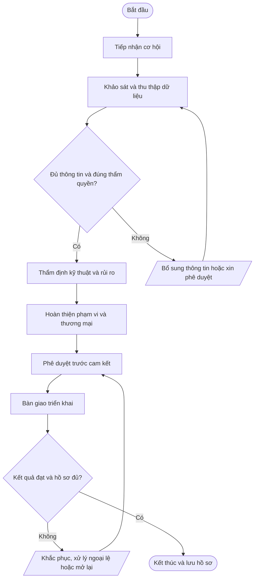

# QT-IT-07 — Phối hợp Sale và IT

> **Trạng thái:** Dự thảo chờ rà soát và phê duyệt  
> **Đơn vị sở hữu:** IT Lead (thẩm định kỹ thuật); Ban Giám đốc/người được ủy quyền (phê duyệt thương mại)  
> **Nhóm:** Van hanh IT  
> **Phiên bản:** 0.1 | **Ngày soạn:** 2026-10-14  
> **Phạm vi áp dụng:** Mstar và các hoạt động dịch vụ IT Outsourcing trong phạm vi hợp đồng/ủy quyền. Phụ lục khách hàng có thể bổ sung yêu cầu chặt chẽ hơn.

## 1. Mục đích

Bảo đảm dịch vụ được cam kết đúng năng lực kỹ thuật, nguồn lực, phạm vi, rủi ro, SLA và điều kiện bàn giao.

## 2. Phạm vi và thời điểm áp dụng

- **Đối tượng/phạm vi:** Sale/Account Manager; IT Lead; kỹ thuật viên chuyên trách; Ban Giám đốc/người được ủy quyền; đầu mối khách hàng.
- **Kích hoạt quy trình:** Khi có cơ hội kinh doanh mới, gia hạn, thay đổi phạm vi hoặc cam kết kỹ thuật mới.
- **Không được tự suy diễn thẩm quyền:** Mọi thao tác trong môi trường khách hàng phải nằm trong phạm vi hợp đồng và quyền được ủy quyền.
- **Nguyên tắc dùng chung:** Quy trình lõi áp dụng chung; SLA, đầu mối, hệ thống, quyền, thời hạn lưu giữ và yêu cầu thông báo phải được cấu hình trong phụ lục từng khách hàng.

## 3. Căn cứ và tài liệu liên quan

Liên quan quản lý nhà cung cấp, yêu cầu khách hàng và kiểm soát vận hành theo SoA; đây là quy trình quản trị dịch vụ nội bộ.

Tài liệu liên quan tùy trường hợp: chính sách an toàn thông tin tổng thể; QT-ISMS-01 (rủi ro); QT-ISMS-02 (tài liệu/hồ sơ); QT-ISMS-03 (nghĩa vụ hợp đồng); QT-ISMS-04 (ngoại lệ); QT-IT-08 (ticket); QT-IT-11 (quyền truy cập); QT-IT-13 (thay đổi); QT-ATTT-04 (sự cố); và phụ lục khách hàng liên quan.

> Mapping ISO trong tài liệu là **tham chiếu định hướng ban đầu**, không phải tuyên bố phù hợp/chứng nhận. Phải xác nhận theo phạm vi ISMS, đánh giá rủi ro và Statement of Applicability (SoA).

## 4. Vai trò và trách nhiệm

| Vai trò | Trách nhiệm tối thiểu |
|---|---|
| Người yêu cầu/đầu mối khách hàng | Cung cấp yêu cầu chính xác, xác nhận phạm vi và phê duyệt khi hợp đồng quy định. |
| Người thực hiện | Thực hiện đúng quy trình, trong phạm vi quyền; ghi nhận thao tác và báo cáo rủi ro/sự cố. |
| Người kiểm tra/chủ sở hữu hệ thống | Xác minh tính đúng, an toàn, đầy đủ và phù hợp với yêu cầu nghiệp vụ. |
| Chủ sở hữu quy trình (IT Lead (thẩm định kỹ thuật); Ban Giám đốc/người được ủy quyền (phê duyệt thương mại)) | Duy trì quy trình, phân công, xử lý ngoại lệ, theo dõi KPI và cải tiến. |
| IT Lead | Phê duyệt kỹ thuật theo thẩm quyền, quản lý rủi ro kỹ thuật và bảo đảm năng lực vận hành. |
| Ban Giám đốc/người được ủy quyền | Phê duyệt chính sách, cam kết thương mại, nguồn lực hoặc rủi ro thuộc thẩm quyền. |

Người thực hiện không tự phê duyệt thay đổi/rủi ro trọng yếu do chính mình đề xuất nếu việc đó làm mất kiểm soát độc lập.

## 5. Đầu vào và đầu ra

**Đầu vào:** Yêu cầu khách hàng; hiện trạng hệ thống; SLA mong muốn; phạm vi/loại trừ; nguồn lực; chi phí; rủi ro.

**Đầu ra tối thiểu:** Phiếu khảo sát; phạm vi kỹ thuật; giả định/loại trừ; đánh giá rủi ro; đề xuất SLA; phê duyệt kỹ thuật và thương mại; bàn giao qua Bitrix24/Ticket.

## 6. Trình tự thực hiện

| Bước | Hoạt động | Người chịu trách nhiệm | Hướng dẫn và kiểm soát | Hồ sơ/đầu ra |
|---:|---|---|---|---|
| 1 | Tiếp nhận cơ hội | Sale/Account Manager | Ghi nhận nhu cầu khách hàng, mục tiêu, địa điểm, hệ thống, thời hạn và người quyết định; tạo hồ sơ/ticket theo kênh thống nhất. | Yêu cầu cơ hội trên Bitrix24 |
| 2 | Khảo sát và thu thập dữ liệu | Sale + IT phụ trách | Khảo sát có ủy quyền; ghi nhận hiện trạng, phụ thuộc, tài sản, rủi ro, yêu cầu ATTT và thông tin còn thiếu. | Biên bản khảo sát |
| 3 | Thẩm định kỹ thuật và rủi ro | IT Lead | Đánh giá tính khả thi, năng lực, nhân sự, bảo mật, SLA, phụ thuộc nhà cung cấp và phương án dự phòng. | Ý kiến thẩm định kỹ thuật |
| 4 | Hoàn thiện phạm vi và thương mại | Sale + IT Lead | Mô tả rõ deliverables, loại trừ, giả định, trách nhiệm khách hàng, điều kiện truy cập, SLA và điều kiện thay đổi. | Bản phạm vi/đề xuất |
| 5 | Phê duyệt trước cam kết | IT Lead + Ban Giám đốc/người được ủy quyền | IT Lead phê duyệt phần kỹ thuật; người có thẩm quyền phê duyệt giá/điều khoản thương mại. Không cam kết vượt năng lực khi chưa có chấp thuận. | Hồ sơ phê duyệt |
| 6 | Bàn giao triển khai | Sale + Service Owner | Tạo ticket bàn giao trên Bitrix24, chuyển hợp đồng/phạm vi, rủi ro, đầu mối, mốc thời gian và các giả định đã chốt. | Biên bản bàn giao và ticket |

### Quy tắc vận hành chung

1. Ghi nhận yêu cầu/hoạt động trên hệ thống quản lý công việc được Mstar phê duyệt (ví dụ Bitrix24/Ticket) khi phù hợp.
2. Xác minh danh tính, thẩm quyền, phạm vi và mức độ tác động trước khi thao tác.
3. Không ghi mật khẩu, token, khóa API, mã khôi phục hoặc secret dạng rõ trong ticket, README, email thông thường hay tài liệu bàn giao.
4. Nếu có thay đổi cấu hình, áp dụng quy trình quản lý thay đổi; nếu nghi ngờ sự cố ATTT, kích hoạt quy trình ứng cứu sự cố.
5. Nếu thiếu dữ liệu, quyền hoặc phê duyệt, tạm dừng bước rủi ro, ghi nhận blocker và yêu cầu bổ sung; không tự ý mở rộng phạm vi.
6. Kết thúc khi kết quả được xác minh, hồ sơ đủ và các việc tồn được giao owner/hạn rõ ràng.

## 7. Lưu đồ quy trình

Lưu đồ thể hiện luồng chuẩn và các nhánh kiểm tra điều kiện, bổ sung thông tin, khắc phục và đóng hồ sơ. Khi điều chỉnh nội dung quy trình, phải cập nhật lưu đồ đồng thời để tránh sai lệch.

## 8. Biểu mẫu và hồ sơ

FR-SI-01 Phiếu yêu cầu khảo sát; FR-SI-02 Checklist khảo sát; FR-SI-03 Phiếu thẩm định kỹ thuật/rủi ro; FR-SI-04 Checklist bàn giao Sale–IT.

Các biểu mẫu trên là mã đề xuất. Khi ban hành chính thức, đưa từng biểu mẫu vào danh mục tài liệu, xác định chủ sở hữu, phiên bản, nơi lưu, quyền truy cập và thời hạn lưu giữ.

## 9. Bằng chứng bắt buộc lưu

- Yêu cầu/ticket và thông tin đầu vào liên quan.
- Phê duyệt của đúng người có thẩm quyền, bao gồm phê duyệt khách hàng khi cần.
- Nhật ký thực hiện, kết quả kiểm tra và thông báo.
- Biên bản bàn giao/nghiệm thu/đóng việc hoặc quyết định ngoại lệ nếu có.
- Các hành động còn tồn, người phụ trách và hạn hoàn thành.

**Kho lưu chính thức:** QT-IT-07 phải được cấu hình theo danh mục tài liệu/hồ sơ của Mstar và phụ lục khách hàng. Không lưu hồ sơ nhạy cảm ở kho công khai hoặc repository mã nguồn nếu chưa được phân loại và phê duyệt.

## 10. KPI và giám sát tuân thủ

100% dịch vụ mới có phê duyệt kỹ thuật và thương mại đúng thẩm quyền; 100% có phạm vi/SLA và bàn giao; số phát sinh do thiếu khảo sát.

Chủ sở hữu quy trình xác định nguồn dữ liệu, chu kỳ đo, người kiểm tra và ngưỡng cảnh báo trước khi áp dụng. Không tự thay đổi công thức hoặc loại trừ dữ liệu mà không có căn cứ và lịch sử phê duyệt.

## 11. Ngoại lệ và xử lý không phù hợp

Nếu thông tin khách hàng chưa đủ, ghi rõ giả định và điều kiện cần xác minh; không dùng giả định như cam kết đã xác nhận. Thay đổi sau khi chốt phạm vi phải theo QT-IT-13.

Mọi ngoại lệ phải có lý do, phạm vi, đánh giá rủi ro, biện pháp bù trừ, người phê duyệt, thời hạn hết hiệu lực và kế hoạch đóng theo QT-ISMS-04. Sự cố ATTT phải được ghi nhận và xử lý theo QT-ATTT-04.

## 12. Phụ lục cần cấu hình theo từng khách hàng

| Thông tin | Nội dung cần điền |
|---|---|
| Khách hàng/mã hợp đồng | Điền theo hợp đồng |
| Phạm vi hệ thống/dịch vụ | Liệt kê hệ thống, tenant, site, tài sản và loại dịch vụ |
| SLA/lịch hỗ trợ | Theo hợp đồng/phụ lục, không dùng mặc định chung |
| Đầu mối yêu cầu/phê duyệt | Tên chức danh, kênh liên hệ và người thay thế |
| Quyền truy cập/kênh kỹ thuật | Chỉ định quyền được ủy quyền, MFA, VPN và thời hạn |
| Yêu cầu dữ liệu/lưu giữ | Phân loại, nơi lưu, thời hạn, trả/xóa và ngoại lệ |
| Thông báo sự cố | Kênh, người nhận và thời hạn theo hợp đồng/pháp luật |
| RTO/RPO/backup (nếu liên quan) | Theo thỏa thuận và kết quả kiểm thử |
| Ngoại lệ/rủi ro tồn dư | Ghi mã hồ sơ, phê duyệt, biện pháp bù trừ và hạn |

## 13. Phê duyệt và lịch sử sửa đổi

| Vai trò | Người ký/tên | Ngày | Trạng thái |
|---|---|---|---|
| Người soạn | Chưa phân công | — | Dự thảo |
| Người kiểm tra | IT Lead/chủ sở hữu liên quan | — | Chờ rà soát |
| Người phê duyệt | Theo ma trận thẩm quyền Mstar | — | Chờ phê duyệt |

| Phiên bản | Ngày | Nội dung thay đổi | Người cập nhật |
|---|---|---|---|
| 0.1 | 2026-10-14 | Tạo bản dự thảo chuẩn hóa; cần rà soát với thực tế vận hành, rủi ro, hợp đồng và SoA. | Mstar |

---
**Lưu ý:** Đây là tài liệu dự thảo để xây dựng và rà soát. Chỉ ban hành sau khi Mstar xác định phạm vi, thẩm quyền, bằng chứng vận hành và phê duyệt chính thức.
