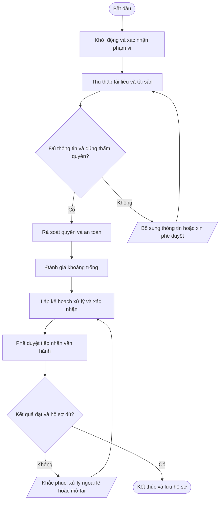

# QT-IT-12 — Tiếp nhận và bàn giao dịch vụ khách hàng

> **Trạng thái:** Dự thảo chờ rà soát và phê duyệt  
> **Đơn vị sở hữu:** Service Owner/IT Lead  
> **Nhóm:** Van hanh IT  
> **Phiên bản:** 0.1 | **Ngày soạn:** 2026-10-14  
> **Phạm vi áp dụng:** Mstar và các hoạt động dịch vụ IT Outsourcing trong phạm vi hợp đồng/ủy quyền. Phụ lục khách hàng có thể bổ sung yêu cầu chặt chẽ hơn.

## 1. Mục đích

Tiếp nhận đầy đủ phạm vi, hồ sơ kỹ thuật, tài sản, quyền được phép, SLA, rủi ro và đầu mối trước khi Mstar vận hành dịch vụ.

## 2. Phạm vi và thời điểm áp dụng

- **Đối tượng/phạm vi:** Account Manager; Service Owner; IT Lead; kỹ thuật phụ trách; đầu mối khách hàng; nhà cung cấp tiền nhiệm.
- **Kích hoạt quy trình:** Khi bắt đầu hợp đồng, chuyển từ nhà cung cấp cũ, mở site/tenant mới hoặc thay đổi phạm vi lớn.
- **Không được tự suy diễn thẩm quyền:** Mọi thao tác trong môi trường khách hàng phải nằm trong phạm vi hợp đồng và quyền được ủy quyền.
- **Nguyên tắc dùng chung:** Quy trình lõi áp dụng chung; SLA, đầu mối, hệ thống, quyền, thời hạn lưu giữ và yêu cầu thông báo phải được cấu hình trong phụ lục từng khách hàng.

## 3. Căn cứ và tài liệu liên quan

ISO/IEC 27002: tài sản, quyền truy cập, nhà cung cấp, cấu hình và vận hành theo SoA.

Tài liệu liên quan tùy trường hợp: chính sách an toàn thông tin tổng thể; QT-ISMS-01 (rủi ro); QT-ISMS-02 (tài liệu/hồ sơ); QT-ISMS-03 (nghĩa vụ hợp đồng); QT-ISMS-04 (ngoại lệ); QT-IT-08 (ticket); QT-IT-11 (quyền truy cập); QT-IT-13 (thay đổi); QT-ATTT-04 (sự cố); và phụ lục khách hàng liên quan.

> Mapping ISO trong tài liệu là **tham chiếu định hướng ban đầu**, không phải tuyên bố phù hợp/chứng nhận. Phải xác nhận theo phạm vi ISMS, đánh giá rủi ro và Statement of Applicability (SoA).

## 4. Vai trò và trách nhiệm

| Vai trò | Trách nhiệm tối thiểu |
|---|---|
| Người yêu cầu/đầu mối khách hàng | Cung cấp yêu cầu chính xác, xác nhận phạm vi và phê duyệt khi hợp đồng quy định. |
| Người thực hiện | Thực hiện đúng quy trình, trong phạm vi quyền; ghi nhận thao tác và báo cáo rủi ro/sự cố. |
| Người kiểm tra/chủ sở hữu hệ thống | Xác minh tính đúng, an toàn, đầy đủ và phù hợp với yêu cầu nghiệp vụ. |
| Chủ sở hữu quy trình (Service Owner/IT Lead) | Duy trì quy trình, phân công, xử lý ngoại lệ, theo dõi KPI và cải tiến. |
| IT Lead | Phê duyệt kỹ thuật theo thẩm quyền, quản lý rủi ro kỹ thuật và bảo đảm năng lực vận hành. |
| Ban Giám đốc/người được ủy quyền | Phê duyệt chính sách, cam kết thương mại, nguồn lực hoặc rủi ro thuộc thẩm quyền. |

Người thực hiện không tự phê duyệt thay đổi/rủi ro trọng yếu do chính mình đề xuất nếu việc đó làm mất kiểm soát độc lập.

## 5. Đầu vào và đầu ra

**Đầu vào:** Hợp đồng/phạm vi; sơ đồ; CMDB; danh sách tài khoản; SLA; danh mục dữ liệu; backup/DR; rủi ro và việc tồn.

**Đầu ra tối thiểu:** Checklist onboarding; hồ sơ hệ thống; ma trận quyền; baseline; danh sách vấn đề; biên bản chấp nhận tiếp nhận.

## 6. Trình tự thực hiện

| Bước | Hoạt động | Người chịu trách nhiệm | Hướng dẫn và kiểm soát | Hồ sơ/đầu ra |
|---:|---|---|---|---|
| 1 | Khởi động và xác nhận phạm vi | Account Manager/Service Owner | Tổ chức kickoff; xác nhận hợp đồng, hệ thống, site, giờ hỗ trợ, SLA, đầu mối, kênh ticket và ranh giới trách nhiệm. | Biên bản kickoff/phạm vi |
| 2 | Thu thập tài liệu và tài sản | Kỹ thuật phụ trách | Thu sơ đồ, inventory, cấu hình, nhà cung cấp, license, backup, log, sự cố tồn đọng và lịch bảo trì. | Checklist hồ sơ |
| 3 | Rà soát quyền và an toàn | IT Lead + khách hàng | Xác minh quyền được ủy quyền, MFA, tài khoản đặc quyền, kênh truy cập, kho bí mật và phân tách dữ liệu. | Ma trận quyền và rủi ro |
| 4 | Đánh giá khoảng trống | Service Owner/IT Lead | Phân loại tài liệu thiếu, lỗ hổng, backup chưa kiểm chứng, hệ thống không được hỗ trợ và cam kết chưa rõ. | Danh sách gap/risk |
| 5 | Lập kế hoạch xử lý và xác nhận | Service Owner + khách hàng | Gán owner/hạn; chốt việc khách hàng phải cung cấp; xác định điều kiện go-live và các rủi ro được chấp nhận. | Kế hoạch chuyển tiếp |
| 6 | Phê duyệt tiếp nhận vận hành | IT Lead/đầu mối khách hàng | Xác nhận hồ sơ tối thiểu, kênh hỗ trợ, quyền, SLA và vấn đề tồn; ghi rõ giới hạn chưa khắc phục. | Biên bản bàn giao tiếp nhận |

### Quy tắc vận hành chung

1. Ghi nhận yêu cầu/hoạt động trên hệ thống quản lý công việc được Mstar phê duyệt (ví dụ Bitrix24/Ticket) khi phù hợp.
2. Xác minh danh tính, thẩm quyền, phạm vi và mức độ tác động trước khi thao tác.
3. Không ghi mật khẩu, token, khóa API, mã khôi phục hoặc secret dạng rõ trong ticket, README, email thông thường hay tài liệu bàn giao.
4. Nếu có thay đổi cấu hình, áp dụng quy trình quản lý thay đổi; nếu nghi ngờ sự cố ATTT, kích hoạt quy trình ứng cứu sự cố.
5. Nếu thiếu dữ liệu, quyền hoặc phê duyệt, tạm dừng bước rủi ro, ghi nhận blocker và yêu cầu bổ sung; không tự ý mở rộng phạm vi.
6. Kết thúc khi kết quả được xác minh, hồ sơ đủ và các việc tồn được giao owner/hạn rõ ràng.

## 7. Lưu đồ quy trình

Lưu đồ thể hiện luồng chuẩn và các nhánh kiểm tra điều kiện, bổ sung thông tin, khắc phục và đóng hồ sơ. Khi điều chỉnh nội dung quy trình, phải cập nhật lưu đồ đồng thời để tránh sai lệch.

## 8. Biểu mẫu và hồ sơ

FR-ONB-01 Checklist onboarding; FR-ONB-02 Danh mục hệ thống/tài sản; FR-ONB-03 Ma trận quyền; FR-ONB-04 Sổ gap/risk; FR-ONB-05 Biên bản tiếp nhận.

Các biểu mẫu trên là mã đề xuất. Khi ban hành chính thức, đưa từng biểu mẫu vào danh mục tài liệu, xác định chủ sở hữu, phiên bản, nơi lưu, quyền truy cập và thời hạn lưu giữ.

## 9. Bằng chứng bắt buộc lưu

- Yêu cầu/ticket và thông tin đầu vào liên quan.
- Phê duyệt của đúng người có thẩm quyền, bao gồm phê duyệt khách hàng khi cần.
- Nhật ký thực hiện, kết quả kiểm tra và thông báo.
- Biên bản bàn giao/nghiệm thu/đóng việc hoặc quyết định ngoại lệ nếu có.
- Các hành động còn tồn, người phụ trách và hạn hoàn thành.

**Kho lưu chính thức:** QT-IT-12 phải được cấu hình theo danh mục tài liệu/hồ sơ của Mstar và phụ lục khách hàng. Không lưu hồ sơ nhạy cảm ở kho công khai hoặc repository mã nguồn nếu chưa được phân loại và phê duyệt.

## 10. KPI và giám sát tuân thủ

Tỷ lệ hệ thống có owner/sơ đồ/backup contact; số gap chưa có kế hoạch; thời gian hoàn tất onboarding; quyền được phê duyệt.

Chủ sở hữu quy trình xác định nguồn dữ liệu, chu kỳ đo, người kiểm tra và ngưỡng cảnh báo trước khi áp dụng. Không tự thay đổi công thức hoặc loại trừ dữ liệu mà không có căn cứ và lịch sử phê duyệt.

## 11. Ngoại lệ và xử lý không phù hợp

Không nhận trách nhiệm cho hệ thống chưa được xác định hoặc không có quyền hợp lệ mà không ghi rõ ngoại lệ/phạm vi. Không yêu cầu khách hàng gửi mật khẩu qua email/ticket; sử dụng kênh quản lý bí mật được phê duyệt.

Mọi ngoại lệ phải có lý do, phạm vi, đánh giá rủi ro, biện pháp bù trừ, người phê duyệt, thời hạn hết hiệu lực và kế hoạch đóng theo QT-ISMS-04. Sự cố ATTT phải được ghi nhận và xử lý theo QT-ATTT-04.

## 12. Phụ lục cần cấu hình theo từng khách hàng

| Thông tin | Nội dung cần điền |
|---|---|
| Khách hàng/mã hợp đồng | Điền theo hợp đồng |
| Phạm vi hệ thống/dịch vụ | Liệt kê hệ thống, tenant, site, tài sản và loại dịch vụ |
| SLA/lịch hỗ trợ | Theo hợp đồng/phụ lục, không dùng mặc định chung |
| Đầu mối yêu cầu/phê duyệt | Tên chức danh, kênh liên hệ và người thay thế |
| Quyền truy cập/kênh kỹ thuật | Chỉ định quyền được ủy quyền, MFA, VPN và thời hạn |
| Yêu cầu dữ liệu/lưu giữ | Phân loại, nơi lưu, thời hạn, trả/xóa và ngoại lệ |
| Thông báo sự cố | Kênh, người nhận và thời hạn theo hợp đồng/pháp luật |
| RTO/RPO/backup (nếu liên quan) | Theo thỏa thuận và kết quả kiểm thử |
| Ngoại lệ/rủi ro tồn dư | Ghi mã hồ sơ, phê duyệt, biện pháp bù trừ và hạn |

## 13. Phê duyệt và lịch sử sửa đổi

| Vai trò | Người ký/tên | Ngày | Trạng thái |
|---|---|---|---|
| Người soạn | Chưa phân công | — | Dự thảo |
| Người kiểm tra | IT Lead/chủ sở hữu liên quan | — | Chờ rà soát |
| Người phê duyệt | Theo ma trận thẩm quyền Mstar | — | Chờ phê duyệt |

| Phiên bản | Ngày | Nội dung thay đổi | Người cập nhật |
|---|---|---|---|
| 0.1 | 2026-10-14 | Tạo bản dự thảo chuẩn hóa; cần rà soát với thực tế vận hành, rủi ro, hợp đồng và SoA. | Mstar |

---
**Lưu ý:** Đây là tài liệu dự thảo để xây dựng và rà soát. Chỉ ban hành sau khi Mstar xác định phạm vi, thẩm quyền, bằng chứng vận hành và phê duyệt chính thức.
