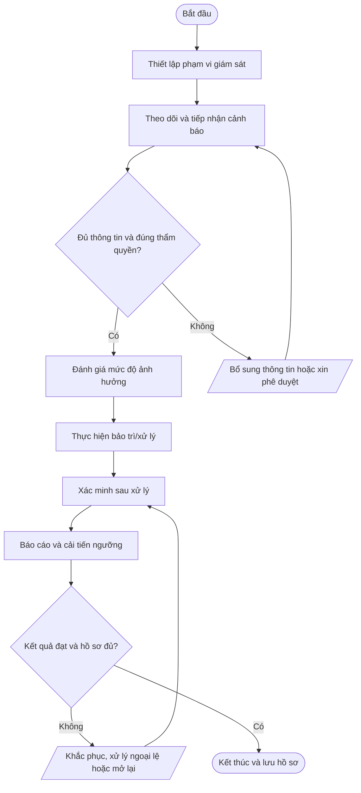

# QT-IT-15 — Giám sát và bảo trì hệ thống

> **Trạng thái:** Dự thảo chờ rà soát và phê duyệt  
> **Đơn vị sở hữu:** IT Operations Lead  
> **Nhóm:** Van hanh IT  
> **Phiên bản:** 0.1 | **Ngày soạn:** 2026-10-14  
> **Phạm vi áp dụng:** Mstar và các hoạt động dịch vụ IT Outsourcing trong phạm vi hợp đồng/ủy quyền. Phụ lục khách hàng có thể bổ sung yêu cầu chặt chẽ hơn.

## 1. Mục đích

Phát hiện sớm sự cố, suy giảm hiệu năng, đầy dung lượng, lỗi dịch vụ và hoạt động bất thường; thực hiện bảo trì có kiểm soát.

## 2. Phạm vi và thời điểm áp dụng

- **Đối tượng/phạm vi:** NOC/IT System; IT Lead; chủ sở hữu dịch vụ; nhà cung cấp; đầu mối khách hàng.
- **Kích hoạt quy trình:** Theo lịch giám sát/bảo trì; khi nhận cảnh báo; trước và sau bảo trì theo hợp đồng.
- **Không được tự suy diễn thẩm quyền:** Mọi thao tác trong môi trường khách hàng phải nằm trong phạm vi hợp đồng và quyền được ủy quyền.
- **Nguyên tắc dùng chung:** Quy trình lõi áp dụng chung; SLA, đầu mối, hệ thống, quyền, thời hạn lưu giữ và yêu cầu thông báo phải được cấu hình trong phụ lục từng khách hàng.

## 3. Căn cứ và tài liệu liên quan

ISO/IEC 27002: logging, monitoring, capacity, operational security theo SoA.

Tài liệu liên quan tùy trường hợp: chính sách an toàn thông tin tổng thể; QT-ISMS-01 (rủi ro); QT-ISMS-02 (tài liệu/hồ sơ); QT-ISMS-03 (nghĩa vụ hợp đồng); QT-ISMS-04 (ngoại lệ); QT-IT-08 (ticket); QT-IT-11 (quyền truy cập); QT-IT-13 (thay đổi); QT-ATTT-04 (sự cố); và phụ lục khách hàng liên quan.

> Mapping ISO trong tài liệu là **tham chiếu định hướng ban đầu**, không phải tuyên bố phù hợp/chứng nhận. Phải xác nhận theo phạm vi ISMS, đánh giá rủi ro và Statement of Applicability (SoA).

## 4. Vai trò và trách nhiệm

| Vai trò | Trách nhiệm tối thiểu |
|---|---|
| Người yêu cầu/đầu mối khách hàng | Cung cấp yêu cầu chính xác, xác nhận phạm vi và phê duyệt khi hợp đồng quy định. |
| Người thực hiện | Thực hiện đúng quy trình, trong phạm vi quyền; ghi nhận thao tác và báo cáo rủi ro/sự cố. |
| Người kiểm tra/chủ sở hữu hệ thống | Xác minh tính đúng, an toàn, đầy đủ và phù hợp với yêu cầu nghiệp vụ. |
| Chủ sở hữu quy trình (IT Operations Lead) | Duy trì quy trình, phân công, xử lý ngoại lệ, theo dõi KPI và cải tiến. |
| IT Lead | Phê duyệt kỹ thuật theo thẩm quyền, quản lý rủi ro kỹ thuật và bảo đảm năng lực vận hành. |
| Ban Giám đốc/người được ủy quyền | Phê duyệt chính sách, cam kết thương mại, nguồn lực hoặc rủi ro thuộc thẩm quyền. |

Người thực hiện không tự phê duyệt thay đổi/rủi ro trọng yếu do chính mình đề xuất nếu việc đó làm mất kiểm soát độc lập.

## 5. Đầu vào và đầu ra

**Đầu vào:** Danh mục giám sát; ngưỡng cảnh báo; SLA; lịch bảo trì; runbook; quyền truy cập.

**Đầu ra tối thiểu:** Cảnh báo/ticket; nhật ký bảo trì; báo cáo sức khỏe; kế hoạch xử lý xu hướng.

## 6. Trình tự thực hiện

| Bước | Hoạt động | Người chịu trách nhiệm | Hướng dẫn và kiểm soát | Hồ sơ/đầu ra |
|---:|---|---|---|---|
| 1 | Thiết lập phạm vi giám sát | IT Operations | Xác định dịch vụ, chỉ số, ngưỡng, lịch, người nhận cảnh báo và yêu cầu bảo vệ log. | Ma trận giám sát |
| 2 | Theo dõi và tiếp nhận cảnh báo | NOC/IT System | Theo dõi dashboard, kiểm tra cảnh báo, lọc false positive có căn cứ và tạo ticket khi cần. | Alert/ticket |
| 3 | Đánh giá mức độ ảnh hưởng | IT Operations/IT Lead | Xác định dịch vụ, khách hàng, phạm vi, mức độ ưu tiên và có dấu hiệu sự cố ATTT hay không. | Phân loại và phương án |
| 4 | Thực hiện bảo trì/xử lý | Kỹ thuật phụ trách | Thông báo theo SLA; xin change nếu cần; thực hiện runbook, ghi log và bảo vệ dữ liệu. | Nhật ký thao tác |
| 5 | Xác minh sau xử lý | Kỹ thuật + chủ sở hữu dịch vụ | Kiểm tra dịch vụ, hiệu năng, cảnh báo và tác động; mở rộng xử lý nếu chưa đạt. | Kết quả xác minh |
| 6 | Báo cáo và cải tiến ngưỡng | IT Lead | Phân tích lặp lại, dung lượng, xu hướng và false positive; cập nhật ngưỡng/quy trình theo change. | Báo cáo vận hành |

### Quy tắc vận hành chung

1. Ghi nhận yêu cầu/hoạt động trên hệ thống quản lý công việc được Mstar phê duyệt (ví dụ Bitrix24/Ticket) khi phù hợp.
2. Xác minh danh tính, thẩm quyền, phạm vi và mức độ tác động trước khi thao tác.
3. Không ghi mật khẩu, token, khóa API, mã khôi phục hoặc secret dạng rõ trong ticket, README, email thông thường hay tài liệu bàn giao.
4. Nếu có thay đổi cấu hình, áp dụng quy trình quản lý thay đổi; nếu nghi ngờ sự cố ATTT, kích hoạt quy trình ứng cứu sự cố.
5. Nếu thiếu dữ liệu, quyền hoặc phê duyệt, tạm dừng bước rủi ro, ghi nhận blocker và yêu cầu bổ sung; không tự ý mở rộng phạm vi.
6. Kết thúc khi kết quả được xác minh, hồ sơ đủ và các việc tồn được giao owner/hạn rõ ràng.

## 7. Lưu đồ quy trình

Lưu đồ thể hiện luồng chuẩn và các nhánh kiểm tra điều kiện, bổ sung thông tin, khắc phục và đóng hồ sơ. Khi điều chỉnh nội dung quy trình, phải cập nhật lưu đồ đồng thời để tránh sai lệch.

## 8. Biểu mẫu và hồ sơ

FR-MON-01 Ma trận giám sát; FR-MON-02 Checklist bảo trì; FR-MON-03 Báo cáo sức khỏe; FR-MON-04 Biên bản xử lý cảnh báo.

Các biểu mẫu trên là mã đề xuất. Khi ban hành chính thức, đưa từng biểu mẫu vào danh mục tài liệu, xác định chủ sở hữu, phiên bản, nơi lưu, quyền truy cập và thời hạn lưu giữ.

## 9. Bằng chứng bắt buộc lưu

- Yêu cầu/ticket và thông tin đầu vào liên quan.
- Phê duyệt của đúng người có thẩm quyền, bao gồm phê duyệt khách hàng khi cần.
- Nhật ký thực hiện, kết quả kiểm tra và thông báo.
- Biên bản bàn giao/nghiệm thu/đóng việc hoặc quyết định ngoại lệ nếu có.
- Các hành động còn tồn, người phụ trách và hạn hoàn thành.

**Kho lưu chính thức:** QT-IT-15 phải được cấu hình theo danh mục tài liệu/hồ sơ của Mstar và phụ lục khách hàng. Không lưu hồ sơ nhạy cảm ở kho công khai hoặc repository mã nguồn nếu chưa được phân loại và phê duyệt.

## 10. KPI và giám sát tuân thủ

Tỷ lệ hệ thống trọng yếu được giám sát; thời gian xử lý cảnh báo; số cảnh báo bỏ sót; bảo trì đúng lịch.

Chủ sở hữu quy trình xác định nguồn dữ liệu, chu kỳ đo, người kiểm tra và ngưỡng cảnh báo trước khi áp dụng. Không tự thay đổi công thức hoặc loại trừ dữ liệu mà không có căn cứ và lịch sử phê duyệt.

## 11. Ngoại lệ và xử lý không phù hợp

Không tắt giám sát để che lỗi mà không có phê duyệt và biện pháp bù trừ. Cảnh báo nghi ngờ xâm nhập phải chuyển QT-ATTT-04.

Mọi ngoại lệ phải có lý do, phạm vi, đánh giá rủi ro, biện pháp bù trừ, người phê duyệt, thời hạn hết hiệu lực và kế hoạch đóng theo QT-ISMS-04. Sự cố ATTT phải được ghi nhận và xử lý theo QT-ATTT-04.

## 12. Phụ lục cần cấu hình theo từng khách hàng

| Thông tin | Nội dung cần điền |
|---|---|
| Khách hàng/mã hợp đồng | Điền theo hợp đồng |
| Phạm vi hệ thống/dịch vụ | Liệt kê hệ thống, tenant, site, tài sản và loại dịch vụ |
| SLA/lịch hỗ trợ | Theo hợp đồng/phụ lục, không dùng mặc định chung |
| Đầu mối yêu cầu/phê duyệt | Tên chức danh, kênh liên hệ và người thay thế |
| Quyền truy cập/kênh kỹ thuật | Chỉ định quyền được ủy quyền, MFA, VPN và thời hạn |
| Yêu cầu dữ liệu/lưu giữ | Phân loại, nơi lưu, thời hạn, trả/xóa và ngoại lệ |
| Thông báo sự cố | Kênh, người nhận và thời hạn theo hợp đồng/pháp luật |
| RTO/RPO/backup (nếu liên quan) | Theo thỏa thuận và kết quả kiểm thử |
| Ngoại lệ/rủi ro tồn dư | Ghi mã hồ sơ, phê duyệt, biện pháp bù trừ và hạn |

## 13. Phê duyệt và lịch sử sửa đổi

| Vai trò | Người ký/tên | Ngày | Trạng thái |
|---|---|---|---|
| Người soạn | Chưa phân công | — | Dự thảo |
| Người kiểm tra | IT Lead/chủ sở hữu liên quan | — | Chờ rà soát |
| Người phê duyệt | Theo ma trận thẩm quyền Mstar | — | Chờ phê duyệt |

| Phiên bản | Ngày | Nội dung thay đổi | Người cập nhật |
|---|---|---|---|
| 0.1 | 2026-10-14 | Tạo bản dự thảo chuẩn hóa; cần rà soát với thực tế vận hành, rủi ro, hợp đồng và SoA. | Mstar |

---
**Lưu ý:** Đây là tài liệu dự thảo để xây dựng và rà soát. Chỉ ban hành sau khi Mstar xác định phạm vi, thẩm quyền, bằng chứng vận hành và phê duyệt chính thức.
