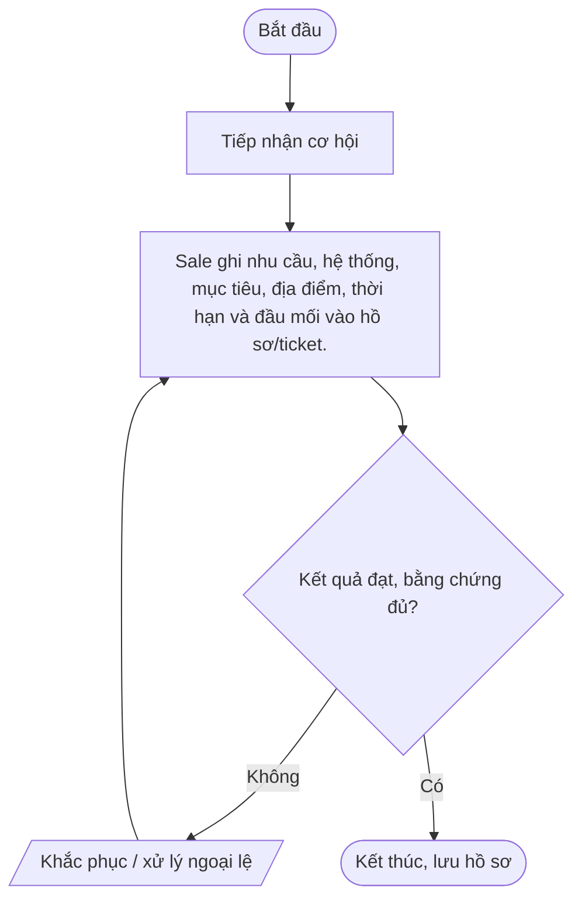
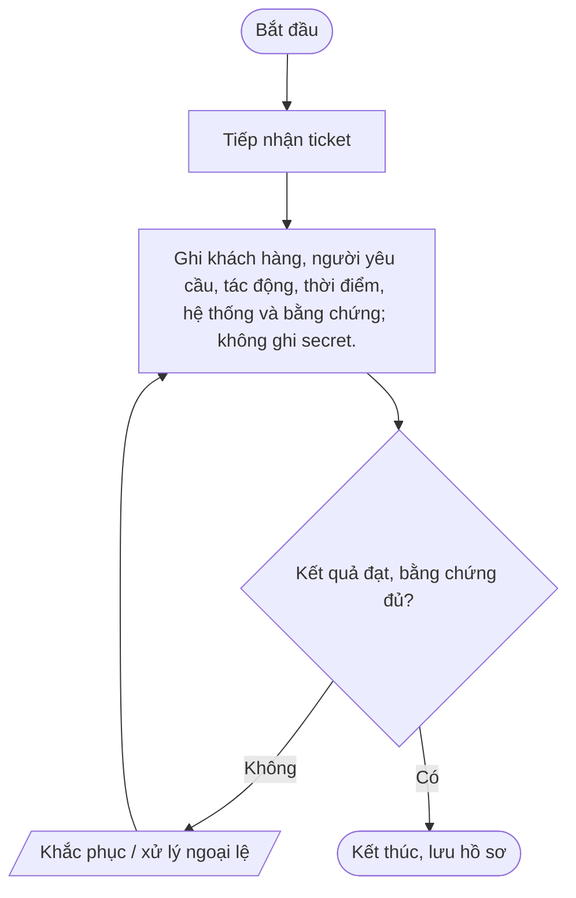
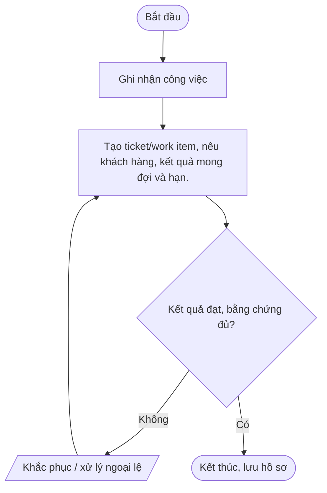
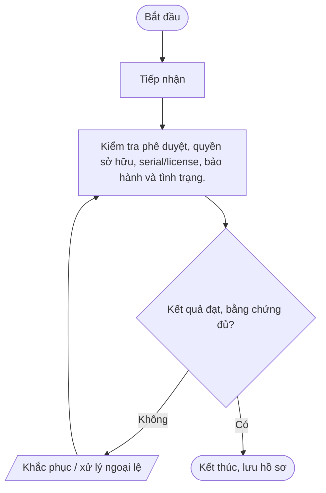
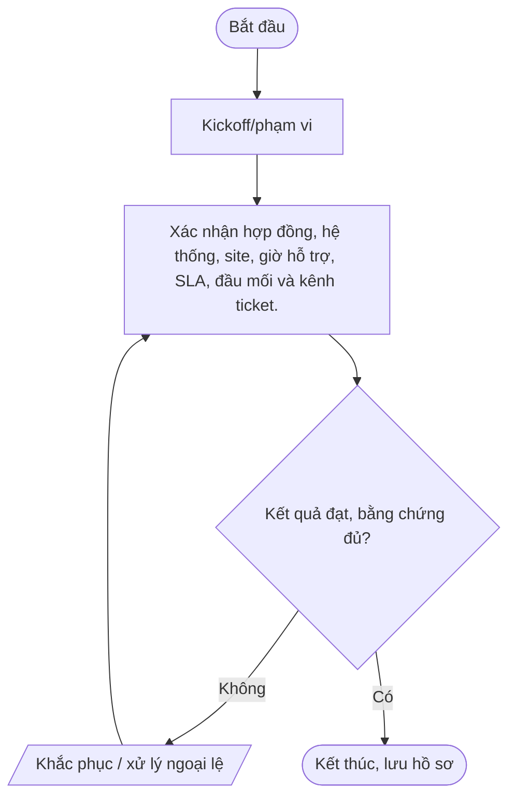
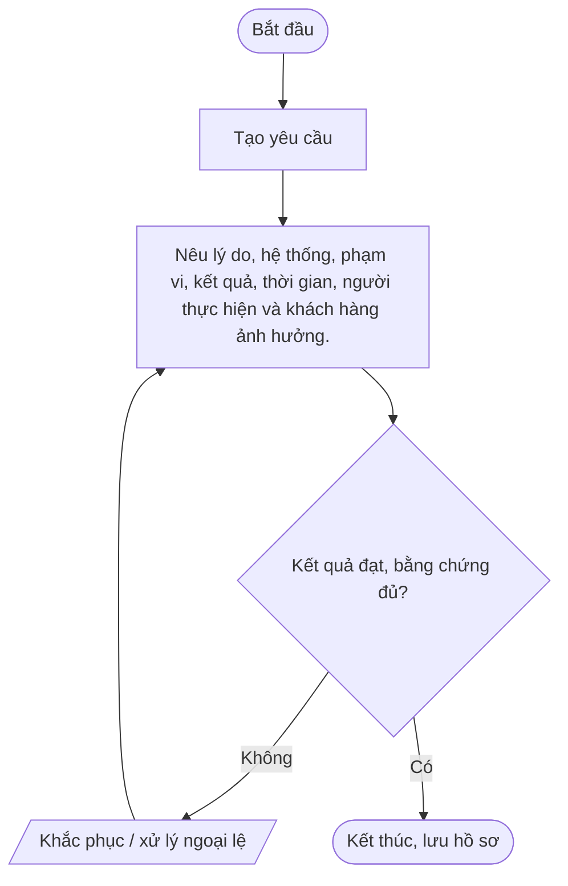
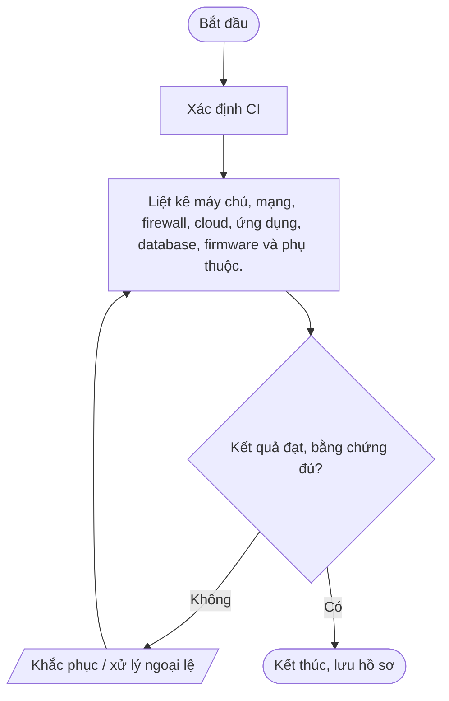
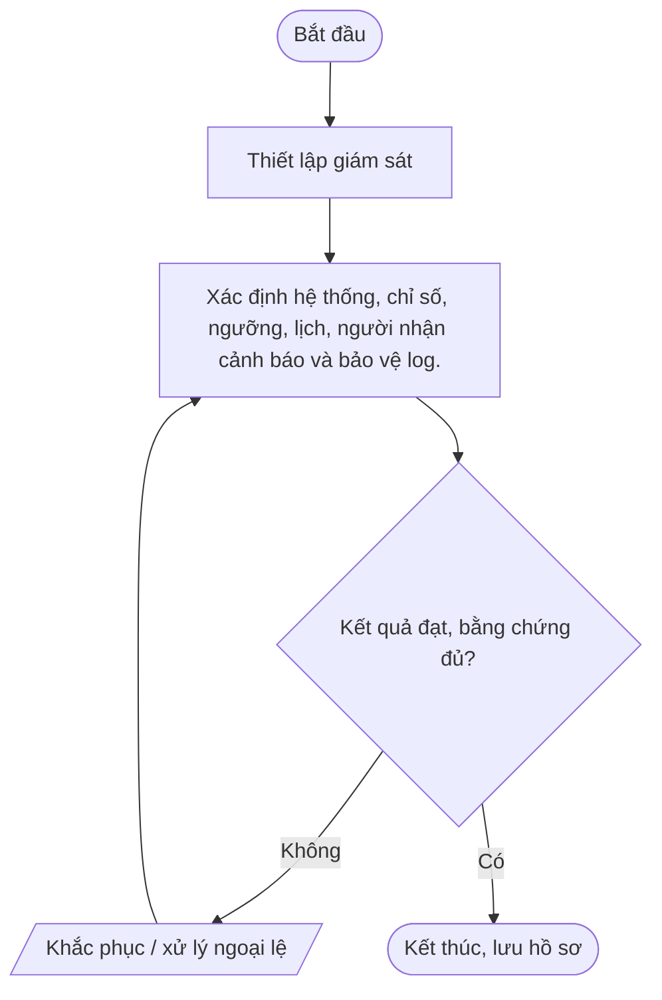
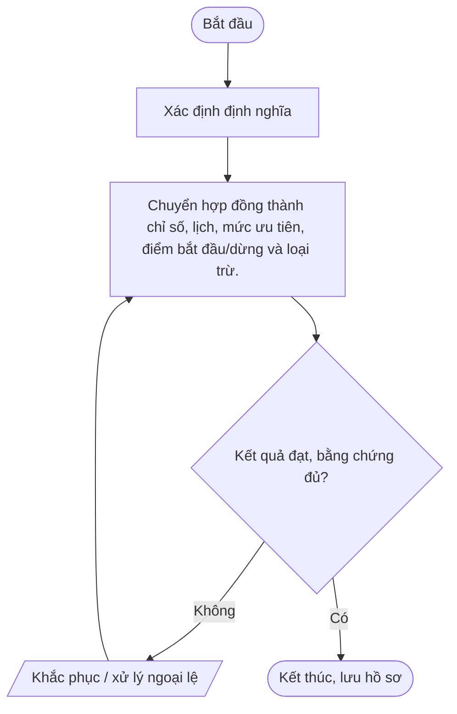

# Nhóm B — Vận hành dịch vụ IT Outsourcing

Bộ quy trình chuẩn Mstar — bản dự thảo ngày 2026-10-14. Tài liệu được thiết kế dùng chung cho dịch vụ IT Outsourcing; các yêu cầu cụ thể được cấu hình trong phụ lục khách hàng.

## Quy tắc áp dụng

- Quy trình lõi dùng chung; phụ lục khách hàng xác định phạm vi, SLA, đầu mối, quyền, retention, thông báo sự cố và yêu cầu phục hồi.
- Mọi thao tác trên hệ thống khách hàng phải được hợp đồng/ủy quyền cho phép.
- Bằng chứng phải có thể truy nguyên: ticket, phê duyệt, log, biên bản, kết quả kiểm tra.
- Không lưu mật khẩu, token, API key hoặc secret dạng rõ trong ticket/repository thông thường.
- Quy trình chỉ có hiệu lực sau khi được rà soát và phê duyệt; đây không phải tuyên bố Mstar đã được chứng nhận ISO.
- Tham chiếu: ISO/IEC 27001:2022 và ISO/IEC 27002:2022; mapping cuối cùng cần căn cứ risk assessment và SoA.

## Danh mục trong nhóm

| Mã | Quy trình | Mục đích |
|---|---|---|
| [QT-IT-07](#qt-it-07) | Phối hợp Sale và IT | Bảo đảm dịch vụ cam kết đúng năng lực kỹ thuật, nguồn lực, phạm vi, rủi ro, SLA và điều kiện bàn giao. |
| [QT-IT-08](#qt-it-08) | Hỗ trợ khách hàng | Tiếp nhận, phân loại, xử lý, cập nhật và đóng yêu cầu theo phạm vi hợp đồng, mức ưu tiên và SLA. |
| [QT-IT-09](#qt-it-09) | Quản lý công việc Phòng IT | Giao việc, ưu tiên, theo dõi tiến độ, bàn giao và báo cáo công việc ticket, định kỳ và ngoài ticket. |
| [QT-IT-10](#qt-it-10) | Quản lý tài sản CNTT | Quản lý vòng đời tài sản, phân biệt tài sản Mstar/khách hàng và bảo đảm giao nhận, kiểm kê, thu hồi, thanh lý an toàn. |
| [QT-IT-12](#qt-it-12) | Tiếp nhận và bàn giao dịch vụ khách hàng | Thu thập đầy đủ phạm vi, hồ sơ kỹ thuật, quyền hợp lệ, SLA, rủi ro và đầu mối trước khi vận hành. |
| [QT-IT-13](#qt-it-13) | Quản lý thay đổi hệ thống | Ngăn thay đổi trái phép hoặc không kiểm soát gây gián đoạn, mất dữ liệu hay suy giảm bảo mật. |
| [QT-IT-14](#qt-it-14) | Quản lý cấu hình hệ thống | Duy trì baseline, quan hệ thành phần và lịch sử cấu hình để vận hành an toàn, khôi phục và điều tra. |
| [QT-IT-15](#qt-it-15) | Giám sát và bảo trì hệ thống | Phát hiện sự cố, suy giảm hiệu năng, đầy dung lượng và hoạt động bất thường; bảo trì có kiểm soát. |
| [QT-IT-16](#qt-it-16) | Quản lý SLA và chất lượng dịch vụ | Đo SLA, backlog, ticket quá hạn, chất lượng và hành động cải tiến bằng dữ liệu kiểm chứng được. |

---
## QT-IT-07 — Phối hợp Sale và IT

**Mục đích:** Bảo đảm dịch vụ cam kết đúng năng lực kỹ thuật, nguồn lực, phạm vi, rủi ro, SLA và điều kiện bàn giao.

**Kích hoạt:** Khi có yêu cầu/sự kiện thuộc phạm vi; khi thay đổi đáng kể; theo chu kỳ; hoặc khi hợp đồng/khách hàng yêu cầu.

**Phạm vi:** Hoạt động Mstar và dịch vụ IT Outsourcing thuộc hợp đồng/ủy quyền. Chi tiết hệ thống, SLA, đầu mối, quyền, retention, thông báo và RTO/RPO phải được cấu hình trong phụ lục khách hàng.

**Vai trò:** Người yêu cầu; người thực hiện; người kiểm tra/chủ sở hữu hệ thống; chủ sở hữu quy trình; IT Lead; người phê duyệt theo ma trận thẩm quyền; đầu mối khách hàng khi hợp đồng yêu cầu. Người thực hiện không tự phê duyệt thay đổi/rủi ro trọng yếu của chính mình.

**Đầu vào:** Yêu cầu/ticket; hợp đồng/phụ lục; danh mục hệ thống/tài sản; quyền được ủy quyền; quy trình liên quan; dữ liệu/bằng chứng hiện có.

**Đầu ra:** Hồ sơ xử lý; kết quả đã xác minh; phê duyệt; ticket/biên bản đóng; việc tồn có owner và hạn.

### Các bước thực hiện

| Bước | Hoạt động | Vai trò chính | Hướng dẫn và kiểm soát | Bằng chứng cần lưu |
|---:|---|---|---|---|
| 1 | Tiếp nhận cơ hội | Người yêu cầu/đầu mối | Tiếp nhận cơ hội | Hồ sơ/ticket/log/phê duyệt tương ứng |
| 2 | Sale ghi nhu cầu, hệ thống, mục tiêu, địa điểm, thời hạn và đầu mối vào hồ sơ/ticket. | Chủ sở hữu quy trình/IT Lead | Sale ghi nhu cầu, hệ thống, mục tiêu, địa điểm, thời hạn và đầu mối vào hồ sơ/ticket. | Hồ sơ/ticket/log/phê duyệt tương ứng |

### Lưu đồ

### Biểu mẫu/hồ sơ

Khảo sát|Sale và IT thu thập hiện trạng, phụ thuộc, tài sản, rủi ro, yêu cầu ATTT và dữ liệu còn thiếu.

### KPI và giám sát

Thẩm định kỹ thuật|IT Lead đánh giá khả thi, nhân lực, bảo mật, SLA, phụ thuộc và phương án dự phòng.

### Ngoại lệ và an toàn thông tin

Chốt phạm vi và phê duyệt|IT Lead duyệt kỹ thuật; Ban Giám đốc/người được ủy quyền duyệt thương mại và điều khoản.

- Xác minh thẩm quyền/phạm vi trước khi thao tác; không tự mở rộng quyền.
- Không ghi mật khẩu, API key, token, khóa riêng hoặc mã khôi phục dạng rõ trong ticket, README, email thường hay tài liệu bàn giao.
- Thay đổi hệ thống phải theo QT-IT-13; nghi ngờ sự cố ATTT phải theo QT-ATTT-04; ngoại lệ phải theo QT-ISMS-04.
- Lưu hồ sơ ở kho được Mstar phê duyệt, phân quyền tối thiểu và giữ theo yêu cầu hợp đồng/pháp luật.
- Chỉ đóng việc khi kết quả được kiểm tra và bằng chứng cần thiết đã lưu.

### Phụ lục khách hàng cần cấu hình

| Trường | Giá trị cần xác nhận |
|---|---|
| Khách hàng/mã hợp đồng | Điền theo hợp đồng |
| Phạm vi hệ thống/dịch vụ | Hệ thống, tenant, site, tài sản, loại dịch vụ |
| SLA/lịch hỗ trợ | Theo hợp đồng/phụ lục |
| Đầu mối yêu cầu/phê duyệt | Chức danh, kênh và người thay thế |
| Quyền/kênh kỹ thuật | Phạm vi ủy quyền, MFA, VPN, thời hạn |
| Dữ liệu/lưu giữ | Phân loại, nơi lưu, thời hạn, trả/xóa |
| Thông báo sự cố | Kênh, người nhận, thời hạn |
| Ngoại lệ/rủi ro tồn dư | Mã hồ sơ, phê duyệt, biện pháp bù trừ, ngày hết hạn |

> **Trạng thái:** Dự thảo v0.1 — chờ Mstar rà soát, thử nghiệm và phê duyệt. Tham chiếu ISO chỉ là định hướng; cần xác nhận theo phạm vi ISMS, đánh giá rủi ro và SoA.

---

## QT-IT-08 — Hỗ trợ khách hàng

**Mục đích:** Tiếp nhận, phân loại, xử lý, cập nhật và đóng yêu cầu theo phạm vi hợp đồng, mức ưu tiên và SLA.

**Kích hoạt:** Khi có yêu cầu/sự kiện thuộc phạm vi; khi thay đổi đáng kể; theo chu kỳ; hoặc khi hợp đồng/khách hàng yêu cầu.

**Phạm vi:** Hoạt động Mstar và dịch vụ IT Outsourcing thuộc hợp đồng/ủy quyền. Chi tiết hệ thống, SLA, đầu mối, quyền, retention, thông báo và RTO/RPO phải được cấu hình trong phụ lục khách hàng.

**Vai trò:** Người yêu cầu; người thực hiện; người kiểm tra/chủ sở hữu hệ thống; chủ sở hữu quy trình; IT Lead; người phê duyệt theo ma trận thẩm quyền; đầu mối khách hàng khi hợp đồng yêu cầu. Người thực hiện không tự phê duyệt thay đổi/rủi ro trọng yếu của chính mình.

**Đầu vào:** Yêu cầu/ticket; hợp đồng/phụ lục; danh mục hệ thống/tài sản; quyền được ủy quyền; quy trình liên quan; dữ liệu/bằng chứng hiện có.

**Đầu ra:** Hồ sơ xử lý; kết quả đã xác minh; phê duyệt; ticket/biên bản đóng; việc tồn có owner và hạn.

### Các bước thực hiện

| Bước | Hoạt động | Vai trò chính | Hướng dẫn và kiểm soát | Bằng chứng cần lưu |
|---:|---|---|---|---|
| 1 | Tiếp nhận ticket | Người yêu cầu/đầu mối | Tiếp nhận ticket | Hồ sơ/ticket/log/phê duyệt tương ứng |
| 2 | Ghi khách hàng, người yêu cầu, tác động, thời điểm, hệ thống và bằng chứng; không ghi secret. | Chủ sở hữu quy trình/IT Lead | Ghi khách hàng, người yêu cầu, tác động, thời điểm, hệ thống và bằng chứng; không ghi secret. | Hồ sơ/ticket/log/phê duyệt tương ứng |

### Lưu đồ

### Biểu mẫu/hồ sơ

Phân loại P1–P4|Xác nhận phạm vi, tác động, khẩn cấp và SLA theo hợp đồng khách hàng.

### KPI và giám sát

Phân công và kiểm tra quyền|Gán kỹ thuật viên đủ năng lực; xác minh quyền và phê duyệt cần thiết.

### Ngoại lệ và an toàn thông tin

Chẩn đoán/xử lý|Thu thập bằng chứng, thao tác được phép; change phải theo QT-IT-13; nghi ATTT chuyển QT-ATTT-04.

- Xác minh thẩm quyền/phạm vi trước khi thao tác; không tự mở rộng quyền.
- Không ghi mật khẩu, API key, token, khóa riêng hoặc mã khôi phục dạng rõ trong ticket, README, email thường hay tài liệu bàn giao.
- Thay đổi hệ thống phải theo QT-IT-13; nghi ngờ sự cố ATTT phải theo QT-ATTT-04; ngoại lệ phải theo QT-ISMS-04.
- Lưu hồ sơ ở kho được Mstar phê duyệt, phân quyền tối thiểu và giữ theo yêu cầu hợp đồng/pháp luật.
- Chỉ đóng việc khi kết quả được kiểm tra và bằng chứng cần thiết đã lưu.

### Phụ lục khách hàng cần cấu hình

| Trường | Giá trị cần xác nhận |
|---|---|
| Khách hàng/mã hợp đồng | Điền theo hợp đồng |
| Phạm vi hệ thống/dịch vụ | Hệ thống, tenant, site, tài sản, loại dịch vụ |
| SLA/lịch hỗ trợ | Theo hợp đồng/phụ lục |
| Đầu mối yêu cầu/phê duyệt | Chức danh, kênh và người thay thế |
| Quyền/kênh kỹ thuật | Phạm vi ủy quyền, MFA, VPN, thời hạn |
| Dữ liệu/lưu giữ | Phân loại, nơi lưu, thời hạn, trả/xóa |
| Thông báo sự cố | Kênh, người nhận, thời hạn |
| Ngoại lệ/rủi ro tồn dư | Mã hồ sơ, phê duyệt, biện pháp bù trừ, ngày hết hạn |

> **Trạng thái:** Dự thảo v0.1 — chờ Mstar rà soát, thử nghiệm và phê duyệt. Tham chiếu ISO chỉ là định hướng; cần xác nhận theo phạm vi ISMS, đánh giá rủi ro và SoA.

---

## QT-IT-09 — Quản lý công việc Phòng IT

**Mục đích:** Giao việc, ưu tiên, theo dõi tiến độ, bàn giao và báo cáo công việc ticket, định kỳ và ngoài ticket.

**Kích hoạt:** Khi có yêu cầu/sự kiện thuộc phạm vi; khi thay đổi đáng kể; theo chu kỳ; hoặc khi hợp đồng/khách hàng yêu cầu.

**Phạm vi:** Hoạt động Mstar và dịch vụ IT Outsourcing thuộc hợp đồng/ủy quyền. Chi tiết hệ thống, SLA, đầu mối, quyền, retention, thông báo và RTO/RPO phải được cấu hình trong phụ lục khách hàng.

**Vai trò:** Người yêu cầu; người thực hiện; người kiểm tra/chủ sở hữu hệ thống; chủ sở hữu quy trình; IT Lead; người phê duyệt theo ma trận thẩm quyền; đầu mối khách hàng khi hợp đồng yêu cầu. Người thực hiện không tự phê duyệt thay đổi/rủi ro trọng yếu của chính mình.

**Đầu vào:** Yêu cầu/ticket; hợp đồng/phụ lục; danh mục hệ thống/tài sản; quyền được ủy quyền; quy trình liên quan; dữ liệu/bằng chứng hiện có.

**Đầu ra:** Hồ sơ xử lý; kết quả đã xác minh; phê duyệt; ticket/biên bản đóng; việc tồn có owner và hạn.

### Các bước thực hiện

| Bước | Hoạt động | Vai trò chính | Hướng dẫn và kiểm soát | Bằng chứng cần lưu |
|---:|---|---|---|---|
| 1 | Ghi nhận công việc | Người yêu cầu/đầu mối | Ghi nhận công việc | Hồ sơ/ticket/log/phê duyệt tương ứng |
| 2 | Tạo ticket/work item, nêu khách hàng, kết quả mong đợi và hạn. | Chủ sở hữu quy trình/IT Lead | Tạo ticket/work item, nêu khách hàng, kết quả mong đợi và hạn. | Hồ sơ/ticket/log/phê duyệt tương ứng |

### Lưu đồ

### Biểu mẫu/hồ sơ

Phân loại/ưu tiên|Xác định loại, tác động, SLA, độ khẩn cấp, phụ thuộc và catalog KPI nếu có.

### KPI và giám sát

Phân công nguồn lực|IT Lead chọn người có kỹ năng/quyền, kiểm tra tải và nhu cầu phê duyệt.

### Ngoại lệ và an toàn thông tin

Thực hiện/cập nhật|Cập nhật trạng thái, thời gian, kết quả, blocker; thay đổi phạm vi phải xin duyệt.

- Xác minh thẩm quyền/phạm vi trước khi thao tác; không tự mở rộng quyền.
- Không ghi mật khẩu, API key, token, khóa riêng hoặc mã khôi phục dạng rõ trong ticket, README, email thường hay tài liệu bàn giao.
- Thay đổi hệ thống phải theo QT-IT-13; nghi ngờ sự cố ATTT phải theo QT-ATTT-04; ngoại lệ phải theo QT-ISMS-04.
- Lưu hồ sơ ở kho được Mstar phê duyệt, phân quyền tối thiểu và giữ theo yêu cầu hợp đồng/pháp luật.
- Chỉ đóng việc khi kết quả được kiểm tra và bằng chứng cần thiết đã lưu.

### Phụ lục khách hàng cần cấu hình

| Trường | Giá trị cần xác nhận |
|---|---|
| Khách hàng/mã hợp đồng | Điền theo hợp đồng |
| Phạm vi hệ thống/dịch vụ | Hệ thống, tenant, site, tài sản, loại dịch vụ |
| SLA/lịch hỗ trợ | Theo hợp đồng/phụ lục |
| Đầu mối yêu cầu/phê duyệt | Chức danh, kênh và người thay thế |
| Quyền/kênh kỹ thuật | Phạm vi ủy quyền, MFA, VPN, thời hạn |
| Dữ liệu/lưu giữ | Phân loại, nơi lưu, thời hạn, trả/xóa |
| Thông báo sự cố | Kênh, người nhận, thời hạn |
| Ngoại lệ/rủi ro tồn dư | Mã hồ sơ, phê duyệt, biện pháp bù trừ, ngày hết hạn |

> **Trạng thái:** Dự thảo v0.1 — chờ Mstar rà soát, thử nghiệm và phê duyệt. Tham chiếu ISO chỉ là định hướng; cần xác nhận theo phạm vi ISMS, đánh giá rủi ro và SoA.

---

## QT-IT-10 — Quản lý tài sản CNTT

**Mục đích:** Quản lý vòng đời tài sản, phân biệt tài sản Mstar/khách hàng và bảo đảm giao nhận, kiểm kê, thu hồi, thanh lý an toàn.

**Kích hoạt:** Khi có yêu cầu/sự kiện thuộc phạm vi; khi thay đổi đáng kể; theo chu kỳ; hoặc khi hợp đồng/khách hàng yêu cầu.

**Phạm vi:** Hoạt động Mstar và dịch vụ IT Outsourcing thuộc hợp đồng/ủy quyền. Chi tiết hệ thống, SLA, đầu mối, quyền, retention, thông báo và RTO/RPO phải được cấu hình trong phụ lục khách hàng.

**Vai trò:** Người yêu cầu; người thực hiện; người kiểm tra/chủ sở hữu hệ thống; chủ sở hữu quy trình; IT Lead; người phê duyệt theo ma trận thẩm quyền; đầu mối khách hàng khi hợp đồng yêu cầu. Người thực hiện không tự phê duyệt thay đổi/rủi ro trọng yếu của chính mình.

**Đầu vào:** Yêu cầu/ticket; hợp đồng/phụ lục; danh mục hệ thống/tài sản; quyền được ủy quyền; quy trình liên quan; dữ liệu/bằng chứng hiện có.

**Đầu ra:** Hồ sơ xử lý; kết quả đã xác minh; phê duyệt; ticket/biên bản đóng; việc tồn có owner và hạn.

### Các bước thực hiện

| Bước | Hoạt động | Vai trò chính | Hướng dẫn và kiểm soát | Bằng chứng cần lưu |
|---:|---|---|---|---|
| 1 | Tiếp nhận | Người yêu cầu/đầu mối | Tiếp nhận | Hồ sơ/ticket/log/phê duyệt tương ứng |
| 2 | Kiểm tra phê duyệt, quyền sở hữu, serial/license, bảo hành và tình trạng. | Chủ sở hữu quy trình/IT Lead | Kiểm tra phê duyệt, quyền sở hữu, serial/license, bảo hành và tình trạng. | Hồ sơ/ticket/log/phê duyệt tương ứng |

### Lưu đồ

### Biểu mẫu/hồ sơ

Đăng ký/phân loại|Gán mã, owner, người giữ, vị trí, mức quan trọng và chủ thể sở hữu.

### KPI và giám sát

Cấp phát/theo dõi|Bàn giao có xác nhận; cập nhật điều chuyển, sửa chữa, cấu hình, license và trạng thái.

### Ngoại lệ và an toàn thông tin

Kiểm kê|Đối chiếu thực tế với sổ; điều tra chênh lệch, thất lạc, license và tài sản vô chủ.

- Xác minh thẩm quyền/phạm vi trước khi thao tác; không tự mở rộng quyền.
- Không ghi mật khẩu, API key, token, khóa riêng hoặc mã khôi phục dạng rõ trong ticket, README, email thường hay tài liệu bàn giao.
- Thay đổi hệ thống phải theo QT-IT-13; nghi ngờ sự cố ATTT phải theo QT-ATTT-04; ngoại lệ phải theo QT-ISMS-04.
- Lưu hồ sơ ở kho được Mstar phê duyệt, phân quyền tối thiểu và giữ theo yêu cầu hợp đồng/pháp luật.
- Chỉ đóng việc khi kết quả được kiểm tra và bằng chứng cần thiết đã lưu.

### Phụ lục khách hàng cần cấu hình

| Trường | Giá trị cần xác nhận |
|---|---|
| Khách hàng/mã hợp đồng | Điền theo hợp đồng |
| Phạm vi hệ thống/dịch vụ | Hệ thống, tenant, site, tài sản, loại dịch vụ |
| SLA/lịch hỗ trợ | Theo hợp đồng/phụ lục |
| Đầu mối yêu cầu/phê duyệt | Chức danh, kênh và người thay thế |
| Quyền/kênh kỹ thuật | Phạm vi ủy quyền, MFA, VPN, thời hạn |
| Dữ liệu/lưu giữ | Phân loại, nơi lưu, thời hạn, trả/xóa |
| Thông báo sự cố | Kênh, người nhận, thời hạn |
| Ngoại lệ/rủi ro tồn dư | Mã hồ sơ, phê duyệt, biện pháp bù trừ, ngày hết hạn |

> **Trạng thái:** Dự thảo v0.1 — chờ Mstar rà soát, thử nghiệm và phê duyệt. Tham chiếu ISO chỉ là định hướng; cần xác nhận theo phạm vi ISMS, đánh giá rủi ro và SoA.

---

## QT-IT-12 — Tiếp nhận và bàn giao dịch vụ khách hàng

**Mục đích:** Thu thập đầy đủ phạm vi, hồ sơ kỹ thuật, quyền hợp lệ, SLA, rủi ro và đầu mối trước khi vận hành.

**Kích hoạt:** Khi có yêu cầu/sự kiện thuộc phạm vi; khi thay đổi đáng kể; theo chu kỳ; hoặc khi hợp đồng/khách hàng yêu cầu.

**Phạm vi:** Hoạt động Mstar và dịch vụ IT Outsourcing thuộc hợp đồng/ủy quyền. Chi tiết hệ thống, SLA, đầu mối, quyền, retention, thông báo và RTO/RPO phải được cấu hình trong phụ lục khách hàng.

**Vai trò:** Người yêu cầu; người thực hiện; người kiểm tra/chủ sở hữu hệ thống; chủ sở hữu quy trình; IT Lead; người phê duyệt theo ma trận thẩm quyền; đầu mối khách hàng khi hợp đồng yêu cầu. Người thực hiện không tự phê duyệt thay đổi/rủi ro trọng yếu của chính mình.

**Đầu vào:** Yêu cầu/ticket; hợp đồng/phụ lục; danh mục hệ thống/tài sản; quyền được ủy quyền; quy trình liên quan; dữ liệu/bằng chứng hiện có.

**Đầu ra:** Hồ sơ xử lý; kết quả đã xác minh; phê duyệt; ticket/biên bản đóng; việc tồn có owner và hạn.

### Các bước thực hiện

| Bước | Hoạt động | Vai trò chính | Hướng dẫn và kiểm soát | Bằng chứng cần lưu |
|---:|---|---|---|---|
| 1 | Kickoff/phạm vi | Người yêu cầu/đầu mối | Kickoff/phạm vi | Hồ sơ/ticket/log/phê duyệt tương ứng |
| 2 | Xác nhận hợp đồng, hệ thống, site, giờ hỗ trợ, SLA, đầu mối và kênh ticket. | Chủ sở hữu quy trình/IT Lead | Xác nhận hợp đồng, hệ thống, site, giờ hỗ trợ, SLA, đầu mối và kênh ticket. | Hồ sơ/ticket/log/phê duyệt tương ứng |

### Lưu đồ

### Biểu mẫu/hồ sơ

Thu hồ sơ|Thu sơ đồ, inventory, cấu hình, nhà cung cấp, backup, log, lịch bảo trì và sự cố tồn.

### KPI và giám sát

Rà soát quyền/an toàn|Xác minh ủy quyền, MFA, tài khoản đặc quyền, vault và phân tách dữ liệu.

### Ngoại lệ và an toàn thông tin

Đánh giá gap/rủi ro|Ghi tài liệu thiếu, lỗ hổng, backup chưa kiểm chứng và cam kết chưa rõ; gán owner/hạn.

- Xác minh thẩm quyền/phạm vi trước khi thao tác; không tự mở rộng quyền.
- Không ghi mật khẩu, API key, token, khóa riêng hoặc mã khôi phục dạng rõ trong ticket, README, email thường hay tài liệu bàn giao.
- Thay đổi hệ thống phải theo QT-IT-13; nghi ngờ sự cố ATTT phải theo QT-ATTT-04; ngoại lệ phải theo QT-ISMS-04.
- Lưu hồ sơ ở kho được Mstar phê duyệt, phân quyền tối thiểu và giữ theo yêu cầu hợp đồng/pháp luật.
- Chỉ đóng việc khi kết quả được kiểm tra và bằng chứng cần thiết đã lưu.

### Phụ lục khách hàng cần cấu hình

| Trường | Giá trị cần xác nhận |
|---|---|
| Khách hàng/mã hợp đồng | Điền theo hợp đồng |
| Phạm vi hệ thống/dịch vụ | Hệ thống, tenant, site, tài sản, loại dịch vụ |
| SLA/lịch hỗ trợ | Theo hợp đồng/phụ lục |
| Đầu mối yêu cầu/phê duyệt | Chức danh, kênh và người thay thế |
| Quyền/kênh kỹ thuật | Phạm vi ủy quyền, MFA, VPN, thời hạn |
| Dữ liệu/lưu giữ | Phân loại, nơi lưu, thời hạn, trả/xóa |
| Thông báo sự cố | Kênh, người nhận, thời hạn |
| Ngoại lệ/rủi ro tồn dư | Mã hồ sơ, phê duyệt, biện pháp bù trừ, ngày hết hạn |

> **Trạng thái:** Dự thảo v0.1 — chờ Mstar rà soát, thử nghiệm và phê duyệt. Tham chiếu ISO chỉ là định hướng; cần xác nhận theo phạm vi ISMS, đánh giá rủi ro và SoA.

---

## QT-IT-13 — Quản lý thay đổi hệ thống

**Mục đích:** Ngăn thay đổi trái phép hoặc không kiểm soát gây gián đoạn, mất dữ liệu hay suy giảm bảo mật.

**Kích hoạt:** Khi có yêu cầu/sự kiện thuộc phạm vi; khi thay đổi đáng kể; theo chu kỳ; hoặc khi hợp đồng/khách hàng yêu cầu.

**Phạm vi:** Hoạt động Mstar và dịch vụ IT Outsourcing thuộc hợp đồng/ủy quyền. Chi tiết hệ thống, SLA, đầu mối, quyền, retention, thông báo và RTO/RPO phải được cấu hình trong phụ lục khách hàng.

**Vai trò:** Người yêu cầu; người thực hiện; người kiểm tra/chủ sở hữu hệ thống; chủ sở hữu quy trình; IT Lead; người phê duyệt theo ma trận thẩm quyền; đầu mối khách hàng khi hợp đồng yêu cầu. Người thực hiện không tự phê duyệt thay đổi/rủi ro trọng yếu của chính mình.

**Đầu vào:** Yêu cầu/ticket; hợp đồng/phụ lục; danh mục hệ thống/tài sản; quyền được ủy quyền; quy trình liên quan; dữ liệu/bằng chứng hiện có.

**Đầu ra:** Hồ sơ xử lý; kết quả đã xác minh; phê duyệt; ticket/biên bản đóng; việc tồn có owner và hạn.

### Các bước thực hiện

| Bước | Hoạt động | Vai trò chính | Hướng dẫn và kiểm soát | Bằng chứng cần lưu |
|---:|---|---|---|---|
| 1 | Tạo yêu cầu | Người yêu cầu/đầu mối | Tạo yêu cầu | Hồ sơ/ticket/log/phê duyệt tương ứng |
| 2 | Nêu lý do, hệ thống, phạm vi, kết quả, thời gian, người thực hiện và khách hàng ảnh hưởng. | Chủ sở hữu quy trình/IT Lead | Nêu lý do, hệ thống, phạm vi, kết quả, thời gian, người thực hiện và khách hàng ảnh hưởng. | Hồ sơ/ticket/log/phê duyệt tương ứng |

### Lưu đồ

### Biểu mẫu/hồ sơ

Đánh giá tác động|Đánh giá rủi ro, downtime, dữ liệu, phụ thuộc, backup, rollback, SLA và thông báo.

### KPI và giám sát

Phê duyệt/lập kế hoạch|Chọn cửa sổ triển khai, kiểm thử, tiêu chí thành công, điểm dừng và người duyệt.

### Ngoại lệ và an toàn thông tin

Triển khai/kiểm thử|Backup cấu hình, ghi trước/sau, thực hiện đúng phạm vi, test dịch vụ/bảo mật và rollback nếu cần.

- Xác minh thẩm quyền/phạm vi trước khi thao tác; không tự mở rộng quyền.
- Không ghi mật khẩu, API key, token, khóa riêng hoặc mã khôi phục dạng rõ trong ticket, README, email thường hay tài liệu bàn giao.
- Thay đổi hệ thống phải theo QT-IT-13; nghi ngờ sự cố ATTT phải theo QT-ATTT-04; ngoại lệ phải theo QT-ISMS-04.
- Lưu hồ sơ ở kho được Mstar phê duyệt, phân quyền tối thiểu và giữ theo yêu cầu hợp đồng/pháp luật.
- Chỉ đóng việc khi kết quả được kiểm tra và bằng chứng cần thiết đã lưu.

### Phụ lục khách hàng cần cấu hình

| Trường | Giá trị cần xác nhận |
|---|---|
| Khách hàng/mã hợp đồng | Điền theo hợp đồng |
| Phạm vi hệ thống/dịch vụ | Hệ thống, tenant, site, tài sản, loại dịch vụ |
| SLA/lịch hỗ trợ | Theo hợp đồng/phụ lục |
| Đầu mối yêu cầu/phê duyệt | Chức danh, kênh và người thay thế |
| Quyền/kênh kỹ thuật | Phạm vi ủy quyền, MFA, VPN, thời hạn |
| Dữ liệu/lưu giữ | Phân loại, nơi lưu, thời hạn, trả/xóa |
| Thông báo sự cố | Kênh, người nhận, thời hạn |
| Ngoại lệ/rủi ro tồn dư | Mã hồ sơ, phê duyệt, biện pháp bù trừ, ngày hết hạn |

> **Trạng thái:** Dự thảo v0.1 — chờ Mstar rà soát, thử nghiệm và phê duyệt. Tham chiếu ISO chỉ là định hướng; cần xác nhận theo phạm vi ISMS, đánh giá rủi ro và SoA.

---

## QT-IT-14 — Quản lý cấu hình hệ thống

**Mục đích:** Duy trì baseline, quan hệ thành phần và lịch sử cấu hình để vận hành an toàn, khôi phục và điều tra.

**Kích hoạt:** Khi có yêu cầu/sự kiện thuộc phạm vi; khi thay đổi đáng kể; theo chu kỳ; hoặc khi hợp đồng/khách hàng yêu cầu.

**Phạm vi:** Hoạt động Mstar và dịch vụ IT Outsourcing thuộc hợp đồng/ủy quyền. Chi tiết hệ thống, SLA, đầu mối, quyền, retention, thông báo và RTO/RPO phải được cấu hình trong phụ lục khách hàng.

**Vai trò:** Người yêu cầu; người thực hiện; người kiểm tra/chủ sở hữu hệ thống; chủ sở hữu quy trình; IT Lead; người phê duyệt theo ma trận thẩm quyền; đầu mối khách hàng khi hợp đồng yêu cầu. Người thực hiện không tự phê duyệt thay đổi/rủi ro trọng yếu của chính mình.

**Đầu vào:** Yêu cầu/ticket; hợp đồng/phụ lục; danh mục hệ thống/tài sản; quyền được ủy quyền; quy trình liên quan; dữ liệu/bằng chứng hiện có.

**Đầu ra:** Hồ sơ xử lý; kết quả đã xác minh; phê duyệt; ticket/biên bản đóng; việc tồn có owner và hạn.

### Các bước thực hiện

| Bước | Hoạt động | Vai trò chính | Hướng dẫn và kiểm soát | Bằng chứng cần lưu |
|---:|---|---|---|---|
| 1 | Xác định CI | Người yêu cầu/đầu mối | Xác định CI | Hồ sơ/ticket/log/phê duyệt tương ứng |
| 2 | Liệt kê máy chủ, mạng, firewall, cloud, ứng dụng, database, firmware và phụ thuộc. | Chủ sở hữu quy trình/IT Lead | Liệt kê máy chủ, mạng, firewall, cloud, ứng dụng, database, firmware và phụ thuộc. | Hồ sơ/ticket/log/phê duyệt tương ứng |

### Lưu đồ

### Biểu mẫu/hồ sơ

Thiết lập baseline|Ghi phiên bản, thông số bảo mật, owner, nguồn chuẩn và cách khôi phục.

### KPI và giám sát

Lưu và cập nhật|Lưu kho có phân quyền; cập nhật baseline sau change được duyệt; giữ lịch sử trước/sau.

### Ngoại lệ và an toàn thông tin

Phát hiện sai lệch|So sánh thực tế với baseline; phân loại rủi ro và tạo ticket/change.

- Xác minh thẩm quyền/phạm vi trước khi thao tác; không tự mở rộng quyền.
- Không ghi mật khẩu, API key, token, khóa riêng hoặc mã khôi phục dạng rõ trong ticket, README, email thường hay tài liệu bàn giao.
- Thay đổi hệ thống phải theo QT-IT-13; nghi ngờ sự cố ATTT phải theo QT-ATTT-04; ngoại lệ phải theo QT-ISMS-04.
- Lưu hồ sơ ở kho được Mstar phê duyệt, phân quyền tối thiểu và giữ theo yêu cầu hợp đồng/pháp luật.
- Chỉ đóng việc khi kết quả được kiểm tra và bằng chứng cần thiết đã lưu.

### Phụ lục khách hàng cần cấu hình

| Trường | Giá trị cần xác nhận |
|---|---|
| Khách hàng/mã hợp đồng | Điền theo hợp đồng |
| Phạm vi hệ thống/dịch vụ | Hệ thống, tenant, site, tài sản, loại dịch vụ |
| SLA/lịch hỗ trợ | Theo hợp đồng/phụ lục |
| Đầu mối yêu cầu/phê duyệt | Chức danh, kênh và người thay thế |
| Quyền/kênh kỹ thuật | Phạm vi ủy quyền, MFA, VPN, thời hạn |
| Dữ liệu/lưu giữ | Phân loại, nơi lưu, thời hạn, trả/xóa |
| Thông báo sự cố | Kênh, người nhận, thời hạn |
| Ngoại lệ/rủi ro tồn dư | Mã hồ sơ, phê duyệt, biện pháp bù trừ, ngày hết hạn |

> **Trạng thái:** Dự thảo v0.1 — chờ Mstar rà soát, thử nghiệm và phê duyệt. Tham chiếu ISO chỉ là định hướng; cần xác nhận theo phạm vi ISMS, đánh giá rủi ro và SoA.

---

## QT-IT-15 — Giám sát và bảo trì hệ thống

**Mục đích:** Phát hiện sự cố, suy giảm hiệu năng, đầy dung lượng và hoạt động bất thường; bảo trì có kiểm soát.

**Kích hoạt:** Khi có yêu cầu/sự kiện thuộc phạm vi; khi thay đổi đáng kể; theo chu kỳ; hoặc khi hợp đồng/khách hàng yêu cầu.

**Phạm vi:** Hoạt động Mstar và dịch vụ IT Outsourcing thuộc hợp đồng/ủy quyền. Chi tiết hệ thống, SLA, đầu mối, quyền, retention, thông báo và RTO/RPO phải được cấu hình trong phụ lục khách hàng.

**Vai trò:** Người yêu cầu; người thực hiện; người kiểm tra/chủ sở hữu hệ thống; chủ sở hữu quy trình; IT Lead; người phê duyệt theo ma trận thẩm quyền; đầu mối khách hàng khi hợp đồng yêu cầu. Người thực hiện không tự phê duyệt thay đổi/rủi ro trọng yếu của chính mình.

**Đầu vào:** Yêu cầu/ticket; hợp đồng/phụ lục; danh mục hệ thống/tài sản; quyền được ủy quyền; quy trình liên quan; dữ liệu/bằng chứng hiện có.

**Đầu ra:** Hồ sơ xử lý; kết quả đã xác minh; phê duyệt; ticket/biên bản đóng; việc tồn có owner và hạn.

### Các bước thực hiện

| Bước | Hoạt động | Vai trò chính | Hướng dẫn và kiểm soát | Bằng chứng cần lưu |
|---:|---|---|---|---|
| 1 | Thiết lập giám sát | Người yêu cầu/đầu mối | Thiết lập giám sát | Hồ sơ/ticket/log/phê duyệt tương ứng |
| 2 | Xác định hệ thống, chỉ số, ngưỡng, lịch, người nhận cảnh báo và bảo vệ log. | Chủ sở hữu quy trình/IT Lead | Xác định hệ thống, chỉ số, ngưỡng, lịch, người nhận cảnh báo và bảo vệ log. | Hồ sơ/ticket/log/phê duyệt tương ứng |

### Lưu đồ

### Biểu mẫu/hồ sơ

Theo dõi cảnh báo|Kiểm tra alert, xác minh, tạo ticket và phân loại ảnh hưởng.

### KPI và giám sát

Đánh giá và thực hiện|Xác định mức độ, thông báo theo SLA; change cần thiết theo QT-IT-13; thao tác theo runbook.

### Ngoại lệ và an toàn thông tin

Xác minh sau xử lý|Kiểm tra dịch vụ, hiệu năng, cảnh báo và tác động khách hàng.

- Xác minh thẩm quyền/phạm vi trước khi thao tác; không tự mở rộng quyền.
- Không ghi mật khẩu, API key, token, khóa riêng hoặc mã khôi phục dạng rõ trong ticket, README, email thường hay tài liệu bàn giao.
- Thay đổi hệ thống phải theo QT-IT-13; nghi ngờ sự cố ATTT phải theo QT-ATTT-04; ngoại lệ phải theo QT-ISMS-04.
- Lưu hồ sơ ở kho được Mstar phê duyệt, phân quyền tối thiểu và giữ theo yêu cầu hợp đồng/pháp luật.
- Chỉ đóng việc khi kết quả được kiểm tra và bằng chứng cần thiết đã lưu.

### Phụ lục khách hàng cần cấu hình

| Trường | Giá trị cần xác nhận |
|---|---|
| Khách hàng/mã hợp đồng | Điền theo hợp đồng |
| Phạm vi hệ thống/dịch vụ | Hệ thống, tenant, site, tài sản, loại dịch vụ |
| SLA/lịch hỗ trợ | Theo hợp đồng/phụ lục |
| Đầu mối yêu cầu/phê duyệt | Chức danh, kênh và người thay thế |
| Quyền/kênh kỹ thuật | Phạm vi ủy quyền, MFA, VPN, thời hạn |
| Dữ liệu/lưu giữ | Phân loại, nơi lưu, thời hạn, trả/xóa |
| Thông báo sự cố | Kênh, người nhận, thời hạn |
| Ngoại lệ/rủi ro tồn dư | Mã hồ sơ, phê duyệt, biện pháp bù trừ, ngày hết hạn |

> **Trạng thái:** Dự thảo v0.1 — chờ Mstar rà soát, thử nghiệm và phê duyệt. Tham chiếu ISO chỉ là định hướng; cần xác nhận theo phạm vi ISMS, đánh giá rủi ro và SoA.

---

## QT-IT-16 — Quản lý SLA và chất lượng dịch vụ

**Mục đích:** Đo SLA, backlog, ticket quá hạn, chất lượng và hành động cải tiến bằng dữ liệu kiểm chứng được.

**Kích hoạt:** Khi có yêu cầu/sự kiện thuộc phạm vi; khi thay đổi đáng kể; theo chu kỳ; hoặc khi hợp đồng/khách hàng yêu cầu.

**Phạm vi:** Hoạt động Mstar và dịch vụ IT Outsourcing thuộc hợp đồng/ủy quyền. Chi tiết hệ thống, SLA, đầu mối, quyền, retention, thông báo và RTO/RPO phải được cấu hình trong phụ lục khách hàng.

**Vai trò:** Người yêu cầu; người thực hiện; người kiểm tra/chủ sở hữu hệ thống; chủ sở hữu quy trình; IT Lead; người phê duyệt theo ma trận thẩm quyền; đầu mối khách hàng khi hợp đồng yêu cầu. Người thực hiện không tự phê duyệt thay đổi/rủi ro trọng yếu của chính mình.

**Đầu vào:** Yêu cầu/ticket; hợp đồng/phụ lục; danh mục hệ thống/tài sản; quyền được ủy quyền; quy trình liên quan; dữ liệu/bằng chứng hiện có.

**Đầu ra:** Hồ sơ xử lý; kết quả đã xác minh; phê duyệt; ticket/biên bản đóng; việc tồn có owner và hạn.

### Các bước thực hiện

| Bước | Hoạt động | Vai trò chính | Hướng dẫn và kiểm soát | Bằng chứng cần lưu |
|---:|---|---|---|---|
| 1 | Xác định định nghĩa | Người yêu cầu/đầu mối | Xác định định nghĩa | Hồ sơ/ticket/log/phê duyệt tương ứng |
| 2 | Chuyển hợp đồng thành chỉ số, lịch, mức ưu tiên, điểm bắt đầu/dừng và loại trừ. | Chủ sở hữu quy trình/IT Lead | Chuyển hợp đồng thành chỉ số, lịch, mức ưu tiên, điểm bắt đầu/dừng và loại trừ. | Hồ sơ/ticket/log/phê duyệt tương ứng |

### Lưu đồ

### Biểu mẫu/hồ sơ

Thu thập/kiểm tra dữ liệu|Trích ticket, kiểm tra timestamp, ticket trùng, dữ liệu thiếu và lý do tạm dừng.

### KPI và giám sát

Tính toán/phân tích|Tính theo từng khách hàng/dịch vụ; phân tích vi phạm, backlog, reopen và nguyên nhân.

### Ngoại lệ và an toàn thông tin

Xác minh và báo cáo|Rà soát ngoại lệ/tranh chấp; phê duyệt báo cáo trước khi gửi khách hàng.

- Xác minh thẩm quyền/phạm vi trước khi thao tác; không tự mở rộng quyền.
- Không ghi mật khẩu, API key, token, khóa riêng hoặc mã khôi phục dạng rõ trong ticket, README, email thường hay tài liệu bàn giao.
- Thay đổi hệ thống phải theo QT-IT-13; nghi ngờ sự cố ATTT phải theo QT-ATTT-04; ngoại lệ phải theo QT-ISMS-04.
- Lưu hồ sơ ở kho được Mstar phê duyệt, phân quyền tối thiểu và giữ theo yêu cầu hợp đồng/pháp luật.
- Chỉ đóng việc khi kết quả được kiểm tra và bằng chứng cần thiết đã lưu.

### Phụ lục khách hàng cần cấu hình

| Trường | Giá trị cần xác nhận |
|---|---|
| Khách hàng/mã hợp đồng | Điền theo hợp đồng |
| Phạm vi hệ thống/dịch vụ | Hệ thống, tenant, site, tài sản, loại dịch vụ |
| SLA/lịch hỗ trợ | Theo hợp đồng/phụ lục |
| Đầu mối yêu cầu/phê duyệt | Chức danh, kênh và người thay thế |
| Quyền/kênh kỹ thuật | Phạm vi ủy quyền, MFA, VPN, thời hạn |
| Dữ liệu/lưu giữ | Phân loại, nơi lưu, thời hạn, trả/xóa |
| Thông báo sự cố | Kênh, người nhận, thời hạn |
| Ngoại lệ/rủi ro tồn dư | Mã hồ sơ, phê duyệt, biện pháp bù trừ, ngày hết hạn |

> **Trạng thái:** Dự thảo v0.1 — chờ Mstar rà soát, thử nghiệm và phê duyệt. Tham chiếu ISO chỉ là định hướng; cần xác nhận theo phạm vi ISMS, đánh giá rủi ro và SoA.
