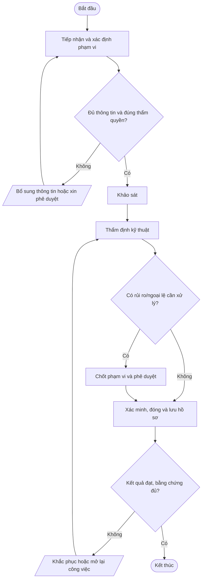
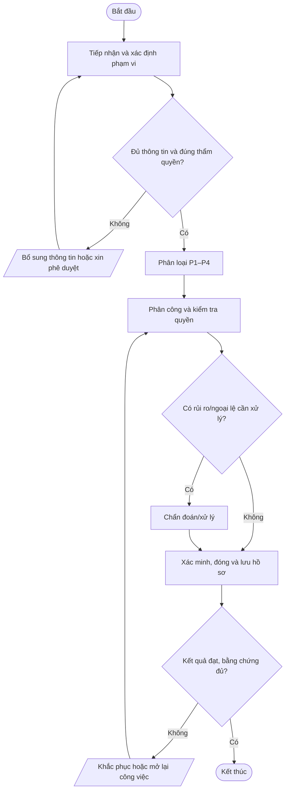
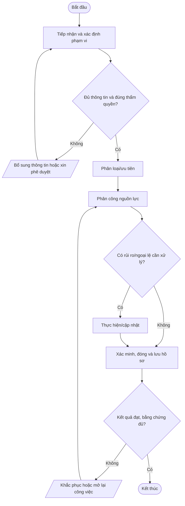
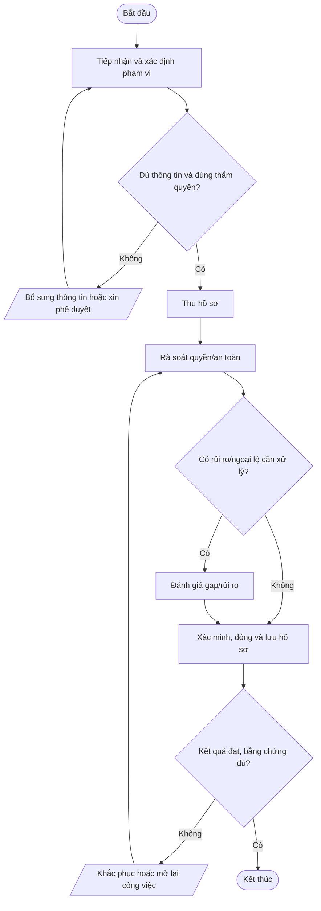
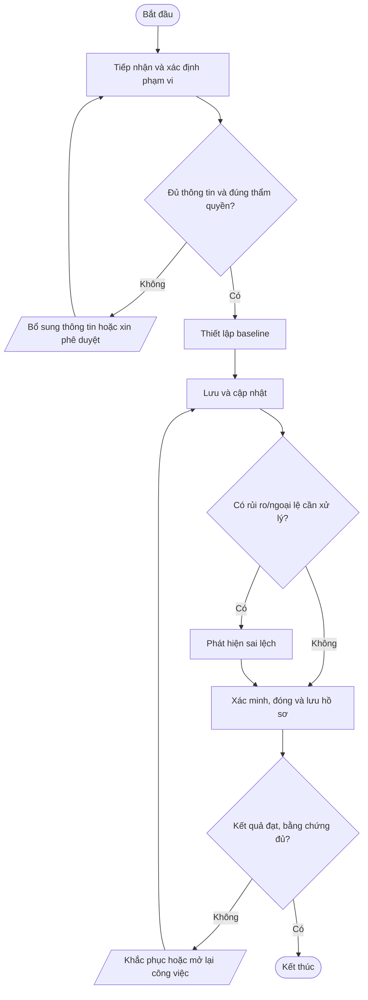
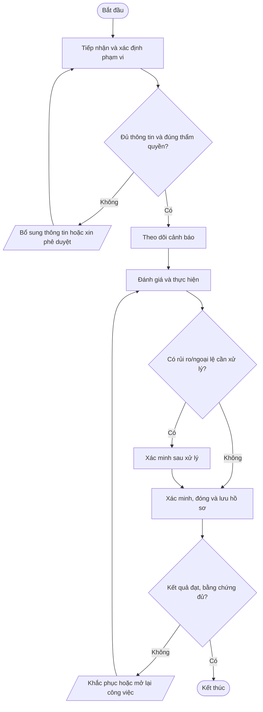

# Nhóm B — Vận hành dịch vụ IT Outsourcing

Bộ quy trình chuẩn Mstar — bản dự thảo ngày 2026-10-14. Tài liệu được thiết kế dùng chung cho dịch vụ IT Outsourcing; các yêu cầu cụ thể được cấu hình trong phụ lục khách hàng.

## Quy tắc áp dụng

- Quy trình lõi dùng chung; phụ lục khách hàng xác định phạm vi, SLA, đầu mối, quyền, retention, thông báo sự cố và yêu cầu phục hồi.
- Mọi thao tác trên hệ thống khách hàng phải được hợp đồng/ủy quyền cho phép.
- Bằng chứng phải có thể truy nguyên: ticket, phê duyệt, log, biên bản, kết quả kiểm tra.
- Không lưu mật khẩu, token, API key hoặc secret dạng rõ trong ticket/repository thông thường.
- Quy trình chỉ có hiệu lực sau khi được rà soát và phê duyệt; đây không phải tuyên bố Mstar đã được chứng nhận ISO.
- Tham chiếu: ISO/IEC 27001:2022 và ISO/IEC 27002:2022; mapping cuối cùng cần căn cứ risk assessment và SoA.

## Danh mục trong nhóm

| Mã | Quy trình | Mục đích |
|---|---|---|
| [QT-IT-07](#qt-it-07) | Phối hợp Sale và IT | Bảo đảm dịch vụ cam kết đúng năng lực kỹ thuật, nguồn lực, phạm vi, rủi ro, SLA và điều kiện bàn giao. |
| [QT-IT-08](#qt-it-08) | Hỗ trợ khách hàng | Tiếp nhận, phân loại, xử lý, cập nhật và đóng yêu cầu theo phạm vi hợp đồng, mức ưu tiên và SLA. |
| [QT-IT-09](#qt-it-09) | Quản lý công việc Phòng IT | Giao việc, ưu tiên, theo dõi tiến độ, bàn giao và báo cáo công việc ticket, định kỳ và ngoài ticket. |
| [QT-IT-10](#qt-it-10) | Quản lý tài sản CNTT | Quản lý vòng đời tài sản, phân biệt tài sản Mstar/khách hàng và bảo đảm giao nhận, kiểm kê, thu hồi, thanh lý an toàn. |
| [QT-IT-12](#qt-it-12) | Tiếp nhận và bàn giao dịch vụ khách hàng | Thu thập đầy đủ phạm vi, hồ sơ kỹ thuật, quyền hợp lệ, SLA, rủi ro và đầu mối trước khi vận hành. |
| [QT-IT-13](#qt-it-13) | Quản lý thay đổi hệ thống | Ngăn thay đổi trái phép hoặc không kiểm soát gây gián đoạn, mất dữ liệu hay suy giảm bảo mật. |
| [QT-IT-14](#qt-it-14) | Quản lý cấu hình hệ thống | Duy trì baseline, quan hệ thành phần và lịch sử cấu hình để vận hành an toàn, khôi phục và điều tra. |
| [QT-IT-15](#qt-it-15) | Giám sát và bảo trì hệ thống | Phát hiện sự cố, suy giảm hiệu năng, đầy dung lượng và hoạt động bất thường; bảo trì có kiểm soát. |
| [QT-IT-16](#qt-it-16) | Quản lý SLA và chất lượng dịch vụ | Đo SLA, backlog, ticket quá hạn, chất lượng và hành động cải tiến bằng dữ liệu kiểm chứng được. |

---
## QT-IT-07 — Phối hợp Sale và IT

**Mục đích:** Bảo đảm dịch vụ cam kết đúng năng lực kỹ thuật, nguồn lực, phạm vi, rủi ro, SLA và điều kiện bàn giao.

**Kích hoạt:** Khi có yêu cầu/sự kiện thuộc phạm vi, khi có thay đổi đáng kể hoặc theo chu kỳ được quy định.

**Phạm vi:** Mstar và hoạt động IT Outsourcing trong phạm vi hợp đồng/ủy quyền. Phụ lục từng khách hàng phải xác định hệ thống, SLA, đầu mối, quyền truy cập, retention, thông báo và yêu cầu phục hồi riêng.

**Vai trò:** Người yêu cầu/đầu mối khách hàng; người thực hiện; người kiểm tra/chủ sở hữu hệ thống; chủ sở hữu quy trình; IT Lead; người phê duyệt theo ma trận thẩm quyền. Người thực hiện không tự phê duyệt rủi ro trọng yếu do chính mình tạo ra.

**Đầu vào:** Yêu cầu/ticket; hợp đồng/phụ lục; danh mục hệ thống/tài sản; quyền được ủy quyền; quy trình liên quan; dữ liệu/bằng chứng hiện có.

**Đầu ra:** Hồ sơ xử lý; kết quả đã xác minh; phê duyệt; ticket/biên bản đóng; việc tồn có owner và hạn.

### Trình tự thực hiện

| Bước | Hoạt động | Vai trò chính | Hướng dẫn và kiểm soát | Bằng chứng cần lưu |
|---:|---|---|---|---|
| 1 | Tiếp nhận và xác định phạm vi | Người tiếp nhận | Ghi nhận yêu cầu/sự kiện, xác minh khách hàng/hệ thống liên quan, mục tiêu, phạm vi hợp đồng, đầu mối và thông tin tối thiểu. Nếu thiếu thông tin hoặc thẩm quyền thì chưa thực hiện bước rủi ro. | Ticket, log, phê duyệt hoặc biên bản tương ứng |
| 2 | Khảo sát | Người thực hiện và người kiểm tra | Sale và IT thu thập hiện trạng, phụ thuộc, tài sản, rủi ro, yêu cầu ATTT và dữ liệu còn thiếu. | Ticket, log, phê duyệt hoặc biên bản tương ứng |
| 3 | Thẩm định kỹ thuật | Người thực hiện và người kiểm tra | IT Lead đánh giá khả thi, nhân lực, bảo mật, SLA, phụ thuộc và phương án dự phòng. | Ticket, log, phê duyệt hoặc biên bản tương ứng |
| 4 | Chốt phạm vi và phê duyệt | Người thực hiện và người kiểm tra | IT Lead duyệt kỹ thuật; Ban Giám đốc/người được ủy quyền duyệt thương mại và điều khoản. | Ticket, log, phê duyệt hoặc biên bản tương ứng |
| 5 | Xác minh, đóng và lưu hồ sơ | Chủ sở hữu quy trình/IT Lead | Người kiểm tra xác nhận kết quả, quyền và phạm vi; ghi thời gian, bằng chứng, quyết định, thông báo và việc tồn. Chỉ đóng khi đủ hồ sơ hoặc có ngoại lệ được duyệt. | Ticket, log, phê duyệt hoặc biên bản tương ứng |

### Lưu đồ

### Biểu mẫu và hồ sơ

- FR-QTIT07-01: Phiếu yêu cầu/checklist khởi tạo.
- FR-QTIT07-02: Hồ sơ đánh giá, phê duyệt hoặc xác minh.
- FR-QTIT07-03: Nhật ký thực hiện/biên bản/báo cáo.
- FR-QTIT07-04: Xác nhận hoàn tất và theo dõi việc tồn.

*Mã biểu mẫu là mã đề xuất; khi ban hành cần đưa vào danh mục tài liệu, xác định chủ sở hữu, nơi lưu, quyền truy cập và thời hạn lưu giữ.*

### KPI và giám sát

- Tỷ lệ hồ sơ có đủ thông tin đầu vào và phê duyệt.
- Tỷ lệ bước/công việc hoàn thành đúng hạn theo quy trình hoặc hợp đồng.
- Số lỗi, ngoại lệ, sự cố hoặc hồ sơ phải làm lại.
- Tỷ lệ hành động khắc phục đóng đúng hạn.

Chủ sở hữu quy trình phải xác định nguồn dữ liệu, công thức, chu kỳ đo và ngưỡng cảnh báo trước khi áp dụng.

### Ngoại lệ và an toàn thông tin

IT Lead duyệt kỹ thuật; Ban Giám đốc/người được ủy quyền duyệt thương mại và điều khoản.

- Không thao tác ngoài phạm vi hợp đồng/ủy quyền; khi thiếu quyền hoặc phê duyệt phải tạm dừng bước có rủi ro.
- Không ghi mật khẩu, API key, token, khóa riêng hoặc mã khôi phục dạng rõ trong ticket, README, email thường hay tài liệu bàn giao.
- Thay đổi hệ thống phải theo QT-IT-13; nghi ngờ sự cố ATTT phải theo QT-ATTT-04; ngoại lệ phải theo QT-ISMS-04.
- Mọi ngoại lệ phải có lý do, đánh giá rủi ro, biện pháp bù trừ, người phê duyệt, owner và hạn hết hiệu lực.

### Phụ lục cần cấu hình theo khách hàng

| Trường | Nội dung xác nhận |
|---|---|
| Khách hàng/mã hợp đồng | Theo hợp đồng đang hiệu lực |
| Phạm vi hệ thống/dịch vụ | Hệ thống, tenant, site, tài sản và loại dịch vụ |
| SLA/lịch hỗ trợ | Theo hợp đồng/phụ lục, không dùng mặc định chung |
| Đầu mối yêu cầu/phê duyệt | Chức danh, kênh liên hệ và người thay thế |
| Quyền/kênh kỹ thuật | Phạm vi ủy quyền, MFA, VPN, thời hạn |
| Dữ liệu/lưu giữ | Phân loại, nơi lưu, thời hạn, trả/xóa |
| Thông báo sự cố | Kênh, người nhận và thời hạn |
| Ngoại lệ/rủi ro tồn dư | Mã hồ sơ, phê duyệt, bù trừ, ngày hết hạn |

**Trạng thái:** Dự thảo v0.1 — chờ rà soát, thử nghiệm và phê duyệt. Mapping ISO chỉ mang tính định hướng; cần xác nhận theo phạm vi ISMS, đánh giá rủi ro và SoA.

---

## QT-IT-08 — Hỗ trợ khách hàng

**Mục đích:** Tiếp nhận, phân loại, xử lý, cập nhật và đóng yêu cầu theo phạm vi hợp đồng, mức ưu tiên và SLA.

**Kích hoạt:** Khi có yêu cầu/sự kiện thuộc phạm vi, khi có thay đổi đáng kể hoặc theo chu kỳ được quy định.

**Phạm vi:** Mstar và hoạt động IT Outsourcing trong phạm vi hợp đồng/ủy quyền. Phụ lục từng khách hàng phải xác định hệ thống, SLA, đầu mối, quyền truy cập, retention, thông báo và yêu cầu phục hồi riêng.

**Vai trò:** Người yêu cầu/đầu mối khách hàng; người thực hiện; người kiểm tra/chủ sở hữu hệ thống; chủ sở hữu quy trình; IT Lead; người phê duyệt theo ma trận thẩm quyền. Người thực hiện không tự phê duyệt rủi ro trọng yếu do chính mình tạo ra.

**Đầu vào:** Yêu cầu/ticket; hợp đồng/phụ lục; danh mục hệ thống/tài sản; quyền được ủy quyền; quy trình liên quan; dữ liệu/bằng chứng hiện có.

**Đầu ra:** Hồ sơ xử lý; kết quả đã xác minh; phê duyệt; ticket/biên bản đóng; việc tồn có owner và hạn.

### Trình tự thực hiện

| Bước | Hoạt động | Vai trò chính | Hướng dẫn và kiểm soát | Bằng chứng cần lưu |
|---:|---|---|---|---|
| 1 | Tiếp nhận và xác định phạm vi | Người tiếp nhận | Ghi nhận yêu cầu/sự kiện, xác minh khách hàng/hệ thống liên quan, mục tiêu, phạm vi hợp đồng, đầu mối và thông tin tối thiểu. Nếu thiếu thông tin hoặc thẩm quyền thì chưa thực hiện bước rủi ro. | Ticket, log, phê duyệt hoặc biên bản tương ứng |
| 2 | Phân loại P1–P4 | Người thực hiện và người kiểm tra | Xác nhận phạm vi, tác động, khẩn cấp và SLA theo hợp đồng khách hàng. | Ticket, log, phê duyệt hoặc biên bản tương ứng |
| 3 | Phân công và kiểm tra quyền | Người thực hiện và người kiểm tra | Gán kỹ thuật viên đủ năng lực; xác minh quyền và phê duyệt cần thiết. | Ticket, log, phê duyệt hoặc biên bản tương ứng |
| 4 | Chẩn đoán/xử lý | Người thực hiện và người kiểm tra | Thu thập bằng chứng, thao tác được phép; change phải theo QT-IT-13; nghi ATTT chuyển QT-ATTT-04. | Ticket, log, phê duyệt hoặc biên bản tương ứng |
| 5 | Xác minh, đóng và lưu hồ sơ | Chủ sở hữu quy trình/IT Lead | Người kiểm tra xác nhận kết quả, quyền và phạm vi; ghi thời gian, bằng chứng, quyết định, thông báo và việc tồn. Chỉ đóng khi đủ hồ sơ hoặc có ngoại lệ được duyệt. | Ticket, log, phê duyệt hoặc biên bản tương ứng |

### Lưu đồ

### Biểu mẫu và hồ sơ

- FR-QTIT08-01: Phiếu yêu cầu/checklist khởi tạo.
- FR-QTIT08-02: Hồ sơ đánh giá, phê duyệt hoặc xác minh.
- FR-QTIT08-03: Nhật ký thực hiện/biên bản/báo cáo.
- FR-QTIT08-04: Xác nhận hoàn tất và theo dõi việc tồn.

*Mã biểu mẫu là mã đề xuất; khi ban hành cần đưa vào danh mục tài liệu, xác định chủ sở hữu, nơi lưu, quyền truy cập và thời hạn lưu giữ.*

### KPI và giám sát

- Tỷ lệ hồ sơ có đủ thông tin đầu vào và phê duyệt.
- Tỷ lệ bước/công việc hoàn thành đúng hạn theo quy trình hoặc hợp đồng.
- Số lỗi, ngoại lệ, sự cố hoặc hồ sơ phải làm lại.
- Tỷ lệ hành động khắc phục đóng đúng hạn.

Chủ sở hữu quy trình phải xác định nguồn dữ liệu, công thức, chu kỳ đo và ngưỡng cảnh báo trước khi áp dụng.

### Ngoại lệ và an toàn thông tin

Thu thập bằng chứng, thao tác được phép; change phải theo QT-IT-13; nghi ATTT chuyển QT-ATTT-04.

- Không thao tác ngoài phạm vi hợp đồng/ủy quyền; khi thiếu quyền hoặc phê duyệt phải tạm dừng bước có rủi ro.
- Không ghi mật khẩu, API key, token, khóa riêng hoặc mã khôi phục dạng rõ trong ticket, README, email thường hay tài liệu bàn giao.
- Thay đổi hệ thống phải theo QT-IT-13; nghi ngờ sự cố ATTT phải theo QT-ATTT-04; ngoại lệ phải theo QT-ISMS-04.
- Mọi ngoại lệ phải có lý do, đánh giá rủi ro, biện pháp bù trừ, người phê duyệt, owner và hạn hết hiệu lực.

### Phụ lục cần cấu hình theo khách hàng

| Trường | Nội dung xác nhận |
|---|---|
| Khách hàng/mã hợp đồng | Theo hợp đồng đang hiệu lực |
| Phạm vi hệ thống/dịch vụ | Hệ thống, tenant, site, tài sản và loại dịch vụ |
| SLA/lịch hỗ trợ | Theo hợp đồng/phụ lục, không dùng mặc định chung |
| Đầu mối yêu cầu/phê duyệt | Chức danh, kênh liên hệ và người thay thế |
| Quyền/kênh kỹ thuật | Phạm vi ủy quyền, MFA, VPN, thời hạn |
| Dữ liệu/lưu giữ | Phân loại, nơi lưu, thời hạn, trả/xóa |
| Thông báo sự cố | Kênh, người nhận và thời hạn |
| Ngoại lệ/rủi ro tồn dư | Mã hồ sơ, phê duyệt, bù trừ, ngày hết hạn |

**Trạng thái:** Dự thảo v0.1 — chờ rà soát, thử nghiệm và phê duyệt. Mapping ISO chỉ mang tính định hướng; cần xác nhận theo phạm vi ISMS, đánh giá rủi ro và SoA.

---

## QT-IT-09 — Quản lý công việc Phòng IT

**Mục đích:** Giao việc, ưu tiên, theo dõi tiến độ, bàn giao và báo cáo công việc ticket, định kỳ và ngoài ticket.

**Kích hoạt:** Khi có yêu cầu/sự kiện thuộc phạm vi, khi có thay đổi đáng kể hoặc theo chu kỳ được quy định.

**Phạm vi:** Mstar và hoạt động IT Outsourcing trong phạm vi hợp đồng/ủy quyền. Phụ lục từng khách hàng phải xác định hệ thống, SLA, đầu mối, quyền truy cập, retention, thông báo và yêu cầu phục hồi riêng.

**Vai trò:** Người yêu cầu/đầu mối khách hàng; người thực hiện; người kiểm tra/chủ sở hữu hệ thống; chủ sở hữu quy trình; IT Lead; người phê duyệt theo ma trận thẩm quyền. Người thực hiện không tự phê duyệt rủi ro trọng yếu do chính mình tạo ra.

**Đầu vào:** Yêu cầu/ticket; hợp đồng/phụ lục; danh mục hệ thống/tài sản; quyền được ủy quyền; quy trình liên quan; dữ liệu/bằng chứng hiện có.

**Đầu ra:** Hồ sơ xử lý; kết quả đã xác minh; phê duyệt; ticket/biên bản đóng; việc tồn có owner và hạn.

### Trình tự thực hiện

| Bước | Hoạt động | Vai trò chính | Hướng dẫn và kiểm soát | Bằng chứng cần lưu |
|---:|---|---|---|---|
| 1 | Tiếp nhận và xác định phạm vi | Người tiếp nhận | Ghi nhận yêu cầu/sự kiện, xác minh khách hàng/hệ thống liên quan, mục tiêu, phạm vi hợp đồng, đầu mối và thông tin tối thiểu. Nếu thiếu thông tin hoặc thẩm quyền thì chưa thực hiện bước rủi ro. | Ticket, log, phê duyệt hoặc biên bản tương ứng |
| 2 | Phân loại/ưu tiên | Người thực hiện và người kiểm tra | Xác định loại, tác động, SLA, độ khẩn cấp, phụ thuộc và catalog KPI nếu có. | Ticket, log, phê duyệt hoặc biên bản tương ứng |
| 3 | Phân công nguồn lực | Người thực hiện và người kiểm tra | IT Lead chọn người có kỹ năng/quyền, kiểm tra tải và nhu cầu phê duyệt. | Ticket, log, phê duyệt hoặc biên bản tương ứng |
| 4 | Thực hiện/cập nhật | Người thực hiện và người kiểm tra | Cập nhật trạng thái, thời gian, kết quả, blocker; thay đổi phạm vi phải xin duyệt. | Ticket, log, phê duyệt hoặc biên bản tương ứng |
| 5 | Xác minh, đóng và lưu hồ sơ | Chủ sở hữu quy trình/IT Lead | Người kiểm tra xác nhận kết quả, quyền và phạm vi; ghi thời gian, bằng chứng, quyết định, thông báo và việc tồn. Chỉ đóng khi đủ hồ sơ hoặc có ngoại lệ được duyệt. | Ticket, log, phê duyệt hoặc biên bản tương ứng |

### Lưu đồ

### Biểu mẫu và hồ sơ

- FR-QTIT09-01: Phiếu yêu cầu/checklist khởi tạo.
- FR-QTIT09-02: Hồ sơ đánh giá, phê duyệt hoặc xác minh.
- FR-QTIT09-03: Nhật ký thực hiện/biên bản/báo cáo.
- FR-QTIT09-04: Xác nhận hoàn tất và theo dõi việc tồn.

*Mã biểu mẫu là mã đề xuất; khi ban hành cần đưa vào danh mục tài liệu, xác định chủ sở hữu, nơi lưu, quyền truy cập và thời hạn lưu giữ.*

### KPI và giám sát

- Tỷ lệ hồ sơ có đủ thông tin đầu vào và phê duyệt.
- Tỷ lệ bước/công việc hoàn thành đúng hạn theo quy trình hoặc hợp đồng.
- Số lỗi, ngoại lệ, sự cố hoặc hồ sơ phải làm lại.
- Tỷ lệ hành động khắc phục đóng đúng hạn.

Chủ sở hữu quy trình phải xác định nguồn dữ liệu, công thức, chu kỳ đo và ngưỡng cảnh báo trước khi áp dụng.

### Ngoại lệ và an toàn thông tin

Cập nhật trạng thái, thời gian, kết quả, blocker; thay đổi phạm vi phải xin duyệt.

- Không thao tác ngoài phạm vi hợp đồng/ủy quyền; khi thiếu quyền hoặc phê duyệt phải tạm dừng bước có rủi ro.
- Không ghi mật khẩu, API key, token, khóa riêng hoặc mã khôi phục dạng rõ trong ticket, README, email thường hay tài liệu bàn giao.
- Thay đổi hệ thống phải theo QT-IT-13; nghi ngờ sự cố ATTT phải theo QT-ATTT-04; ngoại lệ phải theo QT-ISMS-04.
- Mọi ngoại lệ phải có lý do, đánh giá rủi ro, biện pháp bù trừ, người phê duyệt, owner và hạn hết hiệu lực.

### Phụ lục cần cấu hình theo khách hàng

| Trường | Nội dung xác nhận |
|---|---|
| Khách hàng/mã hợp đồng | Theo hợp đồng đang hiệu lực |
| Phạm vi hệ thống/dịch vụ | Hệ thống, tenant, site, tài sản và loại dịch vụ |
| SLA/lịch hỗ trợ | Theo hợp đồng/phụ lục, không dùng mặc định chung |
| Đầu mối yêu cầu/phê duyệt | Chức danh, kênh liên hệ và người thay thế |
| Quyền/kênh kỹ thuật | Phạm vi ủy quyền, MFA, VPN, thời hạn |
| Dữ liệu/lưu giữ | Phân loại, nơi lưu, thời hạn, trả/xóa |
| Thông báo sự cố | Kênh, người nhận và thời hạn |
| Ngoại lệ/rủi ro tồn dư | Mã hồ sơ, phê duyệt, bù trừ, ngày hết hạn |

**Trạng thái:** Dự thảo v0.1 — chờ rà soát, thử nghiệm và phê duyệt. Mapping ISO chỉ mang tính định hướng; cần xác nhận theo phạm vi ISMS, đánh giá rủi ro và SoA.

---

## QT-IT-10 — Quản lý tài sản CNTT

**Mục đích:** Quản lý vòng đời tài sản, phân biệt tài sản Mstar/khách hàng và bảo đảm giao nhận, kiểm kê, thu hồi, thanh lý an toàn.

**Kích hoạt:** Khi có yêu cầu/sự kiện thuộc phạm vi, khi có thay đổi đáng kể hoặc theo chu kỳ được quy định.

**Phạm vi:** Mstar và hoạt động IT Outsourcing trong phạm vi hợp đồng/ủy quyền. Phụ lục từng khách hàng phải xác định hệ thống, SLA, đầu mối, quyền truy cập, retention, thông báo và yêu cầu phục hồi riêng.

**Vai trò:** Người yêu cầu/đầu mối khách hàng; người thực hiện; người kiểm tra/chủ sở hữu hệ thống; chủ sở hữu quy trình; IT Lead; người phê duyệt theo ma trận thẩm quyền. Người thực hiện không tự phê duyệt rủi ro trọng yếu do chính mình tạo ra.

**Đầu vào:** Yêu cầu/ticket; hợp đồng/phụ lục; danh mục hệ thống/tài sản; quyền được ủy quyền; quy trình liên quan; dữ liệu/bằng chứng hiện có.

**Đầu ra:** Hồ sơ xử lý; kết quả đã xác minh; phê duyệt; ticket/biên bản đóng; việc tồn có owner và hạn.

### Trình tự thực hiện

| Bước | Hoạt động | Vai trò chính | Hướng dẫn và kiểm soát | Bằng chứng cần lưu |
|---:|---|---|---|---|
| 1 | Tiếp nhận và xác định phạm vi | Người tiếp nhận | Ghi nhận yêu cầu/sự kiện, xác minh khách hàng/hệ thống liên quan, mục tiêu, phạm vi hợp đồng, đầu mối và thông tin tối thiểu. Nếu thiếu thông tin hoặc thẩm quyền thì chưa thực hiện bước rủi ro. | Ticket, log, phê duyệt hoặc biên bản tương ứng |
| 2 | Đăng ký/phân loại | Người thực hiện và người kiểm tra | Gán mã, owner, người giữ, vị trí, mức quan trọng và chủ thể sở hữu. | Ticket, log, phê duyệt hoặc biên bản tương ứng |
| 3 | Cấp phát/theo dõi | Người thực hiện và người kiểm tra | Bàn giao có xác nhận; cập nhật điều chuyển, sửa chữa, cấu hình, license và trạng thái. | Ticket, log, phê duyệt hoặc biên bản tương ứng |
| 4 | Kiểm kê | Người thực hiện và người kiểm tra | Đối chiếu thực tế với sổ; điều tra chênh lệch, thất lạc, license và tài sản vô chủ. | Ticket, log, phê duyệt hoặc biên bản tương ứng |
| 5 | Xác minh, đóng và lưu hồ sơ | Chủ sở hữu quy trình/IT Lead | Người kiểm tra xác nhận kết quả, quyền và phạm vi; ghi thời gian, bằng chứng, quyết định, thông báo và việc tồn. Chỉ đóng khi đủ hồ sơ hoặc có ngoại lệ được duyệt. | Ticket, log, phê duyệt hoặc biên bản tương ứng |

### Lưu đồ

### Biểu mẫu và hồ sơ

- FR-QTIT10-01: Phiếu yêu cầu/checklist khởi tạo.
- FR-QTIT10-02: Hồ sơ đánh giá, phê duyệt hoặc xác minh.
- FR-QTIT10-03: Nhật ký thực hiện/biên bản/báo cáo.
- FR-QTIT10-04: Xác nhận hoàn tất và theo dõi việc tồn.

*Mã biểu mẫu là mã đề xuất; khi ban hành cần đưa vào danh mục tài liệu, xác định chủ sở hữu, nơi lưu, quyền truy cập và thời hạn lưu giữ.*

### KPI và giám sát

- Tỷ lệ hồ sơ có đủ thông tin đầu vào và phê duyệt.
- Tỷ lệ bước/công việc hoàn thành đúng hạn theo quy trình hoặc hợp đồng.
- Số lỗi, ngoại lệ, sự cố hoặc hồ sơ phải làm lại.
- Tỷ lệ hành động khắc phục đóng đúng hạn.

Chủ sở hữu quy trình phải xác định nguồn dữ liệu, công thức, chu kỳ đo và ngưỡng cảnh báo trước khi áp dụng.

### Ngoại lệ và an toàn thông tin

Đối chiếu thực tế với sổ; điều tra chênh lệch, thất lạc, license và tài sản vô chủ.

- Không thao tác ngoài phạm vi hợp đồng/ủy quyền; khi thiếu quyền hoặc phê duyệt phải tạm dừng bước có rủi ro.
- Không ghi mật khẩu, API key, token, khóa riêng hoặc mã khôi phục dạng rõ trong ticket, README, email thường hay tài liệu bàn giao.
- Thay đổi hệ thống phải theo QT-IT-13; nghi ngờ sự cố ATTT phải theo QT-ATTT-04; ngoại lệ phải theo QT-ISMS-04.
- Mọi ngoại lệ phải có lý do, đánh giá rủi ro, biện pháp bù trừ, người phê duyệt, owner và hạn hết hiệu lực.

### Phụ lục cần cấu hình theo khách hàng

| Trường | Nội dung xác nhận |
|---|---|
| Khách hàng/mã hợp đồng | Theo hợp đồng đang hiệu lực |
| Phạm vi hệ thống/dịch vụ | Hệ thống, tenant, site, tài sản và loại dịch vụ |
| SLA/lịch hỗ trợ | Theo hợp đồng/phụ lục, không dùng mặc định chung |
| Đầu mối yêu cầu/phê duyệt | Chức danh, kênh liên hệ và người thay thế |
| Quyền/kênh kỹ thuật | Phạm vi ủy quyền, MFA, VPN, thời hạn |
| Dữ liệu/lưu giữ | Phân loại, nơi lưu, thời hạn, trả/xóa |
| Thông báo sự cố | Kênh, người nhận và thời hạn |
| Ngoại lệ/rủi ro tồn dư | Mã hồ sơ, phê duyệt, bù trừ, ngày hết hạn |

**Trạng thái:** Dự thảo v0.1 — chờ rà soát, thử nghiệm và phê duyệt. Mapping ISO chỉ mang tính định hướng; cần xác nhận theo phạm vi ISMS, đánh giá rủi ro và SoA.

---

## QT-IT-12 — Tiếp nhận và bàn giao dịch vụ khách hàng

**Mục đích:** Thu thập đầy đủ phạm vi, hồ sơ kỹ thuật, quyền hợp lệ, SLA, rủi ro và đầu mối trước khi vận hành.

**Kích hoạt:** Khi có yêu cầu/sự kiện thuộc phạm vi, khi có thay đổi đáng kể hoặc theo chu kỳ được quy định.

**Phạm vi:** Mstar và hoạt động IT Outsourcing trong phạm vi hợp đồng/ủy quyền. Phụ lục từng khách hàng phải xác định hệ thống, SLA, đầu mối, quyền truy cập, retention, thông báo và yêu cầu phục hồi riêng.

**Vai trò:** Người yêu cầu/đầu mối khách hàng; người thực hiện; người kiểm tra/chủ sở hữu hệ thống; chủ sở hữu quy trình; IT Lead; người phê duyệt theo ma trận thẩm quyền. Người thực hiện không tự phê duyệt rủi ro trọng yếu do chính mình tạo ra.

**Đầu vào:** Yêu cầu/ticket; hợp đồng/phụ lục; danh mục hệ thống/tài sản; quyền được ủy quyền; quy trình liên quan; dữ liệu/bằng chứng hiện có.

**Đầu ra:** Hồ sơ xử lý; kết quả đã xác minh; phê duyệt; ticket/biên bản đóng; việc tồn có owner và hạn.

### Trình tự thực hiện

| Bước | Hoạt động | Vai trò chính | Hướng dẫn và kiểm soát | Bằng chứng cần lưu |
|---:|---|---|---|---|
| 1 | Tiếp nhận và xác định phạm vi | Người tiếp nhận | Ghi nhận yêu cầu/sự kiện, xác minh khách hàng/hệ thống liên quan, mục tiêu, phạm vi hợp đồng, đầu mối và thông tin tối thiểu. Nếu thiếu thông tin hoặc thẩm quyền thì chưa thực hiện bước rủi ro. | Ticket, log, phê duyệt hoặc biên bản tương ứng |
| 2 | Thu hồ sơ | Người thực hiện và người kiểm tra | Thu sơ đồ, inventory, cấu hình, nhà cung cấp, backup, log, lịch bảo trì và sự cố tồn. | Ticket, log, phê duyệt hoặc biên bản tương ứng |
| 3 | Rà soát quyền/an toàn | Người thực hiện và người kiểm tra | Xác minh ủy quyền, MFA, tài khoản đặc quyền, vault và phân tách dữ liệu. | Ticket, log, phê duyệt hoặc biên bản tương ứng |
| 4 | Đánh giá gap/rủi ro | Người thực hiện và người kiểm tra | Ghi tài liệu thiếu, lỗ hổng, backup chưa kiểm chứng và cam kết chưa rõ; gán owner/hạn. | Ticket, log, phê duyệt hoặc biên bản tương ứng |
| 5 | Xác minh, đóng và lưu hồ sơ | Chủ sở hữu quy trình/IT Lead | Người kiểm tra xác nhận kết quả, quyền và phạm vi; ghi thời gian, bằng chứng, quyết định, thông báo và việc tồn. Chỉ đóng khi đủ hồ sơ hoặc có ngoại lệ được duyệt. | Ticket, log, phê duyệt hoặc biên bản tương ứng |

### Lưu đồ

### Biểu mẫu và hồ sơ

- FR-QTIT12-01: Phiếu yêu cầu/checklist khởi tạo.
- FR-QTIT12-02: Hồ sơ đánh giá, phê duyệt hoặc xác minh.
- FR-QTIT12-03: Nhật ký thực hiện/biên bản/báo cáo.
- FR-QTIT12-04: Xác nhận hoàn tất và theo dõi việc tồn.

*Mã biểu mẫu là mã đề xuất; khi ban hành cần đưa vào danh mục tài liệu, xác định chủ sở hữu, nơi lưu, quyền truy cập và thời hạn lưu giữ.*

### KPI và giám sát

- Tỷ lệ hồ sơ có đủ thông tin đầu vào và phê duyệt.
- Tỷ lệ bước/công việc hoàn thành đúng hạn theo quy trình hoặc hợp đồng.
- Số lỗi, ngoại lệ, sự cố hoặc hồ sơ phải làm lại.
- Tỷ lệ hành động khắc phục đóng đúng hạn.

Chủ sở hữu quy trình phải xác định nguồn dữ liệu, công thức, chu kỳ đo và ngưỡng cảnh báo trước khi áp dụng.

### Ngoại lệ và an toàn thông tin

Ghi tài liệu thiếu, lỗ hổng, backup chưa kiểm chứng và cam kết chưa rõ; gán owner/hạn.

- Không thao tác ngoài phạm vi hợp đồng/ủy quyền; khi thiếu quyền hoặc phê duyệt phải tạm dừng bước có rủi ro.
- Không ghi mật khẩu, API key, token, khóa riêng hoặc mã khôi phục dạng rõ trong ticket, README, email thường hay tài liệu bàn giao.
- Thay đổi hệ thống phải theo QT-IT-13; nghi ngờ sự cố ATTT phải theo QT-ATTT-04; ngoại lệ phải theo QT-ISMS-04.
- Mọi ngoại lệ phải có lý do, đánh giá rủi ro, biện pháp bù trừ, người phê duyệt, owner và hạn hết hiệu lực.

### Phụ lục cần cấu hình theo khách hàng

| Trường | Nội dung xác nhận |
|---|---|
| Khách hàng/mã hợp đồng | Theo hợp đồng đang hiệu lực |
| Phạm vi hệ thống/dịch vụ | Hệ thống, tenant, site, tài sản và loại dịch vụ |
| SLA/lịch hỗ trợ | Theo hợp đồng/phụ lục, không dùng mặc định chung |
| Đầu mối yêu cầu/phê duyệt | Chức danh, kênh liên hệ và người thay thế |
| Quyền/kênh kỹ thuật | Phạm vi ủy quyền, MFA, VPN, thời hạn |
| Dữ liệu/lưu giữ | Phân loại, nơi lưu, thời hạn, trả/xóa |
| Thông báo sự cố | Kênh, người nhận và thời hạn |
| Ngoại lệ/rủi ro tồn dư | Mã hồ sơ, phê duyệt, bù trừ, ngày hết hạn |

**Trạng thái:** Dự thảo v0.1 — chờ rà soát, thử nghiệm và phê duyệt. Mapping ISO chỉ mang tính định hướng; cần xác nhận theo phạm vi ISMS, đánh giá rủi ro và SoA.

---

## QT-IT-13 — Quản lý thay đổi hệ thống

**Mục đích:** Ngăn thay đổi trái phép hoặc không kiểm soát gây gián đoạn, mất dữ liệu hay suy giảm bảo mật.

**Kích hoạt:** Khi có yêu cầu/sự kiện thuộc phạm vi, khi có thay đổi đáng kể hoặc theo chu kỳ được quy định.

**Phạm vi:** Mstar và hoạt động IT Outsourcing trong phạm vi hợp đồng/ủy quyền. Phụ lục từng khách hàng phải xác định hệ thống, SLA, đầu mối, quyền truy cập, retention, thông báo và yêu cầu phục hồi riêng.

**Vai trò:** Người yêu cầu/đầu mối khách hàng; người thực hiện; người kiểm tra/chủ sở hữu hệ thống; chủ sở hữu quy trình; IT Lead; người phê duyệt theo ma trận thẩm quyền. Người thực hiện không tự phê duyệt rủi ro trọng yếu do chính mình tạo ra.

**Đầu vào:** Yêu cầu/ticket; hợp đồng/phụ lục; danh mục hệ thống/tài sản; quyền được ủy quyền; quy trình liên quan; dữ liệu/bằng chứng hiện có.

**Đầu ra:** Hồ sơ xử lý; kết quả đã xác minh; phê duyệt; ticket/biên bản đóng; việc tồn có owner và hạn.

### Trình tự thực hiện

| Bước | Hoạt động | Vai trò chính | Hướng dẫn và kiểm soát | Bằng chứng cần lưu |
|---:|---|---|---|---|
| 1 | Tiếp nhận và xác định phạm vi | Người tiếp nhận | Ghi nhận yêu cầu/sự kiện, xác minh khách hàng/hệ thống liên quan, mục tiêu, phạm vi hợp đồng, đầu mối và thông tin tối thiểu. Nếu thiếu thông tin hoặc thẩm quyền thì chưa thực hiện bước rủi ro. | Ticket, log, phê duyệt hoặc biên bản tương ứng |
| 2 | Đánh giá tác động | Người thực hiện và người kiểm tra | Đánh giá rủi ro, downtime, dữ liệu, phụ thuộc, backup, rollback, SLA và thông báo. | Ticket, log, phê duyệt hoặc biên bản tương ứng |
| 3 | Phê duyệt/lập kế hoạch | Người thực hiện và người kiểm tra | Chọn cửa sổ triển khai, kiểm thử, tiêu chí thành công, điểm dừng và người duyệt. | Ticket, log, phê duyệt hoặc biên bản tương ứng |
| 4 | Triển khai/kiểm thử | Người thực hiện và người kiểm tra | Backup cấu hình, ghi trước/sau, thực hiện đúng phạm vi, test dịch vụ/bảo mật và rollback nếu cần. | Ticket, log, phê duyệt hoặc biên bản tương ứng |
| 5 | Xác minh, đóng và lưu hồ sơ | Chủ sở hữu quy trình/IT Lead | Người kiểm tra xác nhận kết quả, quyền và phạm vi; ghi thời gian, bằng chứng, quyết định, thông báo và việc tồn. Chỉ đóng khi đủ hồ sơ hoặc có ngoại lệ được duyệt. | Ticket, log, phê duyệt hoặc biên bản tương ứng |

### Lưu đồ

### Biểu mẫu và hồ sơ

- FR-QTIT13-01: Phiếu yêu cầu/checklist khởi tạo.
- FR-QTIT13-02: Hồ sơ đánh giá, phê duyệt hoặc xác minh.
- FR-QTIT13-03: Nhật ký thực hiện/biên bản/báo cáo.
- FR-QTIT13-04: Xác nhận hoàn tất và theo dõi việc tồn.

*Mã biểu mẫu là mã đề xuất; khi ban hành cần đưa vào danh mục tài liệu, xác định chủ sở hữu, nơi lưu, quyền truy cập và thời hạn lưu giữ.*

### KPI và giám sát

- Tỷ lệ hồ sơ có đủ thông tin đầu vào và phê duyệt.
- Tỷ lệ bước/công việc hoàn thành đúng hạn theo quy trình hoặc hợp đồng.
- Số lỗi, ngoại lệ, sự cố hoặc hồ sơ phải làm lại.
- Tỷ lệ hành động khắc phục đóng đúng hạn.

Chủ sở hữu quy trình phải xác định nguồn dữ liệu, công thức, chu kỳ đo và ngưỡng cảnh báo trước khi áp dụng.

### Ngoại lệ và an toàn thông tin

Backup cấu hình, ghi trước/sau, thực hiện đúng phạm vi, test dịch vụ/bảo mật và rollback nếu cần.

- Không thao tác ngoài phạm vi hợp đồng/ủy quyền; khi thiếu quyền hoặc phê duyệt phải tạm dừng bước có rủi ro.
- Không ghi mật khẩu, API key, token, khóa riêng hoặc mã khôi phục dạng rõ trong ticket, README, email thường hay tài liệu bàn giao.
- Thay đổi hệ thống phải theo QT-IT-13; nghi ngờ sự cố ATTT phải theo QT-ATTT-04; ngoại lệ phải theo QT-ISMS-04.
- Mọi ngoại lệ phải có lý do, đánh giá rủi ro, biện pháp bù trừ, người phê duyệt, owner và hạn hết hiệu lực.

### Phụ lục cần cấu hình theo khách hàng

| Trường | Nội dung xác nhận |
|---|---|
| Khách hàng/mã hợp đồng | Theo hợp đồng đang hiệu lực |
| Phạm vi hệ thống/dịch vụ | Hệ thống, tenant, site, tài sản và loại dịch vụ |
| SLA/lịch hỗ trợ | Theo hợp đồng/phụ lục, không dùng mặc định chung |
| Đầu mối yêu cầu/phê duyệt | Chức danh, kênh liên hệ và người thay thế |
| Quyền/kênh kỹ thuật | Phạm vi ủy quyền, MFA, VPN, thời hạn |
| Dữ liệu/lưu giữ | Phân loại, nơi lưu, thời hạn, trả/xóa |
| Thông báo sự cố | Kênh, người nhận và thời hạn |
| Ngoại lệ/rủi ro tồn dư | Mã hồ sơ, phê duyệt, bù trừ, ngày hết hạn |

**Trạng thái:** Dự thảo v0.1 — chờ rà soát, thử nghiệm và phê duyệt. Mapping ISO chỉ mang tính định hướng; cần xác nhận theo phạm vi ISMS, đánh giá rủi ro và SoA.

---

## QT-IT-14 — Quản lý cấu hình hệ thống

**Mục đích:** Duy trì baseline, quan hệ thành phần và lịch sử cấu hình để vận hành an toàn, khôi phục và điều tra.

**Kích hoạt:** Khi có yêu cầu/sự kiện thuộc phạm vi, khi có thay đổi đáng kể hoặc theo chu kỳ được quy định.

**Phạm vi:** Mstar và hoạt động IT Outsourcing trong phạm vi hợp đồng/ủy quyền. Phụ lục từng khách hàng phải xác định hệ thống, SLA, đầu mối, quyền truy cập, retention, thông báo và yêu cầu phục hồi riêng.

**Vai trò:** Người yêu cầu/đầu mối khách hàng; người thực hiện; người kiểm tra/chủ sở hữu hệ thống; chủ sở hữu quy trình; IT Lead; người phê duyệt theo ma trận thẩm quyền. Người thực hiện không tự phê duyệt rủi ro trọng yếu do chính mình tạo ra.

**Đầu vào:** Yêu cầu/ticket; hợp đồng/phụ lục; danh mục hệ thống/tài sản; quyền được ủy quyền; quy trình liên quan; dữ liệu/bằng chứng hiện có.

**Đầu ra:** Hồ sơ xử lý; kết quả đã xác minh; phê duyệt; ticket/biên bản đóng; việc tồn có owner và hạn.

### Trình tự thực hiện

| Bước | Hoạt động | Vai trò chính | Hướng dẫn và kiểm soát | Bằng chứng cần lưu |
|---:|---|---|---|---|
| 1 | Tiếp nhận và xác định phạm vi | Người tiếp nhận | Ghi nhận yêu cầu/sự kiện, xác minh khách hàng/hệ thống liên quan, mục tiêu, phạm vi hợp đồng, đầu mối và thông tin tối thiểu. Nếu thiếu thông tin hoặc thẩm quyền thì chưa thực hiện bước rủi ro. | Ticket, log, phê duyệt hoặc biên bản tương ứng |
| 2 | Thiết lập baseline | Người thực hiện và người kiểm tra | Ghi phiên bản, thông số bảo mật, owner, nguồn chuẩn và cách khôi phục. | Ticket, log, phê duyệt hoặc biên bản tương ứng |
| 3 | Lưu và cập nhật | Người thực hiện và người kiểm tra | Lưu kho có phân quyền; cập nhật baseline sau change được duyệt; giữ lịch sử trước/sau. | Ticket, log, phê duyệt hoặc biên bản tương ứng |
| 4 | Phát hiện sai lệch | Người thực hiện và người kiểm tra | So sánh thực tế với baseline; phân loại rủi ro và tạo ticket/change. | Ticket, log, phê duyệt hoặc biên bản tương ứng |
| 5 | Xác minh, đóng và lưu hồ sơ | Chủ sở hữu quy trình/IT Lead | Người kiểm tra xác nhận kết quả, quyền và phạm vi; ghi thời gian, bằng chứng, quyết định, thông báo và việc tồn. Chỉ đóng khi đủ hồ sơ hoặc có ngoại lệ được duyệt. | Ticket, log, phê duyệt hoặc biên bản tương ứng |

### Lưu đồ

### Biểu mẫu và hồ sơ

- FR-QTIT14-01: Phiếu yêu cầu/checklist khởi tạo.
- FR-QTIT14-02: Hồ sơ đánh giá, phê duyệt hoặc xác minh.
- FR-QTIT14-03: Nhật ký thực hiện/biên bản/báo cáo.
- FR-QTIT14-04: Xác nhận hoàn tất và theo dõi việc tồn.

*Mã biểu mẫu là mã đề xuất; khi ban hành cần đưa vào danh mục tài liệu, xác định chủ sở hữu, nơi lưu, quyền truy cập và thời hạn lưu giữ.*

### KPI và giám sát

- Tỷ lệ hồ sơ có đủ thông tin đầu vào và phê duyệt.
- Tỷ lệ bước/công việc hoàn thành đúng hạn theo quy trình hoặc hợp đồng.
- Số lỗi, ngoại lệ, sự cố hoặc hồ sơ phải làm lại.
- Tỷ lệ hành động khắc phục đóng đúng hạn.

Chủ sở hữu quy trình phải xác định nguồn dữ liệu, công thức, chu kỳ đo và ngưỡng cảnh báo trước khi áp dụng.

### Ngoại lệ và an toàn thông tin

So sánh thực tế với baseline; phân loại rủi ro và tạo ticket/change.

- Không thao tác ngoài phạm vi hợp đồng/ủy quyền; khi thiếu quyền hoặc phê duyệt phải tạm dừng bước có rủi ro.
- Không ghi mật khẩu, API key, token, khóa riêng hoặc mã khôi phục dạng rõ trong ticket, README, email thường hay tài liệu bàn giao.
- Thay đổi hệ thống phải theo QT-IT-13; nghi ngờ sự cố ATTT phải theo QT-ATTT-04; ngoại lệ phải theo QT-ISMS-04.
- Mọi ngoại lệ phải có lý do, đánh giá rủi ro, biện pháp bù trừ, người phê duyệt, owner và hạn hết hiệu lực.

### Phụ lục cần cấu hình theo khách hàng

| Trường | Nội dung xác nhận |
|---|---|
| Khách hàng/mã hợp đồng | Theo hợp đồng đang hiệu lực |
| Phạm vi hệ thống/dịch vụ | Hệ thống, tenant, site, tài sản và loại dịch vụ |
| SLA/lịch hỗ trợ | Theo hợp đồng/phụ lục, không dùng mặc định chung |
| Đầu mối yêu cầu/phê duyệt | Chức danh, kênh liên hệ và người thay thế |
| Quyền/kênh kỹ thuật | Phạm vi ủy quyền, MFA, VPN, thời hạn |
| Dữ liệu/lưu giữ | Phân loại, nơi lưu, thời hạn, trả/xóa |
| Thông báo sự cố | Kênh, người nhận và thời hạn |
| Ngoại lệ/rủi ro tồn dư | Mã hồ sơ, phê duyệt, bù trừ, ngày hết hạn |

**Trạng thái:** Dự thảo v0.1 — chờ rà soát, thử nghiệm và phê duyệt. Mapping ISO chỉ mang tính định hướng; cần xác nhận theo phạm vi ISMS, đánh giá rủi ro và SoA.

---

## QT-IT-15 — Giám sát và bảo trì hệ thống

**Mục đích:** Phát hiện sự cố, suy giảm hiệu năng, đầy dung lượng và hoạt động bất thường; bảo trì có kiểm soát.

**Kích hoạt:** Khi có yêu cầu/sự kiện thuộc phạm vi, khi có thay đổi đáng kể hoặc theo chu kỳ được quy định.

**Phạm vi:** Mstar và hoạt động IT Outsourcing trong phạm vi hợp đồng/ủy quyền. Phụ lục từng khách hàng phải xác định hệ thống, SLA, đầu mối, quyền truy cập, retention, thông báo và yêu cầu phục hồi riêng.

**Vai trò:** Người yêu cầu/đầu mối khách hàng; người thực hiện; người kiểm tra/chủ sở hữu hệ thống; chủ sở hữu quy trình; IT Lead; người phê duyệt theo ma trận thẩm quyền. Người thực hiện không tự phê duyệt rủi ro trọng yếu do chính mình tạo ra.

**Đầu vào:** Yêu cầu/ticket; hợp đồng/phụ lục; danh mục hệ thống/tài sản; quyền được ủy quyền; quy trình liên quan; dữ liệu/bằng chứng hiện có.

**Đầu ra:** Hồ sơ xử lý; kết quả đã xác minh; phê duyệt; ticket/biên bản đóng; việc tồn có owner và hạn.

### Trình tự thực hiện

| Bước | Hoạt động | Vai trò chính | Hướng dẫn và kiểm soát | Bằng chứng cần lưu |
|---:|---|---|---|---|
| 1 | Tiếp nhận và xác định phạm vi | Người tiếp nhận | Ghi nhận yêu cầu/sự kiện, xác minh khách hàng/hệ thống liên quan, mục tiêu, phạm vi hợp đồng, đầu mối và thông tin tối thiểu. Nếu thiếu thông tin hoặc thẩm quyền thì chưa thực hiện bước rủi ro. | Ticket, log, phê duyệt hoặc biên bản tương ứng |
| 2 | Theo dõi cảnh báo | Người thực hiện và người kiểm tra | Kiểm tra alert, xác minh, tạo ticket và phân loại ảnh hưởng. | Ticket, log, phê duyệt hoặc biên bản tương ứng |
| 3 | Đánh giá và thực hiện | Người thực hiện và người kiểm tra | Xác định mức độ, thông báo theo SLA; change cần thiết theo QT-IT-13; thao tác theo runbook. | Ticket, log, phê duyệt hoặc biên bản tương ứng |
| 4 | Xác minh sau xử lý | Người thực hiện và người kiểm tra | Kiểm tra dịch vụ, hiệu năng, cảnh báo và tác động khách hàng. | Ticket, log, phê duyệt hoặc biên bản tương ứng |
| 5 | Xác minh, đóng và lưu hồ sơ | Chủ sở hữu quy trình/IT Lead | Người kiểm tra xác nhận kết quả, quyền và phạm vi; ghi thời gian, bằng chứng, quyết định, thông báo và việc tồn. Chỉ đóng khi đủ hồ sơ hoặc có ngoại lệ được duyệt. | Ticket, log, phê duyệt hoặc biên bản tương ứng |

### Lưu đồ

### Biểu mẫu và hồ sơ

- FR-QTIT15-01: Phiếu yêu cầu/checklist khởi tạo.
- FR-QTIT15-02: Hồ sơ đánh giá, phê duyệt hoặc xác minh.
- FR-QTIT15-03: Nhật ký thực hiện/biên bản/báo cáo.
- FR-QTIT15-04: Xác nhận hoàn tất và theo dõi việc tồn.

*Mã biểu mẫu là mã đề xuất; khi ban hành cần đưa vào danh mục tài liệu, xác định chủ sở hữu, nơi lưu, quyền truy cập và thời hạn lưu giữ.*

### KPI và giám sát

- Tỷ lệ hồ sơ có đủ thông tin đầu vào và phê duyệt.
- Tỷ lệ bước/công việc hoàn thành đúng hạn theo quy trình hoặc hợp đồng.
- Số lỗi, ngoại lệ, sự cố hoặc hồ sơ phải làm lại.
- Tỷ lệ hành động khắc phục đóng đúng hạn.

Chủ sở hữu quy trình phải xác định nguồn dữ liệu, công thức, chu kỳ đo và ngưỡng cảnh báo trước khi áp dụng.

### Ngoại lệ và an toàn thông tin

Kiểm tra dịch vụ, hiệu năng, cảnh báo và tác động khách hàng.

- Không thao tác ngoài phạm vi hợp đồng/ủy quyền; khi thiếu quyền hoặc phê duyệt phải tạm dừng bước có rủi ro.
- Không ghi mật khẩu, API key, token, khóa riêng hoặc mã khôi phục dạng rõ trong ticket, README, email thường hay tài liệu bàn giao.
- Thay đổi hệ thống phải theo QT-IT-13; nghi ngờ sự cố ATTT phải theo QT-ATTT-04; ngoại lệ phải theo QT-ISMS-04.
- Mọi ngoại lệ phải có lý do, đánh giá rủi ro, biện pháp bù trừ, người phê duyệt, owner và hạn hết hiệu lực.

### Phụ lục cần cấu hình theo khách hàng

| Trường | Nội dung xác nhận |
|---|---|
| Khách hàng/mã hợp đồng | Theo hợp đồng đang hiệu lực |
| Phạm vi hệ thống/dịch vụ | Hệ thống, tenant, site, tài sản và loại dịch vụ |
| SLA/lịch hỗ trợ | Theo hợp đồng/phụ lục, không dùng mặc định chung |
| Đầu mối yêu cầu/phê duyệt | Chức danh, kênh liên hệ và người thay thế |
| Quyền/kênh kỹ thuật | Phạm vi ủy quyền, MFA, VPN, thời hạn |
| Dữ liệu/lưu giữ | Phân loại, nơi lưu, thời hạn, trả/xóa |
| Thông báo sự cố | Kênh, người nhận và thời hạn |
| Ngoại lệ/rủi ro tồn dư | Mã hồ sơ, phê duyệt, bù trừ, ngày hết hạn |

**Trạng thái:** Dự thảo v0.1 — chờ rà soát, thử nghiệm và phê duyệt. Mapping ISO chỉ mang tính định hướng; cần xác nhận theo phạm vi ISMS, đánh giá rủi ro và SoA.

---

## QT-IT-16 — Quản lý SLA và chất lượng dịch vụ

**Mục đích:** Đo SLA, backlog, ticket quá hạn, chất lượng và hành động cải tiến bằng dữ liệu kiểm chứng được.

**Kích hoạt:** Khi có yêu cầu/sự kiện thuộc phạm vi, khi có thay đổi đáng kể hoặc theo chu kỳ được quy định.

**Phạm vi:** Mstar và hoạt động IT Outsourcing trong phạm vi hợp đồng/ủy quyền. Phụ lục từng khách hàng phải xác định hệ thống, SLA, đầu mối, quyền truy cập, retention, thông báo và yêu cầu phục hồi riêng.

**Vai trò:** Người yêu cầu/đầu mối khách hàng; người thực hiện; người kiểm tra/chủ sở hữu hệ thống; chủ sở hữu quy trình; IT Lead; người phê duyệt theo ma trận thẩm quyền. Người thực hiện không tự phê duyệt rủi ro trọng yếu do chính mình tạo ra.

**Đầu vào:** Yêu cầu/ticket; hợp đồng/phụ lục; danh mục hệ thống/tài sản; quyền được ủy quyền; quy trình liên quan; dữ liệu/bằng chứng hiện có.

**Đầu ra:** Hồ sơ xử lý; kết quả đã xác minh; phê duyệt; ticket/biên bản đóng; việc tồn có owner và hạn.

### Trình tự thực hiện

| Bước | Hoạt động | Vai trò chính | Hướng dẫn và kiểm soát | Bằng chứng cần lưu |
|---:|---|---|---|---|
| 1 | Tiếp nhận và xác định phạm vi | Người tiếp nhận | Ghi nhận yêu cầu/sự kiện, xác minh khách hàng/hệ thống liên quan, mục tiêu, phạm vi hợp đồng, đầu mối và thông tin tối thiểu. Nếu thiếu thông tin hoặc thẩm quyền thì chưa thực hiện bước rủi ro. | Ticket, log, phê duyệt hoặc biên bản tương ứng |
| 2 | Thu thập/kiểm tra dữ liệu | Người thực hiện và người kiểm tra | Trích ticket, kiểm tra timestamp, ticket trùng, dữ liệu thiếu và lý do tạm dừng. | Ticket, log, phê duyệt hoặc biên bản tương ứng |
| 3 | Tính toán/phân tích | Người thực hiện và người kiểm tra | Tính theo từng khách hàng/dịch vụ; phân tích vi phạm, backlog, reopen và nguyên nhân. | Ticket, log, phê duyệt hoặc biên bản tương ứng |
| 4 | Xác minh và báo cáo | Người thực hiện và người kiểm tra | Rà soát ngoại lệ/tranh chấp; phê duyệt báo cáo trước khi gửi khách hàng. | Ticket, log, phê duyệt hoặc biên bản tương ứng |
| 5 | Xác minh, đóng và lưu hồ sơ | Chủ sở hữu quy trình/IT Lead | Người kiểm tra xác nhận kết quả, quyền và phạm vi; ghi thời gian, bằng chứng, quyết định, thông báo và việc tồn. Chỉ đóng khi đủ hồ sơ hoặc có ngoại lệ được duyệt. | Ticket, log, phê duyệt hoặc biên bản tương ứng |

### Lưu đồ

### Biểu mẫu và hồ sơ

- FR-QTIT16-01: Phiếu yêu cầu/checklist khởi tạo.
- FR-QTIT16-02: Hồ sơ đánh giá, phê duyệt hoặc xác minh.
- FR-QTIT16-03: Nhật ký thực hiện/biên bản/báo cáo.
- FR-QTIT16-04: Xác nhận hoàn tất và theo dõi việc tồn.

*Mã biểu mẫu là mã đề xuất; khi ban hành cần đưa vào danh mục tài liệu, xác định chủ sở hữu, nơi lưu, quyền truy cập và thời hạn lưu giữ.*

### KPI và giám sát

- Tỷ lệ hồ sơ có đủ thông tin đầu vào và phê duyệt.
- Tỷ lệ bước/công việc hoàn thành đúng hạn theo quy trình hoặc hợp đồng.
- Số lỗi, ngoại lệ, sự cố hoặc hồ sơ phải làm lại.
- Tỷ lệ hành động khắc phục đóng đúng hạn.

Chủ sở hữu quy trình phải xác định nguồn dữ liệu, công thức, chu kỳ đo và ngưỡng cảnh báo trước khi áp dụng.

### Ngoại lệ và an toàn thông tin

Rà soát ngoại lệ/tranh chấp; phê duyệt báo cáo trước khi gửi khách hàng.

- Không thao tác ngoài phạm vi hợp đồng/ủy quyền; khi thiếu quyền hoặc phê duyệt phải tạm dừng bước có rủi ro.
- Không ghi mật khẩu, API key, token, khóa riêng hoặc mã khôi phục dạng rõ trong ticket, README, email thường hay tài liệu bàn giao.
- Thay đổi hệ thống phải theo QT-IT-13; nghi ngờ sự cố ATTT phải theo QT-ATTT-04; ngoại lệ phải theo QT-ISMS-04.
- Mọi ngoại lệ phải có lý do, đánh giá rủi ro, biện pháp bù trừ, người phê duyệt, owner và hạn hết hiệu lực.

### Phụ lục cần cấu hình theo khách hàng

| Trường | Nội dung xác nhận |
|---|---|
| Khách hàng/mã hợp đồng | Theo hợp đồng đang hiệu lực |
| Phạm vi hệ thống/dịch vụ | Hệ thống, tenant, site, tài sản và loại dịch vụ |
| SLA/lịch hỗ trợ | Theo hợp đồng/phụ lục, không dùng mặc định chung |
| Đầu mối yêu cầu/phê duyệt | Chức danh, kênh liên hệ và người thay thế |
| Quyền/kênh kỹ thuật | Phạm vi ủy quyền, MFA, VPN, thời hạn |
| Dữ liệu/lưu giữ | Phân loại, nơi lưu, thời hạn, trả/xóa |
| Thông báo sự cố | Kênh, người nhận và thời hạn |
| Ngoại lệ/rủi ro tồn dư | Mã hồ sơ, phê duyệt, bù trừ, ngày hết hạn |

**Trạng thái:** Dự thảo v0.1 — chờ rà soát, thử nghiệm và phê duyệt. Mapping ISO chỉ mang tính định hướng; cần xác nhận theo phạm vi ISMS, đánh giá rủi ro và SoA.
