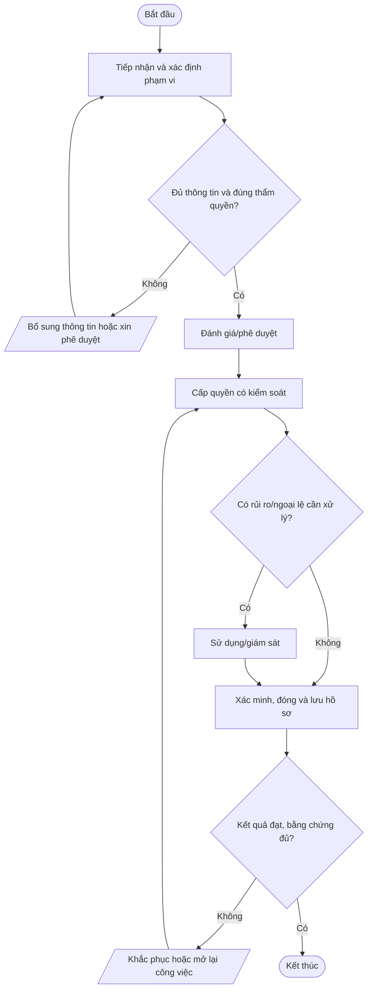
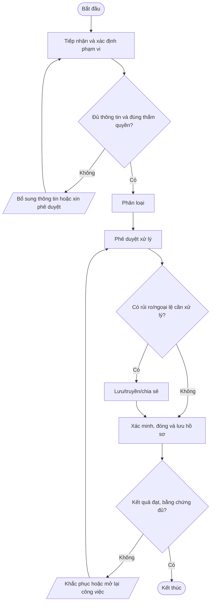
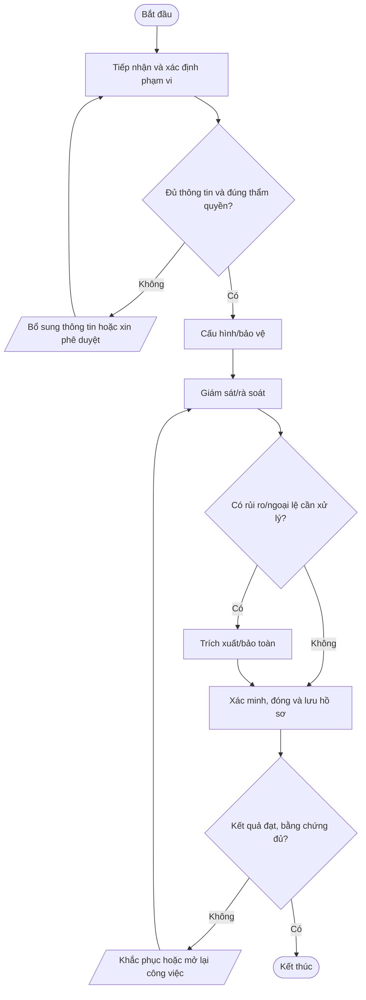
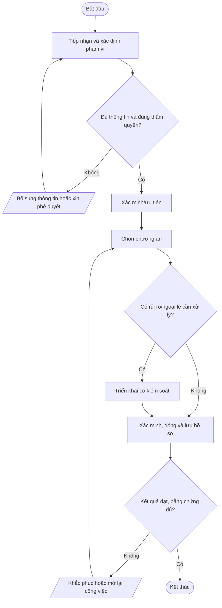
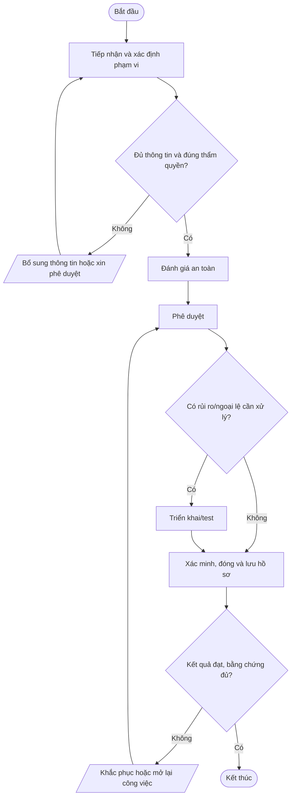
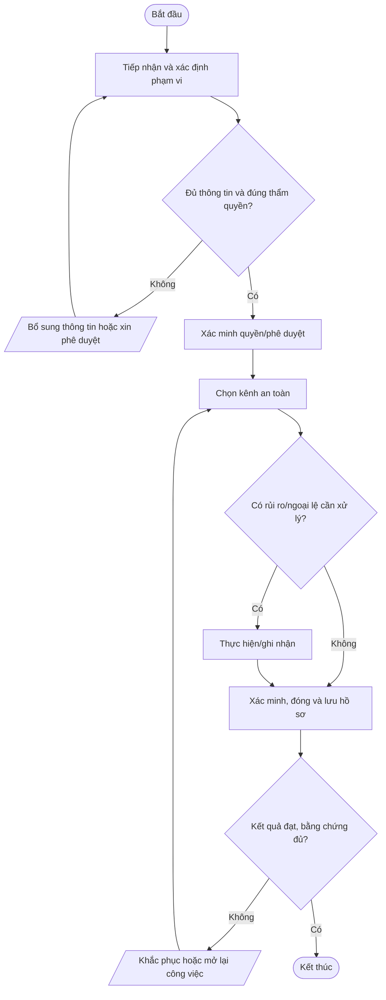

# Nhóm C — An toàn thông tin và bảo vệ dữ liệu

Bộ quy trình chuẩn Mstar — bản dự thảo ngày 2026-10-14. Tài liệu được thiết kế dùng chung cho dịch vụ IT Outsourcing; các yêu cầu cụ thể được cấu hình trong phụ lục khách hàng.

## Quy tắc áp dụng

- Quy trình lõi dùng chung; phụ lục khách hàng xác định phạm vi, SLA, đầu mối, quyền, retention, thông báo sự cố và yêu cầu phục hồi.
- Mọi thao tác trên hệ thống khách hàng phải được hợp đồng/ủy quyền cho phép.
- Bằng chứng phải có thể truy nguyên: ticket, phê duyệt, log, biên bản, kết quả kiểm tra.
- Không lưu mật khẩu, token, API key hoặc secret dạng rõ trong ticket/repository thông thường.
- Quy trình chỉ có hiệu lực sau khi được rà soát và phê duyệt; đây không phải tuyên bố Mstar đã được chứng nhận ISO.
- Tham chiếu: ISO/IEC 27001:2022 và ISO/IEC 27002:2022; mapping cuối cùng cần căn cứ risk assessment và SoA.

## Danh mục trong nhóm

| Mã | Quy trình | Mục đích |
|---|---|---|
| [QT-IT-11](#qt-it-11) | Quản lý tài khoản và quyền truy cập | Bảo đảm mỗi danh tính được xác thực, quyền được phê duyệt theo nhu cầu, rà soát và thu hồi đúng lúc. |
| [QT-ATTT-01](#qt-attt-01) | Quản lý tài khoản đặc quyền | Giới hạn và giám sát tài khoản có khả năng thay đổi hệ thống trọng yếu hoặc truy cập dữ liệu nhạy cảm. |
| [QT-ATTT-02](#qt-attt-02) | Quản lý mật khẩu và bí mật kỹ thuật | Bảo vệ mật khẩu, token, API key, SSH key, chứng thư và bí mật khỏi lộ lọt hoặc tồn tại sau khi hết nhu cầu. |
| [QT-ATTT-03](#qt-attt-03) | Phân loại và xử lý dữ liệu | Bảo vệ dữ liệu theo độ nhạy, quyền sở hữu, mục đích, hợp đồng và vòng đời. |
| [QT-ATTT-04](#qt-attt-04) | Quản lý và ứng cứu sự cố ATTT | Phát hiện, cô lập, điều tra, phục hồi và thông báo sự cố; bảo toàn bằng chứng và cải tiến. |
| [QT-ATTT-05](#qt-attt-05) | Quản lý nhật ký và bằng chứng | Bảo đảm log truy nguyên được, chống sửa/xóa trái phép, lưu giữ và trích xuất có kiểm soát. |
| [QT-ATTT-06](#qt-attt-06) | Quản lý lỗ hổng và bản vá | Ưu tiên khắc phục lỗ hổng theo mức nghiêm trọng, khả năng khai thác, phơi nhiễm và tác động. |
| [QT-ATTT-07](#qt-attt-07) | Bảo vệ thiết bị đầu cuối | Giảm mã độc, mất thiết bị, truy cập trái phép và thất thoát dữ liệu từ thiết bị truy cập hệ thống Mstar/khách hàng. |
| [QT-ATTT-08](#qt-attt-08) | Quản lý mạng, Firewall và truy cập từ xa | Kiểm soát luồng mạng, VPN, firewall và remote support theo nhu cầu, phê duyệt và khả năng truy vết. |
| [QT-ATTT-09](#qt-attt-09) | Quản lý nhà cung cấp và bên thứ ba | Đánh giá và kiểm soát rủi ro nhà cung cấp truy cập hệ thống, dữ liệu hoặc dịch vụ trọng yếu. |
| [QT-ATTT-10](#qt-attt-10) | Kiểm soát dữ liệu khách hàng | Ngăn truy cập, sao chép, chia sẻ hoặc sử dụng dữ liệu khách hàng ngoài mục đích; bảo đảm phân tách và truy vết. |

---
## QT-IT-11 — Quản lý tài khoản và quyền truy cập

**Mục đích:** Bảo đảm mỗi danh tính được xác thực, quyền được phê duyệt theo nhu cầu, rà soát và thu hồi đúng lúc.

**Kích hoạt:** Khi có yêu cầu/sự kiện thuộc phạm vi, khi có thay đổi đáng kể hoặc theo chu kỳ được quy định.

**Phạm vi:** Mstar và hoạt động IT Outsourcing trong phạm vi hợp đồng/ủy quyền. Phụ lục từng khách hàng phải xác định hệ thống, SLA, đầu mối, quyền truy cập, retention, thông báo và yêu cầu phục hồi riêng.

**Vai trò:** Người yêu cầu/đầu mối khách hàng; người thực hiện; người kiểm tra/chủ sở hữu hệ thống; chủ sở hữu quy trình; IT Lead; người phê duyệt theo ma trận thẩm quyền. Người thực hiện không tự phê duyệt rủi ro trọng yếu do chính mình tạo ra.

**Đầu vào:** Yêu cầu/ticket; hợp đồng/phụ lục; danh mục hệ thống/tài sản; quyền được ủy quyền; quy trình liên quan; dữ liệu/bằng chứng hiện có.

**Đầu ra:** Hồ sơ xử lý; kết quả đã xác minh; phê duyệt; ticket/biên bản đóng; việc tồn có owner và hạn.

### Trình tự thực hiện

| Bước | Hoạt động | Vai trò chính | Hướng dẫn và kiểm soát | Bằng chứng cần lưu |
|---:|---|---|---|---|
| 1 | Tiếp nhận và xác định phạm vi | Người tiếp nhận | Ghi nhận yêu cầu/sự kiện, xác minh khách hàng/hệ thống liên quan, mục tiêu, phạm vi hợp đồng, đầu mối và thông tin tối thiểu. Nếu thiếu thông tin hoặc thẩm quyền thì chưa thực hiện bước rủi ro. | Ticket, log, phê duyệt hoặc biên bản tương ứng |
| 2 | Xác minh/phê duyệt | Người thực hiện và người kiểm tra | Quản lý và chủ sở hữu hệ thống xác nhận quyền tối thiểu, xung đột nhiệm vụ và phê duyệt khách hàng. | Ticket, log, phê duyệt hoặc biên bản tương ứng |
| 3 | Cấp quyền | Người thực hiện và người kiểm tra | Tạo tài khoản riêng, bật MFA theo chính sách, cấp role tối thiểu và ghi log. | Ticket, log, phê duyệt hoặc biên bản tương ứng |
| 4 | Rà soát | Người thực hiện và người kiểm tra | Đối chiếu danh sách với vai trò; ưu tiên quyền đặc quyền, vendor và quyền khách hàng. | Ticket, log, phê duyệt hoặc biên bản tương ứng |
| 5 | Xác minh, đóng và lưu hồ sơ | Chủ sở hữu quy trình/IT Lead | Người kiểm tra xác nhận kết quả, quyền và phạm vi; ghi thời gian, bằng chứng, quyết định, thông báo và việc tồn. Chỉ đóng khi đủ hồ sơ hoặc có ngoại lệ được duyệt. | Ticket, log, phê duyệt hoặc biên bản tương ứng |

### Lưu đồ

### Biểu mẫu và hồ sơ

- FR-QTIT11-01: Phiếu yêu cầu/checklist khởi tạo.
- FR-QTIT11-02: Hồ sơ đánh giá, phê duyệt hoặc xác minh.
- FR-QTIT11-03: Nhật ký thực hiện/biên bản/báo cáo.
- FR-QTIT11-04: Xác nhận hoàn tất và theo dõi việc tồn.

*Mã biểu mẫu là mã đề xuất; khi ban hành cần đưa vào danh mục tài liệu, xác định chủ sở hữu, nơi lưu, quyền truy cập và thời hạn lưu giữ.*

### KPI và giám sát

- Tỷ lệ hồ sơ có đủ thông tin đầu vào và phê duyệt.
- Tỷ lệ bước/công việc hoàn thành đúng hạn theo quy trình hoặc hợp đồng.
- Số lỗi, ngoại lệ, sự cố hoặc hồ sơ phải làm lại.
- Tỷ lệ hành động khắc phục đóng đúng hạn.

Chủ sở hữu quy trình phải xác định nguồn dữ liệu, công thức, chu kỳ đo và ngưỡng cảnh báo trước khi áp dụng.

### Ngoại lệ và an toàn thông tin

Đối chiếu danh sách với vai trò; ưu tiên quyền đặc quyền, vendor và quyền khách hàng.

- Không thao tác ngoài phạm vi hợp đồng/ủy quyền; khi thiếu quyền hoặc phê duyệt phải tạm dừng bước có rủi ro.
- Không ghi mật khẩu, API key, token, khóa riêng hoặc mã khôi phục dạng rõ trong ticket, README, email thường hay tài liệu bàn giao.
- Thay đổi hệ thống phải theo QT-IT-13; nghi ngờ sự cố ATTT phải theo QT-ATTT-04; ngoại lệ phải theo QT-ISMS-04.
- Mọi ngoại lệ phải có lý do, đánh giá rủi ro, biện pháp bù trừ, người phê duyệt, owner và hạn hết hiệu lực.

### Phụ lục cần cấu hình theo khách hàng

| Trường | Nội dung xác nhận |
|---|---|
| Khách hàng/mã hợp đồng | Theo hợp đồng đang hiệu lực |
| Phạm vi hệ thống/dịch vụ | Hệ thống, tenant, site, tài sản và loại dịch vụ |
| SLA/lịch hỗ trợ | Theo hợp đồng/phụ lục, không dùng mặc định chung |
| Đầu mối yêu cầu/phê duyệt | Chức danh, kênh liên hệ và người thay thế |
| Quyền/kênh kỹ thuật | Phạm vi ủy quyền, MFA, VPN, thời hạn |
| Dữ liệu/lưu giữ | Phân loại, nơi lưu, thời hạn, trả/xóa |
| Thông báo sự cố | Kênh, người nhận và thời hạn |
| Ngoại lệ/rủi ro tồn dư | Mã hồ sơ, phê duyệt, bù trừ, ngày hết hạn |

**Trạng thái:** Dự thảo v0.1 — chờ rà soát, thử nghiệm và phê duyệt. Mapping ISO chỉ mang tính định hướng; cần xác nhận theo phạm vi ISMS, đánh giá rủi ro và SoA.

---

## QT-ATTT-01 — Quản lý tài khoản đặc quyền

**Mục đích:** Giới hạn và giám sát tài khoản có khả năng thay đổi hệ thống trọng yếu hoặc truy cập dữ liệu nhạy cảm.

**Kích hoạt:** Khi có yêu cầu/sự kiện thuộc phạm vi, khi có thay đổi đáng kể hoặc theo chu kỳ được quy định.

**Phạm vi:** Mstar và hoạt động IT Outsourcing trong phạm vi hợp đồng/ủy quyền. Phụ lục từng khách hàng phải xác định hệ thống, SLA, đầu mối, quyền truy cập, retention, thông báo và yêu cầu phục hồi riêng.

**Vai trò:** Người yêu cầu/đầu mối khách hàng; người thực hiện; người kiểm tra/chủ sở hữu hệ thống; chủ sở hữu quy trình; IT Lead; người phê duyệt theo ma trận thẩm quyền. Người thực hiện không tự phê duyệt rủi ro trọng yếu do chính mình tạo ra.

**Đầu vào:** Yêu cầu/ticket; hợp đồng/phụ lục; danh mục hệ thống/tài sản; quyền được ủy quyền; quy trình liên quan; dữ liệu/bằng chứng hiện có.

**Đầu ra:** Hồ sơ xử lý; kết quả đã xác minh; phê duyệt; ticket/biên bản đóng; việc tồn có owner và hạn.

### Trình tự thực hiện

| Bước | Hoạt động | Vai trò chính | Hướng dẫn và kiểm soát | Bằng chứng cần lưu |
|---:|---|---|---|---|
| 1 | Tiếp nhận và xác định phạm vi | Người tiếp nhận | Ghi nhận yêu cầu/sự kiện, xác minh khách hàng/hệ thống liên quan, mục tiêu, phạm vi hợp đồng, đầu mối và thông tin tối thiểu. Nếu thiếu thông tin hoặc thẩm quyền thì chưa thực hiện bước rủi ro. | Ticket, log, phê duyệt hoặc biên bản tương ứng |
| 2 | Đánh giá/phê duyệt | Người thực hiện và người kiểm tra | Đánh giá rủi ro, xung đột nhiệm vụ, MFA, log, yêu cầu khách hàng và thời hạn. | Ticket, log, phê duyệt hoặc biên bản tương ứng |
| 3 | Cấp quyền có kiểm soát | Người thực hiện và người kiểm tra | Dùng danh tính riêng, MFA, quyền vừa đủ/tạm thời; bí mật lưu trong vault. | Ticket, log, phê duyệt hoặc biên bản tương ứng |
| 4 | Sử dụng/giám sát | Người thực hiện và người kiểm tra | Gắn với ticket/change, ghi log và giám sát hành động nhạy cảm. | Ticket, log, phê duyệt hoặc biên bản tương ứng |
| 5 | Xác minh, đóng và lưu hồ sơ | Chủ sở hữu quy trình/IT Lead | Người kiểm tra xác nhận kết quả, quyền và phạm vi; ghi thời gian, bằng chứng, quyết định, thông báo và việc tồn. Chỉ đóng khi đủ hồ sơ hoặc có ngoại lệ được duyệt. | Ticket, log, phê duyệt hoặc biên bản tương ứng |

### Lưu đồ

### Biểu mẫu và hồ sơ

- FR-QTATTT01-01: Phiếu yêu cầu/checklist khởi tạo.
- FR-QTATTT01-02: Hồ sơ đánh giá, phê duyệt hoặc xác minh.
- FR-QTATTT01-03: Nhật ký thực hiện/biên bản/báo cáo.
- FR-QTATTT01-04: Xác nhận hoàn tất và theo dõi việc tồn.

*Mã biểu mẫu là mã đề xuất; khi ban hành cần đưa vào danh mục tài liệu, xác định chủ sở hữu, nơi lưu, quyền truy cập và thời hạn lưu giữ.*

### KPI và giám sát

- Tỷ lệ hồ sơ có đủ thông tin đầu vào và phê duyệt.
- Tỷ lệ bước/công việc hoàn thành đúng hạn theo quy trình hoặc hợp đồng.
- Số lỗi, ngoại lệ, sự cố hoặc hồ sơ phải làm lại.
- Tỷ lệ hành động khắc phục đóng đúng hạn.

Chủ sở hữu quy trình phải xác định nguồn dữ liệu, công thức, chu kỳ đo và ngưỡng cảnh báo trước khi áp dụng.

### Ngoại lệ và an toàn thông tin

Gắn với ticket/change, ghi log và giám sát hành động nhạy cảm.

- Không thao tác ngoài phạm vi hợp đồng/ủy quyền; khi thiếu quyền hoặc phê duyệt phải tạm dừng bước có rủi ro.
- Không ghi mật khẩu, API key, token, khóa riêng hoặc mã khôi phục dạng rõ trong ticket, README, email thường hay tài liệu bàn giao.
- Thay đổi hệ thống phải theo QT-IT-13; nghi ngờ sự cố ATTT phải theo QT-ATTT-04; ngoại lệ phải theo QT-ISMS-04.
- Mọi ngoại lệ phải có lý do, đánh giá rủi ro, biện pháp bù trừ, người phê duyệt, owner và hạn hết hiệu lực.

### Phụ lục cần cấu hình theo khách hàng

| Trường | Nội dung xác nhận |
|---|---|
| Khách hàng/mã hợp đồng | Theo hợp đồng đang hiệu lực |
| Phạm vi hệ thống/dịch vụ | Hệ thống, tenant, site, tài sản và loại dịch vụ |
| SLA/lịch hỗ trợ | Theo hợp đồng/phụ lục, không dùng mặc định chung |
| Đầu mối yêu cầu/phê duyệt | Chức danh, kênh liên hệ và người thay thế |
| Quyền/kênh kỹ thuật | Phạm vi ủy quyền, MFA, VPN, thời hạn |
| Dữ liệu/lưu giữ | Phân loại, nơi lưu, thời hạn, trả/xóa |
| Thông báo sự cố | Kênh, người nhận và thời hạn |
| Ngoại lệ/rủi ro tồn dư | Mã hồ sơ, phê duyệt, bù trừ, ngày hết hạn |

**Trạng thái:** Dự thảo v0.1 — chờ rà soát, thử nghiệm và phê duyệt. Mapping ISO chỉ mang tính định hướng; cần xác nhận theo phạm vi ISMS, đánh giá rủi ro và SoA.

---

## QT-ATTT-02 — Quản lý mật khẩu và bí mật kỹ thuật

**Mục đích:** Bảo vệ mật khẩu, token, API key, SSH key, chứng thư và bí mật khỏi lộ lọt hoặc tồn tại sau khi hết nhu cầu.

**Kích hoạt:** Khi có yêu cầu/sự kiện thuộc phạm vi, khi có thay đổi đáng kể hoặc theo chu kỳ được quy định.

**Phạm vi:** Mstar và hoạt động IT Outsourcing trong phạm vi hợp đồng/ủy quyền. Phụ lục từng khách hàng phải xác định hệ thống, SLA, đầu mối, quyền truy cập, retention, thông báo và yêu cầu phục hồi riêng.

**Vai trò:** Người yêu cầu/đầu mối khách hàng; người thực hiện; người kiểm tra/chủ sở hữu hệ thống; chủ sở hữu quy trình; IT Lead; người phê duyệt theo ma trận thẩm quyền. Người thực hiện không tự phê duyệt rủi ro trọng yếu do chính mình tạo ra.

**Đầu vào:** Yêu cầu/ticket; hợp đồng/phụ lục; danh mục hệ thống/tài sản; quyền được ủy quyền; quy trình liên quan; dữ liệu/bằng chứng hiện có.

**Đầu ra:** Hồ sơ xử lý; kết quả đã xác minh; phê duyệt; ticket/biên bản đóng; việc tồn có owner và hạn.

### Trình tự thực hiện

| Bước | Hoạt động | Vai trò chính | Hướng dẫn và kiểm soát | Bằng chứng cần lưu |
|---:|---|---|---|---|
| 1 | Tiếp nhận và xác định phạm vi | Người tiếp nhận | Ghi nhận yêu cầu/sự kiện, xác minh khách hàng/hệ thống liên quan, mục tiêu, phạm vi hợp đồng, đầu mối và thông tin tối thiểu. Nếu thiếu thông tin hoặc thẩm quyền thì chưa thực hiện bước rủi ro. | Ticket, log, phê duyệt hoặc biên bản tương ứng |
| 2 | Chọn kho an toàn | Người thực hiện và người kiểm tra | Dùng vault/password manager được duyệt; bật MFA, audit log và quyền tối thiểu. | Ticket, log, phê duyệt hoặc biên bản tương ứng |
| 3 | Cấp quyền/luân chuyển | Người thực hiện và người kiểm tra | Cấp qua kênh an toàn; luân chuyển khi thay người hoặc theo rủi ro; không gửi qua ticket/email thường. | Ticket, log, phê duyệt hoặc biên bản tương ứng |
| 4 | Ứng phó nghi lộ | Người thực hiện và người kiểm tra | Thu hồi/rotate, kiểm tra log và các hệ thống phụ thuộc; mở incident khi cần. | Ticket, log, phê duyệt hoặc biên bản tương ứng |
| 5 | Xác minh, đóng và lưu hồ sơ | Chủ sở hữu quy trình/IT Lead | Người kiểm tra xác nhận kết quả, quyền và phạm vi; ghi thời gian, bằng chứng, quyết định, thông báo và việc tồn. Chỉ đóng khi đủ hồ sơ hoặc có ngoại lệ được duyệt. | Ticket, log, phê duyệt hoặc biên bản tương ứng |

### Lưu đồ

### Biểu mẫu và hồ sơ

- FR-QTATTT02-01: Phiếu yêu cầu/checklist khởi tạo.
- FR-QTATTT02-02: Hồ sơ đánh giá, phê duyệt hoặc xác minh.
- FR-QTATTT02-03: Nhật ký thực hiện/biên bản/báo cáo.
- FR-QTATTT02-04: Xác nhận hoàn tất và theo dõi việc tồn.

*Mã biểu mẫu là mã đề xuất; khi ban hành cần đưa vào danh mục tài liệu, xác định chủ sở hữu, nơi lưu, quyền truy cập và thời hạn lưu giữ.*

### KPI và giám sát

- Tỷ lệ hồ sơ có đủ thông tin đầu vào và phê duyệt.
- Tỷ lệ bước/công việc hoàn thành đúng hạn theo quy trình hoặc hợp đồng.
- Số lỗi, ngoại lệ, sự cố hoặc hồ sơ phải làm lại.
- Tỷ lệ hành động khắc phục đóng đúng hạn.

Chủ sở hữu quy trình phải xác định nguồn dữ liệu, công thức, chu kỳ đo và ngưỡng cảnh báo trước khi áp dụng.

### Ngoại lệ và an toàn thông tin

Thu hồi/rotate, kiểm tra log và các hệ thống phụ thuộc; mở incident khi cần.

- Không thao tác ngoài phạm vi hợp đồng/ủy quyền; khi thiếu quyền hoặc phê duyệt phải tạm dừng bước có rủi ro.
- Không ghi mật khẩu, API key, token, khóa riêng hoặc mã khôi phục dạng rõ trong ticket, README, email thường hay tài liệu bàn giao.
- Thay đổi hệ thống phải theo QT-IT-13; nghi ngờ sự cố ATTT phải theo QT-ATTT-04; ngoại lệ phải theo QT-ISMS-04.
- Mọi ngoại lệ phải có lý do, đánh giá rủi ro, biện pháp bù trừ, người phê duyệt, owner và hạn hết hiệu lực.

### Phụ lục cần cấu hình theo khách hàng

| Trường | Nội dung xác nhận |
|---|---|
| Khách hàng/mã hợp đồng | Theo hợp đồng đang hiệu lực |
| Phạm vi hệ thống/dịch vụ | Hệ thống, tenant, site, tài sản và loại dịch vụ |
| SLA/lịch hỗ trợ | Theo hợp đồng/phụ lục, không dùng mặc định chung |
| Đầu mối yêu cầu/phê duyệt | Chức danh, kênh liên hệ và người thay thế |
| Quyền/kênh kỹ thuật | Phạm vi ủy quyền, MFA, VPN, thời hạn |
| Dữ liệu/lưu giữ | Phân loại, nơi lưu, thời hạn, trả/xóa |
| Thông báo sự cố | Kênh, người nhận và thời hạn |
| Ngoại lệ/rủi ro tồn dư | Mã hồ sơ, phê duyệt, bù trừ, ngày hết hạn |

**Trạng thái:** Dự thảo v0.1 — chờ rà soát, thử nghiệm và phê duyệt. Mapping ISO chỉ mang tính định hướng; cần xác nhận theo phạm vi ISMS, đánh giá rủi ro và SoA.

---

## QT-ATTT-03 — Phân loại và xử lý dữ liệu

**Mục đích:** Bảo vệ dữ liệu theo độ nhạy, quyền sở hữu, mục đích, hợp đồng và vòng đời.

**Kích hoạt:** Khi có yêu cầu/sự kiện thuộc phạm vi, khi có thay đổi đáng kể hoặc theo chu kỳ được quy định.

**Phạm vi:** Mstar và hoạt động IT Outsourcing trong phạm vi hợp đồng/ủy quyền. Phụ lục từng khách hàng phải xác định hệ thống, SLA, đầu mối, quyền truy cập, retention, thông báo và yêu cầu phục hồi riêng.

**Vai trò:** Người yêu cầu/đầu mối khách hàng; người thực hiện; người kiểm tra/chủ sở hữu hệ thống; chủ sở hữu quy trình; IT Lead; người phê duyệt theo ma trận thẩm quyền. Người thực hiện không tự phê duyệt rủi ro trọng yếu do chính mình tạo ra.

**Đầu vào:** Yêu cầu/ticket; hợp đồng/phụ lục; danh mục hệ thống/tài sản; quyền được ủy quyền; quy trình liên quan; dữ liệu/bằng chứng hiện có.

**Đầu ra:** Hồ sơ xử lý; kết quả đã xác minh; phê duyệt; ticket/biên bản đóng; việc tồn có owner và hạn.

### Trình tự thực hiện

| Bước | Hoạt động | Vai trò chính | Hướng dẫn và kiểm soát | Bằng chứng cần lưu |
|---:|---|---|---|---|
| 1 | Tiếp nhận và xác định phạm vi | Người tiếp nhận | Ghi nhận yêu cầu/sự kiện, xác minh khách hàng/hệ thống liên quan, mục tiêu, phạm vi hợp đồng, đầu mối và thông tin tối thiểu. Nếu thiếu thông tin hoặc thẩm quyền thì chưa thực hiện bước rủi ro. | Ticket, log, phê duyệt hoặc biên bản tương ứng |
| 2 | Phân loại | Người thực hiện và người kiểm tra | Gán nhãn và yêu cầu truy cập, mã hóa, logging, truyền và lưu giữ. | Ticket, log, phê duyệt hoặc biên bản tương ứng |
| 3 | Phê duyệt xử lý | Người thực hiện và người kiểm tra | Xác minh mục đích hợp lệ, người được phép và quyền xuất/chia sẻ. | Ticket, log, phê duyệt hoặc biên bản tương ứng |
| 4 | Lưu/truyền/chia sẻ | Người thực hiện và người kiểm tra | Dùng nơi/kênh được duyệt, mã hóa phù hợp, xác minh người nhận và tránh bản sao không kiểm soát. | Ticket, log, phê duyệt hoặc biên bản tương ứng |
| 5 | Xác minh, đóng và lưu hồ sơ | Chủ sở hữu quy trình/IT Lead | Người kiểm tra xác nhận kết quả, quyền và phạm vi; ghi thời gian, bằng chứng, quyết định, thông báo và việc tồn. Chỉ đóng khi đủ hồ sơ hoặc có ngoại lệ được duyệt. | Ticket, log, phê duyệt hoặc biên bản tương ứng |

### Lưu đồ

### Biểu mẫu và hồ sơ

- FR-QTATTT03-01: Phiếu yêu cầu/checklist khởi tạo.
- FR-QTATTT03-02: Hồ sơ đánh giá, phê duyệt hoặc xác minh.
- FR-QTATTT03-03: Nhật ký thực hiện/biên bản/báo cáo.
- FR-QTATTT03-04: Xác nhận hoàn tất và theo dõi việc tồn.

*Mã biểu mẫu là mã đề xuất; khi ban hành cần đưa vào danh mục tài liệu, xác định chủ sở hữu, nơi lưu, quyền truy cập và thời hạn lưu giữ.*

### KPI và giám sát

- Tỷ lệ hồ sơ có đủ thông tin đầu vào và phê duyệt.
- Tỷ lệ bước/công việc hoàn thành đúng hạn theo quy trình hoặc hợp đồng.
- Số lỗi, ngoại lệ, sự cố hoặc hồ sơ phải làm lại.
- Tỷ lệ hành động khắc phục đóng đúng hạn.

Chủ sở hữu quy trình phải xác định nguồn dữ liệu, công thức, chu kỳ đo và ngưỡng cảnh báo trước khi áp dụng.

### Ngoại lệ và an toàn thông tin

Dùng nơi/kênh được duyệt, mã hóa phù hợp, xác minh người nhận và tránh bản sao không kiểm soát.

- Không thao tác ngoài phạm vi hợp đồng/ủy quyền; khi thiếu quyền hoặc phê duyệt phải tạm dừng bước có rủi ro.
- Không ghi mật khẩu, API key, token, khóa riêng hoặc mã khôi phục dạng rõ trong ticket, README, email thường hay tài liệu bàn giao.
- Thay đổi hệ thống phải theo QT-IT-13; nghi ngờ sự cố ATTT phải theo QT-ATTT-04; ngoại lệ phải theo QT-ISMS-04.
- Mọi ngoại lệ phải có lý do, đánh giá rủi ro, biện pháp bù trừ, người phê duyệt, owner và hạn hết hiệu lực.

### Phụ lục cần cấu hình theo khách hàng

| Trường | Nội dung xác nhận |
|---|---|
| Khách hàng/mã hợp đồng | Theo hợp đồng đang hiệu lực |
| Phạm vi hệ thống/dịch vụ | Hệ thống, tenant, site, tài sản và loại dịch vụ |
| SLA/lịch hỗ trợ | Theo hợp đồng/phụ lục, không dùng mặc định chung |
| Đầu mối yêu cầu/phê duyệt | Chức danh, kênh liên hệ và người thay thế |
| Quyền/kênh kỹ thuật | Phạm vi ủy quyền, MFA, VPN, thời hạn |
| Dữ liệu/lưu giữ | Phân loại, nơi lưu, thời hạn, trả/xóa |
| Thông báo sự cố | Kênh, người nhận và thời hạn |
| Ngoại lệ/rủi ro tồn dư | Mã hồ sơ, phê duyệt, bù trừ, ngày hết hạn |

**Trạng thái:** Dự thảo v0.1 — chờ rà soát, thử nghiệm và phê duyệt. Mapping ISO chỉ mang tính định hướng; cần xác nhận theo phạm vi ISMS, đánh giá rủi ro và SoA.

---

## QT-ATTT-04 — Quản lý và ứng cứu sự cố ATTT

**Mục đích:** Phát hiện, cô lập, điều tra, phục hồi và thông báo sự cố; bảo toàn bằng chứng và cải tiến.

**Kích hoạt:** Khi có yêu cầu/sự kiện thuộc phạm vi, khi có thay đổi đáng kể hoặc theo chu kỳ được quy định.

**Phạm vi:** Mstar và hoạt động IT Outsourcing trong phạm vi hợp đồng/ủy quyền. Phụ lục từng khách hàng phải xác định hệ thống, SLA, đầu mối, quyền truy cập, retention, thông báo và yêu cầu phục hồi riêng.

**Vai trò:** Người yêu cầu/đầu mối khách hàng; người thực hiện; người kiểm tra/chủ sở hữu hệ thống; chủ sở hữu quy trình; IT Lead; người phê duyệt theo ma trận thẩm quyền. Người thực hiện không tự phê duyệt rủi ro trọng yếu do chính mình tạo ra.

**Đầu vào:** Yêu cầu/ticket; hợp đồng/phụ lục; danh mục hệ thống/tài sản; quyền được ủy quyền; quy trình liên quan; dữ liệu/bằng chứng hiện có.

**Đầu ra:** Hồ sơ xử lý; kết quả đã xác minh; phê duyệt; ticket/biên bản đóng; việc tồn có owner và hạn.

### Trình tự thực hiện

| Bước | Hoạt động | Vai trò chính | Hướng dẫn và kiểm soát | Bằng chứng cần lưu |
|---:|---|---|---|---|
| 1 | Tiếp nhận và xác định phạm vi | Người tiếp nhận | Ghi nhận yêu cầu/sự kiện, xác minh khách hàng/hệ thống liên quan, mục tiêu, phạm vi hợp đồng, đầu mối và thông tin tối thiểu. Nếu thiếu thông tin hoặc thẩm quyền thì chưa thực hiện bước rủi ro. | Ticket, log, phê duyệt hoặc biên bản tương ứng |
| 2 | Phân loại/kích hoạt | Người thực hiện và người kiểm tra | Xác định mức độ, dữ liệu/khách hàng ảnh hưởng, người chỉ huy và nghĩa vụ thông báo. | Ticket, log, phê duyệt hoặc biên bản tương ứng |
| 3 | Cô lập/bảo toàn | Người thực hiện và người kiểm tra | Giới hạn lan rộng, bảo toàn log/snapshot/hash và chuỗi bàn giao bằng chứng. | Ticket, log, phê duyệt hoặc biên bản tương ứng |
| 4 | Điều tra/khắc phục | Người thực hiện và người kiểm tra | Xác định vector/phạm vi, loại bỏ nguyên nhân và xác minh môi trường sạch. | Ticket, log, phê duyệt hoặc biên bản tương ứng |
| 5 | Xác minh, đóng và lưu hồ sơ | Chủ sở hữu quy trình/IT Lead | Người kiểm tra xác nhận kết quả, quyền và phạm vi; ghi thời gian, bằng chứng, quyết định, thông báo và việc tồn. Chỉ đóng khi đủ hồ sơ hoặc có ngoại lệ được duyệt. | Ticket, log, phê duyệt hoặc biên bản tương ứng |

### Lưu đồ

### Biểu mẫu và hồ sơ

- FR-QTATTT04-01: Phiếu yêu cầu/checklist khởi tạo.
- FR-QTATTT04-02: Hồ sơ đánh giá, phê duyệt hoặc xác minh.
- FR-QTATTT04-03: Nhật ký thực hiện/biên bản/báo cáo.
- FR-QTATTT04-04: Xác nhận hoàn tất và theo dõi việc tồn.

*Mã biểu mẫu là mã đề xuất; khi ban hành cần đưa vào danh mục tài liệu, xác định chủ sở hữu, nơi lưu, quyền truy cập và thời hạn lưu giữ.*

### KPI và giám sát

- Tỷ lệ hồ sơ có đủ thông tin đầu vào và phê duyệt.
- Tỷ lệ bước/công việc hoàn thành đúng hạn theo quy trình hoặc hợp đồng.
- Số lỗi, ngoại lệ, sự cố hoặc hồ sơ phải làm lại.
- Tỷ lệ hành động khắc phục đóng đúng hạn.

Chủ sở hữu quy trình phải xác định nguồn dữ liệu, công thức, chu kỳ đo và ngưỡng cảnh báo trước khi áp dụng.

### Ngoại lệ và an toàn thông tin

Xác định vector/phạm vi, loại bỏ nguyên nhân và xác minh môi trường sạch.

- Không thao tác ngoài phạm vi hợp đồng/ủy quyền; khi thiếu quyền hoặc phê duyệt phải tạm dừng bước có rủi ro.
- Không ghi mật khẩu, API key, token, khóa riêng hoặc mã khôi phục dạng rõ trong ticket, README, email thường hay tài liệu bàn giao.
- Thay đổi hệ thống phải theo QT-IT-13; nghi ngờ sự cố ATTT phải theo QT-ATTT-04; ngoại lệ phải theo QT-ISMS-04.
- Mọi ngoại lệ phải có lý do, đánh giá rủi ro, biện pháp bù trừ, người phê duyệt, owner và hạn hết hiệu lực.

### Phụ lục cần cấu hình theo khách hàng

| Trường | Nội dung xác nhận |
|---|---|
| Khách hàng/mã hợp đồng | Theo hợp đồng đang hiệu lực |
| Phạm vi hệ thống/dịch vụ | Hệ thống, tenant, site, tài sản và loại dịch vụ |
| SLA/lịch hỗ trợ | Theo hợp đồng/phụ lục, không dùng mặc định chung |
| Đầu mối yêu cầu/phê duyệt | Chức danh, kênh liên hệ và người thay thế |
| Quyền/kênh kỹ thuật | Phạm vi ủy quyền, MFA, VPN, thời hạn |
| Dữ liệu/lưu giữ | Phân loại, nơi lưu, thời hạn, trả/xóa |
| Thông báo sự cố | Kênh, người nhận và thời hạn |
| Ngoại lệ/rủi ro tồn dư | Mã hồ sơ, phê duyệt, bù trừ, ngày hết hạn |

**Trạng thái:** Dự thảo v0.1 — chờ rà soát, thử nghiệm và phê duyệt. Mapping ISO chỉ mang tính định hướng; cần xác nhận theo phạm vi ISMS, đánh giá rủi ro và SoA.

---

## QT-ATTT-05 — Quản lý nhật ký và bằng chứng

**Mục đích:** Bảo đảm log truy nguyên được, chống sửa/xóa trái phép, lưu giữ và trích xuất có kiểm soát.

**Kích hoạt:** Khi có yêu cầu/sự kiện thuộc phạm vi, khi có thay đổi đáng kể hoặc theo chu kỳ được quy định.

**Phạm vi:** Mstar và hoạt động IT Outsourcing trong phạm vi hợp đồng/ủy quyền. Phụ lục từng khách hàng phải xác định hệ thống, SLA, đầu mối, quyền truy cập, retention, thông báo và yêu cầu phục hồi riêng.

**Vai trò:** Người yêu cầu/đầu mối khách hàng; người thực hiện; người kiểm tra/chủ sở hữu hệ thống; chủ sở hữu quy trình; IT Lead; người phê duyệt theo ma trận thẩm quyền. Người thực hiện không tự phê duyệt rủi ro trọng yếu do chính mình tạo ra.

**Đầu vào:** Yêu cầu/ticket; hợp đồng/phụ lục; danh mục hệ thống/tài sản; quyền được ủy quyền; quy trình liên quan; dữ liệu/bằng chứng hiện có.

**Đầu ra:** Hồ sơ xử lý; kết quả đã xác minh; phê duyệt; ticket/biên bản đóng; việc tồn có owner và hạn.

### Trình tự thực hiện

| Bước | Hoạt động | Vai trò chính | Hướng dẫn và kiểm soát | Bằng chứng cần lưu |
|---:|---|---|---|---|
| 1 | Tiếp nhận và xác định phạm vi | Người tiếp nhận | Ghi nhận yêu cầu/sự kiện, xác minh khách hàng/hệ thống liên quan, mục tiêu, phạm vi hợp đồng, đầu mối và thông tin tối thiểu. Nếu thiếu thông tin hoặc thẩm quyền thì chưa thực hiện bước rủi ro. | Ticket, log, phê duyệt hoặc biên bản tương ứng |
| 2 | Cấu hình/bảo vệ | Người thực hiện và người kiểm tra | Bật log, đồng bộ thời gian, giới hạn quyền, chuyển tới kho được bảo vệ khi phù hợp. | Ticket, log, phê duyệt hoặc biên bản tương ứng |
| 3 | Giám sát/rà soát | Người thực hiện và người kiểm tra | Theo dõi lỗi thu thập, dung lượng, bất thường và truy cập log. | Ticket, log, phê duyệt hoặc biên bản tương ứng |
| 4 | Trích xuất/bảo toàn | Người thực hiện và người kiểm tra | Ghi mục đích, người làm, phạm vi, thời gian, hash nếu phù hợp và chain-of-custody. | Ticket, log, phê duyệt hoặc biên bản tương ứng |
| 5 | Xác minh, đóng và lưu hồ sơ | Chủ sở hữu quy trình/IT Lead | Người kiểm tra xác nhận kết quả, quyền và phạm vi; ghi thời gian, bằng chứng, quyết định, thông báo và việc tồn. Chỉ đóng khi đủ hồ sơ hoặc có ngoại lệ được duyệt. | Ticket, log, phê duyệt hoặc biên bản tương ứng |

### Lưu đồ

### Biểu mẫu và hồ sơ

- FR-QTATTT05-01: Phiếu yêu cầu/checklist khởi tạo.
- FR-QTATTT05-02: Hồ sơ đánh giá, phê duyệt hoặc xác minh.
- FR-QTATTT05-03: Nhật ký thực hiện/biên bản/báo cáo.
- FR-QTATTT05-04: Xác nhận hoàn tất và theo dõi việc tồn.

*Mã biểu mẫu là mã đề xuất; khi ban hành cần đưa vào danh mục tài liệu, xác định chủ sở hữu, nơi lưu, quyền truy cập và thời hạn lưu giữ.*

### KPI và giám sát

- Tỷ lệ hồ sơ có đủ thông tin đầu vào và phê duyệt.
- Tỷ lệ bước/công việc hoàn thành đúng hạn theo quy trình hoặc hợp đồng.
- Số lỗi, ngoại lệ, sự cố hoặc hồ sơ phải làm lại.
- Tỷ lệ hành động khắc phục đóng đúng hạn.

Chủ sở hữu quy trình phải xác định nguồn dữ liệu, công thức, chu kỳ đo và ngưỡng cảnh báo trước khi áp dụng.

### Ngoại lệ và an toàn thông tin

Ghi mục đích, người làm, phạm vi, thời gian, hash nếu phù hợp và chain-of-custody.

- Không thao tác ngoài phạm vi hợp đồng/ủy quyền; khi thiếu quyền hoặc phê duyệt phải tạm dừng bước có rủi ro.
- Không ghi mật khẩu, API key, token, khóa riêng hoặc mã khôi phục dạng rõ trong ticket, README, email thường hay tài liệu bàn giao.
- Thay đổi hệ thống phải theo QT-IT-13; nghi ngờ sự cố ATTT phải theo QT-ATTT-04; ngoại lệ phải theo QT-ISMS-04.
- Mọi ngoại lệ phải có lý do, đánh giá rủi ro, biện pháp bù trừ, người phê duyệt, owner và hạn hết hiệu lực.

### Phụ lục cần cấu hình theo khách hàng

| Trường | Nội dung xác nhận |
|---|---|
| Khách hàng/mã hợp đồng | Theo hợp đồng đang hiệu lực |
| Phạm vi hệ thống/dịch vụ | Hệ thống, tenant, site, tài sản và loại dịch vụ |
| SLA/lịch hỗ trợ | Theo hợp đồng/phụ lục, không dùng mặc định chung |
| Đầu mối yêu cầu/phê duyệt | Chức danh, kênh liên hệ và người thay thế |
| Quyền/kênh kỹ thuật | Phạm vi ủy quyền, MFA, VPN, thời hạn |
| Dữ liệu/lưu giữ | Phân loại, nơi lưu, thời hạn, trả/xóa |
| Thông báo sự cố | Kênh, người nhận và thời hạn |
| Ngoại lệ/rủi ro tồn dư | Mã hồ sơ, phê duyệt, bù trừ, ngày hết hạn |

**Trạng thái:** Dự thảo v0.1 — chờ rà soát, thử nghiệm và phê duyệt. Mapping ISO chỉ mang tính định hướng; cần xác nhận theo phạm vi ISMS, đánh giá rủi ro và SoA.

---

## QT-ATTT-06 — Quản lý lỗ hổng và bản vá

**Mục đích:** Ưu tiên khắc phục lỗ hổng theo mức nghiêm trọng, khả năng khai thác, phơi nhiễm và tác động.

**Kích hoạt:** Khi có yêu cầu/sự kiện thuộc phạm vi, khi có thay đổi đáng kể hoặc theo chu kỳ được quy định.

**Phạm vi:** Mstar và hoạt động IT Outsourcing trong phạm vi hợp đồng/ủy quyền. Phụ lục từng khách hàng phải xác định hệ thống, SLA, đầu mối, quyền truy cập, retention, thông báo và yêu cầu phục hồi riêng.

**Vai trò:** Người yêu cầu/đầu mối khách hàng; người thực hiện; người kiểm tra/chủ sở hữu hệ thống; chủ sở hữu quy trình; IT Lead; người phê duyệt theo ma trận thẩm quyền. Người thực hiện không tự phê duyệt rủi ro trọng yếu do chính mình tạo ra.

**Đầu vào:** Yêu cầu/ticket; hợp đồng/phụ lục; danh mục hệ thống/tài sản; quyền được ủy quyền; quy trình liên quan; dữ liệu/bằng chứng hiện có.

**Đầu ra:** Hồ sơ xử lý; kết quả đã xác minh; phê duyệt; ticket/biên bản đóng; việc tồn có owner và hạn.

### Trình tự thực hiện

| Bước | Hoạt động | Vai trò chính | Hướng dẫn và kiểm soát | Bằng chứng cần lưu |
|---:|---|---|---|---|
| 1 | Tiếp nhận và xác định phạm vi | Người tiếp nhận | Ghi nhận yêu cầu/sự kiện, xác minh khách hàng/hệ thống liên quan, mục tiêu, phạm vi hợp đồng, đầu mối và thông tin tối thiểu. Nếu thiếu thông tin hoặc thẩm quyền thì chưa thực hiện bước rủi ro. | Ticket, log, phê duyệt hoặc biên bản tương ứng |
| 2 | Xác minh/ưu tiên | Người thực hiện và người kiểm tra | Xác nhận áp dụng, exposure, exploit, tác động và hạn khắc phục. | Ticket, log, phê duyệt hoặc biên bản tương ứng |
| 3 | Chọn phương án | Người thực hiện và người kiểm tra | Vá, nâng cấp, giảm thiểu, cô lập hoặc ngoại lệ có thời hạn; đánh giá backup/rollback. | Ticket, log, phê duyệt hoặc biên bản tương ứng |
| 4 | Triển khai có kiểm soát | Người thực hiện và người kiểm tra | Thực hiện change, thử nghiệm, phê duyệt và thông báo cần thiết. | Ticket, log, phê duyệt hoặc biên bản tương ứng |
| 5 | Xác minh, đóng và lưu hồ sơ | Chủ sở hữu quy trình/IT Lead | Người kiểm tra xác nhận kết quả, quyền và phạm vi; ghi thời gian, bằng chứng, quyết định, thông báo và việc tồn. Chỉ đóng khi đủ hồ sơ hoặc có ngoại lệ được duyệt. | Ticket, log, phê duyệt hoặc biên bản tương ứng |

### Lưu đồ

### Biểu mẫu và hồ sơ

- FR-QTATTT06-01: Phiếu yêu cầu/checklist khởi tạo.
- FR-QTATTT06-02: Hồ sơ đánh giá, phê duyệt hoặc xác minh.
- FR-QTATTT06-03: Nhật ký thực hiện/biên bản/báo cáo.
- FR-QTATTT06-04: Xác nhận hoàn tất và theo dõi việc tồn.

*Mã biểu mẫu là mã đề xuất; khi ban hành cần đưa vào danh mục tài liệu, xác định chủ sở hữu, nơi lưu, quyền truy cập và thời hạn lưu giữ.*

### KPI và giám sát

- Tỷ lệ hồ sơ có đủ thông tin đầu vào và phê duyệt.
- Tỷ lệ bước/công việc hoàn thành đúng hạn theo quy trình hoặc hợp đồng.
- Số lỗi, ngoại lệ, sự cố hoặc hồ sơ phải làm lại.
- Tỷ lệ hành động khắc phục đóng đúng hạn.

Chủ sở hữu quy trình phải xác định nguồn dữ liệu, công thức, chu kỳ đo và ngưỡng cảnh báo trước khi áp dụng.

### Ngoại lệ và an toàn thông tin

Thực hiện change, thử nghiệm, phê duyệt và thông báo cần thiết.

- Không thao tác ngoài phạm vi hợp đồng/ủy quyền; khi thiếu quyền hoặc phê duyệt phải tạm dừng bước có rủi ro.
- Không ghi mật khẩu, API key, token, khóa riêng hoặc mã khôi phục dạng rõ trong ticket, README, email thường hay tài liệu bàn giao.
- Thay đổi hệ thống phải theo QT-IT-13; nghi ngờ sự cố ATTT phải theo QT-ATTT-04; ngoại lệ phải theo QT-ISMS-04.
- Mọi ngoại lệ phải có lý do, đánh giá rủi ro, biện pháp bù trừ, người phê duyệt, owner và hạn hết hiệu lực.

### Phụ lục cần cấu hình theo khách hàng

| Trường | Nội dung xác nhận |
|---|---|
| Khách hàng/mã hợp đồng | Theo hợp đồng đang hiệu lực |
| Phạm vi hệ thống/dịch vụ | Hệ thống, tenant, site, tài sản và loại dịch vụ |
| SLA/lịch hỗ trợ | Theo hợp đồng/phụ lục, không dùng mặc định chung |
| Đầu mối yêu cầu/phê duyệt | Chức danh, kênh liên hệ và người thay thế |
| Quyền/kênh kỹ thuật | Phạm vi ủy quyền, MFA, VPN, thời hạn |
| Dữ liệu/lưu giữ | Phân loại, nơi lưu, thời hạn, trả/xóa |
| Thông báo sự cố | Kênh, người nhận và thời hạn |
| Ngoại lệ/rủi ro tồn dư | Mã hồ sơ, phê duyệt, bù trừ, ngày hết hạn |

**Trạng thái:** Dự thảo v0.1 — chờ rà soát, thử nghiệm và phê duyệt. Mapping ISO chỉ mang tính định hướng; cần xác nhận theo phạm vi ISMS, đánh giá rủi ro và SoA.

---

## QT-ATTT-07 — Bảo vệ thiết bị đầu cuối

**Mục đích:** Giảm mã độc, mất thiết bị, truy cập trái phép và thất thoát dữ liệu từ thiết bị truy cập hệ thống Mstar/khách hàng.

**Kích hoạt:** Khi có yêu cầu/sự kiện thuộc phạm vi, khi có thay đổi đáng kể hoặc theo chu kỳ được quy định.

**Phạm vi:** Mstar và hoạt động IT Outsourcing trong phạm vi hợp đồng/ủy quyền. Phụ lục từng khách hàng phải xác định hệ thống, SLA, đầu mối, quyền truy cập, retention, thông báo và yêu cầu phục hồi riêng.

**Vai trò:** Người yêu cầu/đầu mối khách hàng; người thực hiện; người kiểm tra/chủ sở hữu hệ thống; chủ sở hữu quy trình; IT Lead; người phê duyệt theo ma trận thẩm quyền. Người thực hiện không tự phê duyệt rủi ro trọng yếu do chính mình tạo ra.

**Đầu vào:** Yêu cầu/ticket; hợp đồng/phụ lục; danh mục hệ thống/tài sản; quyền được ủy quyền; quy trình liên quan; dữ liệu/bằng chứng hiện có.

**Đầu ra:** Hồ sơ xử lý; kết quả đã xác minh; phê duyệt; ticket/biên bản đóng; việc tồn có owner và hạn.

### Trình tự thực hiện

| Bước | Hoạt động | Vai trò chính | Hướng dẫn và kiểm soát | Bằng chứng cần lưu |
|---:|---|---|---|---|
| 1 | Tiếp nhận và xác định phạm vi | Người tiếp nhận | Ghi nhận yêu cầu/sự kiện, xác minh khách hàng/hệ thống liên quan, mục tiêu, phạm vi hợp đồng, đầu mối và thông tin tối thiểu. Nếu thiếu thông tin hoặc thẩm quyền thì chưa thực hiện bước rủi ro. | Ticket, log, phê duyệt hoặc biên bản tương ứng |
| 2 | Áp baseline | Người thực hiện và người kiểm tra | Cập nhật, EDR/AV, mã hóa, firewall, screen lock, MFA và hạn chế local admin. | Ticket, log, phê duyệt hoặc biên bản tương ứng |
| 3 | Giám sát tuân thủ | Người thực hiện và người kiểm tra | Theo dõi EDR, bản vá, mã hóa, phần mềm không phép và thiết bị mất liên lạc. | Ticket, log, phê duyệt hoặc biên bản tương ứng |
| 4 | Xử lý cảnh báo/mất | Người thực hiện và người kiểm tra | Cô lập, khóa session/token, điều tra và thông báo nếu ảnh hưởng khách hàng. | Ticket, log, phê duyệt hoặc biên bản tương ứng |
| 5 | Xác minh, đóng và lưu hồ sơ | Chủ sở hữu quy trình/IT Lead | Người kiểm tra xác nhận kết quả, quyền và phạm vi; ghi thời gian, bằng chứng, quyết định, thông báo và việc tồn. Chỉ đóng khi đủ hồ sơ hoặc có ngoại lệ được duyệt. | Ticket, log, phê duyệt hoặc biên bản tương ứng |

### Lưu đồ

### Biểu mẫu và hồ sơ

- FR-QTATTT07-01: Phiếu yêu cầu/checklist khởi tạo.
- FR-QTATTT07-02: Hồ sơ đánh giá, phê duyệt hoặc xác minh.
- FR-QTATTT07-03: Nhật ký thực hiện/biên bản/báo cáo.
- FR-QTATTT07-04: Xác nhận hoàn tất và theo dõi việc tồn.

*Mã biểu mẫu là mã đề xuất; khi ban hành cần đưa vào danh mục tài liệu, xác định chủ sở hữu, nơi lưu, quyền truy cập và thời hạn lưu giữ.*

### KPI và giám sát

- Tỷ lệ hồ sơ có đủ thông tin đầu vào và phê duyệt.
- Tỷ lệ bước/công việc hoàn thành đúng hạn theo quy trình hoặc hợp đồng.
- Số lỗi, ngoại lệ, sự cố hoặc hồ sơ phải làm lại.
- Tỷ lệ hành động khắc phục đóng đúng hạn.

Chủ sở hữu quy trình phải xác định nguồn dữ liệu, công thức, chu kỳ đo và ngưỡng cảnh báo trước khi áp dụng.

### Ngoại lệ và an toàn thông tin

Cô lập, khóa session/token, điều tra và thông báo nếu ảnh hưởng khách hàng.

- Không thao tác ngoài phạm vi hợp đồng/ủy quyền; khi thiếu quyền hoặc phê duyệt phải tạm dừng bước có rủi ro.
- Không ghi mật khẩu, API key, token, khóa riêng hoặc mã khôi phục dạng rõ trong ticket, README, email thường hay tài liệu bàn giao.
- Thay đổi hệ thống phải theo QT-IT-13; nghi ngờ sự cố ATTT phải theo QT-ATTT-04; ngoại lệ phải theo QT-ISMS-04.
- Mọi ngoại lệ phải có lý do, đánh giá rủi ro, biện pháp bù trừ, người phê duyệt, owner và hạn hết hiệu lực.

### Phụ lục cần cấu hình theo khách hàng

| Trường | Nội dung xác nhận |
|---|---|
| Khách hàng/mã hợp đồng | Theo hợp đồng đang hiệu lực |
| Phạm vi hệ thống/dịch vụ | Hệ thống, tenant, site, tài sản và loại dịch vụ |
| SLA/lịch hỗ trợ | Theo hợp đồng/phụ lục, không dùng mặc định chung |
| Đầu mối yêu cầu/phê duyệt | Chức danh, kênh liên hệ và người thay thế |
| Quyền/kênh kỹ thuật | Phạm vi ủy quyền, MFA, VPN, thời hạn |
| Dữ liệu/lưu giữ | Phân loại, nơi lưu, thời hạn, trả/xóa |
| Thông báo sự cố | Kênh, người nhận và thời hạn |
| Ngoại lệ/rủi ro tồn dư | Mã hồ sơ, phê duyệt, bù trừ, ngày hết hạn |

**Trạng thái:** Dự thảo v0.1 — chờ rà soát, thử nghiệm và phê duyệt. Mapping ISO chỉ mang tính định hướng; cần xác nhận theo phạm vi ISMS, đánh giá rủi ro và SoA.

---

## QT-ATTT-08 — Quản lý mạng, Firewall và truy cập từ xa

**Mục đích:** Kiểm soát luồng mạng, VPN, firewall và remote support theo nhu cầu, phê duyệt và khả năng truy vết.

**Kích hoạt:** Khi có yêu cầu/sự kiện thuộc phạm vi, khi có thay đổi đáng kể hoặc theo chu kỳ được quy định.

**Phạm vi:** Mstar và hoạt động IT Outsourcing trong phạm vi hợp đồng/ủy quyền. Phụ lục từng khách hàng phải xác định hệ thống, SLA, đầu mối, quyền truy cập, retention, thông báo và yêu cầu phục hồi riêng.

**Vai trò:** Người yêu cầu/đầu mối khách hàng; người thực hiện; người kiểm tra/chủ sở hữu hệ thống; chủ sở hữu quy trình; IT Lead; người phê duyệt theo ma trận thẩm quyền. Người thực hiện không tự phê duyệt rủi ro trọng yếu do chính mình tạo ra.

**Đầu vào:** Yêu cầu/ticket; hợp đồng/phụ lục; danh mục hệ thống/tài sản; quyền được ủy quyền; quy trình liên quan; dữ liệu/bằng chứng hiện có.

**Đầu ra:** Hồ sơ xử lý; kết quả đã xác minh; phê duyệt; ticket/biên bản đóng; việc tồn có owner và hạn.

### Trình tự thực hiện

| Bước | Hoạt động | Vai trò chính | Hướng dẫn và kiểm soát | Bằng chứng cần lưu |
|---:|---|---|---|---|
| 1 | Tiếp nhận và xác định phạm vi | Người tiếp nhận | Ghi nhận yêu cầu/sự kiện, xác minh khách hàng/hệ thống liên quan, mục tiêu, phạm vi hợp đồng, đầu mối và thông tin tối thiểu. Nếu thiếu thông tin hoặc thẩm quyền thì chưa thực hiện bước rủi ro. | Ticket, log, phê duyệt hoặc biên bản tương ứng |
| 2 | Đánh giá an toàn | Người thực hiện và người kiểm tra | Kiểm tra phân vùng, exposure Internet, MFA/VPN, log và phương án ít quyền hơn. | Ticket, log, phê duyệt hoặc biên bản tương ứng |
| 3 | Phê duyệt | Người thực hiện và người kiểm tra | IT Lead/chủ sở hữu hệ thống/khách hàng phê duyệt theo phạm vi và thẩm quyền. | Ticket, log, phê duyệt hoặc biên bản tương ứng |
| 4 | Triển khai/test | Người thực hiện và người kiểm tra | Backup cấu hình, áp rule hẹp nhất, ghi change, test kết nối và log. | Ticket, log, phê duyệt hoặc biên bản tương ứng |
| 5 | Xác minh, đóng và lưu hồ sơ | Chủ sở hữu quy trình/IT Lead | Người kiểm tra xác nhận kết quả, quyền và phạm vi; ghi thời gian, bằng chứng, quyết định, thông báo và việc tồn. Chỉ đóng khi đủ hồ sơ hoặc có ngoại lệ được duyệt. | Ticket, log, phê duyệt hoặc biên bản tương ứng |

### Lưu đồ

### Biểu mẫu và hồ sơ

- FR-QTATTT08-01: Phiếu yêu cầu/checklist khởi tạo.
- FR-QTATTT08-02: Hồ sơ đánh giá, phê duyệt hoặc xác minh.
- FR-QTATTT08-03: Nhật ký thực hiện/biên bản/báo cáo.
- FR-QTATTT08-04: Xác nhận hoàn tất và theo dõi việc tồn.

*Mã biểu mẫu là mã đề xuất; khi ban hành cần đưa vào danh mục tài liệu, xác định chủ sở hữu, nơi lưu, quyền truy cập và thời hạn lưu giữ.*

### KPI và giám sát

- Tỷ lệ hồ sơ có đủ thông tin đầu vào và phê duyệt.
- Tỷ lệ bước/công việc hoàn thành đúng hạn theo quy trình hoặc hợp đồng.
- Số lỗi, ngoại lệ, sự cố hoặc hồ sơ phải làm lại.
- Tỷ lệ hành động khắc phục đóng đúng hạn.

Chủ sở hữu quy trình phải xác định nguồn dữ liệu, công thức, chu kỳ đo và ngưỡng cảnh báo trước khi áp dụng.

### Ngoại lệ và an toàn thông tin

Backup cấu hình, áp rule hẹp nhất, ghi change, test kết nối và log.

- Không thao tác ngoài phạm vi hợp đồng/ủy quyền; khi thiếu quyền hoặc phê duyệt phải tạm dừng bước có rủi ro.
- Không ghi mật khẩu, API key, token, khóa riêng hoặc mã khôi phục dạng rõ trong ticket, README, email thường hay tài liệu bàn giao.
- Thay đổi hệ thống phải theo QT-IT-13; nghi ngờ sự cố ATTT phải theo QT-ATTT-04; ngoại lệ phải theo QT-ISMS-04.
- Mọi ngoại lệ phải có lý do, đánh giá rủi ro, biện pháp bù trừ, người phê duyệt, owner và hạn hết hiệu lực.

### Phụ lục cần cấu hình theo khách hàng

| Trường | Nội dung xác nhận |
|---|---|
| Khách hàng/mã hợp đồng | Theo hợp đồng đang hiệu lực |
| Phạm vi hệ thống/dịch vụ | Hệ thống, tenant, site, tài sản và loại dịch vụ |
| SLA/lịch hỗ trợ | Theo hợp đồng/phụ lục, không dùng mặc định chung |
| Đầu mối yêu cầu/phê duyệt | Chức danh, kênh liên hệ và người thay thế |
| Quyền/kênh kỹ thuật | Phạm vi ủy quyền, MFA, VPN, thời hạn |
| Dữ liệu/lưu giữ | Phân loại, nơi lưu, thời hạn, trả/xóa |
| Thông báo sự cố | Kênh, người nhận và thời hạn |
| Ngoại lệ/rủi ro tồn dư | Mã hồ sơ, phê duyệt, bù trừ, ngày hết hạn |

**Trạng thái:** Dự thảo v0.1 — chờ rà soát, thử nghiệm và phê duyệt. Mapping ISO chỉ mang tính định hướng; cần xác nhận theo phạm vi ISMS, đánh giá rủi ro và SoA.

---

## QT-ATTT-09 — Quản lý nhà cung cấp và bên thứ ba

**Mục đích:** Đánh giá và kiểm soát rủi ro nhà cung cấp truy cập hệ thống, dữ liệu hoặc dịch vụ trọng yếu.

**Kích hoạt:** Khi có yêu cầu/sự kiện thuộc phạm vi, khi có thay đổi đáng kể hoặc theo chu kỳ được quy định.

**Phạm vi:** Mstar và hoạt động IT Outsourcing trong phạm vi hợp đồng/ủy quyền. Phụ lục từng khách hàng phải xác định hệ thống, SLA, đầu mối, quyền truy cập, retention, thông báo và yêu cầu phục hồi riêng.

**Vai trò:** Người yêu cầu/đầu mối khách hàng; người thực hiện; người kiểm tra/chủ sở hữu hệ thống; chủ sở hữu quy trình; IT Lead; người phê duyệt theo ma trận thẩm quyền. Người thực hiện không tự phê duyệt rủi ro trọng yếu do chính mình tạo ra.

**Đầu vào:** Yêu cầu/ticket; hợp đồng/phụ lục; danh mục hệ thống/tài sản; quyền được ủy quyền; quy trình liên quan; dữ liệu/bằng chứng hiện có.

**Đầu ra:** Hồ sơ xử lý; kết quả đã xác minh; phê duyệt; ticket/biên bản đóng; việc tồn có owner và hạn.

### Trình tự thực hiện

| Bước | Hoạt động | Vai trò chính | Hướng dẫn và kiểm soát | Bằng chứng cần lưu |
|---:|---|---|---|---|
| 1 | Tiếp nhận và xác định phạm vi | Người tiếp nhận | Ghi nhận yêu cầu/sự kiện, xác minh khách hàng/hệ thống liên quan, mục tiêu, phạm vi hợp đồng, đầu mối và thông tin tối thiểu. Nếu thiếu thông tin hoặc thẩm quyền thì chưa thực hiện bước rủi ro. | Ticket, log, phê duyệt hoặc biên bản tương ứng |
| 2 | Thẩm định rủi ro | Người thực hiện và người kiểm tra | Đánh giá bảo mật, vị trí dữ liệu, sự cố, liên tục kinh doanh và quyền kiểm tra. | Ticket, log, phê duyệt hoặc biên bản tương ứng |
| 3 | Ký điều khoản/phê duyệt | Người thực hiện và người kiểm tra | Chốt NDA, xử lý dữ liệu, thông báo sự cố, subprocessor, SLA, audit và exit. | Ticket, log, phê duyệt hoặc biên bản tương ứng |
| 4 | Cấp quyền/theo dõi | Người thực hiện và người kiểm tra | Cấp quyền tối thiểu, MFA, thời hạn; theo dõi SLA, sự cố và thay đổi. | Ticket, log, phê duyệt hoặc biên bản tương ứng |
| 5 | Xác minh, đóng và lưu hồ sơ | Chủ sở hữu quy trình/IT Lead | Người kiểm tra xác nhận kết quả, quyền và phạm vi; ghi thời gian, bằng chứng, quyết định, thông báo và việc tồn. Chỉ đóng khi đủ hồ sơ hoặc có ngoại lệ được duyệt. | Ticket, log, phê duyệt hoặc biên bản tương ứng |

### Lưu đồ

### Biểu mẫu và hồ sơ

- FR-QTATTT09-01: Phiếu yêu cầu/checklist khởi tạo.
- FR-QTATTT09-02: Hồ sơ đánh giá, phê duyệt hoặc xác minh.
- FR-QTATTT09-03: Nhật ký thực hiện/biên bản/báo cáo.
- FR-QTATTT09-04: Xác nhận hoàn tất và theo dõi việc tồn.

*Mã biểu mẫu là mã đề xuất; khi ban hành cần đưa vào danh mục tài liệu, xác định chủ sở hữu, nơi lưu, quyền truy cập và thời hạn lưu giữ.*

### KPI và giám sát

- Tỷ lệ hồ sơ có đủ thông tin đầu vào và phê duyệt.
- Tỷ lệ bước/công việc hoàn thành đúng hạn theo quy trình hoặc hợp đồng.
- Số lỗi, ngoại lệ, sự cố hoặc hồ sơ phải làm lại.
- Tỷ lệ hành động khắc phục đóng đúng hạn.

Chủ sở hữu quy trình phải xác định nguồn dữ liệu, công thức, chu kỳ đo và ngưỡng cảnh báo trước khi áp dụng.

### Ngoại lệ và an toàn thông tin

Cấp quyền tối thiểu, MFA, thời hạn; theo dõi SLA, sự cố và thay đổi.

- Không thao tác ngoài phạm vi hợp đồng/ủy quyền; khi thiếu quyền hoặc phê duyệt phải tạm dừng bước có rủi ro.
- Không ghi mật khẩu, API key, token, khóa riêng hoặc mã khôi phục dạng rõ trong ticket, README, email thường hay tài liệu bàn giao.
- Thay đổi hệ thống phải theo QT-IT-13; nghi ngờ sự cố ATTT phải theo QT-ATTT-04; ngoại lệ phải theo QT-ISMS-04.
- Mọi ngoại lệ phải có lý do, đánh giá rủi ro, biện pháp bù trừ, người phê duyệt, owner và hạn hết hiệu lực.

### Phụ lục cần cấu hình theo khách hàng

| Trường | Nội dung xác nhận |
|---|---|
| Khách hàng/mã hợp đồng | Theo hợp đồng đang hiệu lực |
| Phạm vi hệ thống/dịch vụ | Hệ thống, tenant, site, tài sản và loại dịch vụ |
| SLA/lịch hỗ trợ | Theo hợp đồng/phụ lục, không dùng mặc định chung |
| Đầu mối yêu cầu/phê duyệt | Chức danh, kênh liên hệ và người thay thế |
| Quyền/kênh kỹ thuật | Phạm vi ủy quyền, MFA, VPN, thời hạn |
| Dữ liệu/lưu giữ | Phân loại, nơi lưu, thời hạn, trả/xóa |
| Thông báo sự cố | Kênh, người nhận và thời hạn |
| Ngoại lệ/rủi ro tồn dư | Mã hồ sơ, phê duyệt, bù trừ, ngày hết hạn |

**Trạng thái:** Dự thảo v0.1 — chờ rà soát, thử nghiệm và phê duyệt. Mapping ISO chỉ mang tính định hướng; cần xác nhận theo phạm vi ISMS, đánh giá rủi ro và SoA.

---

## QT-ATTT-10 — Kiểm soát dữ liệu khách hàng

**Mục đích:** Ngăn truy cập, sao chép, chia sẻ hoặc sử dụng dữ liệu khách hàng ngoài mục đích; bảo đảm phân tách và truy vết.

**Kích hoạt:** Khi có yêu cầu/sự kiện thuộc phạm vi, khi có thay đổi đáng kể hoặc theo chu kỳ được quy định.

**Phạm vi:** Mstar và hoạt động IT Outsourcing trong phạm vi hợp đồng/ủy quyền. Phụ lục từng khách hàng phải xác định hệ thống, SLA, đầu mối, quyền truy cập, retention, thông báo và yêu cầu phục hồi riêng.

**Vai trò:** Người yêu cầu/đầu mối khách hàng; người thực hiện; người kiểm tra/chủ sở hữu hệ thống; chủ sở hữu quy trình; IT Lead; người phê duyệt theo ma trận thẩm quyền. Người thực hiện không tự phê duyệt rủi ro trọng yếu do chính mình tạo ra.

**Đầu vào:** Yêu cầu/ticket; hợp đồng/phụ lục; danh mục hệ thống/tài sản; quyền được ủy quyền; quy trình liên quan; dữ liệu/bằng chứng hiện có.

**Đầu ra:** Hồ sơ xử lý; kết quả đã xác minh; phê duyệt; ticket/biên bản đóng; việc tồn có owner và hạn.

### Trình tự thực hiện

| Bước | Hoạt động | Vai trò chính | Hướng dẫn và kiểm soát | Bằng chứng cần lưu |
|---:|---|---|---|---|
| 1 | Tiếp nhận và xác định phạm vi | Người tiếp nhận | Ghi nhận yêu cầu/sự kiện, xác minh khách hàng/hệ thống liên quan, mục tiêu, phạm vi hợp đồng, đầu mối và thông tin tối thiểu. Nếu thiếu thông tin hoặc thẩm quyền thì chưa thực hiện bước rủi ro. | Ticket, log, phê duyệt hoặc biên bản tương ứng |
| 2 | Xác minh quyền/phê duyệt | Người thực hiện và người kiểm tra | Kiểm tra hợp đồng, mục đích, dữ liệu cá nhân/nhạy cảm và thẩm quyền. | Ticket, log, phê duyệt hoặc biên bản tương ứng |
| 3 | Chọn kênh an toàn | Người thực hiện và người kiểm tra | Dùng kênh được duyệt, mã hóa, thời hạn link và phương án xóa. | Ticket, log, phê duyệt hoặc biên bản tương ứng |
| 4 | Thực hiện/ghi nhận | Người thực hiện và người kiểm tra | Xử lý dữ liệu tối thiểu; xác minh người nhận; ghi ticket/log và thời điểm. | Ticket, log, phê duyệt hoặc biên bản tương ứng |
| 5 | Xác minh, đóng và lưu hồ sơ | Chủ sở hữu quy trình/IT Lead | Người kiểm tra xác nhận kết quả, quyền và phạm vi; ghi thời gian, bằng chứng, quyết định, thông báo và việc tồn. Chỉ đóng khi đủ hồ sơ hoặc có ngoại lệ được duyệt. | Ticket, log, phê duyệt hoặc biên bản tương ứng |

### Lưu đồ

### Biểu mẫu và hồ sơ

- FR-QTATTT10-01: Phiếu yêu cầu/checklist khởi tạo.
- FR-QTATTT10-02: Hồ sơ đánh giá, phê duyệt hoặc xác minh.
- FR-QTATTT10-03: Nhật ký thực hiện/biên bản/báo cáo.
- FR-QTATTT10-04: Xác nhận hoàn tất và theo dõi việc tồn.

*Mã biểu mẫu là mã đề xuất; khi ban hành cần đưa vào danh mục tài liệu, xác định chủ sở hữu, nơi lưu, quyền truy cập và thời hạn lưu giữ.*

### KPI và giám sát

- Tỷ lệ hồ sơ có đủ thông tin đầu vào và phê duyệt.
- Tỷ lệ bước/công việc hoàn thành đúng hạn theo quy trình hoặc hợp đồng.
- Số lỗi, ngoại lệ, sự cố hoặc hồ sơ phải làm lại.
- Tỷ lệ hành động khắc phục đóng đúng hạn.

Chủ sở hữu quy trình phải xác định nguồn dữ liệu, công thức, chu kỳ đo và ngưỡng cảnh báo trước khi áp dụng.

### Ngoại lệ và an toàn thông tin

Xử lý dữ liệu tối thiểu; xác minh người nhận; ghi ticket/log và thời điểm.

- Không thao tác ngoài phạm vi hợp đồng/ủy quyền; khi thiếu quyền hoặc phê duyệt phải tạm dừng bước có rủi ro.
- Không ghi mật khẩu, API key, token, khóa riêng hoặc mã khôi phục dạng rõ trong ticket, README, email thường hay tài liệu bàn giao.
- Thay đổi hệ thống phải theo QT-IT-13; nghi ngờ sự cố ATTT phải theo QT-ATTT-04; ngoại lệ phải theo QT-ISMS-04.
- Mọi ngoại lệ phải có lý do, đánh giá rủi ro, biện pháp bù trừ, người phê duyệt, owner và hạn hết hiệu lực.

### Phụ lục cần cấu hình theo khách hàng

| Trường | Nội dung xác nhận |
|---|---|
| Khách hàng/mã hợp đồng | Theo hợp đồng đang hiệu lực |
| Phạm vi hệ thống/dịch vụ | Hệ thống, tenant, site, tài sản và loại dịch vụ |
| SLA/lịch hỗ trợ | Theo hợp đồng/phụ lục, không dùng mặc định chung |
| Đầu mối yêu cầu/phê duyệt | Chức danh, kênh liên hệ và người thay thế |
| Quyền/kênh kỹ thuật | Phạm vi ủy quyền, MFA, VPN, thời hạn |
| Dữ liệu/lưu giữ | Phân loại, nơi lưu, thời hạn, trả/xóa |
| Thông báo sự cố | Kênh, người nhận và thời hạn |
| Ngoại lệ/rủi ro tồn dư | Mã hồ sơ, phê duyệt, bù trừ, ngày hết hạn |

**Trạng thái:** Dự thảo v0.1 — chờ rà soát, thử nghiệm và phê duyệt. Mapping ISO chỉ mang tính định hướng; cần xác nhận theo phạm vi ISMS, đánh giá rủi ro và SoA.
