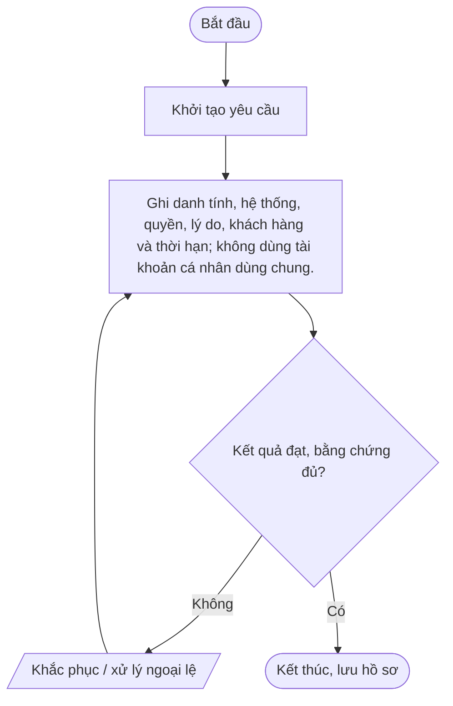
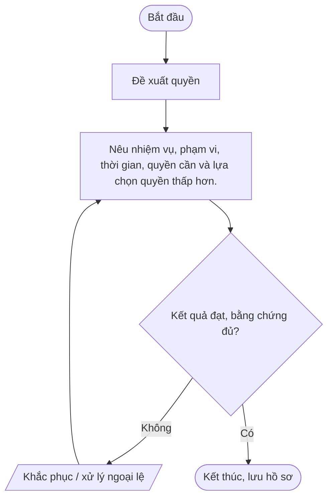
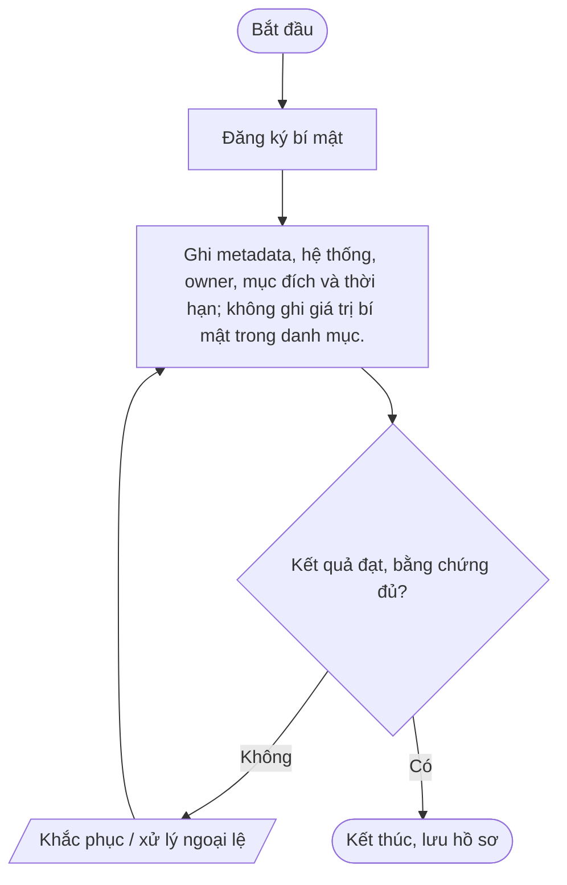
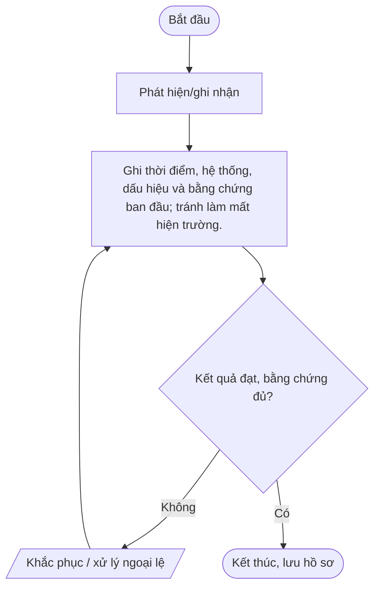
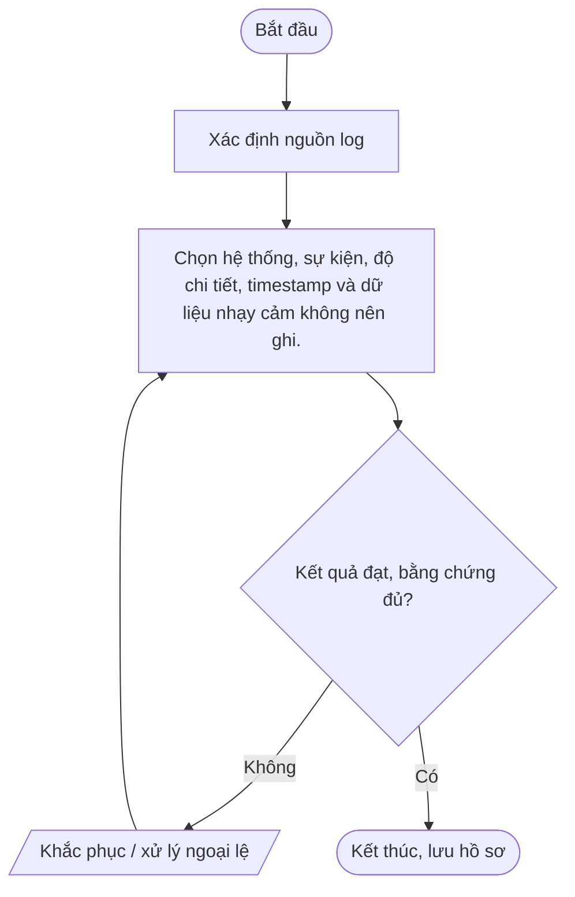
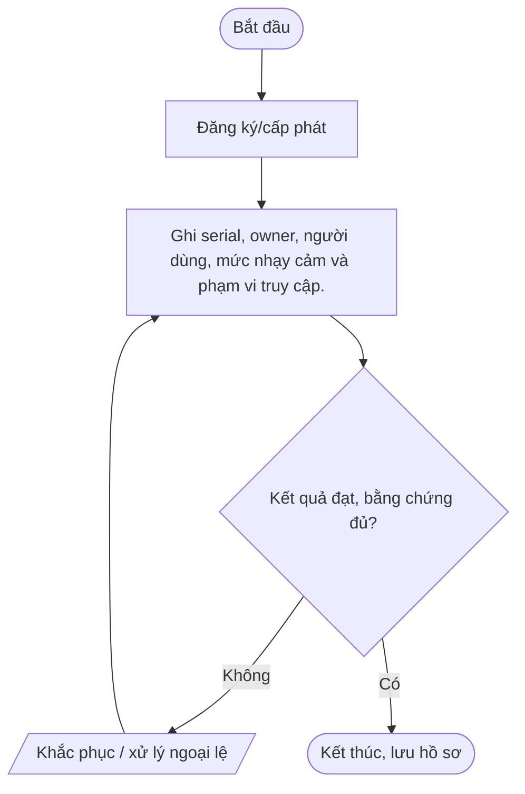
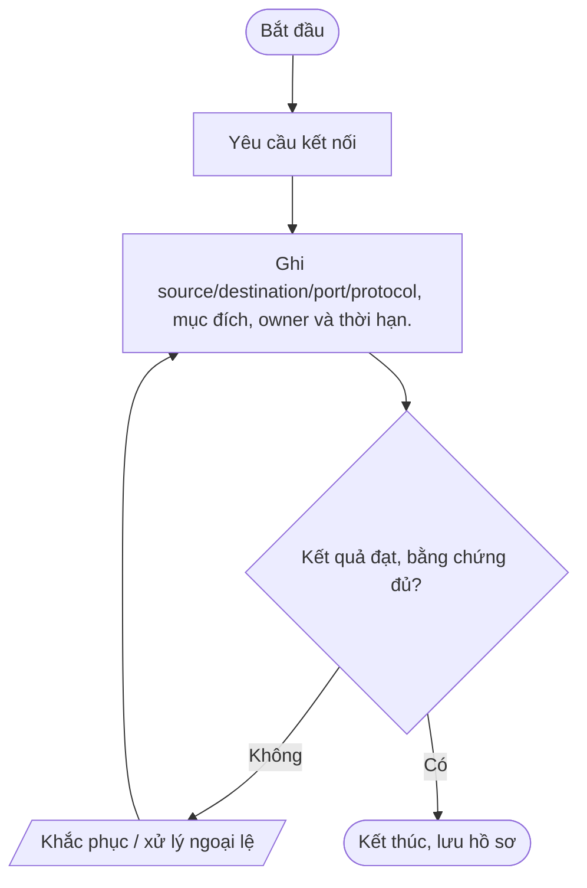
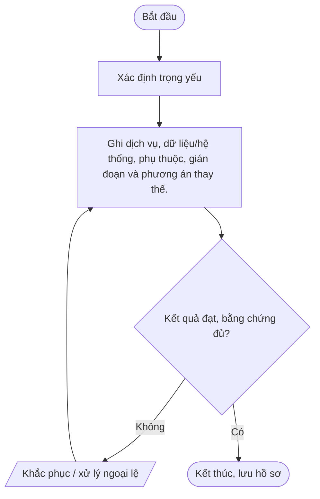
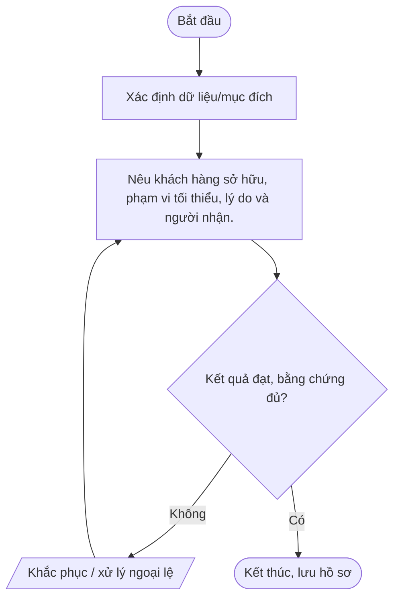

# Nhóm C — An toàn thông tin và bảo vệ dữ liệu

Bộ quy trình chuẩn Mstar — bản dự thảo ngày 2026-10-14. Tài liệu được thiết kế dùng chung cho dịch vụ IT Outsourcing; các yêu cầu cụ thể được cấu hình trong phụ lục khách hàng.

## Quy tắc áp dụng

- Quy trình lõi dùng chung; phụ lục khách hàng xác định phạm vi, SLA, đầu mối, quyền, retention, thông báo sự cố và yêu cầu phục hồi.
- Mọi thao tác trên hệ thống khách hàng phải được hợp đồng/ủy quyền cho phép.
- Bằng chứng phải có thể truy nguyên: ticket, phê duyệt, log, biên bản, kết quả kiểm tra.
- Không lưu mật khẩu, token, API key hoặc secret dạng rõ trong ticket/repository thông thường.
- Quy trình chỉ có hiệu lực sau khi được rà soát và phê duyệt; đây không phải tuyên bố Mstar đã được chứng nhận ISO.
- Tham chiếu: ISO/IEC 27001:2022 và ISO/IEC 27002:2022; mapping cuối cùng cần căn cứ risk assessment và SoA.

## Danh mục trong nhóm

| Mã | Quy trình | Mục đích |
|---|---|---|
| [QT-IT-11](#qt-it-11) | Quản lý tài khoản và quyền truy cập | Bảo đảm mỗi danh tính được xác thực, quyền được phê duyệt theo nhu cầu, rà soát và thu hồi đúng lúc. |
| [QT-ATTT-01](#qt-attt-01) | Quản lý tài khoản đặc quyền | Giới hạn và giám sát tài khoản có khả năng thay đổi hệ thống trọng yếu hoặc truy cập dữ liệu nhạy cảm. |
| [QT-ATTT-02](#qt-attt-02) | Quản lý mật khẩu và bí mật kỹ thuật | Bảo vệ mật khẩu, token, API key, SSH key, chứng thư và bí mật khỏi lộ lọt hoặc tồn tại sau khi hết nhu cầu. |
| [QT-ATTT-03](#qt-attt-03) | Phân loại và xử lý dữ liệu | Bảo vệ dữ liệu theo độ nhạy, quyền sở hữu, mục đích, hợp đồng và vòng đời. |
| [QT-ATTT-04](#qt-attt-04) | Quản lý và ứng cứu sự cố ATTT | Phát hiện, cô lập, điều tra, phục hồi và thông báo sự cố; bảo toàn bằng chứng và cải tiến. |
| [QT-ATTT-05](#qt-attt-05) | Quản lý nhật ký và bằng chứng | Bảo đảm log truy nguyên được, chống sửa/xóa trái phép, lưu giữ và trích xuất có kiểm soát. |
| [QT-ATTT-06](#qt-attt-06) | Quản lý lỗ hổng và bản vá | Ưu tiên khắc phục lỗ hổng theo mức nghiêm trọng, khả năng khai thác, phơi nhiễm và tác động. |
| [QT-ATTT-07](#qt-attt-07) | Bảo vệ thiết bị đầu cuối | Giảm mã độc, mất thiết bị, truy cập trái phép và thất thoát dữ liệu từ thiết bị truy cập hệ thống Mstar/khách hàng. |
| [QT-ATTT-08](#qt-attt-08) | Quản lý mạng, Firewall và truy cập từ xa | Kiểm soát luồng mạng, VPN, firewall và remote support theo nhu cầu, phê duyệt và khả năng truy vết. |
| [QT-ATTT-09](#qt-attt-09) | Quản lý nhà cung cấp và bên thứ ba | Đánh giá và kiểm soát rủi ro nhà cung cấp truy cập hệ thống, dữ liệu hoặc dịch vụ trọng yếu. |
| [QT-ATTT-10](#qt-attt-10) | Kiểm soát dữ liệu khách hàng | Ngăn truy cập, sao chép, chia sẻ hoặc sử dụng dữ liệu khách hàng ngoài mục đích; bảo đảm phân tách và truy vết. |

---
## QT-IT-11 — Quản lý tài khoản và quyền truy cập

**Mục đích:** Bảo đảm mỗi danh tính được xác thực, quyền được phê duyệt theo nhu cầu, rà soát và thu hồi đúng lúc.

**Kích hoạt:** Khi có yêu cầu/sự kiện thuộc phạm vi; khi thay đổi đáng kể; theo chu kỳ; hoặc khi hợp đồng/khách hàng yêu cầu.

**Phạm vi:** Hoạt động Mstar và dịch vụ IT Outsourcing thuộc hợp đồng/ủy quyền. Chi tiết hệ thống, SLA, đầu mối, quyền, retention, thông báo và RTO/RPO phải được cấu hình trong phụ lục khách hàng.

**Vai trò:** Người yêu cầu; người thực hiện; người kiểm tra/chủ sở hữu hệ thống; chủ sở hữu quy trình; IT Lead; người phê duyệt theo ma trận thẩm quyền; đầu mối khách hàng khi hợp đồng yêu cầu. Người thực hiện không tự phê duyệt thay đổi/rủi ro trọng yếu của chính mình.

**Đầu vào:** Yêu cầu/ticket; hợp đồng/phụ lục; danh mục hệ thống/tài sản; quyền được ủy quyền; quy trình liên quan; dữ liệu/bằng chứng hiện có.

**Đầu ra:** Hồ sơ xử lý; kết quả đã xác minh; phê duyệt; ticket/biên bản đóng; việc tồn có owner và hạn.

### Các bước thực hiện

| Bước | Hoạt động | Vai trò chính | Hướng dẫn và kiểm soát | Bằng chứng cần lưu |
|---:|---|---|---|---|
| 1 | Khởi tạo yêu cầu | Người yêu cầu/đầu mối | Khởi tạo yêu cầu | Hồ sơ/ticket/log/phê duyệt tương ứng |
| 2 | Ghi danh tính, hệ thống, quyền, lý do, khách hàng và thời hạn; không dùng tài khoản cá nhân dùng chung. | Chủ sở hữu quy trình/IT Lead | Ghi danh tính, hệ thống, quyền, lý do, khách hàng và thời hạn; không dùng tài khoản cá nhân dùng chung. | Hồ sơ/ticket/log/phê duyệt tương ứng |

### Lưu đồ

### Biểu mẫu/hồ sơ

Xác minh/phê duyệt|Quản lý và chủ sở hữu hệ thống xác nhận quyền tối thiểu, xung đột nhiệm vụ và phê duyệt khách hàng.

### KPI và giám sát

Cấp quyền|Tạo tài khoản riêng, bật MFA theo chính sách, cấp role tối thiểu và ghi log.

### Ngoại lệ và an toàn thông tin

Rà soát|Đối chiếu danh sách với vai trò; ưu tiên quyền đặc quyền, vendor và quyền khách hàng.

- Xác minh thẩm quyền/phạm vi trước khi thao tác; không tự mở rộng quyền.
- Không ghi mật khẩu, API key, token, khóa riêng hoặc mã khôi phục dạng rõ trong ticket, README, email thường hay tài liệu bàn giao.
- Thay đổi hệ thống phải theo QT-IT-13; nghi ngờ sự cố ATTT phải theo QT-ATTT-04; ngoại lệ phải theo QT-ISMS-04.
- Lưu hồ sơ ở kho được Mstar phê duyệt, phân quyền tối thiểu và giữ theo yêu cầu hợp đồng/pháp luật.
- Chỉ đóng việc khi kết quả được kiểm tra và bằng chứng cần thiết đã lưu.

### Phụ lục khách hàng cần cấu hình

| Trường | Giá trị cần xác nhận |
|---|---|
| Khách hàng/mã hợp đồng | Điền theo hợp đồng |
| Phạm vi hệ thống/dịch vụ | Hệ thống, tenant, site, tài sản, loại dịch vụ |
| SLA/lịch hỗ trợ | Theo hợp đồng/phụ lục |
| Đầu mối yêu cầu/phê duyệt | Chức danh, kênh và người thay thế |
| Quyền/kênh kỹ thuật | Phạm vi ủy quyền, MFA, VPN, thời hạn |
| Dữ liệu/lưu giữ | Phân loại, nơi lưu, thời hạn, trả/xóa |
| Thông báo sự cố | Kênh, người nhận, thời hạn |
| Ngoại lệ/rủi ro tồn dư | Mã hồ sơ, phê duyệt, biện pháp bù trừ, ngày hết hạn |

> **Trạng thái:** Dự thảo v0.1 — chờ Mstar rà soát, thử nghiệm và phê duyệt. Tham chiếu ISO chỉ là định hướng; cần xác nhận theo phạm vi ISMS, đánh giá rủi ro và SoA.

---

## QT-ATTT-01 — Quản lý tài khoản đặc quyền

**Mục đích:** Giới hạn và giám sát tài khoản có khả năng thay đổi hệ thống trọng yếu hoặc truy cập dữ liệu nhạy cảm.

**Kích hoạt:** Khi có yêu cầu/sự kiện thuộc phạm vi; khi thay đổi đáng kể; theo chu kỳ; hoặc khi hợp đồng/khách hàng yêu cầu.

**Phạm vi:** Hoạt động Mstar và dịch vụ IT Outsourcing thuộc hợp đồng/ủy quyền. Chi tiết hệ thống, SLA, đầu mối, quyền, retention, thông báo và RTO/RPO phải được cấu hình trong phụ lục khách hàng.

**Vai trò:** Người yêu cầu; người thực hiện; người kiểm tra/chủ sở hữu hệ thống; chủ sở hữu quy trình; IT Lead; người phê duyệt theo ma trận thẩm quyền; đầu mối khách hàng khi hợp đồng yêu cầu. Người thực hiện không tự phê duyệt thay đổi/rủi ro trọng yếu của chính mình.

**Đầu vào:** Yêu cầu/ticket; hợp đồng/phụ lục; danh mục hệ thống/tài sản; quyền được ủy quyền; quy trình liên quan; dữ liệu/bằng chứng hiện có.

**Đầu ra:** Hồ sơ xử lý; kết quả đã xác minh; phê duyệt; ticket/biên bản đóng; việc tồn có owner và hạn.

### Các bước thực hiện

| Bước | Hoạt động | Vai trò chính | Hướng dẫn và kiểm soát | Bằng chứng cần lưu |
|---:|---|---|---|---|
| 1 | Đề xuất quyền | Người yêu cầu/đầu mối | Đề xuất quyền | Hồ sơ/ticket/log/phê duyệt tương ứng |
| 2 | Nêu nhiệm vụ, phạm vi, thời gian, quyền cần và lựa chọn quyền thấp hơn. | Chủ sở hữu quy trình/IT Lead | Nêu nhiệm vụ, phạm vi, thời gian, quyền cần và lựa chọn quyền thấp hơn. | Hồ sơ/ticket/log/phê duyệt tương ứng |

### Lưu đồ

### Biểu mẫu/hồ sơ

Đánh giá/phê duyệt|Đánh giá rủi ro, xung đột nhiệm vụ, MFA, log, yêu cầu khách hàng và thời hạn.

### KPI và giám sát

Cấp quyền có kiểm soát|Dùng danh tính riêng, MFA, quyền vừa đủ/tạm thời; bí mật lưu trong vault.

### Ngoại lệ và an toàn thông tin

Sử dụng/giám sát|Gắn với ticket/change, ghi log và giám sát hành động nhạy cảm.

- Xác minh thẩm quyền/phạm vi trước khi thao tác; không tự mở rộng quyền.
- Không ghi mật khẩu, API key, token, khóa riêng hoặc mã khôi phục dạng rõ trong ticket, README, email thường hay tài liệu bàn giao.
- Thay đổi hệ thống phải theo QT-IT-13; nghi ngờ sự cố ATTT phải theo QT-ATTT-04; ngoại lệ phải theo QT-ISMS-04.
- Lưu hồ sơ ở kho được Mstar phê duyệt, phân quyền tối thiểu và giữ theo yêu cầu hợp đồng/pháp luật.
- Chỉ đóng việc khi kết quả được kiểm tra và bằng chứng cần thiết đã lưu.

### Phụ lục khách hàng cần cấu hình

| Trường | Giá trị cần xác nhận |
|---|---|
| Khách hàng/mã hợp đồng | Điền theo hợp đồng |
| Phạm vi hệ thống/dịch vụ | Hệ thống, tenant, site, tài sản, loại dịch vụ |
| SLA/lịch hỗ trợ | Theo hợp đồng/phụ lục |
| Đầu mối yêu cầu/phê duyệt | Chức danh, kênh và người thay thế |
| Quyền/kênh kỹ thuật | Phạm vi ủy quyền, MFA, VPN, thời hạn |
| Dữ liệu/lưu giữ | Phân loại, nơi lưu, thời hạn, trả/xóa |
| Thông báo sự cố | Kênh, người nhận, thời hạn |
| Ngoại lệ/rủi ro tồn dư | Mã hồ sơ, phê duyệt, biện pháp bù trừ, ngày hết hạn |

> **Trạng thái:** Dự thảo v0.1 — chờ Mstar rà soát, thử nghiệm và phê duyệt. Tham chiếu ISO chỉ là định hướng; cần xác nhận theo phạm vi ISMS, đánh giá rủi ro và SoA.

---

## QT-ATTT-02 — Quản lý mật khẩu và bí mật kỹ thuật

**Mục đích:** Bảo vệ mật khẩu, token, API key, SSH key, chứng thư và bí mật khỏi lộ lọt hoặc tồn tại sau khi hết nhu cầu.

**Kích hoạt:** Khi có yêu cầu/sự kiện thuộc phạm vi; khi thay đổi đáng kể; theo chu kỳ; hoặc khi hợp đồng/khách hàng yêu cầu.

**Phạm vi:** Hoạt động Mstar và dịch vụ IT Outsourcing thuộc hợp đồng/ủy quyền. Chi tiết hệ thống, SLA, đầu mối, quyền, retention, thông báo và RTO/RPO phải được cấu hình trong phụ lục khách hàng.

**Vai trò:** Người yêu cầu; người thực hiện; người kiểm tra/chủ sở hữu hệ thống; chủ sở hữu quy trình; IT Lead; người phê duyệt theo ma trận thẩm quyền; đầu mối khách hàng khi hợp đồng yêu cầu. Người thực hiện không tự phê duyệt thay đổi/rủi ro trọng yếu của chính mình.

**Đầu vào:** Yêu cầu/ticket; hợp đồng/phụ lục; danh mục hệ thống/tài sản; quyền được ủy quyền; quy trình liên quan; dữ liệu/bằng chứng hiện có.

**Đầu ra:** Hồ sơ xử lý; kết quả đã xác minh; phê duyệt; ticket/biên bản đóng; việc tồn có owner và hạn.

### Các bước thực hiện

| Bước | Hoạt động | Vai trò chính | Hướng dẫn và kiểm soát | Bằng chứng cần lưu |
|---:|---|---|---|---|
| 1 | Đăng ký bí mật | Người yêu cầu/đầu mối | Đăng ký bí mật | Hồ sơ/ticket/log/phê duyệt tương ứng |
| 2 | Ghi metadata, hệ thống, owner, mục đích và thời hạn; không ghi giá trị bí mật trong danh mục. | Chủ sở hữu quy trình/IT Lead | Ghi metadata, hệ thống, owner, mục đích và thời hạn; không ghi giá trị bí mật trong danh mục. | Hồ sơ/ticket/log/phê duyệt tương ứng |

### Lưu đồ

### Biểu mẫu/hồ sơ

Chọn kho an toàn|Dùng vault/password manager được duyệt; bật MFA, audit log và quyền tối thiểu.

### KPI và giám sát

Cấp quyền/luân chuyển|Cấp qua kênh an toàn; luân chuyển khi thay người hoặc theo rủi ro; không gửi qua ticket/email thường.

### Ngoại lệ và an toàn thông tin

Ứng phó nghi lộ|Thu hồi/rotate, kiểm tra log và các hệ thống phụ thuộc; mở incident khi cần.

- Xác minh thẩm quyền/phạm vi trước khi thao tác; không tự mở rộng quyền.
- Không ghi mật khẩu, API key, token, khóa riêng hoặc mã khôi phục dạng rõ trong ticket, README, email thường hay tài liệu bàn giao.
- Thay đổi hệ thống phải theo QT-IT-13; nghi ngờ sự cố ATTT phải theo QT-ATTT-04; ngoại lệ phải theo QT-ISMS-04.
- Lưu hồ sơ ở kho được Mstar phê duyệt, phân quyền tối thiểu và giữ theo yêu cầu hợp đồng/pháp luật.
- Chỉ đóng việc khi kết quả được kiểm tra và bằng chứng cần thiết đã lưu.

### Phụ lục khách hàng cần cấu hình

| Trường | Giá trị cần xác nhận |
|---|---|
| Khách hàng/mã hợp đồng | Điền theo hợp đồng |
| Phạm vi hệ thống/dịch vụ | Hệ thống, tenant, site, tài sản, loại dịch vụ |
| SLA/lịch hỗ trợ | Theo hợp đồng/phụ lục |
| Đầu mối yêu cầu/phê duyệt | Chức danh, kênh và người thay thế |
| Quyền/kênh kỹ thuật | Phạm vi ủy quyền, MFA, VPN, thời hạn |
| Dữ liệu/lưu giữ | Phân loại, nơi lưu, thời hạn, trả/xóa |
| Thông báo sự cố | Kênh, người nhận, thời hạn |
| Ngoại lệ/rủi ro tồn dư | Mã hồ sơ, phê duyệt, biện pháp bù trừ, ngày hết hạn |

> **Trạng thái:** Dự thảo v0.1 — chờ Mstar rà soát, thử nghiệm và phê duyệt. Tham chiếu ISO chỉ là định hướng; cần xác nhận theo phạm vi ISMS, đánh giá rủi ro và SoA.

---

## QT-ATTT-03 — Phân loại và xử lý dữ liệu

**Mục đích:** Bảo vệ dữ liệu theo độ nhạy, quyền sở hữu, mục đích, hợp đồng và vòng đời.

**Kích hoạt:** Khi có yêu cầu/sự kiện thuộc phạm vi; khi thay đổi đáng kể; theo chu kỳ; hoặc khi hợp đồng/khách hàng yêu cầu.

**Phạm vi:** Hoạt động Mstar và dịch vụ IT Outsourcing thuộc hợp đồng/ủy quyền. Chi tiết hệ thống, SLA, đầu mối, quyền, retention, thông báo và RTO/RPO phải được cấu hình trong phụ lục khách hàng.

**Vai trò:** Người yêu cầu; người thực hiện; người kiểm tra/chủ sở hữu hệ thống; chủ sở hữu quy trình; IT Lead; người phê duyệt theo ma trận thẩm quyền; đầu mối khách hàng khi hợp đồng yêu cầu. Người thực hiện không tự phê duyệt thay đổi/rủi ro trọng yếu của chính mình.

**Đầu vào:** Yêu cầu/ticket; hợp đồng/phụ lục; danh mục hệ thống/tài sản; quyền được ủy quyền; quy trình liên quan; dữ liệu/bằng chứng hiện có.

**Đầu ra:** Hồ sơ xử lý; kết quả đã xác minh; phê duyệt; ticket/biên bản đóng; việc tồn có owner và hạn.

### Các bước thực hiện

| Bước | Hoạt động | Vai trò chính | Hướng dẫn và kiểm soát | Bằng chứng cần lưu |
|---:|---|---|---|---|
| 1 | Nhận diện/owner | Người yêu cầu/đầu mối | Nhận diện/owner | Hồ sơ/ticket/log/phê duyệt tương ứng |
| 2 | Ghi loại dữ liệu, nguồn, mục đích, chủ sở hữu, dữ liệu cá nhân/nhạy cảm và khách hàng. | Chủ sở hữu quy trình/IT Lead | Ghi loại dữ liệu, nguồn, mục đích, chủ sở hữu, dữ liệu cá nhân/nhạy cảm và khách hàng. | Hồ sơ/ticket/log/phê duyệt tương ứng |

### Lưu đồ

### Biểu mẫu/hồ sơ

Phân loại|Gán nhãn và yêu cầu truy cập, mã hóa, logging, truyền và lưu giữ.

### KPI và giám sát

Phê duyệt xử lý|Xác minh mục đích hợp lệ, người được phép và quyền xuất/chia sẻ.

### Ngoại lệ và an toàn thông tin

Lưu/truyền/chia sẻ|Dùng nơi/kênh được duyệt, mã hóa phù hợp, xác minh người nhận và tránh bản sao không kiểm soát.

- Xác minh thẩm quyền/phạm vi trước khi thao tác; không tự mở rộng quyền.
- Không ghi mật khẩu, API key, token, khóa riêng hoặc mã khôi phục dạng rõ trong ticket, README, email thường hay tài liệu bàn giao.
- Thay đổi hệ thống phải theo QT-IT-13; nghi ngờ sự cố ATTT phải theo QT-ATTT-04; ngoại lệ phải theo QT-ISMS-04.
- Lưu hồ sơ ở kho được Mstar phê duyệt, phân quyền tối thiểu và giữ theo yêu cầu hợp đồng/pháp luật.
- Chỉ đóng việc khi kết quả được kiểm tra và bằng chứng cần thiết đã lưu.

### Phụ lục khách hàng cần cấu hình

| Trường | Giá trị cần xác nhận |
|---|---|
| Khách hàng/mã hợp đồng | Điền theo hợp đồng |
| Phạm vi hệ thống/dịch vụ | Hệ thống, tenant, site, tài sản, loại dịch vụ |
| SLA/lịch hỗ trợ | Theo hợp đồng/phụ lục |
| Đầu mối yêu cầu/phê duyệt | Chức danh, kênh và người thay thế |
| Quyền/kênh kỹ thuật | Phạm vi ủy quyền, MFA, VPN, thời hạn |
| Dữ liệu/lưu giữ | Phân loại, nơi lưu, thời hạn, trả/xóa |
| Thông báo sự cố | Kênh, người nhận, thời hạn |
| Ngoại lệ/rủi ro tồn dư | Mã hồ sơ, phê duyệt, biện pháp bù trừ, ngày hết hạn |

> **Trạng thái:** Dự thảo v0.1 — chờ Mstar rà soát, thử nghiệm và phê duyệt. Tham chiếu ISO chỉ là định hướng; cần xác nhận theo phạm vi ISMS, đánh giá rủi ro và SoA.

---

## QT-ATTT-04 — Quản lý và ứng cứu sự cố ATTT

**Mục đích:** Phát hiện, cô lập, điều tra, phục hồi và thông báo sự cố; bảo toàn bằng chứng và cải tiến.

**Kích hoạt:** Khi có yêu cầu/sự kiện thuộc phạm vi; khi thay đổi đáng kể; theo chu kỳ; hoặc khi hợp đồng/khách hàng yêu cầu.

**Phạm vi:** Hoạt động Mstar và dịch vụ IT Outsourcing thuộc hợp đồng/ủy quyền. Chi tiết hệ thống, SLA, đầu mối, quyền, retention, thông báo và RTO/RPO phải được cấu hình trong phụ lục khách hàng.

**Vai trò:** Người yêu cầu; người thực hiện; người kiểm tra/chủ sở hữu hệ thống; chủ sở hữu quy trình; IT Lead; người phê duyệt theo ma trận thẩm quyền; đầu mối khách hàng khi hợp đồng yêu cầu. Người thực hiện không tự phê duyệt thay đổi/rủi ro trọng yếu của chính mình.

**Đầu vào:** Yêu cầu/ticket; hợp đồng/phụ lục; danh mục hệ thống/tài sản; quyền được ủy quyền; quy trình liên quan; dữ liệu/bằng chứng hiện có.

**Đầu ra:** Hồ sơ xử lý; kết quả đã xác minh; phê duyệt; ticket/biên bản đóng; việc tồn có owner và hạn.

### Các bước thực hiện

| Bước | Hoạt động | Vai trò chính | Hướng dẫn và kiểm soát | Bằng chứng cần lưu |
|---:|---|---|---|---|
| 1 | Phát hiện/ghi nhận | Người yêu cầu/đầu mối | Phát hiện/ghi nhận | Hồ sơ/ticket/log/phê duyệt tương ứng |
| 2 | Ghi thời điểm, hệ thống, dấu hiệu và bằng chứng ban đầu; tránh làm mất hiện trường. | Chủ sở hữu quy trình/IT Lead | Ghi thời điểm, hệ thống, dấu hiệu và bằng chứng ban đầu; tránh làm mất hiện trường. | Hồ sơ/ticket/log/phê duyệt tương ứng |

### Lưu đồ

### Biểu mẫu/hồ sơ

Phân loại/kích hoạt|Xác định mức độ, dữ liệu/khách hàng ảnh hưởng, người chỉ huy và nghĩa vụ thông báo.

### KPI và giám sát

Cô lập/bảo toàn|Giới hạn lan rộng, bảo toàn log/snapshot/hash và chuỗi bàn giao bằng chứng.

### Ngoại lệ và an toàn thông tin

Điều tra/khắc phục|Xác định vector/phạm vi, loại bỏ nguyên nhân và xác minh môi trường sạch.

- Xác minh thẩm quyền/phạm vi trước khi thao tác; không tự mở rộng quyền.
- Không ghi mật khẩu, API key, token, khóa riêng hoặc mã khôi phục dạng rõ trong ticket, README, email thường hay tài liệu bàn giao.
- Thay đổi hệ thống phải theo QT-IT-13; nghi ngờ sự cố ATTT phải theo QT-ATTT-04; ngoại lệ phải theo QT-ISMS-04.
- Lưu hồ sơ ở kho được Mstar phê duyệt, phân quyền tối thiểu và giữ theo yêu cầu hợp đồng/pháp luật.
- Chỉ đóng việc khi kết quả được kiểm tra và bằng chứng cần thiết đã lưu.

### Phụ lục khách hàng cần cấu hình

| Trường | Giá trị cần xác nhận |
|---|---|
| Khách hàng/mã hợp đồng | Điền theo hợp đồng |
| Phạm vi hệ thống/dịch vụ | Hệ thống, tenant, site, tài sản, loại dịch vụ |
| SLA/lịch hỗ trợ | Theo hợp đồng/phụ lục |
| Đầu mối yêu cầu/phê duyệt | Chức danh, kênh và người thay thế |
| Quyền/kênh kỹ thuật | Phạm vi ủy quyền, MFA, VPN, thời hạn |
| Dữ liệu/lưu giữ | Phân loại, nơi lưu, thời hạn, trả/xóa |
| Thông báo sự cố | Kênh, người nhận, thời hạn |
| Ngoại lệ/rủi ro tồn dư | Mã hồ sơ, phê duyệt, biện pháp bù trừ, ngày hết hạn |

> **Trạng thái:** Dự thảo v0.1 — chờ Mstar rà soát, thử nghiệm và phê duyệt. Tham chiếu ISO chỉ là định hướng; cần xác nhận theo phạm vi ISMS, đánh giá rủi ro và SoA.

---

## QT-ATTT-05 — Quản lý nhật ký và bằng chứng

**Mục đích:** Bảo đảm log truy nguyên được, chống sửa/xóa trái phép, lưu giữ và trích xuất có kiểm soát.

**Kích hoạt:** Khi có yêu cầu/sự kiện thuộc phạm vi; khi thay đổi đáng kể; theo chu kỳ; hoặc khi hợp đồng/khách hàng yêu cầu.

**Phạm vi:** Hoạt động Mstar và dịch vụ IT Outsourcing thuộc hợp đồng/ủy quyền. Chi tiết hệ thống, SLA, đầu mối, quyền, retention, thông báo và RTO/RPO phải được cấu hình trong phụ lục khách hàng.

**Vai trò:** Người yêu cầu; người thực hiện; người kiểm tra/chủ sở hữu hệ thống; chủ sở hữu quy trình; IT Lead; người phê duyệt theo ma trận thẩm quyền; đầu mối khách hàng khi hợp đồng yêu cầu. Người thực hiện không tự phê duyệt thay đổi/rủi ro trọng yếu của chính mình.

**Đầu vào:** Yêu cầu/ticket; hợp đồng/phụ lục; danh mục hệ thống/tài sản; quyền được ủy quyền; quy trình liên quan; dữ liệu/bằng chứng hiện có.

**Đầu ra:** Hồ sơ xử lý; kết quả đã xác minh; phê duyệt; ticket/biên bản đóng; việc tồn có owner và hạn.

### Các bước thực hiện

| Bước | Hoạt động | Vai trò chính | Hướng dẫn và kiểm soát | Bằng chứng cần lưu |
|---:|---|---|---|---|
| 1 | Xác định nguồn log | Người yêu cầu/đầu mối | Xác định nguồn log | Hồ sơ/ticket/log/phê duyệt tương ứng |
| 2 | Chọn hệ thống, sự kiện, độ chi tiết, timestamp và dữ liệu nhạy cảm không nên ghi. | Chủ sở hữu quy trình/IT Lead | Chọn hệ thống, sự kiện, độ chi tiết, timestamp và dữ liệu nhạy cảm không nên ghi. | Hồ sơ/ticket/log/phê duyệt tương ứng |

### Lưu đồ

### Biểu mẫu/hồ sơ

Cấu hình/bảo vệ|Bật log, đồng bộ thời gian, giới hạn quyền, chuyển tới kho được bảo vệ khi phù hợp.

### KPI và giám sát

Giám sát/rà soát|Theo dõi lỗi thu thập, dung lượng, bất thường và truy cập log.

### Ngoại lệ và an toàn thông tin

Trích xuất/bảo toàn|Ghi mục đích, người làm, phạm vi, thời gian, hash nếu phù hợp và chain-of-custody.

- Xác minh thẩm quyền/phạm vi trước khi thao tác; không tự mở rộng quyền.
- Không ghi mật khẩu, API key, token, khóa riêng hoặc mã khôi phục dạng rõ trong ticket, README, email thường hay tài liệu bàn giao.
- Thay đổi hệ thống phải theo QT-IT-13; nghi ngờ sự cố ATTT phải theo QT-ATTT-04; ngoại lệ phải theo QT-ISMS-04.
- Lưu hồ sơ ở kho được Mstar phê duyệt, phân quyền tối thiểu và giữ theo yêu cầu hợp đồng/pháp luật.
- Chỉ đóng việc khi kết quả được kiểm tra và bằng chứng cần thiết đã lưu.

### Phụ lục khách hàng cần cấu hình

| Trường | Giá trị cần xác nhận |
|---|---|
| Khách hàng/mã hợp đồng | Điền theo hợp đồng |
| Phạm vi hệ thống/dịch vụ | Hệ thống, tenant, site, tài sản, loại dịch vụ |
| SLA/lịch hỗ trợ | Theo hợp đồng/phụ lục |
| Đầu mối yêu cầu/phê duyệt | Chức danh, kênh và người thay thế |
| Quyền/kênh kỹ thuật | Phạm vi ủy quyền, MFA, VPN, thời hạn |
| Dữ liệu/lưu giữ | Phân loại, nơi lưu, thời hạn, trả/xóa |
| Thông báo sự cố | Kênh, người nhận, thời hạn |
| Ngoại lệ/rủi ro tồn dư | Mã hồ sơ, phê duyệt, biện pháp bù trừ, ngày hết hạn |

> **Trạng thái:** Dự thảo v0.1 — chờ Mstar rà soát, thử nghiệm và phê duyệt. Tham chiếu ISO chỉ là định hướng; cần xác nhận theo phạm vi ISMS, đánh giá rủi ro và SoA.

---

## QT-ATTT-06 — Quản lý lỗ hổng và bản vá

**Mục đích:** Ưu tiên khắc phục lỗ hổng theo mức nghiêm trọng, khả năng khai thác, phơi nhiễm và tác động.

**Kích hoạt:** Khi có yêu cầu/sự kiện thuộc phạm vi; khi thay đổi đáng kể; theo chu kỳ; hoặc khi hợp đồng/khách hàng yêu cầu.

**Phạm vi:** Hoạt động Mstar và dịch vụ IT Outsourcing thuộc hợp đồng/ủy quyền. Chi tiết hệ thống, SLA, đầu mối, quyền, retention, thông báo và RTO/RPO phải được cấu hình trong phụ lục khách hàng.

**Vai trò:** Người yêu cầu; người thực hiện; người kiểm tra/chủ sở hữu hệ thống; chủ sở hữu quy trình; IT Lead; người phê duyệt theo ma trận thẩm quyền; đầu mối khách hàng khi hợp đồng yêu cầu. Người thực hiện không tự phê duyệt thay đổi/rủi ro trọng yếu của chính mình.

**Đầu vào:** Yêu cầu/ticket; hợp đồng/phụ lục; danh mục hệ thống/tài sản; quyền được ủy quyền; quy trình liên quan; dữ liệu/bằng chứng hiện có.

**Đầu ra:** Hồ sơ xử lý; kết quả đã xác minh; phê duyệt; ticket/biên bản đóng; việc tồn có owner và hạn.

### Các bước thực hiện

| Bước | Hoạt động | Vai trò chính | Hướng dẫn và kiểm soát | Bằng chứng cần lưu |
|---:|---|---|---|---|
| 1 | Tiếp nhận phát hiện | Người yêu cầu/đầu mối | Tiếp nhận phát hiện | Hồ sơ/ticket/log/phê duyệt tương ứng |
| 2 | Ghi nguồn, tài sản, phiên bản, bằng chứng, mức độ và ngày phát hiện. | Chủ sở hữu quy trình/IT Lead | Ghi nguồn, tài sản, phiên bản, bằng chứng, mức độ và ngày phát hiện. | Hồ sơ/ticket/log/phê duyệt tương ứng |

### Lưu đồ

### Biểu mẫu/hồ sơ

Xác minh/ưu tiên|Xác nhận áp dụng, exposure, exploit, tác động và hạn khắc phục.

### KPI và giám sát

Chọn phương án|Vá, nâng cấp, giảm thiểu, cô lập hoặc ngoại lệ có thời hạn; đánh giá backup/rollback.

### Ngoại lệ và an toàn thông tin

Triển khai có kiểm soát|Thực hiện change, thử nghiệm, phê duyệt và thông báo cần thiết.

- Xác minh thẩm quyền/phạm vi trước khi thao tác; không tự mở rộng quyền.
- Không ghi mật khẩu, API key, token, khóa riêng hoặc mã khôi phục dạng rõ trong ticket, README, email thường hay tài liệu bàn giao.
- Thay đổi hệ thống phải theo QT-IT-13; nghi ngờ sự cố ATTT phải theo QT-ATTT-04; ngoại lệ phải theo QT-ISMS-04.
- Lưu hồ sơ ở kho được Mstar phê duyệt, phân quyền tối thiểu và giữ theo yêu cầu hợp đồng/pháp luật.
- Chỉ đóng việc khi kết quả được kiểm tra và bằng chứng cần thiết đã lưu.

### Phụ lục khách hàng cần cấu hình

| Trường | Giá trị cần xác nhận |
|---|---|
| Khách hàng/mã hợp đồng | Điền theo hợp đồng |
| Phạm vi hệ thống/dịch vụ | Hệ thống, tenant, site, tài sản, loại dịch vụ |
| SLA/lịch hỗ trợ | Theo hợp đồng/phụ lục |
| Đầu mối yêu cầu/phê duyệt | Chức danh, kênh và người thay thế |
| Quyền/kênh kỹ thuật | Phạm vi ủy quyền, MFA, VPN, thời hạn |
| Dữ liệu/lưu giữ | Phân loại, nơi lưu, thời hạn, trả/xóa |
| Thông báo sự cố | Kênh, người nhận, thời hạn |
| Ngoại lệ/rủi ro tồn dư | Mã hồ sơ, phê duyệt, biện pháp bù trừ, ngày hết hạn |

> **Trạng thái:** Dự thảo v0.1 — chờ Mstar rà soát, thử nghiệm và phê duyệt. Tham chiếu ISO chỉ là định hướng; cần xác nhận theo phạm vi ISMS, đánh giá rủi ro và SoA.

---

## QT-ATTT-07 — Bảo vệ thiết bị đầu cuối

**Mục đích:** Giảm mã độc, mất thiết bị, truy cập trái phép và thất thoát dữ liệu từ thiết bị truy cập hệ thống Mstar/khách hàng.

**Kích hoạt:** Khi có yêu cầu/sự kiện thuộc phạm vi; khi thay đổi đáng kể; theo chu kỳ; hoặc khi hợp đồng/khách hàng yêu cầu.

**Phạm vi:** Hoạt động Mstar và dịch vụ IT Outsourcing thuộc hợp đồng/ủy quyền. Chi tiết hệ thống, SLA, đầu mối, quyền, retention, thông báo và RTO/RPO phải được cấu hình trong phụ lục khách hàng.

**Vai trò:** Người yêu cầu; người thực hiện; người kiểm tra/chủ sở hữu hệ thống; chủ sở hữu quy trình; IT Lead; người phê duyệt theo ma trận thẩm quyền; đầu mối khách hàng khi hợp đồng yêu cầu. Người thực hiện không tự phê duyệt thay đổi/rủi ro trọng yếu của chính mình.

**Đầu vào:** Yêu cầu/ticket; hợp đồng/phụ lục; danh mục hệ thống/tài sản; quyền được ủy quyền; quy trình liên quan; dữ liệu/bằng chứng hiện có.

**Đầu ra:** Hồ sơ xử lý; kết quả đã xác minh; phê duyệt; ticket/biên bản đóng; việc tồn có owner và hạn.

### Các bước thực hiện

| Bước | Hoạt động | Vai trò chính | Hướng dẫn và kiểm soát | Bằng chứng cần lưu |
|---:|---|---|---|---|
| 1 | Đăng ký/cấp phát | Người yêu cầu/đầu mối | Đăng ký/cấp phát | Hồ sơ/ticket/log/phê duyệt tương ứng |
| 2 | Ghi serial, owner, người dùng, mức nhạy cảm và phạm vi truy cập. | Chủ sở hữu quy trình/IT Lead | Ghi serial, owner, người dùng, mức nhạy cảm và phạm vi truy cập. | Hồ sơ/ticket/log/phê duyệt tương ứng |

### Lưu đồ

### Biểu mẫu/hồ sơ

Áp baseline|Cập nhật, EDR/AV, mã hóa, firewall, screen lock, MFA và hạn chế local admin.

### KPI và giám sát

Giám sát tuân thủ|Theo dõi EDR, bản vá, mã hóa, phần mềm không phép và thiết bị mất liên lạc.

### Ngoại lệ và an toàn thông tin

Xử lý cảnh báo/mất|Cô lập, khóa session/token, điều tra và thông báo nếu ảnh hưởng khách hàng.

- Xác minh thẩm quyền/phạm vi trước khi thao tác; không tự mở rộng quyền.
- Không ghi mật khẩu, API key, token, khóa riêng hoặc mã khôi phục dạng rõ trong ticket, README, email thường hay tài liệu bàn giao.
- Thay đổi hệ thống phải theo QT-IT-13; nghi ngờ sự cố ATTT phải theo QT-ATTT-04; ngoại lệ phải theo QT-ISMS-04.
- Lưu hồ sơ ở kho được Mstar phê duyệt, phân quyền tối thiểu và giữ theo yêu cầu hợp đồng/pháp luật.
- Chỉ đóng việc khi kết quả được kiểm tra và bằng chứng cần thiết đã lưu.

### Phụ lục khách hàng cần cấu hình

| Trường | Giá trị cần xác nhận |
|---|---|
| Khách hàng/mã hợp đồng | Điền theo hợp đồng |
| Phạm vi hệ thống/dịch vụ | Hệ thống, tenant, site, tài sản, loại dịch vụ |
| SLA/lịch hỗ trợ | Theo hợp đồng/phụ lục |
| Đầu mối yêu cầu/phê duyệt | Chức danh, kênh và người thay thế |
| Quyền/kênh kỹ thuật | Phạm vi ủy quyền, MFA, VPN, thời hạn |
| Dữ liệu/lưu giữ | Phân loại, nơi lưu, thời hạn, trả/xóa |
| Thông báo sự cố | Kênh, người nhận, thời hạn |
| Ngoại lệ/rủi ro tồn dư | Mã hồ sơ, phê duyệt, biện pháp bù trừ, ngày hết hạn |

> **Trạng thái:** Dự thảo v0.1 — chờ Mstar rà soát, thử nghiệm và phê duyệt. Tham chiếu ISO chỉ là định hướng; cần xác nhận theo phạm vi ISMS, đánh giá rủi ro và SoA.

---

## QT-ATTT-08 — Quản lý mạng, Firewall và truy cập từ xa

**Mục đích:** Kiểm soát luồng mạng, VPN, firewall và remote support theo nhu cầu, phê duyệt và khả năng truy vết.

**Kích hoạt:** Khi có yêu cầu/sự kiện thuộc phạm vi; khi thay đổi đáng kể; theo chu kỳ; hoặc khi hợp đồng/khách hàng yêu cầu.

**Phạm vi:** Hoạt động Mstar và dịch vụ IT Outsourcing thuộc hợp đồng/ủy quyền. Chi tiết hệ thống, SLA, đầu mối, quyền, retention, thông báo và RTO/RPO phải được cấu hình trong phụ lục khách hàng.

**Vai trò:** Người yêu cầu; người thực hiện; người kiểm tra/chủ sở hữu hệ thống; chủ sở hữu quy trình; IT Lead; người phê duyệt theo ma trận thẩm quyền; đầu mối khách hàng khi hợp đồng yêu cầu. Người thực hiện không tự phê duyệt thay đổi/rủi ro trọng yếu của chính mình.

**Đầu vào:** Yêu cầu/ticket; hợp đồng/phụ lục; danh mục hệ thống/tài sản; quyền được ủy quyền; quy trình liên quan; dữ liệu/bằng chứng hiện có.

**Đầu ra:** Hồ sơ xử lý; kết quả đã xác minh; phê duyệt; ticket/biên bản đóng; việc tồn có owner và hạn.

### Các bước thực hiện

| Bước | Hoạt động | Vai trò chính | Hướng dẫn và kiểm soát | Bằng chứng cần lưu |
|---:|---|---|---|---|
| 1 | Yêu cầu kết nối | Người yêu cầu/đầu mối | Yêu cầu kết nối | Hồ sơ/ticket/log/phê duyệt tương ứng |
| 2 | Ghi source/destination/port/protocol, mục đích, owner và thời hạn. | Chủ sở hữu quy trình/IT Lead | Ghi source/destination/port/protocol, mục đích, owner và thời hạn. | Hồ sơ/ticket/log/phê duyệt tương ứng |

### Lưu đồ

### Biểu mẫu/hồ sơ

Đánh giá an toàn|Kiểm tra phân vùng, exposure Internet, MFA/VPN, log và phương án ít quyền hơn.

### KPI và giám sát

Phê duyệt|IT Lead/chủ sở hữu hệ thống/khách hàng phê duyệt theo phạm vi và thẩm quyền.

### Ngoại lệ và an toàn thông tin

Triển khai/test|Backup cấu hình, áp rule hẹp nhất, ghi change, test kết nối và log.

- Xác minh thẩm quyền/phạm vi trước khi thao tác; không tự mở rộng quyền.
- Không ghi mật khẩu, API key, token, khóa riêng hoặc mã khôi phục dạng rõ trong ticket, README, email thường hay tài liệu bàn giao.
- Thay đổi hệ thống phải theo QT-IT-13; nghi ngờ sự cố ATTT phải theo QT-ATTT-04; ngoại lệ phải theo QT-ISMS-04.
- Lưu hồ sơ ở kho được Mstar phê duyệt, phân quyền tối thiểu và giữ theo yêu cầu hợp đồng/pháp luật.
- Chỉ đóng việc khi kết quả được kiểm tra và bằng chứng cần thiết đã lưu.

### Phụ lục khách hàng cần cấu hình

| Trường | Giá trị cần xác nhận |
|---|---|
| Khách hàng/mã hợp đồng | Điền theo hợp đồng |
| Phạm vi hệ thống/dịch vụ | Hệ thống, tenant, site, tài sản, loại dịch vụ |
| SLA/lịch hỗ trợ | Theo hợp đồng/phụ lục |
| Đầu mối yêu cầu/phê duyệt | Chức danh, kênh và người thay thế |
| Quyền/kênh kỹ thuật | Phạm vi ủy quyền, MFA, VPN, thời hạn |
| Dữ liệu/lưu giữ | Phân loại, nơi lưu, thời hạn, trả/xóa |
| Thông báo sự cố | Kênh, người nhận, thời hạn |
| Ngoại lệ/rủi ro tồn dư | Mã hồ sơ, phê duyệt, biện pháp bù trừ, ngày hết hạn |

> **Trạng thái:** Dự thảo v0.1 — chờ Mstar rà soát, thử nghiệm và phê duyệt. Tham chiếu ISO chỉ là định hướng; cần xác nhận theo phạm vi ISMS, đánh giá rủi ro và SoA.

---

## QT-ATTT-09 — Quản lý nhà cung cấp và bên thứ ba

**Mục đích:** Đánh giá và kiểm soát rủi ro nhà cung cấp truy cập hệ thống, dữ liệu hoặc dịch vụ trọng yếu.

**Kích hoạt:** Khi có yêu cầu/sự kiện thuộc phạm vi; khi thay đổi đáng kể; theo chu kỳ; hoặc khi hợp đồng/khách hàng yêu cầu.

**Phạm vi:** Hoạt động Mstar và dịch vụ IT Outsourcing thuộc hợp đồng/ủy quyền. Chi tiết hệ thống, SLA, đầu mối, quyền, retention, thông báo và RTO/RPO phải được cấu hình trong phụ lục khách hàng.

**Vai trò:** Người yêu cầu; người thực hiện; người kiểm tra/chủ sở hữu hệ thống; chủ sở hữu quy trình; IT Lead; người phê duyệt theo ma trận thẩm quyền; đầu mối khách hàng khi hợp đồng yêu cầu. Người thực hiện không tự phê duyệt thay đổi/rủi ro trọng yếu của chính mình.

**Đầu vào:** Yêu cầu/ticket; hợp đồng/phụ lục; danh mục hệ thống/tài sản; quyền được ủy quyền; quy trình liên quan; dữ liệu/bằng chứng hiện có.

**Đầu ra:** Hồ sơ xử lý; kết quả đã xác minh; phê duyệt; ticket/biên bản đóng; việc tồn có owner và hạn.

### Các bước thực hiện

| Bước | Hoạt động | Vai trò chính | Hướng dẫn và kiểm soát | Bằng chứng cần lưu |
|---:|---|---|---|---|
| 1 | Xác định trọng yếu | Người yêu cầu/đầu mối | Xác định trọng yếu | Hồ sơ/ticket/log/phê duyệt tương ứng |
| 2 | Ghi dịch vụ, dữ liệu/hệ thống, phụ thuộc, gián đoạn và phương án thay thế. | Chủ sở hữu quy trình/IT Lead | Ghi dịch vụ, dữ liệu/hệ thống, phụ thuộc, gián đoạn và phương án thay thế. | Hồ sơ/ticket/log/phê duyệt tương ứng |

### Lưu đồ

### Biểu mẫu/hồ sơ

Thẩm định rủi ro|Đánh giá bảo mật, vị trí dữ liệu, sự cố, liên tục kinh doanh và quyền kiểm tra.

### KPI và giám sát

Ký điều khoản/phê duyệt|Chốt NDA, xử lý dữ liệu, thông báo sự cố, subprocessor, SLA, audit và exit.

### Ngoại lệ và an toàn thông tin

Cấp quyền/theo dõi|Cấp quyền tối thiểu, MFA, thời hạn; theo dõi SLA, sự cố và thay đổi.

- Xác minh thẩm quyền/phạm vi trước khi thao tác; không tự mở rộng quyền.
- Không ghi mật khẩu, API key, token, khóa riêng hoặc mã khôi phục dạng rõ trong ticket, README, email thường hay tài liệu bàn giao.
- Thay đổi hệ thống phải theo QT-IT-13; nghi ngờ sự cố ATTT phải theo QT-ATTT-04; ngoại lệ phải theo QT-ISMS-04.
- Lưu hồ sơ ở kho được Mstar phê duyệt, phân quyền tối thiểu và giữ theo yêu cầu hợp đồng/pháp luật.
- Chỉ đóng việc khi kết quả được kiểm tra và bằng chứng cần thiết đã lưu.

### Phụ lục khách hàng cần cấu hình

| Trường | Giá trị cần xác nhận |
|---|---|
| Khách hàng/mã hợp đồng | Điền theo hợp đồng |
| Phạm vi hệ thống/dịch vụ | Hệ thống, tenant, site, tài sản, loại dịch vụ |
| SLA/lịch hỗ trợ | Theo hợp đồng/phụ lục |
| Đầu mối yêu cầu/phê duyệt | Chức danh, kênh và người thay thế |
| Quyền/kênh kỹ thuật | Phạm vi ủy quyền, MFA, VPN, thời hạn |
| Dữ liệu/lưu giữ | Phân loại, nơi lưu, thời hạn, trả/xóa |
| Thông báo sự cố | Kênh, người nhận, thời hạn |
| Ngoại lệ/rủi ro tồn dư | Mã hồ sơ, phê duyệt, biện pháp bù trừ, ngày hết hạn |

> **Trạng thái:** Dự thảo v0.1 — chờ Mstar rà soát, thử nghiệm và phê duyệt. Tham chiếu ISO chỉ là định hướng; cần xác nhận theo phạm vi ISMS, đánh giá rủi ro và SoA.

---

## QT-ATTT-10 — Kiểm soát dữ liệu khách hàng

**Mục đích:** Ngăn truy cập, sao chép, chia sẻ hoặc sử dụng dữ liệu khách hàng ngoài mục đích; bảo đảm phân tách và truy vết.

**Kích hoạt:** Khi có yêu cầu/sự kiện thuộc phạm vi; khi thay đổi đáng kể; theo chu kỳ; hoặc khi hợp đồng/khách hàng yêu cầu.

**Phạm vi:** Hoạt động Mstar và dịch vụ IT Outsourcing thuộc hợp đồng/ủy quyền. Chi tiết hệ thống, SLA, đầu mối, quyền, retention, thông báo và RTO/RPO phải được cấu hình trong phụ lục khách hàng.

**Vai trò:** Người yêu cầu; người thực hiện; người kiểm tra/chủ sở hữu hệ thống; chủ sở hữu quy trình; IT Lead; người phê duyệt theo ma trận thẩm quyền; đầu mối khách hàng khi hợp đồng yêu cầu. Người thực hiện không tự phê duyệt thay đổi/rủi ro trọng yếu của chính mình.

**Đầu vào:** Yêu cầu/ticket; hợp đồng/phụ lục; danh mục hệ thống/tài sản; quyền được ủy quyền; quy trình liên quan; dữ liệu/bằng chứng hiện có.

**Đầu ra:** Hồ sơ xử lý; kết quả đã xác minh; phê duyệt; ticket/biên bản đóng; việc tồn có owner và hạn.

### Các bước thực hiện

| Bước | Hoạt động | Vai trò chính | Hướng dẫn và kiểm soát | Bằng chứng cần lưu |
|---:|---|---|---|---|
| 1 | Xác định dữ liệu/mục đích | Người yêu cầu/đầu mối | Xác định dữ liệu/mục đích | Hồ sơ/ticket/log/phê duyệt tương ứng |
| 2 | Nêu khách hàng sở hữu, phạm vi tối thiểu, lý do và người nhận. | Chủ sở hữu quy trình/IT Lead | Nêu khách hàng sở hữu, phạm vi tối thiểu, lý do và người nhận. | Hồ sơ/ticket/log/phê duyệt tương ứng |

### Lưu đồ

### Biểu mẫu/hồ sơ

Xác minh quyền/phê duyệt|Kiểm tra hợp đồng, mục đích, dữ liệu cá nhân/nhạy cảm và thẩm quyền.

### KPI và giám sát

Chọn kênh an toàn|Dùng kênh được duyệt, mã hóa, thời hạn link và phương án xóa.

### Ngoại lệ và an toàn thông tin

Thực hiện/ghi nhận|Xử lý dữ liệu tối thiểu; xác minh người nhận; ghi ticket/log và thời điểm.

- Xác minh thẩm quyền/phạm vi trước khi thao tác; không tự mở rộng quyền.
- Không ghi mật khẩu, API key, token, khóa riêng hoặc mã khôi phục dạng rõ trong ticket, README, email thường hay tài liệu bàn giao.
- Thay đổi hệ thống phải theo QT-IT-13; nghi ngờ sự cố ATTT phải theo QT-ATTT-04; ngoại lệ phải theo QT-ISMS-04.
- Lưu hồ sơ ở kho được Mstar phê duyệt, phân quyền tối thiểu và giữ theo yêu cầu hợp đồng/pháp luật.
- Chỉ đóng việc khi kết quả được kiểm tra và bằng chứng cần thiết đã lưu.

### Phụ lục khách hàng cần cấu hình

| Trường | Giá trị cần xác nhận |
|---|---|
| Khách hàng/mã hợp đồng | Điền theo hợp đồng |
| Phạm vi hệ thống/dịch vụ | Hệ thống, tenant, site, tài sản, loại dịch vụ |
| SLA/lịch hỗ trợ | Theo hợp đồng/phụ lục |
| Đầu mối yêu cầu/phê duyệt | Chức danh, kênh và người thay thế |
| Quyền/kênh kỹ thuật | Phạm vi ủy quyền, MFA, VPN, thời hạn |
| Dữ liệu/lưu giữ | Phân loại, nơi lưu, thời hạn, trả/xóa |
| Thông báo sự cố | Kênh, người nhận, thời hạn |
| Ngoại lệ/rủi ro tồn dư | Mã hồ sơ, phê duyệt, biện pháp bù trừ, ngày hết hạn |

> **Trạng thái:** Dự thảo v0.1 — chờ Mstar rà soát, thử nghiệm và phê duyệt. Tham chiếu ISO chỉ là định hướng; cần xác nhận theo phạm vi ISMS, đánh giá rủi ro và SoA.
