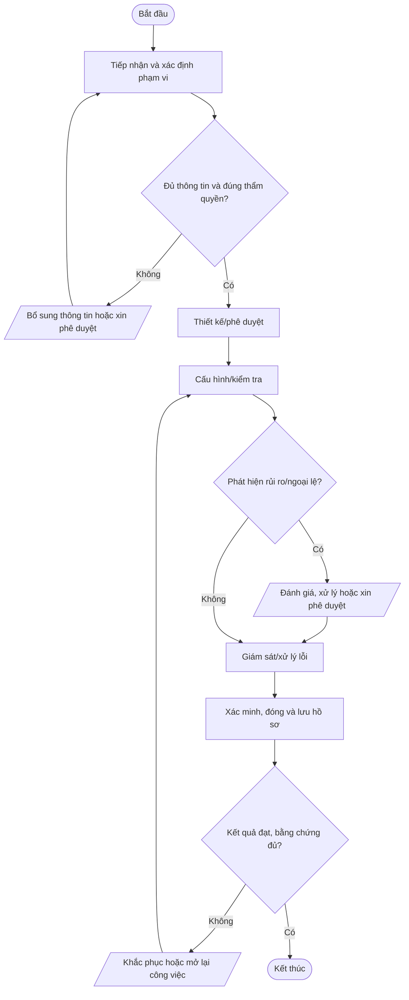
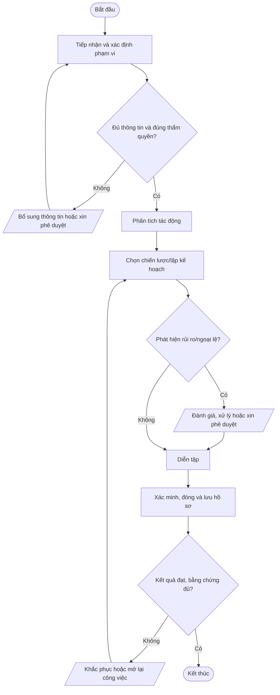
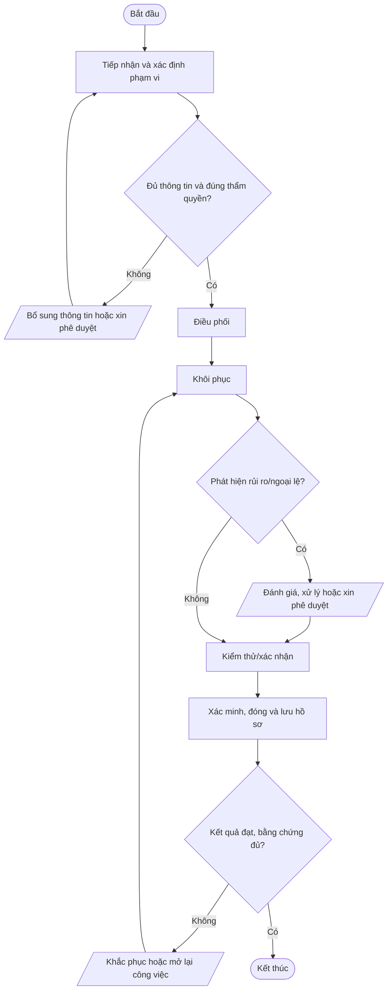
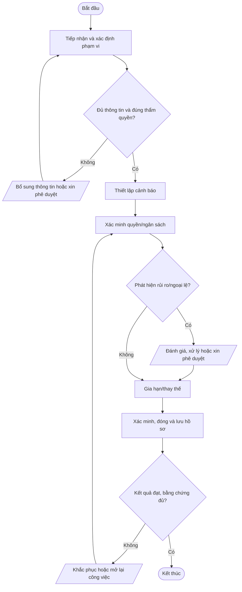

# Nhóm D — Sao lưu, khôi phục và liên tục kinh doanh

Bộ quy trình chuẩn Mstar — bản dự thảo ngày 2026-10-14. Tài liệu được thiết kế dùng chung cho dịch vụ IT Outsourcing; các yêu cầu cụ thể được cấu hình trong phụ lục khách hàng.

## Quy tắc áp dụng

- Quy trình lõi dùng chung; phụ lục khách hàng xác định phạm vi, SLA, đầu mối, quyền, retention, thông báo sự cố và yêu cầu phục hồi.
- Mọi thao tác trên hệ thống khách hàng phải được hợp đồng/ủy quyền cho phép.
- Bằng chứng phải có thể truy nguyên: ticket, phê duyệt, log, biên bản, kết quả kiểm tra.
- Không lưu mật khẩu, token, API key hoặc secret dạng rõ trong ticket/repository thông thường.
- Quy trình chỉ có hiệu lực sau khi được rà soát và phê duyệt; đây không phải tuyên bố Mstar đã được chứng nhận ISO.
- Tham chiếu: ISO/IEC 27001:2022 và ISO/IEC 27002:2022; mapping cuối cùng cần căn cứ risk assessment và SoA.

## Tài liệu quy trình chi tiết

Danh mục quy trình chi tiết thuộc nhóm Sao lưu, khôi phục và BCP/DR:

| Mã | Quy trình chi tiết |
|---|---|
| QT-OPS-01 | [Sao lưu dữ liệu](../chi-tiet/QT-OPS-01.md) |
| QT-OPS-02 | [Kiểm thử khôi phục dữ liệu](../chi-tiet/QT-OPS-02.md) |
| QT-OPS-03 | [Quản lý domain, SSL và chứng thư](../chi-tiet/QT-OPS-03.md) |
| QT-BCP-01 | [Duy trì hoạt động liên tục](../chi-tiet/QT-BCP-01.md) |
| QT-BCP-02 | [Khôi phục sau thảm họa](../chi-tiet/QT-BCP-02.md) |

Mở [danh mục toàn bộ quy trình chi tiết](../chi-tiet/README.md). Các tài liệu vẫn là dự thảo, chỉ áp dụng sau khi được rà soát, thử nghiệm và phê duyệt.

---

## Danh mục trong nhóm

| Mã | Quy trình | Mục đích |
|---|---|---|
| [QT-OPS-01](#qt-ops-01) | Sao lưu dữ liệu | Xác định phạm vi, lịch, mã hóa, nơi lưu, retention và theo dõi backup theo RPO/RTO đã thỏa thuận. |
| [QT-OPS-02](#qt-ops-02) | Kiểm thử khôi phục dữ liệu | Chứng minh bản sao lưu khôi phục được, dữ liệu toàn vẹn và mục tiêu RTO/RPO đạt được. |
| [QT-BCP-01](#qt-bcp-01) | Duy trì hoạt động kinh doanh | Xác định dịch vụ trọng yếu, tác động gián đoạn, RTO/RPO và phương án duy trì hoạt động. |
| [QT-BCP-02](#qt-bcp-02) | Khôi phục sau thảm họa | Điều phối kích hoạt DR, khôi phục theo ưu tiên và xác nhận dịch vụ trở lại mức chấp nhận được. |
| [QT-OPS-03](#qt-ops-03) | Quản lý domain, SSL và chứng thư số | Ngăn gián đoạn do domain, DNS, TLS/SSL, license hoặc chứng thư hết hạn. |

---
## QT-OPS-01 — Sao lưu dữ liệu

**Mục đích:** Xác định phạm vi, lịch, mã hóa, nơi lưu, retention và theo dõi backup theo RPO/RTO đã thỏa thuận.

**Kích hoạt:** Khi có yêu cầu/sự kiện thuộc phạm vi, khi có thay đổi đáng kể hoặc theo chu kỳ được quy định.

**Phạm vi:** Mstar và hoạt động IT Outsourcing trong phạm vi hợp đồng/ủy quyền. Phụ lục từng khách hàng phải xác định hệ thống, SLA, đầu mối, quyền truy cập, retention, thông báo và yêu cầu phục hồi riêng.

**Vai trò:** Người yêu cầu/đầu mối khách hàng; người thực hiện; người kiểm tra/chủ sở hữu hệ thống; chủ sở hữu quy trình; IT Lead; người phê duyệt theo ma trận thẩm quyền. Người thực hiện không tự phê duyệt rủi ro trọng yếu do chính mình tạo ra.

**Đầu vào:** Yêu cầu/ticket; hợp đồng/phụ lục; danh mục hệ thống/tài sản; quyền được ủy quyền; quy trình liên quan; dữ liệu/bằng chứng hiện có.

**Đầu ra:** Hồ sơ xử lý; kết quả đã xác minh; phê duyệt; ticket/biên bản đóng; việc tồn có owner và hạn.

### Trình tự thực hiện

| Bước | Hoạt động | Vai trò chính | Hướng dẫn và kiểm soát | Bằng chứng cần lưu |
|---:|---|---|---|---|
| 1 | Tiếp nhận và xác định phạm vi | Người tiếp nhận | Ghi nhận yêu cầu/sự kiện, xác minh hệ thống, mục tiêu, phạm vi hợp đồng, đầu mối và thông tin tối thiểu. Nếu thiếu thông tin hoặc thẩm quyền thì chưa thực hiện bước rủi ro. | Ticket, log, phê duyệt hoặc biên bản tương ứng |
| 2 | Thiết kế/phê duyệt | Người thực hiện và người kiểm tra | Chọn phương thức, bản sao tách biệt/immutable khi phù hợp, quyền và dung lượng. | Ticket, log, phê duyệt hoặc biên bản tương ứng |
| 3 | Cấu hình/kiểm tra | Người thực hiện và người kiểm tra | Thiết lập job, cảnh báo, mã hóa, quyền tối thiểu và test lần đầu. | Ticket, log, phê duyệt hoặc biên bản tương ứng |
| 4 | Giám sát/xử lý lỗi | Người thực hiện và người kiểm tra | Theo dõi job, dung lượng, khoảng trống RPO; tạo ticket, chạy lại và thông báo khi ảnh hưởng. | Ticket, log, phê duyệt hoặc biên bản tương ứng |
| 5 | Xác minh, đóng và lưu hồ sơ | Chủ sở hữu quy trình/IT Lead | Người kiểm tra xác nhận kết quả, quyền và phạm vi; ghi thời gian, bằng chứng, quyết định, thông báo và việc tồn. Chỉ đóng khi đủ hồ sơ hoặc có ngoại lệ được duyệt. | Ticket, log, phê duyệt hoặc biên bản tương ứng |

### Lưu đồ

### Biểu mẫu và hồ sơ

- FR-QTOPS01-01: Phiếu yêu cầu/checklist khởi tạo.
- FR-QTOPS01-02: Hồ sơ đánh giá, phê duyệt hoặc xác minh.
- FR-QTOPS01-03: Nhật ký thực hiện/biên bản/báo cáo.
- FR-QTOPS01-04: Xác nhận hoàn tất và theo dõi việc tồn.

*Mã biểu mẫu là mã đề xuất; khi ban hành cần đưa vào danh mục tài liệu, xác định chủ sở hữu, nơi lưu, quyền truy cập và thời hạn lưu giữ.*

### KPI và giám sát

- Tỷ lệ hồ sơ có đủ thông tin đầu vào và phê duyệt.
- Tỷ lệ bước/công việc hoàn thành đúng hạn theo quy trình hoặc hợp đồng.
- Số lỗi, ngoại lệ, sự cố hoặc hồ sơ phải làm lại.
- Tỷ lệ hành động khắc phục đóng đúng hạn.

Chủ sở hữu quy trình phải xác định nguồn dữ liệu, công thức, chu kỳ đo và ngưỡng cảnh báo trước khi áp dụng.

### Ngoại lệ và an toàn thông tin

Theo dõi job, dung lượng, khoảng trống RPO; tạo ticket, chạy lại và thông báo khi ảnh hưởng.

- Không thao tác ngoài phạm vi hợp đồng/ủy quyền; khi thiếu quyền hoặc phê duyệt phải tạm dừng bước có rủi ro.
- Không ghi mật khẩu, API key, token, khóa riêng hoặc mã khôi phục dạng rõ trong ticket, README, email thường hay tài liệu bàn giao.
- Thay đổi hệ thống phải theo QT-IT-13; nghi ngờ sự cố ATTT phải theo QT-ATTT-04; ngoại lệ phải theo QT-ISMS-04.
- Mọi ngoại lệ phải có lý do, đánh giá rủi ro, biện pháp bù trừ, người phê duyệt, owner và hạn hết hiệu lực.

### Phụ lục cần cấu hình theo khách hàng

| Trường | Nội dung xác nhận |
|---|---|
| Khách hàng/mã hợp đồng | Theo hợp đồng đang hiệu lực |
| Phạm vi hệ thống/dịch vụ | Hệ thống, tenant, site, tài sản và loại dịch vụ |
| SLA/lịch hỗ trợ | Theo hợp đồng/phụ lục, không dùng mặc định chung |
| Đầu mối yêu cầu/phê duyệt | Chức danh, kênh liên hệ và người thay thế |
| Quyền/kênh kỹ thuật | Phạm vi ủy quyền, MFA, VPN, thời hạn |
| Dữ liệu/lưu giữ | Phân loại, nơi lưu, thời hạn, trả/xóa |
| Thông báo sự cố | Kênh, người nhận và thời hạn |
| Ngoại lệ/rủi ro tồn dư | Mã hồ sơ, phê duyệt, bù trừ, ngày hết hạn |

**Trạng thái:** Dự thảo v0.1 — chờ rà soát, thử nghiệm và phê duyệt. Mapping ISO chỉ mang tính định hướng; cần xác nhận theo phạm vi ISMS, đánh giá rủi ro và SoA.

---

## QT-OPS-02 — Kiểm thử khôi phục dữ liệu

**Mục đích:** Chứng minh bản sao lưu khôi phục được, dữ liệu toàn vẹn và mục tiêu RTO/RPO đạt được.

**Kích hoạt:** Khi có yêu cầu/sự kiện thuộc phạm vi, khi có thay đổi đáng kể hoặc theo chu kỳ được quy định.

**Phạm vi:** Mstar và hoạt động IT Outsourcing trong phạm vi hợp đồng/ủy quyền. Phụ lục từng khách hàng phải xác định hệ thống, SLA, đầu mối, quyền truy cập, retention, thông báo và yêu cầu phục hồi riêng.

**Vai trò:** Người yêu cầu/đầu mối khách hàng; người thực hiện; người kiểm tra/chủ sở hữu hệ thống; chủ sở hữu quy trình; IT Lead; người phê duyệt theo ma trận thẩm quyền. Người thực hiện không tự phê duyệt rủi ro trọng yếu do chính mình tạo ra.

**Đầu vào:** Yêu cầu/ticket; hợp đồng/phụ lục; danh mục hệ thống/tài sản; quyền được ủy quyền; quy trình liên quan; dữ liệu/bằng chứng hiện có.

**Đầu ra:** Hồ sơ xử lý; kết quả đã xác minh; phê duyệt; ticket/biên bản đóng; việc tồn có owner và hạn.

### Trình tự thực hiện

| Bước | Hoạt động | Vai trò chính | Hướng dẫn và kiểm soát | Bằng chứng cần lưu |
|---:|---|---|---|---|
| 1 | Tiếp nhận và xác định phạm vi | Người tiếp nhận | Ghi nhận yêu cầu/sự kiện, xác minh hệ thống, mục tiêu, phạm vi hợp đồng, đầu mối và thông tin tối thiểu. Nếu thiếu thông tin hoặc thẩm quyền thì chưa thực hiện bước rủi ro. | Ticket, log, phê duyệt hoặc biên bản tương ứng |
| 2 | Phê duyệt/chuẩn bị | Người thực hiện và người kiểm tra | Xác nhận không ảnh hưởng production; kiểm tra môi trường, quyền, bản sao và dung lượng. | Ticket, log, phê duyệt hoặc biên bản tương ứng |
| 3 | Thực hiện restore | Người thực hiện và người kiểm tra | Khôi phục theo runbook vào môi trường an toàn; ghi thời gian, lỗi và thao tác. | Ticket, log, phê duyệt hoặc biên bản tương ứng |
| 4 | Xác minh | Người thực hiện và người kiểm tra | Đối chiếu dữ liệu, quyền, dịch vụ và thời gian thực tế với mục tiêu. | Ticket, log, phê duyệt hoặc biên bản tương ứng |
| 5 | Xác minh, đóng và lưu hồ sơ | Chủ sở hữu quy trình/IT Lead | Người kiểm tra xác nhận kết quả, quyền và phạm vi; ghi thời gian, bằng chứng, quyết định, thông báo và việc tồn. Chỉ đóng khi đủ hồ sơ hoặc có ngoại lệ được duyệt. | Ticket, log, phê duyệt hoặc biên bản tương ứng |

### Lưu đồ

### Biểu mẫu và hồ sơ

- FR-QTOPS02-01: Phiếu yêu cầu/checklist khởi tạo.
- FR-QTOPS02-02: Hồ sơ đánh giá, phê duyệt hoặc xác minh.
- FR-QTOPS02-03: Nhật ký thực hiện/biên bản/báo cáo.
- FR-QTOPS02-04: Xác nhận hoàn tất và theo dõi việc tồn.

*Mã biểu mẫu là mã đề xuất; khi ban hành cần đưa vào danh mục tài liệu, xác định chủ sở hữu, nơi lưu, quyền truy cập và thời hạn lưu giữ.*

### KPI và giám sát

- Tỷ lệ hồ sơ có đủ thông tin đầu vào và phê duyệt.
- Tỷ lệ bước/công việc hoàn thành đúng hạn theo quy trình hoặc hợp đồng.
- Số lỗi, ngoại lệ, sự cố hoặc hồ sơ phải làm lại.
- Tỷ lệ hành động khắc phục đóng đúng hạn.

Chủ sở hữu quy trình phải xác định nguồn dữ liệu, công thức, chu kỳ đo và ngưỡng cảnh báo trước khi áp dụng.

### Ngoại lệ và an toàn thông tin

Đối chiếu dữ liệu, quyền, dịch vụ và thời gian thực tế với mục tiêu.

- Không thao tác ngoài phạm vi hợp đồng/ủy quyền; khi thiếu quyền hoặc phê duyệt phải tạm dừng bước có rủi ro.
- Không ghi mật khẩu, API key, token, khóa riêng hoặc mã khôi phục dạng rõ trong ticket, README, email thường hay tài liệu bàn giao.
- Thay đổi hệ thống phải theo QT-IT-13; nghi ngờ sự cố ATTT phải theo QT-ATTT-04; ngoại lệ phải theo QT-ISMS-04.
- Mọi ngoại lệ phải có lý do, đánh giá rủi ro, biện pháp bù trừ, người phê duyệt, owner và hạn hết hiệu lực.

### Phụ lục cần cấu hình theo khách hàng

| Trường | Nội dung xác nhận |
|---|---|
| Khách hàng/mã hợp đồng | Theo hợp đồng đang hiệu lực |
| Phạm vi hệ thống/dịch vụ | Hệ thống, tenant, site, tài sản và loại dịch vụ |
| SLA/lịch hỗ trợ | Theo hợp đồng/phụ lục, không dùng mặc định chung |
| Đầu mối yêu cầu/phê duyệt | Chức danh, kênh liên hệ và người thay thế |
| Quyền/kênh kỹ thuật | Phạm vi ủy quyền, MFA, VPN, thời hạn |
| Dữ liệu/lưu giữ | Phân loại, nơi lưu, thời hạn, trả/xóa |
| Thông báo sự cố | Kênh, người nhận và thời hạn |
| Ngoại lệ/rủi ro tồn dư | Mã hồ sơ, phê duyệt, bù trừ, ngày hết hạn |

**Trạng thái:** Dự thảo v0.1 — chờ rà soát, thử nghiệm và phê duyệt. Mapping ISO chỉ mang tính định hướng; cần xác nhận theo phạm vi ISMS, đánh giá rủi ro và SoA.

---

## QT-BCP-01 — Duy trì hoạt động kinh doanh

**Mục đích:** Xác định dịch vụ trọng yếu, tác động gián đoạn, RTO/RPO và phương án duy trì hoạt động.

**Kích hoạt:** Khi có yêu cầu/sự kiện thuộc phạm vi, khi có thay đổi đáng kể hoặc theo chu kỳ được quy định.

**Phạm vi:** Mstar và hoạt động IT Outsourcing trong phạm vi hợp đồng/ủy quyền. Phụ lục từng khách hàng phải xác định hệ thống, SLA, đầu mối, quyền truy cập, retention, thông báo và yêu cầu phục hồi riêng.

**Vai trò:** Người yêu cầu/đầu mối khách hàng; người thực hiện; người kiểm tra/chủ sở hữu hệ thống; chủ sở hữu quy trình; IT Lead; người phê duyệt theo ma trận thẩm quyền. Người thực hiện không tự phê duyệt rủi ro trọng yếu do chính mình tạo ra.

**Đầu vào:** Yêu cầu/ticket; hợp đồng/phụ lục; danh mục hệ thống/tài sản; quyền được ủy quyền; quy trình liên quan; dữ liệu/bằng chứng hiện có.

**Đầu ra:** Hồ sơ xử lý; kết quả đã xác minh; phê duyệt; ticket/biên bản đóng; việc tồn có owner và hạn.

### Trình tự thực hiện

| Bước | Hoạt động | Vai trò chính | Hướng dẫn và kiểm soát | Bằng chứng cần lưu |
|---:|---|---|---|---|
| 1 | Tiếp nhận và xác định phạm vi | Người tiếp nhận | Ghi nhận yêu cầu/sự kiện, xác minh hệ thống, mục tiêu, phạm vi hợp đồng, đầu mối và thông tin tối thiểu. Nếu thiếu thông tin hoặc thẩm quyền thì chưa thực hiện bước rủi ro. | Ticket, log, phê duyệt hoặc biên bản tương ứng |
| 2 | Phân tích tác động | Người thực hiện và người kiểm tra | Đánh giá hậu quả theo thời gian, gián đoạn chấp nhận được và nghĩa vụ khách hàng. | Ticket, log, phê duyệt hoặc biên bản tương ứng |
| 3 | Chọn chiến lược/lập kế hoạch | Người thực hiện và người kiểm tra | Xác định nhân sự thay thế, liên lạc, địa điểm, công cụ, kích hoạt và trách nhiệm. | Ticket, log, phê duyệt hoặc biên bản tương ứng |
| 4 | Diễn tập | Người thực hiện và người kiểm tra | Tabletop/test phù hợp, ghi thời gian, thiếu sót và bài học. | Ticket, log, phê duyệt hoặc biên bản tương ứng |
| 5 | Xác minh, đóng và lưu hồ sơ | Chủ sở hữu quy trình/IT Lead | Người kiểm tra xác nhận kết quả, quyền và phạm vi; ghi thời gian, bằng chứng, quyết định, thông báo và việc tồn. Chỉ đóng khi đủ hồ sơ hoặc có ngoại lệ được duyệt. | Ticket, log, phê duyệt hoặc biên bản tương ứng |

### Lưu đồ

### Biểu mẫu và hồ sơ

- FR-QTBCP01-01: Phiếu yêu cầu/checklist khởi tạo.
- FR-QTBCP01-02: Hồ sơ đánh giá, phê duyệt hoặc xác minh.
- FR-QTBCP01-03: Nhật ký thực hiện/biên bản/báo cáo.
- FR-QTBCP01-04: Xác nhận hoàn tất và theo dõi việc tồn.

*Mã biểu mẫu là mã đề xuất; khi ban hành cần đưa vào danh mục tài liệu, xác định chủ sở hữu, nơi lưu, quyền truy cập và thời hạn lưu giữ.*

### KPI và giám sát

- Tỷ lệ hồ sơ có đủ thông tin đầu vào và phê duyệt.
- Tỷ lệ bước/công việc hoàn thành đúng hạn theo quy trình hoặc hợp đồng.
- Số lỗi, ngoại lệ, sự cố hoặc hồ sơ phải làm lại.
- Tỷ lệ hành động khắc phục đóng đúng hạn.

Chủ sở hữu quy trình phải xác định nguồn dữ liệu, công thức, chu kỳ đo và ngưỡng cảnh báo trước khi áp dụng.

### Ngoại lệ và an toàn thông tin

Tabletop/test phù hợp, ghi thời gian, thiếu sót và bài học.

- Không thao tác ngoài phạm vi hợp đồng/ủy quyền; khi thiếu quyền hoặc phê duyệt phải tạm dừng bước có rủi ro.
- Không ghi mật khẩu, API key, token, khóa riêng hoặc mã khôi phục dạng rõ trong ticket, README, email thường hay tài liệu bàn giao.
- Thay đổi hệ thống phải theo QT-IT-13; nghi ngờ sự cố ATTT phải theo QT-ATTT-04; ngoại lệ phải theo QT-ISMS-04.
- Mọi ngoại lệ phải có lý do, đánh giá rủi ro, biện pháp bù trừ, người phê duyệt, owner và hạn hết hiệu lực.

### Phụ lục cần cấu hình theo khách hàng

| Trường | Nội dung xác nhận |
|---|---|
| Khách hàng/mã hợp đồng | Theo hợp đồng đang hiệu lực |
| Phạm vi hệ thống/dịch vụ | Hệ thống, tenant, site, tài sản và loại dịch vụ |
| SLA/lịch hỗ trợ | Theo hợp đồng/phụ lục, không dùng mặc định chung |
| Đầu mối yêu cầu/phê duyệt | Chức danh, kênh liên hệ và người thay thế |
| Quyền/kênh kỹ thuật | Phạm vi ủy quyền, MFA, VPN, thời hạn |
| Dữ liệu/lưu giữ | Phân loại, nơi lưu, thời hạn, trả/xóa |
| Thông báo sự cố | Kênh, người nhận và thời hạn |
| Ngoại lệ/rủi ro tồn dư | Mã hồ sơ, phê duyệt, bù trừ, ngày hết hạn |

**Trạng thái:** Dự thảo v0.1 — chờ rà soát, thử nghiệm và phê duyệt. Mapping ISO chỉ mang tính định hướng; cần xác nhận theo phạm vi ISMS, đánh giá rủi ro và SoA.

---

## QT-BCP-02 — Khôi phục sau thảm họa

**Mục đích:** Điều phối kích hoạt DR, khôi phục theo ưu tiên và xác nhận dịch vụ trở lại mức chấp nhận được.

**Kích hoạt:** Khi có yêu cầu/sự kiện thuộc phạm vi, khi có thay đổi đáng kể hoặc theo chu kỳ được quy định.

**Phạm vi:** Mstar và hoạt động IT Outsourcing trong phạm vi hợp đồng/ủy quyền. Phụ lục từng khách hàng phải xác định hệ thống, SLA, đầu mối, quyền truy cập, retention, thông báo và yêu cầu phục hồi riêng.

**Vai trò:** Người yêu cầu/đầu mối khách hàng; người thực hiện; người kiểm tra/chủ sở hữu hệ thống; chủ sở hữu quy trình; IT Lead; người phê duyệt theo ma trận thẩm quyền. Người thực hiện không tự phê duyệt rủi ro trọng yếu do chính mình tạo ra.

**Đầu vào:** Yêu cầu/ticket; hợp đồng/phụ lục; danh mục hệ thống/tài sản; quyền được ủy quyền; quy trình liên quan; dữ liệu/bằng chứng hiện có.

**Đầu ra:** Hồ sơ xử lý; kết quả đã xác minh; phê duyệt; ticket/biên bản đóng; việc tồn có owner và hạn.

### Trình tự thực hiện

| Bước | Hoạt động | Vai trò chính | Hướng dẫn và kiểm soát | Bằng chứng cần lưu |
|---:|---|---|---|---|
| 1 | Tiếp nhận và xác định phạm vi | Người tiếp nhận | Ghi nhận yêu cầu/sự kiện, xác minh hệ thống, mục tiêu, phạm vi hợp đồng, đầu mối và thông tin tối thiểu. Nếu thiếu thông tin hoặc thẩm quyền thì chưa thực hiện bước rủi ro. | Ticket, log, phê duyệt hoặc biên bản tương ứng |
| 2 | Điều phối | Người thực hiện và người kiểm tra | Mở kênh liên lạc, phân vai, ưu tiên dịch vụ và thông báo theo hợp đồng. | Ticket, log, phê duyệt hoặc biên bản tương ứng |
| 3 | Khôi phục | Người thực hiện và người kiểm tra | Khôi phục mạng, định danh, dữ liệu, ứng dụng và phụ thuộc theo runbook. | Ticket, log, phê duyệt hoặc biên bản tương ứng |
| 4 | Kiểm thử/xác nhận | Người thực hiện và người kiểm tra | Kiểm tra dữ liệu, bảo mật, nghiệp vụ, RTO/RPO thực tế và khách hàng xác nhận khi cần. | Ticket, log, phê duyệt hoặc biên bản tương ứng |
| 5 | Xác minh, đóng và lưu hồ sơ | Chủ sở hữu quy trình/IT Lead | Người kiểm tra xác nhận kết quả, quyền và phạm vi; ghi thời gian, bằng chứng, quyết định, thông báo và việc tồn. Chỉ đóng khi đủ hồ sơ hoặc có ngoại lệ được duyệt. | Ticket, log, phê duyệt hoặc biên bản tương ứng |

### Lưu đồ

### Biểu mẫu và hồ sơ

- FR-QTBCP02-01: Phiếu yêu cầu/checklist khởi tạo.
- FR-QTBCP02-02: Hồ sơ đánh giá, phê duyệt hoặc xác minh.
- FR-QTBCP02-03: Nhật ký thực hiện/biên bản/báo cáo.
- FR-QTBCP02-04: Xác nhận hoàn tất và theo dõi việc tồn.

*Mã biểu mẫu là mã đề xuất; khi ban hành cần đưa vào danh mục tài liệu, xác định chủ sở hữu, nơi lưu, quyền truy cập và thời hạn lưu giữ.*

### KPI và giám sát

- Tỷ lệ hồ sơ có đủ thông tin đầu vào và phê duyệt.
- Tỷ lệ bước/công việc hoàn thành đúng hạn theo quy trình hoặc hợp đồng.
- Số lỗi, ngoại lệ, sự cố hoặc hồ sơ phải làm lại.
- Tỷ lệ hành động khắc phục đóng đúng hạn.

Chủ sở hữu quy trình phải xác định nguồn dữ liệu, công thức, chu kỳ đo và ngưỡng cảnh báo trước khi áp dụng.

### Ngoại lệ và an toàn thông tin

Kiểm tra dữ liệu, bảo mật, nghiệp vụ, RTO/RPO thực tế và khách hàng xác nhận khi cần.

- Không thao tác ngoài phạm vi hợp đồng/ủy quyền; khi thiếu quyền hoặc phê duyệt phải tạm dừng bước có rủi ro.
- Không ghi mật khẩu, API key, token, khóa riêng hoặc mã khôi phục dạng rõ trong ticket, README, email thường hay tài liệu bàn giao.
- Thay đổi hệ thống phải theo QT-IT-13; nghi ngờ sự cố ATTT phải theo QT-ATTT-04; ngoại lệ phải theo QT-ISMS-04.
- Mọi ngoại lệ phải có lý do, đánh giá rủi ro, biện pháp bù trừ, người phê duyệt, owner và hạn hết hiệu lực.

### Phụ lục cần cấu hình theo khách hàng

| Trường | Nội dung xác nhận |
|---|---|
| Khách hàng/mã hợp đồng | Theo hợp đồng đang hiệu lực |
| Phạm vi hệ thống/dịch vụ | Hệ thống, tenant, site, tài sản và loại dịch vụ |
| SLA/lịch hỗ trợ | Theo hợp đồng/phụ lục, không dùng mặc định chung |
| Đầu mối yêu cầu/phê duyệt | Chức danh, kênh liên hệ và người thay thế |
| Quyền/kênh kỹ thuật | Phạm vi ủy quyền, MFA, VPN, thời hạn |
| Dữ liệu/lưu giữ | Phân loại, nơi lưu, thời hạn, trả/xóa |
| Thông báo sự cố | Kênh, người nhận và thời hạn |
| Ngoại lệ/rủi ro tồn dư | Mã hồ sơ, phê duyệt, bù trừ, ngày hết hạn |

**Trạng thái:** Dự thảo v0.1 — chờ rà soát, thử nghiệm và phê duyệt. Mapping ISO chỉ mang tính định hướng; cần xác nhận theo phạm vi ISMS, đánh giá rủi ro và SoA.

---

## QT-OPS-03 — Quản lý domain, SSL và chứng thư số

**Mục đích:** Ngăn gián đoạn do domain, DNS, TLS/SSL, license hoặc chứng thư hết hạn.

**Kích hoạt:** Khi có yêu cầu/sự kiện thuộc phạm vi, khi có thay đổi đáng kể hoặc theo chu kỳ được quy định.

**Phạm vi:** Mstar và hoạt động IT Outsourcing trong phạm vi hợp đồng/ủy quyền. Phụ lục từng khách hàng phải xác định hệ thống, SLA, đầu mối, quyền truy cập, retention, thông báo và yêu cầu phục hồi riêng.

**Vai trò:** Người yêu cầu/đầu mối khách hàng; người thực hiện; người kiểm tra/chủ sở hữu hệ thống; chủ sở hữu quy trình; IT Lead; người phê duyệt theo ma trận thẩm quyền. Người thực hiện không tự phê duyệt rủi ro trọng yếu do chính mình tạo ra.

**Đầu vào:** Yêu cầu/ticket; hợp đồng/phụ lục; danh mục hệ thống/tài sản; quyền được ủy quyền; quy trình liên quan; dữ liệu/bằng chứng hiện có.

**Đầu ra:** Hồ sơ xử lý; kết quả đã xác minh; phê duyệt; ticket/biên bản đóng; việc tồn có owner và hạn.

### Trình tự thực hiện

| Bước | Hoạt động | Vai trò chính | Hướng dẫn và kiểm soát | Bằng chứng cần lưu |
|---:|---|---|---|---|
| 1 | Tiếp nhận và xác định phạm vi | Người tiếp nhận | Ghi nhận yêu cầu/sự kiện, xác minh hệ thống, mục tiêu, phạm vi hợp đồng, đầu mối và thông tin tối thiểu. Nếu thiếu thông tin hoặc thẩm quyền thì chưa thực hiện bước rủi ro. | Ticket, log, phê duyệt hoặc biên bản tương ứng |
| 2 | Thiết lập cảnh báo | Người thực hiện và người kiểm tra | Đặt nhiều mốc cảnh báo, xác minh người nhận và kênh dự phòng. | Ticket, log, phê duyệt hoặc biên bản tương ứng |
| 3 | Xác minh quyền/ngân sách | Người thực hiện và người kiểm tra | Xác định người được phép gia hạn, phê duyệt và phương thức thanh toán. | Ticket, log, phê duyệt hoặc biên bản tương ứng |
| 4 | Gia hạn/thay thế | Người thực hiện và người kiểm tra | Thực hiện theo thẩm quyền; thay DNS/cấu hình phải theo change management. | Ticket, log, phê duyệt hoặc biên bản tương ứng |
| 5 | Xác minh, đóng và lưu hồ sơ | Chủ sở hữu quy trình/IT Lead | Người kiểm tra xác nhận kết quả, quyền và phạm vi; ghi thời gian, bằng chứng, quyết định, thông báo và việc tồn. Chỉ đóng khi đủ hồ sơ hoặc có ngoại lệ được duyệt. | Ticket, log, phê duyệt hoặc biên bản tương ứng |

### Lưu đồ

### Biểu mẫu và hồ sơ

- FR-QTOPS03-01: Phiếu yêu cầu/checklist khởi tạo.
- FR-QTOPS03-02: Hồ sơ đánh giá, phê duyệt hoặc xác minh.
- FR-QTOPS03-03: Nhật ký thực hiện/biên bản/báo cáo.
- FR-QTOPS03-04: Xác nhận hoàn tất và theo dõi việc tồn.

*Mã biểu mẫu là mã đề xuất; khi ban hành cần đưa vào danh mục tài liệu, xác định chủ sở hữu, nơi lưu, quyền truy cập và thời hạn lưu giữ.*

### KPI và giám sát

- Tỷ lệ hồ sơ có đủ thông tin đầu vào và phê duyệt.
- Tỷ lệ bước/công việc hoàn thành đúng hạn theo quy trình hoặc hợp đồng.
- Số lỗi, ngoại lệ, sự cố hoặc hồ sơ phải làm lại.
- Tỷ lệ hành động khắc phục đóng đúng hạn.

Chủ sở hữu quy trình phải xác định nguồn dữ liệu, công thức, chu kỳ đo và ngưỡng cảnh báo trước khi áp dụng.

### Ngoại lệ và an toàn thông tin

Thực hiện theo thẩm quyền; thay DNS/cấu hình phải theo change management.

- Không thao tác ngoài phạm vi hợp đồng/ủy quyền; khi thiếu quyền hoặc phê duyệt phải tạm dừng bước có rủi ro.
- Không ghi mật khẩu, API key, token, khóa riêng hoặc mã khôi phục dạng rõ trong ticket, README, email thường hay tài liệu bàn giao.
- Thay đổi hệ thống phải theo QT-IT-13; nghi ngờ sự cố ATTT phải theo QT-ATTT-04; ngoại lệ phải theo QT-ISMS-04.
- Mọi ngoại lệ phải có lý do, đánh giá rủi ro, biện pháp bù trừ, người phê duyệt, owner và hạn hết hiệu lực.

### Phụ lục cần cấu hình theo khách hàng

| Trường | Nội dung xác nhận |
|---|---|
| Khách hàng/mã hợp đồng | Theo hợp đồng đang hiệu lực |
| Phạm vi hệ thống/dịch vụ | Hệ thống, tenant, site, tài sản và loại dịch vụ |
| SLA/lịch hỗ trợ | Theo hợp đồng/phụ lục, không dùng mặc định chung |
| Đầu mối yêu cầu/phê duyệt | Chức danh, kênh liên hệ và người thay thế |
| Quyền/kênh kỹ thuật | Phạm vi ủy quyền, MFA, VPN, thời hạn |
| Dữ liệu/lưu giữ | Phân loại, nơi lưu, thời hạn, trả/xóa |
| Thông báo sự cố | Kênh, người nhận và thời hạn |
| Ngoại lệ/rủi ro tồn dư | Mã hồ sơ, phê duyệt, bù trừ, ngày hết hạn |

**Trạng thái:** Dự thảo v0.1 — chờ rà soát, thử nghiệm và phê duyệt. Mapping ISO chỉ mang tính định hướng; cần xác nhận theo phạm vi ISMS, đánh giá rủi ro và SoA.
