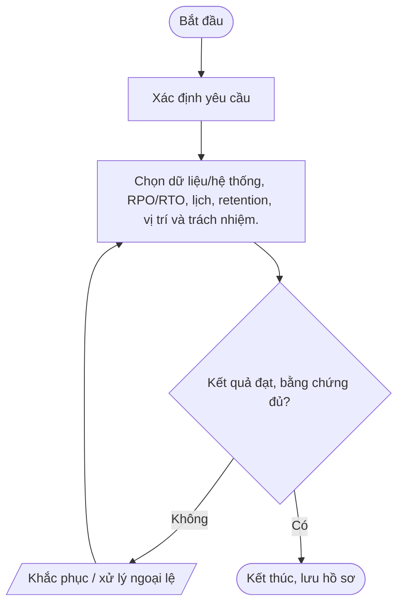
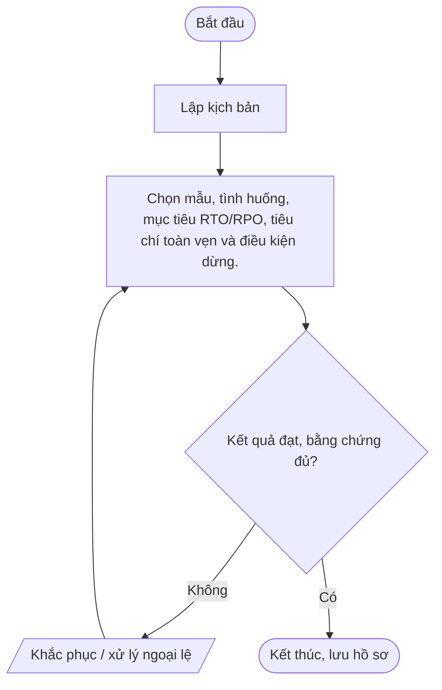
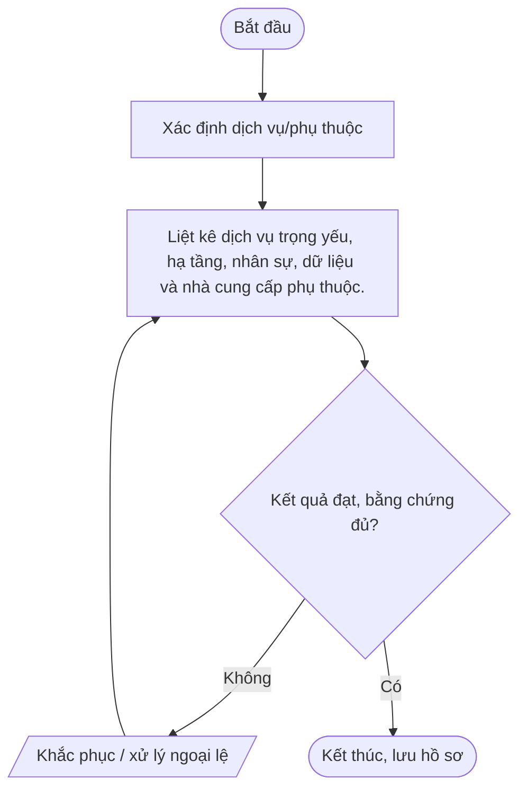
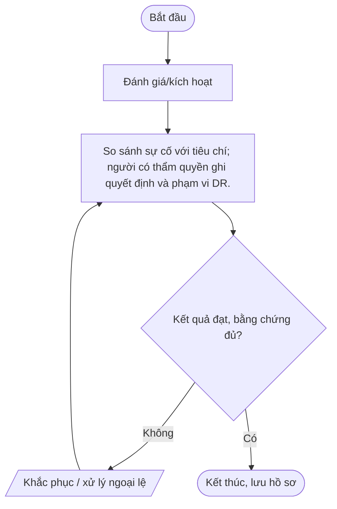
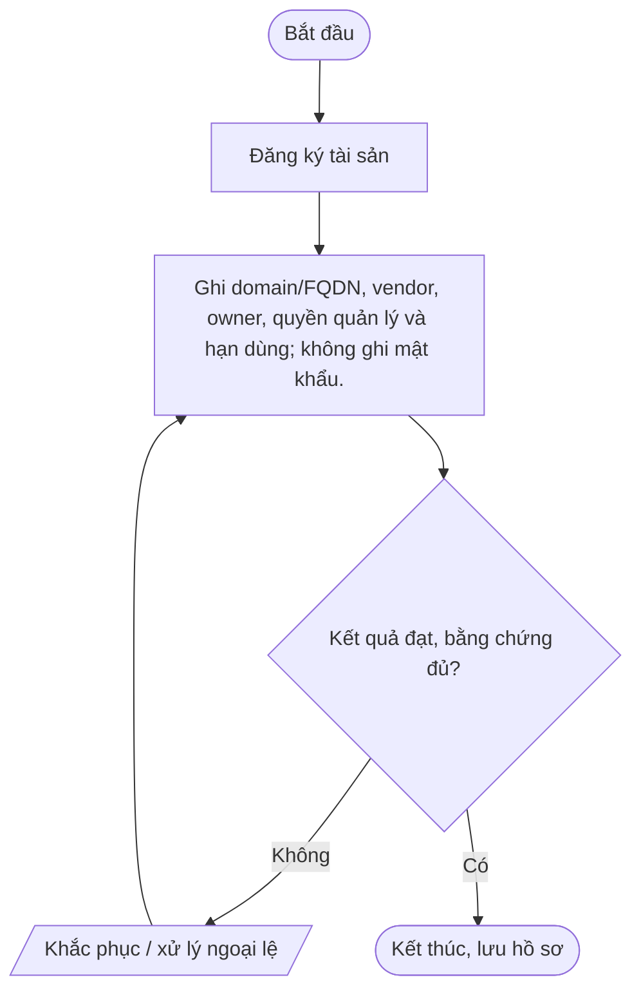

# Nhóm D — Sao lưu, khôi phục và liên tục kinh doanh

Bộ quy trình chuẩn Mstar — bản dự thảo ngày 2026-10-14. Tài liệu được thiết kế dùng chung cho dịch vụ IT Outsourcing; các yêu cầu cụ thể được cấu hình trong phụ lục khách hàng.

## Quy tắc áp dụng

- Quy trình lõi dùng chung; phụ lục khách hàng xác định phạm vi, SLA, đầu mối, quyền, retention, thông báo sự cố và yêu cầu phục hồi.
- Mọi thao tác trên hệ thống khách hàng phải được hợp đồng/ủy quyền cho phép.
- Bằng chứng phải có thể truy nguyên: ticket, phê duyệt, log, biên bản, kết quả kiểm tra.
- Không lưu mật khẩu, token, API key hoặc secret dạng rõ trong ticket/repository thông thường.
- Quy trình chỉ có hiệu lực sau khi được rà soát và phê duyệt; đây không phải tuyên bố Mstar đã được chứng nhận ISO.
- Tham chiếu: ISO/IEC 27001:2022 và ISO/IEC 27002:2022; mapping cuối cùng cần căn cứ risk assessment và SoA.

## Danh mục trong nhóm

| Mã | Quy trình | Mục đích |
|---|---|---|
| [QT-OPS-01](#qt-ops-01) | Sao lưu dữ liệu | Xác định phạm vi, lịch, mã hóa, nơi lưu, retention và theo dõi backup theo RPO/RTO đã thỏa thuận. |
| [QT-OPS-02](#qt-ops-02) | Kiểm thử khôi phục dữ liệu | Chứng minh bản sao lưu khôi phục được, dữ liệu toàn vẹn và mục tiêu RTO/RPO đạt được. |
| [QT-BCP-01](#qt-bcp-01) | Duy trì hoạt động kinh doanh | Xác định dịch vụ trọng yếu, tác động gián đoạn, RTO/RPO và phương án duy trì hoạt động. |
| [QT-BCP-02](#qt-bcp-02) | Khôi phục sau thảm họa | Điều phối kích hoạt DR, khôi phục theo ưu tiên và xác nhận dịch vụ trở lại mức chấp nhận được. |
| [QT-OPS-03](#qt-ops-03) | Quản lý domain, SSL và chứng thư số | Ngăn gián đoạn do domain, DNS, TLS/SSL, license hoặc chứng thư hết hạn. |

---
## QT-OPS-01 — Sao lưu dữ liệu

**Mục đích:** Xác định phạm vi, lịch, mã hóa, nơi lưu, retention và theo dõi backup theo RPO/RTO đã thỏa thuận.

**Kích hoạt:** Khi có yêu cầu/sự kiện thuộc phạm vi; khi thay đổi đáng kể; theo chu kỳ; hoặc khi hợp đồng/khách hàng yêu cầu.

**Phạm vi:** Hoạt động Mstar và dịch vụ IT Outsourcing thuộc hợp đồng/ủy quyền. Chi tiết hệ thống, SLA, đầu mối, quyền, retention, thông báo và RTO/RPO phải được cấu hình trong phụ lục khách hàng.

**Vai trò:** Người yêu cầu; người thực hiện; người kiểm tra/chủ sở hữu hệ thống; chủ sở hữu quy trình; IT Lead; người phê duyệt theo ma trận thẩm quyền; đầu mối khách hàng khi hợp đồng yêu cầu. Người thực hiện không tự phê duyệt thay đổi/rủi ro trọng yếu của chính mình.

**Đầu vào:** Yêu cầu/ticket; hợp đồng/phụ lục; danh mục hệ thống/tài sản; quyền được ủy quyền; quy trình liên quan; dữ liệu/bằng chứng hiện có.

**Đầu ra:** Hồ sơ xử lý; kết quả đã xác minh; phê duyệt; ticket/biên bản đóng; việc tồn có owner và hạn.

### Các bước thực hiện

| Bước | Hoạt động | Vai trò chính | Hướng dẫn và kiểm soát | Bằng chứng cần lưu |
|---:|---|---|---|---|
| 1 | Xác định yêu cầu | Người yêu cầu/đầu mối | Xác định yêu cầu | Hồ sơ/ticket/log/phê duyệt tương ứng |
| 2 | Chọn dữ liệu/hệ thống, RPO/RTO, lịch, retention, vị trí và trách nhiệm. | Chủ sở hữu quy trình/IT Lead | Chọn dữ liệu/hệ thống, RPO/RTO, lịch, retention, vị trí và trách nhiệm. | Hồ sơ/ticket/log/phê duyệt tương ứng |

### Lưu đồ

### Biểu mẫu/hồ sơ

Thiết kế/phê duyệt|Chọn phương thức, bản sao tách biệt/immutable khi phù hợp, quyền và dung lượng.

### KPI và giám sát

Cấu hình/kiểm tra|Thiết lập job, cảnh báo, mã hóa, quyền tối thiểu và test lần đầu.

### Ngoại lệ và an toàn thông tin

Giám sát/xử lý lỗi|Theo dõi job, dung lượng, khoảng trống RPO; tạo ticket, chạy lại và thông báo khi ảnh hưởng.

- Xác minh thẩm quyền/phạm vi trước khi thao tác; không tự mở rộng quyền.
- Không ghi mật khẩu, API key, token, khóa riêng hoặc mã khôi phục dạng rõ trong ticket, README, email thường hay tài liệu bàn giao.
- Thay đổi hệ thống phải theo QT-IT-13; nghi ngờ sự cố ATTT phải theo QT-ATTT-04; ngoại lệ phải theo QT-ISMS-04.
- Lưu hồ sơ ở kho được Mstar phê duyệt, phân quyền tối thiểu và giữ theo yêu cầu hợp đồng/pháp luật.
- Chỉ đóng việc khi kết quả được kiểm tra và bằng chứng cần thiết đã lưu.

### Phụ lục khách hàng cần cấu hình

| Trường | Giá trị cần xác nhận |
|---|---|
| Khách hàng/mã hợp đồng | Điền theo hợp đồng |
| Phạm vi hệ thống/dịch vụ | Hệ thống, tenant, site, tài sản, loại dịch vụ |
| SLA/lịch hỗ trợ | Theo hợp đồng/phụ lục |
| Đầu mối yêu cầu/phê duyệt | Chức danh, kênh và người thay thế |
| Quyền/kênh kỹ thuật | Phạm vi ủy quyền, MFA, VPN, thời hạn |
| Dữ liệu/lưu giữ | Phân loại, nơi lưu, thời hạn, trả/xóa |
| Thông báo sự cố | Kênh, người nhận, thời hạn |
| Ngoại lệ/rủi ro tồn dư | Mã hồ sơ, phê duyệt, biện pháp bù trừ, ngày hết hạn |

> **Trạng thái:** Dự thảo v0.1 — chờ Mstar rà soát, thử nghiệm và phê duyệt. Tham chiếu ISO chỉ là định hướng; cần xác nhận theo phạm vi ISMS, đánh giá rủi ro và SoA.

---

## QT-OPS-02 — Kiểm thử khôi phục dữ liệu

**Mục đích:** Chứng minh bản sao lưu khôi phục được, dữ liệu toàn vẹn và mục tiêu RTO/RPO đạt được.

**Kích hoạt:** Khi có yêu cầu/sự kiện thuộc phạm vi; khi thay đổi đáng kể; theo chu kỳ; hoặc khi hợp đồng/khách hàng yêu cầu.

**Phạm vi:** Hoạt động Mstar và dịch vụ IT Outsourcing thuộc hợp đồng/ủy quyền. Chi tiết hệ thống, SLA, đầu mối, quyền, retention, thông báo và RTO/RPO phải được cấu hình trong phụ lục khách hàng.

**Vai trò:** Người yêu cầu; người thực hiện; người kiểm tra/chủ sở hữu hệ thống; chủ sở hữu quy trình; IT Lead; người phê duyệt theo ma trận thẩm quyền; đầu mối khách hàng khi hợp đồng yêu cầu. Người thực hiện không tự phê duyệt thay đổi/rủi ro trọng yếu của chính mình.

**Đầu vào:** Yêu cầu/ticket; hợp đồng/phụ lục; danh mục hệ thống/tài sản; quyền được ủy quyền; quy trình liên quan; dữ liệu/bằng chứng hiện có.

**Đầu ra:** Hồ sơ xử lý; kết quả đã xác minh; phê duyệt; ticket/biên bản đóng; việc tồn có owner và hạn.

### Các bước thực hiện

| Bước | Hoạt động | Vai trò chính | Hướng dẫn và kiểm soát | Bằng chứng cần lưu |
|---:|---|---|---|---|
| 1 | Lập kịch bản | Người yêu cầu/đầu mối | Lập kịch bản | Hồ sơ/ticket/log/phê duyệt tương ứng |
| 2 | Chọn mẫu, tình huống, mục tiêu RTO/RPO, tiêu chí toàn vẹn và điều kiện dừng. | Chủ sở hữu quy trình/IT Lead | Chọn mẫu, tình huống, mục tiêu RTO/RPO, tiêu chí toàn vẹn và điều kiện dừng. | Hồ sơ/ticket/log/phê duyệt tương ứng |

### Lưu đồ

### Biểu mẫu/hồ sơ

Phê duyệt/chuẩn bị|Xác nhận không ảnh hưởng production; kiểm tra môi trường, quyền, bản sao và dung lượng.

### KPI và giám sát

Thực hiện restore|Khôi phục theo runbook vào môi trường an toàn; ghi thời gian, lỗi và thao tác.

### Ngoại lệ và an toàn thông tin

Xác minh|Đối chiếu dữ liệu, quyền, dịch vụ và thời gian thực tế với mục tiêu.

- Xác minh thẩm quyền/phạm vi trước khi thao tác; không tự mở rộng quyền.
- Không ghi mật khẩu, API key, token, khóa riêng hoặc mã khôi phục dạng rõ trong ticket, README, email thường hay tài liệu bàn giao.
- Thay đổi hệ thống phải theo QT-IT-13; nghi ngờ sự cố ATTT phải theo QT-ATTT-04; ngoại lệ phải theo QT-ISMS-04.
- Lưu hồ sơ ở kho được Mstar phê duyệt, phân quyền tối thiểu và giữ theo yêu cầu hợp đồng/pháp luật.
- Chỉ đóng việc khi kết quả được kiểm tra và bằng chứng cần thiết đã lưu.

### Phụ lục khách hàng cần cấu hình

| Trường | Giá trị cần xác nhận |
|---|---|
| Khách hàng/mã hợp đồng | Điền theo hợp đồng |
| Phạm vi hệ thống/dịch vụ | Hệ thống, tenant, site, tài sản, loại dịch vụ |
| SLA/lịch hỗ trợ | Theo hợp đồng/phụ lục |
| Đầu mối yêu cầu/phê duyệt | Chức danh, kênh và người thay thế |
| Quyền/kênh kỹ thuật | Phạm vi ủy quyền, MFA, VPN, thời hạn |
| Dữ liệu/lưu giữ | Phân loại, nơi lưu, thời hạn, trả/xóa |
| Thông báo sự cố | Kênh, người nhận, thời hạn |
| Ngoại lệ/rủi ro tồn dư | Mã hồ sơ, phê duyệt, biện pháp bù trừ, ngày hết hạn |

> **Trạng thái:** Dự thảo v0.1 — chờ Mstar rà soát, thử nghiệm và phê duyệt. Tham chiếu ISO chỉ là định hướng; cần xác nhận theo phạm vi ISMS, đánh giá rủi ro và SoA.

---

## QT-BCP-01 — Duy trì hoạt động kinh doanh

**Mục đích:** Xác định dịch vụ trọng yếu, tác động gián đoạn, RTO/RPO và phương án duy trì hoạt động.

**Kích hoạt:** Khi có yêu cầu/sự kiện thuộc phạm vi; khi thay đổi đáng kể; theo chu kỳ; hoặc khi hợp đồng/khách hàng yêu cầu.

**Phạm vi:** Hoạt động Mstar và dịch vụ IT Outsourcing thuộc hợp đồng/ủy quyền. Chi tiết hệ thống, SLA, đầu mối, quyền, retention, thông báo và RTO/RPO phải được cấu hình trong phụ lục khách hàng.

**Vai trò:** Người yêu cầu; người thực hiện; người kiểm tra/chủ sở hữu hệ thống; chủ sở hữu quy trình; IT Lead; người phê duyệt theo ma trận thẩm quyền; đầu mối khách hàng khi hợp đồng yêu cầu. Người thực hiện không tự phê duyệt thay đổi/rủi ro trọng yếu của chính mình.

**Đầu vào:** Yêu cầu/ticket; hợp đồng/phụ lục; danh mục hệ thống/tài sản; quyền được ủy quyền; quy trình liên quan; dữ liệu/bằng chứng hiện có.

**Đầu ra:** Hồ sơ xử lý; kết quả đã xác minh; phê duyệt; ticket/biên bản đóng; việc tồn có owner và hạn.

### Các bước thực hiện

| Bước | Hoạt động | Vai trò chính | Hướng dẫn và kiểm soát | Bằng chứng cần lưu |
|---:|---|---|---|---|
| 1 | Xác định dịch vụ/phụ thuộc | Người yêu cầu/đầu mối | Xác định dịch vụ/phụ thuộc | Hồ sơ/ticket/log/phê duyệt tương ứng |
| 2 | Liệt kê dịch vụ trọng yếu, hạ tầng, nhân sự, dữ liệu và nhà cung cấp phụ thuộc. | Chủ sở hữu quy trình/IT Lead | Liệt kê dịch vụ trọng yếu, hạ tầng, nhân sự, dữ liệu và nhà cung cấp phụ thuộc. | Hồ sơ/ticket/log/phê duyệt tương ứng |

### Lưu đồ

### Biểu mẫu/hồ sơ

Phân tích tác động|Đánh giá hậu quả theo thời gian, gián đoạn chấp nhận được và nghĩa vụ khách hàng.

### KPI và giám sát

Chọn chiến lược/lập kế hoạch|Xác định nhân sự thay thế, liên lạc, địa điểm, công cụ, kích hoạt và trách nhiệm.

### Ngoại lệ và an toàn thông tin

Diễn tập|Tabletop/test phù hợp, ghi thời gian, thiếu sót và bài học.

- Xác minh thẩm quyền/phạm vi trước khi thao tác; không tự mở rộng quyền.
- Không ghi mật khẩu, API key, token, khóa riêng hoặc mã khôi phục dạng rõ trong ticket, README, email thường hay tài liệu bàn giao.
- Thay đổi hệ thống phải theo QT-IT-13; nghi ngờ sự cố ATTT phải theo QT-ATTT-04; ngoại lệ phải theo QT-ISMS-04.
- Lưu hồ sơ ở kho được Mstar phê duyệt, phân quyền tối thiểu và giữ theo yêu cầu hợp đồng/pháp luật.
- Chỉ đóng việc khi kết quả được kiểm tra và bằng chứng cần thiết đã lưu.

### Phụ lục khách hàng cần cấu hình

| Trường | Giá trị cần xác nhận |
|---|---|
| Khách hàng/mã hợp đồng | Điền theo hợp đồng |
| Phạm vi hệ thống/dịch vụ | Hệ thống, tenant, site, tài sản, loại dịch vụ |
| SLA/lịch hỗ trợ | Theo hợp đồng/phụ lục |
| Đầu mối yêu cầu/phê duyệt | Chức danh, kênh và người thay thế |
| Quyền/kênh kỹ thuật | Phạm vi ủy quyền, MFA, VPN, thời hạn |
| Dữ liệu/lưu giữ | Phân loại, nơi lưu, thời hạn, trả/xóa |
| Thông báo sự cố | Kênh, người nhận, thời hạn |
| Ngoại lệ/rủi ro tồn dư | Mã hồ sơ, phê duyệt, biện pháp bù trừ, ngày hết hạn |

> **Trạng thái:** Dự thảo v0.1 — chờ Mstar rà soát, thử nghiệm và phê duyệt. Tham chiếu ISO chỉ là định hướng; cần xác nhận theo phạm vi ISMS, đánh giá rủi ro và SoA.

---

## QT-BCP-02 — Khôi phục sau thảm họa

**Mục đích:** Điều phối kích hoạt DR, khôi phục theo ưu tiên và xác nhận dịch vụ trở lại mức chấp nhận được.

**Kích hoạt:** Khi có yêu cầu/sự kiện thuộc phạm vi; khi thay đổi đáng kể; theo chu kỳ; hoặc khi hợp đồng/khách hàng yêu cầu.

**Phạm vi:** Hoạt động Mstar và dịch vụ IT Outsourcing thuộc hợp đồng/ủy quyền. Chi tiết hệ thống, SLA, đầu mối, quyền, retention, thông báo và RTO/RPO phải được cấu hình trong phụ lục khách hàng.

**Vai trò:** Người yêu cầu; người thực hiện; người kiểm tra/chủ sở hữu hệ thống; chủ sở hữu quy trình; IT Lead; người phê duyệt theo ma trận thẩm quyền; đầu mối khách hàng khi hợp đồng yêu cầu. Người thực hiện không tự phê duyệt thay đổi/rủi ro trọng yếu của chính mình.

**Đầu vào:** Yêu cầu/ticket; hợp đồng/phụ lục; danh mục hệ thống/tài sản; quyền được ủy quyền; quy trình liên quan; dữ liệu/bằng chứng hiện có.

**Đầu ra:** Hồ sơ xử lý; kết quả đã xác minh; phê duyệt; ticket/biên bản đóng; việc tồn có owner và hạn.

### Các bước thực hiện

| Bước | Hoạt động | Vai trò chính | Hướng dẫn và kiểm soát | Bằng chứng cần lưu |
|---:|---|---|---|---|
| 1 | Đánh giá/kích hoạt | Người yêu cầu/đầu mối | Đánh giá/kích hoạt | Hồ sơ/ticket/log/phê duyệt tương ứng |
| 2 | So sánh sự cố với tiêu chí; người có thẩm quyền ghi quyết định và phạm vi DR. | Chủ sở hữu quy trình/IT Lead | So sánh sự cố với tiêu chí; người có thẩm quyền ghi quyết định và phạm vi DR. | Hồ sơ/ticket/log/phê duyệt tương ứng |

### Lưu đồ

### Biểu mẫu/hồ sơ

Điều phối|Mở kênh liên lạc, phân vai, ưu tiên dịch vụ và thông báo theo hợp đồng.

### KPI và giám sát

Khôi phục|Khôi phục mạng, định danh, dữ liệu, ứng dụng và phụ thuộc theo runbook.

### Ngoại lệ và an toàn thông tin

Kiểm thử/xác nhận|Kiểm tra dữ liệu, bảo mật, nghiệp vụ, RTO/RPO thực tế và khách hàng xác nhận khi cần.

- Xác minh thẩm quyền/phạm vi trước khi thao tác; không tự mở rộng quyền.
- Không ghi mật khẩu, API key, token, khóa riêng hoặc mã khôi phục dạng rõ trong ticket, README, email thường hay tài liệu bàn giao.
- Thay đổi hệ thống phải theo QT-IT-13; nghi ngờ sự cố ATTT phải theo QT-ATTT-04; ngoại lệ phải theo QT-ISMS-04.
- Lưu hồ sơ ở kho được Mstar phê duyệt, phân quyền tối thiểu và giữ theo yêu cầu hợp đồng/pháp luật.
- Chỉ đóng việc khi kết quả được kiểm tra và bằng chứng cần thiết đã lưu.

### Phụ lục khách hàng cần cấu hình

| Trường | Giá trị cần xác nhận |
|---|---|
| Khách hàng/mã hợp đồng | Điền theo hợp đồng |
| Phạm vi hệ thống/dịch vụ | Hệ thống, tenant, site, tài sản, loại dịch vụ |
| SLA/lịch hỗ trợ | Theo hợp đồng/phụ lục |
| Đầu mối yêu cầu/phê duyệt | Chức danh, kênh và người thay thế |
| Quyền/kênh kỹ thuật | Phạm vi ủy quyền, MFA, VPN, thời hạn |
| Dữ liệu/lưu giữ | Phân loại, nơi lưu, thời hạn, trả/xóa |
| Thông báo sự cố | Kênh, người nhận, thời hạn |
| Ngoại lệ/rủi ro tồn dư | Mã hồ sơ, phê duyệt, biện pháp bù trừ, ngày hết hạn |

> **Trạng thái:** Dự thảo v0.1 — chờ Mstar rà soát, thử nghiệm và phê duyệt. Tham chiếu ISO chỉ là định hướng; cần xác nhận theo phạm vi ISMS, đánh giá rủi ro và SoA.

---

## QT-OPS-03 — Quản lý domain, SSL và chứng thư số

**Mục đích:** Ngăn gián đoạn do domain, DNS, TLS/SSL, license hoặc chứng thư hết hạn.

**Kích hoạt:** Khi có yêu cầu/sự kiện thuộc phạm vi; khi thay đổi đáng kể; theo chu kỳ; hoặc khi hợp đồng/khách hàng yêu cầu.

**Phạm vi:** Hoạt động Mstar và dịch vụ IT Outsourcing thuộc hợp đồng/ủy quyền. Chi tiết hệ thống, SLA, đầu mối, quyền, retention, thông báo và RTO/RPO phải được cấu hình trong phụ lục khách hàng.

**Vai trò:** Người yêu cầu; người thực hiện; người kiểm tra/chủ sở hữu hệ thống; chủ sở hữu quy trình; IT Lead; người phê duyệt theo ma trận thẩm quyền; đầu mối khách hàng khi hợp đồng yêu cầu. Người thực hiện không tự phê duyệt thay đổi/rủi ro trọng yếu của chính mình.

**Đầu vào:** Yêu cầu/ticket; hợp đồng/phụ lục; danh mục hệ thống/tài sản; quyền được ủy quyền; quy trình liên quan; dữ liệu/bằng chứng hiện có.

**Đầu ra:** Hồ sơ xử lý; kết quả đã xác minh; phê duyệt; ticket/biên bản đóng; việc tồn có owner và hạn.

### Các bước thực hiện

| Bước | Hoạt động | Vai trò chính | Hướng dẫn và kiểm soát | Bằng chứng cần lưu |
|---:|---|---|---|---|
| 1 | Đăng ký tài sản | Người yêu cầu/đầu mối | Đăng ký tài sản | Hồ sơ/ticket/log/phê duyệt tương ứng |
| 2 | Ghi domain/FQDN, vendor, owner, quyền quản lý và hạn dùng; không ghi mật khẩu. | Chủ sở hữu quy trình/IT Lead | Ghi domain/FQDN, vendor, owner, quyền quản lý và hạn dùng; không ghi mật khẩu. | Hồ sơ/ticket/log/phê duyệt tương ứng |

### Lưu đồ

### Biểu mẫu/hồ sơ

Thiết lập cảnh báo|Đặt nhiều mốc cảnh báo, xác minh người nhận và kênh dự phòng.

### KPI và giám sát

Xác minh quyền/ngân sách|Xác định người được phép gia hạn, phê duyệt và phương thức thanh toán.

### Ngoại lệ và an toàn thông tin

Gia hạn/thay thế|Thực hiện theo thẩm quyền; thay DNS/cấu hình phải theo change management.

- Xác minh thẩm quyền/phạm vi trước khi thao tác; không tự mở rộng quyền.
- Không ghi mật khẩu, API key, token, khóa riêng hoặc mã khôi phục dạng rõ trong ticket, README, email thường hay tài liệu bàn giao.
- Thay đổi hệ thống phải theo QT-IT-13; nghi ngờ sự cố ATTT phải theo QT-ATTT-04; ngoại lệ phải theo QT-ISMS-04.
- Lưu hồ sơ ở kho được Mstar phê duyệt, phân quyền tối thiểu và giữ theo yêu cầu hợp đồng/pháp luật.
- Chỉ đóng việc khi kết quả được kiểm tra và bằng chứng cần thiết đã lưu.

### Phụ lục khách hàng cần cấu hình

| Trường | Giá trị cần xác nhận |
|---|---|
| Khách hàng/mã hợp đồng | Điền theo hợp đồng |
| Phạm vi hệ thống/dịch vụ | Hệ thống, tenant, site, tài sản, loại dịch vụ |
| SLA/lịch hỗ trợ | Theo hợp đồng/phụ lục |
| Đầu mối yêu cầu/phê duyệt | Chức danh, kênh và người thay thế |
| Quyền/kênh kỹ thuật | Phạm vi ủy quyền, MFA, VPN, thời hạn |
| Dữ liệu/lưu giữ | Phân loại, nơi lưu, thời hạn, trả/xóa |
| Thông báo sự cố | Kênh, người nhận, thời hạn |
| Ngoại lệ/rủi ro tồn dư | Mã hồ sơ, phê duyệt, biện pháp bù trừ, ngày hết hạn |

> **Trạng thái:** Dự thảo v0.1 — chờ Mstar rà soát, thử nghiệm và phê duyệt. Tham chiếu ISO chỉ là định hướng; cần xác nhận theo phạm vi ISMS, đánh giá rủi ro và SoA.
