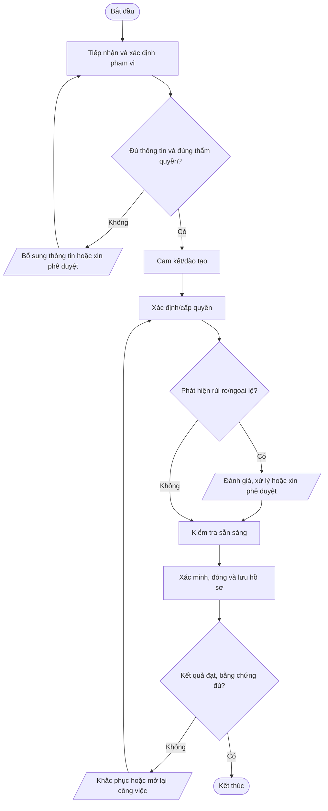
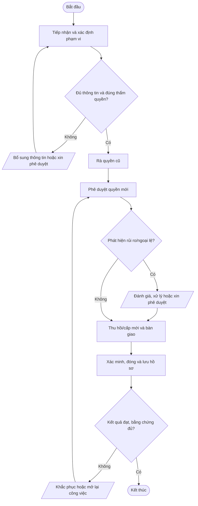
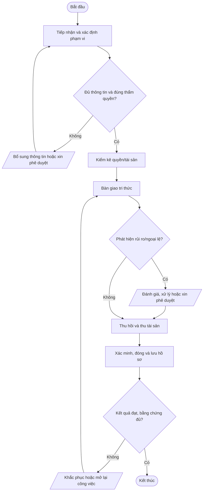
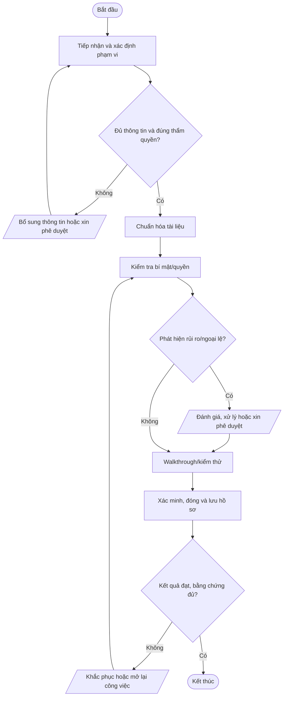
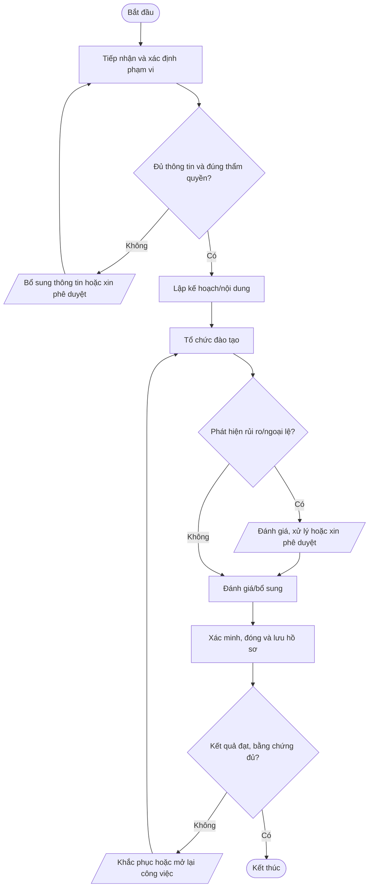

# Nhóm E — Nhân sự và bảo toàn thông tin

Bộ quy trình chuẩn Mstar — bản dự thảo ngày 2026-10-14. Tài liệu được thiết kế dùng chung cho dịch vụ IT Outsourcing; các yêu cầu cụ thể được cấu hình trong phụ lục khách hàng.

## Quy tắc áp dụng

- Quy trình lõi dùng chung; phụ lục khách hàng xác định phạm vi, SLA, đầu mối, quyền, retention, thông báo sự cố và yêu cầu phục hồi.
- Mọi thao tác trên hệ thống khách hàng phải được hợp đồng/ủy quyền cho phép.
- Bằng chứng phải có thể truy nguyên: ticket, phê duyệt, log, biên bản, kết quả kiểm tra.
- Không lưu mật khẩu, token, API key hoặc secret dạng rõ trong ticket/repository thông thường.
- Quy trình chỉ có hiệu lực sau khi được rà soát và phê duyệt; đây không phải tuyên bố Mstar đã được chứng nhận ISO.
- Tham chiếu: ISO/IEC 27001:2022 và ISO/IEC 27002:2022; mapping cuối cùng cần căn cứ risk assessment và SoA.

## Tài liệu quy trình chi tiết

Danh mục quy trình chi tiết thuộc nhóm Nhân sự:

| Mã | Quy trình chi tiết |
|---|---|
| QT-HR-01 | [Tiếp nhận nhân sự mới](../chi-tiet/QT-HR-01.md) |
| QT-HR-02 | [Điều chuyển nhân sự](../chi-tiet/QT-HR-02.md) |
| QT-HR-03 | [Nghỉ việc và thu hồi quyền](../chi-tiet/QT-HR-03.md) |
| QT-HR-04 | [Bàn giao tri thức](../chi-tiet/QT-HR-04.md) |
| QT-HR-05 | [Đào tạo nhận thức ATTT](../chi-tiet/QT-HR-05.md) |

Mở [danh mục toàn bộ quy trình chi tiết](../chi-tiet/README.md). Các tài liệu vẫn là dự thảo, chỉ áp dụng sau khi được rà soát, thử nghiệm và phê duyệt.

---

## Danh mục trong nhóm

| Mã | Quy trình | Mục đích |
|---|---|---|
| [QT-HR-01](#qt-hr-01) | Tiếp nhận nhân sự mới | Bảo đảm nhân sự/nhà thầu hoàn tất cam kết, đào tạo và được cấp thiết bị/quyền đúng vai trò. |
| [QT-HR-02](#qt-hr-02) | Điều chuyển nhân sự | Điều chỉnh quyền, thiết bị, trách nhiệm và đào tạo khi đổi vị trí/nhóm/khách hàng. |
| [QT-HR-03](#qt-hr-03) | Nhân viên nghỉ việc | Thu hồi quyền đúng thời điểm, thu hồi tài sản, bảo toàn thông tin và bàn giao tri thức khi nghỉ việc. |
| [QT-HR-04](#qt-hr-04) | Bàn giao kiến thức và tài liệu kỹ thuật | Giảm phụ thuộc cá nhân, giúp người thay thế vận hành hệ thống bằng tài liệu chuẩn thay vì tài khoản cũ. |
| [QT-HR-05](#qt-hr-05) | Đào tạo và nhận thức an toàn thông tin | Giúp nhân sự hiểu trách nhiệm, nhận diện nguy cơ và thực hiện quy trình theo vai trò. |

---
## QT-HR-01 — Tiếp nhận nhân sự mới

**Mục đích:** Bảo đảm nhân sự/nhà thầu hoàn tất cam kết, đào tạo và được cấp thiết bị/quyền đúng vai trò.

**Kích hoạt:** Khi có yêu cầu/sự kiện thuộc phạm vi, khi có thay đổi đáng kể hoặc theo chu kỳ được quy định.

**Phạm vi:** Mstar và hoạt động IT Outsourcing trong phạm vi hợp đồng/ủy quyền. Phụ lục từng khách hàng phải xác định hệ thống, SLA, đầu mối, quyền truy cập, retention, thông báo và yêu cầu phục hồi riêng.

**Vai trò:** Người yêu cầu/đầu mối khách hàng; người thực hiện; người kiểm tra/chủ sở hữu hệ thống; chủ sở hữu quy trình; IT Lead; người phê duyệt theo ma trận thẩm quyền. Người thực hiện không tự phê duyệt rủi ro trọng yếu do chính mình tạo ra.

**Đầu vào:** Yêu cầu/ticket; hợp đồng/phụ lục; danh mục hệ thống/tài sản; quyền được ủy quyền; quy trình liên quan; dữ liệu/bằng chứng hiện có.

**Đầu ra:** Hồ sơ xử lý; kết quả đã xác minh; phê duyệt; ticket/biên bản đóng; việc tồn có owner và hạn.

### Trình tự thực hiện

| Bước | Hoạt động | Vai trò chính | Hướng dẫn và kiểm soát | Bằng chứng cần lưu |
|---:|---|---|---|---|
| 1 | Tiếp nhận và xác định phạm vi | Người tiếp nhận | Ghi nhận yêu cầu/sự kiện, xác minh hệ thống, mục tiêu, phạm vi hợp đồng, đầu mối và thông tin tối thiểu. Nếu thiếu thông tin hoặc thẩm quyền thì chưa thực hiện bước rủi ro. | Ticket, log, phê duyệt hoặc biên bản tương ứng |
| 2 | Cam kết/đào tạo | Người thực hiện và người kiểm tra | Cung cấp quy tắc bảo mật, xử lý dữ liệu, báo sự cố và nghĩa vụ khi nghỉ việc. | Ticket, log, phê duyệt hoặc biên bản tương ứng |
| 3 | Xác định/cấp quyền | Người thực hiện và người kiểm tra | Quản lý yêu cầu quyền tối thiểu; IT cấp tài khoản riêng, MFA và thiết bị baseline sau phê duyệt. | Ticket, log, phê duyệt hoặc biên bản tương ứng |
| 4 | Kiểm tra sẵn sàng | Người thực hiện và người kiểm tra | Xác minh thiết bị, quyền, đào tạo, hướng dẫn và đầu mối hỗ trợ. | Ticket, log, phê duyệt hoặc biên bản tương ứng |
| 5 | Xác minh, đóng và lưu hồ sơ | Chủ sở hữu quy trình/IT Lead | Người kiểm tra xác nhận kết quả, quyền và phạm vi; ghi thời gian, bằng chứng, quyết định, thông báo và việc tồn. Chỉ đóng khi đủ hồ sơ hoặc có ngoại lệ được duyệt. | Ticket, log, phê duyệt hoặc biên bản tương ứng |

### Lưu đồ

### Biểu mẫu và hồ sơ

- FR-QTHR01-01: Phiếu yêu cầu/checklist khởi tạo.
- FR-QTHR01-02: Hồ sơ đánh giá, phê duyệt hoặc xác minh.
- FR-QTHR01-03: Nhật ký thực hiện/biên bản/báo cáo.
- FR-QTHR01-04: Xác nhận hoàn tất và theo dõi việc tồn.

*Mã biểu mẫu là mã đề xuất; khi ban hành cần đưa vào danh mục tài liệu, xác định chủ sở hữu, nơi lưu, quyền truy cập và thời hạn lưu giữ.*

### KPI và giám sát

- Tỷ lệ hồ sơ có đủ thông tin đầu vào và phê duyệt.
- Tỷ lệ bước/công việc hoàn thành đúng hạn theo quy trình hoặc hợp đồng.
- Số lỗi, ngoại lệ, sự cố hoặc hồ sơ phải làm lại.
- Tỷ lệ hành động khắc phục đóng đúng hạn.

Chủ sở hữu quy trình phải xác định nguồn dữ liệu, công thức, chu kỳ đo và ngưỡng cảnh báo trước khi áp dụng.

### Ngoại lệ và an toàn thông tin

Xác minh thiết bị, quyền, đào tạo, hướng dẫn và đầu mối hỗ trợ.

- Không thao tác ngoài phạm vi hợp đồng/ủy quyền; khi thiếu quyền hoặc phê duyệt phải tạm dừng bước có rủi ro.
- Không ghi mật khẩu, API key, token, khóa riêng hoặc mã khôi phục dạng rõ trong ticket, README, email thường hay tài liệu bàn giao.
- Thay đổi hệ thống phải theo QT-IT-13; nghi ngờ sự cố ATTT phải theo QT-ATTT-04; ngoại lệ phải theo QT-ISMS-04.
- Mọi ngoại lệ phải có lý do, đánh giá rủi ro, biện pháp bù trừ, người phê duyệt, owner và hạn hết hiệu lực.

### Phụ lục cần cấu hình theo khách hàng

| Trường | Nội dung xác nhận |
|---|---|
| Khách hàng/mã hợp đồng | Theo hợp đồng đang hiệu lực |
| Phạm vi hệ thống/dịch vụ | Hệ thống, tenant, site, tài sản và loại dịch vụ |
| SLA/lịch hỗ trợ | Theo hợp đồng/phụ lục, không dùng mặc định chung |
| Đầu mối yêu cầu/phê duyệt | Chức danh, kênh liên hệ và người thay thế |
| Quyền/kênh kỹ thuật | Phạm vi ủy quyền, MFA, VPN, thời hạn |
| Dữ liệu/lưu giữ | Phân loại, nơi lưu, thời hạn, trả/xóa |
| Thông báo sự cố | Kênh, người nhận và thời hạn |
| Ngoại lệ/rủi ro tồn dư | Mã hồ sơ, phê duyệt, bù trừ, ngày hết hạn |

**Trạng thái:** Dự thảo v0.1 — chờ rà soát, thử nghiệm và phê duyệt. Mapping ISO chỉ mang tính định hướng; cần xác nhận theo phạm vi ISMS, đánh giá rủi ro và SoA.

---

## QT-HR-02 — Điều chuyển nhân sự

**Mục đích:** Điều chỉnh quyền, thiết bị, trách nhiệm và đào tạo khi đổi vị trí/nhóm/khách hàng.

**Kích hoạt:** Khi có yêu cầu/sự kiện thuộc phạm vi, khi có thay đổi đáng kể hoặc theo chu kỳ được quy định.

**Phạm vi:** Mstar và hoạt động IT Outsourcing trong phạm vi hợp đồng/ủy quyền. Phụ lục từng khách hàng phải xác định hệ thống, SLA, đầu mối, quyền truy cập, retention, thông báo và yêu cầu phục hồi riêng.

**Vai trò:** Người yêu cầu/đầu mối khách hàng; người thực hiện; người kiểm tra/chủ sở hữu hệ thống; chủ sở hữu quy trình; IT Lead; người phê duyệt theo ma trận thẩm quyền. Người thực hiện không tự phê duyệt rủi ro trọng yếu do chính mình tạo ra.

**Đầu vào:** Yêu cầu/ticket; hợp đồng/phụ lục; danh mục hệ thống/tài sản; quyền được ủy quyền; quy trình liên quan; dữ liệu/bằng chứng hiện có.

**Đầu ra:** Hồ sơ xử lý; kết quả đã xác minh; phê duyệt; ticket/biên bản đóng; việc tồn có owner và hạn.

### Trình tự thực hiện

| Bước | Hoạt động | Vai trò chính | Hướng dẫn và kiểm soát | Bằng chứng cần lưu |
|---:|---|---|---|---|
| 1 | Tiếp nhận và xác định phạm vi | Người tiếp nhận | Ghi nhận yêu cầu/sự kiện, xác minh hệ thống, mục tiêu, phạm vi hợp đồng, đầu mối và thông tin tối thiểu. Nếu thiếu thông tin hoặc thẩm quyền thì chưa thực hiện bước rủi ro. | Ticket, log, phê duyệt hoặc biên bản tương ứng |
| 2 | Rà quyền cũ | Người thực hiện và người kiểm tra | Liệt kê quyền, nhóm, token, đặc quyền và quyền khách hàng không còn cần. | Ticket, log, phê duyệt hoặc biên bản tương ứng |
| 3 | Phê duyệt quyền mới | Người thực hiện và người kiểm tra | Quản lý mới/chủ sở hữu xác định quyền tối thiểu và xung đột nhiệm vụ. | Ticket, log, phê duyệt hoặc biên bản tương ứng |
| 4 | Thu hồi/cấp mới và bàn giao | Người thực hiện và người kiểm tra | Thu hồi quyền cũ đúng thời điểm, cấp mới sau duyệt, bàn giao ticket/tài sản/tài liệu. | Ticket, log, phê duyệt hoặc biên bản tương ứng |
| 5 | Xác minh, đóng và lưu hồ sơ | Chủ sở hữu quy trình/IT Lead | Người kiểm tra xác nhận kết quả, quyền và phạm vi; ghi thời gian, bằng chứng, quyết định, thông báo và việc tồn. Chỉ đóng khi đủ hồ sơ hoặc có ngoại lệ được duyệt. | Ticket, log, phê duyệt hoặc biên bản tương ứng |

### Lưu đồ

### Biểu mẫu và hồ sơ

- FR-QTHR02-01: Phiếu yêu cầu/checklist khởi tạo.
- FR-QTHR02-02: Hồ sơ đánh giá, phê duyệt hoặc xác minh.
- FR-QTHR02-03: Nhật ký thực hiện/biên bản/báo cáo.
- FR-QTHR02-04: Xác nhận hoàn tất và theo dõi việc tồn.

*Mã biểu mẫu là mã đề xuất; khi ban hành cần đưa vào danh mục tài liệu, xác định chủ sở hữu, nơi lưu, quyền truy cập và thời hạn lưu giữ.*

### KPI và giám sát

- Tỷ lệ hồ sơ có đủ thông tin đầu vào và phê duyệt.
- Tỷ lệ bước/công việc hoàn thành đúng hạn theo quy trình hoặc hợp đồng.
- Số lỗi, ngoại lệ, sự cố hoặc hồ sơ phải làm lại.
- Tỷ lệ hành động khắc phục đóng đúng hạn.

Chủ sở hữu quy trình phải xác định nguồn dữ liệu, công thức, chu kỳ đo và ngưỡng cảnh báo trước khi áp dụng.

### Ngoại lệ và an toàn thông tin

Thu hồi quyền cũ đúng thời điểm, cấp mới sau duyệt, bàn giao ticket/tài sản/tài liệu.

- Không thao tác ngoài phạm vi hợp đồng/ủy quyền; khi thiếu quyền hoặc phê duyệt phải tạm dừng bước có rủi ro.
- Không ghi mật khẩu, API key, token, khóa riêng hoặc mã khôi phục dạng rõ trong ticket, README, email thường hay tài liệu bàn giao.
- Thay đổi hệ thống phải theo QT-IT-13; nghi ngờ sự cố ATTT phải theo QT-ATTT-04; ngoại lệ phải theo QT-ISMS-04.
- Mọi ngoại lệ phải có lý do, đánh giá rủi ro, biện pháp bù trừ, người phê duyệt, owner và hạn hết hiệu lực.

### Phụ lục cần cấu hình theo khách hàng

| Trường | Nội dung xác nhận |
|---|---|
| Khách hàng/mã hợp đồng | Theo hợp đồng đang hiệu lực |
| Phạm vi hệ thống/dịch vụ | Hệ thống, tenant, site, tài sản và loại dịch vụ |
| SLA/lịch hỗ trợ | Theo hợp đồng/phụ lục, không dùng mặc định chung |
| Đầu mối yêu cầu/phê duyệt | Chức danh, kênh liên hệ và người thay thế |
| Quyền/kênh kỹ thuật | Phạm vi ủy quyền, MFA, VPN, thời hạn |
| Dữ liệu/lưu giữ | Phân loại, nơi lưu, thời hạn, trả/xóa |
| Thông báo sự cố | Kênh, người nhận và thời hạn |
| Ngoại lệ/rủi ro tồn dư | Mã hồ sơ, phê duyệt, bù trừ, ngày hết hạn |

**Trạng thái:** Dự thảo v0.1 — chờ rà soát, thử nghiệm và phê duyệt. Mapping ISO chỉ mang tính định hướng; cần xác nhận theo phạm vi ISMS, đánh giá rủi ro và SoA.

---

## QT-HR-03 — Nhân viên nghỉ việc

**Mục đích:** Thu hồi quyền đúng thời điểm, thu hồi tài sản, bảo toàn thông tin và bàn giao tri thức khi nghỉ việc.

**Kích hoạt:** Khi có yêu cầu/sự kiện thuộc phạm vi, khi có thay đổi đáng kể hoặc theo chu kỳ được quy định.

**Phạm vi:** Mstar và hoạt động IT Outsourcing trong phạm vi hợp đồng/ủy quyền. Phụ lục từng khách hàng phải xác định hệ thống, SLA, đầu mối, quyền truy cập, retention, thông báo và yêu cầu phục hồi riêng.

**Vai trò:** Người yêu cầu/đầu mối khách hàng; người thực hiện; người kiểm tra/chủ sở hữu hệ thống; chủ sở hữu quy trình; IT Lead; người phê duyệt theo ma trận thẩm quyền. Người thực hiện không tự phê duyệt rủi ro trọng yếu do chính mình tạo ra.

**Đầu vào:** Yêu cầu/ticket; hợp đồng/phụ lục; danh mục hệ thống/tài sản; quyền được ủy quyền; quy trình liên quan; dữ liệu/bằng chứng hiện có.

**Đầu ra:** Hồ sơ xử lý; kết quả đã xác minh; phê duyệt; ticket/biên bản đóng; việc tồn có owner và hạn.

### Trình tự thực hiện

| Bước | Hoạt động | Vai trò chính | Hướng dẫn và kiểm soát | Bằng chứng cần lưu |
|---:|---|---|---|---|
| 1 | Tiếp nhận và xác định phạm vi | Người tiếp nhận | Ghi nhận yêu cầu/sự kiện, xác minh hệ thống, mục tiêu, phạm vi hợp đồng, đầu mối và thông tin tối thiểu. Nếu thiếu thông tin hoặc thẩm quyền thì chưa thực hiện bước rủi ro. | Ticket, log, phê duyệt hoặc biên bản tương ứng |
| 2 | Kiểm kê quyền/tài sản | Người thực hiện và người kiểm tra | Tổng hợp tài khoản, VPN, cloud, email, vault, token, thiết bị, ticket và tài liệu. | Ticket, log, phê duyệt hoặc biên bản tương ứng |
| 3 | Bàn giao tri thức | Người thực hiện và người kiểm tra | Bàn giao ticket, runbook, cấu hình, rủi ro, đầu mối và lịch vận hành. | Ticket, log, phê duyệt hoặc biên bản tương ứng |
| 4 | Thu hồi và thu tài sản | Người thực hiện và người kiểm tra | Khóa tài khoản/session, thu hồi token/SSH/VPN, thu thiết bị và xử lý dữ liệu theo phê duyệt. | Ticket, log, phê duyệt hoặc biên bản tương ứng |
| 5 | Xác minh, đóng và lưu hồ sơ | Chủ sở hữu quy trình/IT Lead | Người kiểm tra xác nhận kết quả, quyền và phạm vi; ghi thời gian, bằng chứng, quyết định, thông báo và việc tồn. Chỉ đóng khi đủ hồ sơ hoặc có ngoại lệ được duyệt. | Ticket, log, phê duyệt hoặc biên bản tương ứng |

### Lưu đồ

### Biểu mẫu và hồ sơ

- FR-QTHR03-01: Phiếu yêu cầu/checklist khởi tạo.
- FR-QTHR03-02: Hồ sơ đánh giá, phê duyệt hoặc xác minh.
- FR-QTHR03-03: Nhật ký thực hiện/biên bản/báo cáo.
- FR-QTHR03-04: Xác nhận hoàn tất và theo dõi việc tồn.

*Mã biểu mẫu là mã đề xuất; khi ban hành cần đưa vào danh mục tài liệu, xác định chủ sở hữu, nơi lưu, quyền truy cập và thời hạn lưu giữ.*

### KPI và giám sát

- Tỷ lệ hồ sơ có đủ thông tin đầu vào và phê duyệt.
- Tỷ lệ bước/công việc hoàn thành đúng hạn theo quy trình hoặc hợp đồng.
- Số lỗi, ngoại lệ, sự cố hoặc hồ sơ phải làm lại.
- Tỷ lệ hành động khắc phục đóng đúng hạn.

Chủ sở hữu quy trình phải xác định nguồn dữ liệu, công thức, chu kỳ đo và ngưỡng cảnh báo trước khi áp dụng.

### Ngoại lệ và an toàn thông tin

Khóa tài khoản/session, thu hồi token/SSH/VPN, thu thiết bị và xử lý dữ liệu theo phê duyệt.

- Không thao tác ngoài phạm vi hợp đồng/ủy quyền; khi thiếu quyền hoặc phê duyệt phải tạm dừng bước có rủi ro.
- Không ghi mật khẩu, API key, token, khóa riêng hoặc mã khôi phục dạng rõ trong ticket, README, email thường hay tài liệu bàn giao.
- Thay đổi hệ thống phải theo QT-IT-13; nghi ngờ sự cố ATTT phải theo QT-ATTT-04; ngoại lệ phải theo QT-ISMS-04.
- Mọi ngoại lệ phải có lý do, đánh giá rủi ro, biện pháp bù trừ, người phê duyệt, owner và hạn hết hiệu lực.

### Phụ lục cần cấu hình theo khách hàng

| Trường | Nội dung xác nhận |
|---|---|
| Khách hàng/mã hợp đồng | Theo hợp đồng đang hiệu lực |
| Phạm vi hệ thống/dịch vụ | Hệ thống, tenant, site, tài sản và loại dịch vụ |
| SLA/lịch hỗ trợ | Theo hợp đồng/phụ lục, không dùng mặc định chung |
| Đầu mối yêu cầu/phê duyệt | Chức danh, kênh liên hệ và người thay thế |
| Quyền/kênh kỹ thuật | Phạm vi ủy quyền, MFA, VPN, thời hạn |
| Dữ liệu/lưu giữ | Phân loại, nơi lưu, thời hạn, trả/xóa |
| Thông báo sự cố | Kênh, người nhận và thời hạn |
| Ngoại lệ/rủi ro tồn dư | Mã hồ sơ, phê duyệt, bù trừ, ngày hết hạn |

**Trạng thái:** Dự thảo v0.1 — chờ rà soát, thử nghiệm và phê duyệt. Mapping ISO chỉ mang tính định hướng; cần xác nhận theo phạm vi ISMS, đánh giá rủi ro và SoA.

---

## QT-HR-04 — Bàn giao kiến thức và tài liệu kỹ thuật

**Mục đích:** Giảm phụ thuộc cá nhân, giúp người thay thế vận hành hệ thống bằng tài liệu chuẩn thay vì tài khoản cũ.

**Kích hoạt:** Khi có yêu cầu/sự kiện thuộc phạm vi, khi có thay đổi đáng kể hoặc theo chu kỳ được quy định.

**Phạm vi:** Mstar và hoạt động IT Outsourcing trong phạm vi hợp đồng/ủy quyền. Phụ lục từng khách hàng phải xác định hệ thống, SLA, đầu mối, quyền truy cập, retention, thông báo và yêu cầu phục hồi riêng.

**Vai trò:** Người yêu cầu/đầu mối khách hàng; người thực hiện; người kiểm tra/chủ sở hữu hệ thống; chủ sở hữu quy trình; IT Lead; người phê duyệt theo ma trận thẩm quyền. Người thực hiện không tự phê duyệt rủi ro trọng yếu do chính mình tạo ra.

**Đầu vào:** Yêu cầu/ticket; hợp đồng/phụ lục; danh mục hệ thống/tài sản; quyền được ủy quyền; quy trình liên quan; dữ liệu/bằng chứng hiện có.

**Đầu ra:** Hồ sơ xử lý; kết quả đã xác minh; phê duyệt; ticket/biên bản đóng; việc tồn có owner và hạn.

### Trình tự thực hiện

| Bước | Hoạt động | Vai trò chính | Hướng dẫn và kiểm soát | Bằng chứng cần lưu |
|---:|---|---|---|---|
| 1 | Tiếp nhận và xác định phạm vi | Người tiếp nhận | Ghi nhận yêu cầu/sự kiện, xác minh hệ thống, mục tiêu, phạm vi hợp đồng, đầu mối và thông tin tối thiểu. Nếu thiếu thông tin hoặc thẩm quyền thì chưa thực hiện bước rủi ro. | Ticket, log, phê duyệt hoặc biên bản tương ứng |
| 2 | Chuẩn hóa tài liệu | Người thực hiện và người kiểm tra | Cập nhật sơ đồ, inventory, runbook, cấu hình, backup/restore, vendor và cảnh báo. | Ticket, log, phê duyệt hoặc biên bản tương ứng |
| 3 | Kiểm tra bí mật/quyền | Người thực hiện và người kiểm tra | Đưa secret vào vault; loại secret khỏi tài liệu; chuyển quyền bằng quy trình IAM. | Ticket, log, phê duyệt hoặc biên bản tương ứng |
| 4 | Walkthrough/kiểm thử | Người thực hiện và người kiểm tra | Giải thích vận hành và cho người nhận thực hiện mẫu; ghi gap/tài liệu thiếu. | Ticket, log, phê duyệt hoặc biên bản tương ứng |
| 5 | Xác minh, đóng và lưu hồ sơ | Chủ sở hữu quy trình/IT Lead | Người kiểm tra xác nhận kết quả, quyền và phạm vi; ghi thời gian, bằng chứng, quyết định, thông báo và việc tồn. Chỉ đóng khi đủ hồ sơ hoặc có ngoại lệ được duyệt. | Ticket, log, phê duyệt hoặc biên bản tương ứng |

### Lưu đồ

### Biểu mẫu và hồ sơ

- FR-QTHR04-01: Phiếu yêu cầu/checklist khởi tạo.
- FR-QTHR04-02: Hồ sơ đánh giá, phê duyệt hoặc xác minh.
- FR-QTHR04-03: Nhật ký thực hiện/biên bản/báo cáo.
- FR-QTHR04-04: Xác nhận hoàn tất và theo dõi việc tồn.

*Mã biểu mẫu là mã đề xuất; khi ban hành cần đưa vào danh mục tài liệu, xác định chủ sở hữu, nơi lưu, quyền truy cập và thời hạn lưu giữ.*

### KPI và giám sát

- Tỷ lệ hồ sơ có đủ thông tin đầu vào và phê duyệt.
- Tỷ lệ bước/công việc hoàn thành đúng hạn theo quy trình hoặc hợp đồng.
- Số lỗi, ngoại lệ, sự cố hoặc hồ sơ phải làm lại.
- Tỷ lệ hành động khắc phục đóng đúng hạn.

Chủ sở hữu quy trình phải xác định nguồn dữ liệu, công thức, chu kỳ đo và ngưỡng cảnh báo trước khi áp dụng.

### Ngoại lệ và an toàn thông tin

Giải thích vận hành và cho người nhận thực hiện mẫu; ghi gap/tài liệu thiếu.

- Không thao tác ngoài phạm vi hợp đồng/ủy quyền; khi thiếu quyền hoặc phê duyệt phải tạm dừng bước có rủi ro.
- Không ghi mật khẩu, API key, token, khóa riêng hoặc mã khôi phục dạng rõ trong ticket, README, email thường hay tài liệu bàn giao.
- Thay đổi hệ thống phải theo QT-IT-13; nghi ngờ sự cố ATTT phải theo QT-ATTT-04; ngoại lệ phải theo QT-ISMS-04.
- Mọi ngoại lệ phải có lý do, đánh giá rủi ro, biện pháp bù trừ, người phê duyệt, owner và hạn hết hiệu lực.

### Phụ lục cần cấu hình theo khách hàng

| Trường | Nội dung xác nhận |
|---|---|
| Khách hàng/mã hợp đồng | Theo hợp đồng đang hiệu lực |
| Phạm vi hệ thống/dịch vụ | Hệ thống, tenant, site, tài sản và loại dịch vụ |
| SLA/lịch hỗ trợ | Theo hợp đồng/phụ lục, không dùng mặc định chung |
| Đầu mối yêu cầu/phê duyệt | Chức danh, kênh liên hệ và người thay thế |
| Quyền/kênh kỹ thuật | Phạm vi ủy quyền, MFA, VPN, thời hạn |
| Dữ liệu/lưu giữ | Phân loại, nơi lưu, thời hạn, trả/xóa |
| Thông báo sự cố | Kênh, người nhận và thời hạn |
| Ngoại lệ/rủi ro tồn dư | Mã hồ sơ, phê duyệt, bù trừ, ngày hết hạn |

**Trạng thái:** Dự thảo v0.1 — chờ rà soát, thử nghiệm và phê duyệt. Mapping ISO chỉ mang tính định hướng; cần xác nhận theo phạm vi ISMS, đánh giá rủi ro và SoA.

---

## QT-HR-05 — Đào tạo và nhận thức an toàn thông tin

**Mục đích:** Giúp nhân sự hiểu trách nhiệm, nhận diện nguy cơ và thực hiện quy trình theo vai trò.

**Kích hoạt:** Khi có yêu cầu/sự kiện thuộc phạm vi, khi có thay đổi đáng kể hoặc theo chu kỳ được quy định.

**Phạm vi:** Mstar và hoạt động IT Outsourcing trong phạm vi hợp đồng/ủy quyền. Phụ lục từng khách hàng phải xác định hệ thống, SLA, đầu mối, quyền truy cập, retention, thông báo và yêu cầu phục hồi riêng.

**Vai trò:** Người yêu cầu/đầu mối khách hàng; người thực hiện; người kiểm tra/chủ sở hữu hệ thống; chủ sở hữu quy trình; IT Lead; người phê duyệt theo ma trận thẩm quyền. Người thực hiện không tự phê duyệt rủi ro trọng yếu do chính mình tạo ra.

**Đầu vào:** Yêu cầu/ticket; hợp đồng/phụ lục; danh mục hệ thống/tài sản; quyền được ủy quyền; quy trình liên quan; dữ liệu/bằng chứng hiện có.

**Đầu ra:** Hồ sơ xử lý; kết quả đã xác minh; phê duyệt; ticket/biên bản đóng; việc tồn có owner và hạn.

### Trình tự thực hiện

| Bước | Hoạt động | Vai trò chính | Hướng dẫn và kiểm soát | Bằng chứng cần lưu |
|---:|---|---|---|---|
| 1 | Tiếp nhận và xác định phạm vi | Người tiếp nhận | Ghi nhận yêu cầu/sự kiện, xác minh hệ thống, mục tiêu, phạm vi hợp đồng, đầu mối và thông tin tối thiểu. Nếu thiếu thông tin hoặc thẩm quyền thì chưa thực hiện bước rủi ro. | Ticket, log, phê duyệt hoặc biên bản tương ứng |
| 2 | Lập kế hoạch/nội dung | Người thực hiện và người kiểm tra | Xác định lịch, hình thức, tài liệu, bài kiểm tra và tiêu chí đạt. | Ticket, log, phê duyệt hoặc biên bản tương ứng |
| 3 | Tổ chức đào tạo | Người thực hiện và người kiểm tra | Thực hiện onboarding, định kỳ và chuyên đề; ghi nhận người tham gia. | Ticket, log, phê duyệt hoặc biên bản tương ứng |
| 4 | Đánh giá/bổ sung | Người thực hiện và người kiểm tra | Kiểm tra kiến thức; tổ chức đào tạo bù/coaching cho người chưa đạt. | Ticket, log, phê duyệt hoặc biên bản tương ứng |
| 5 | Xác minh, đóng và lưu hồ sơ | Chủ sở hữu quy trình/IT Lead | Người kiểm tra xác nhận kết quả, quyền và phạm vi; ghi thời gian, bằng chứng, quyết định, thông báo và việc tồn. Chỉ đóng khi đủ hồ sơ hoặc có ngoại lệ được duyệt. | Ticket, log, phê duyệt hoặc biên bản tương ứng |

### Lưu đồ

### Biểu mẫu và hồ sơ

- FR-QTHR05-01: Phiếu yêu cầu/checklist khởi tạo.
- FR-QTHR05-02: Hồ sơ đánh giá, phê duyệt hoặc xác minh.
- FR-QTHR05-03: Nhật ký thực hiện/biên bản/báo cáo.
- FR-QTHR05-04: Xác nhận hoàn tất và theo dõi việc tồn.

*Mã biểu mẫu là mã đề xuất; khi ban hành cần đưa vào danh mục tài liệu, xác định chủ sở hữu, nơi lưu, quyền truy cập và thời hạn lưu giữ.*

### KPI và giám sát

- Tỷ lệ hồ sơ có đủ thông tin đầu vào và phê duyệt.
- Tỷ lệ bước/công việc hoàn thành đúng hạn theo quy trình hoặc hợp đồng.
- Số lỗi, ngoại lệ, sự cố hoặc hồ sơ phải làm lại.
- Tỷ lệ hành động khắc phục đóng đúng hạn.

Chủ sở hữu quy trình phải xác định nguồn dữ liệu, công thức, chu kỳ đo và ngưỡng cảnh báo trước khi áp dụng.

### Ngoại lệ và an toàn thông tin

Kiểm tra kiến thức; tổ chức đào tạo bù/coaching cho người chưa đạt.

- Không thao tác ngoài phạm vi hợp đồng/ủy quyền; khi thiếu quyền hoặc phê duyệt phải tạm dừng bước có rủi ro.
- Không ghi mật khẩu, API key, token, khóa riêng hoặc mã khôi phục dạng rõ trong ticket, README, email thường hay tài liệu bàn giao.
- Thay đổi hệ thống phải theo QT-IT-13; nghi ngờ sự cố ATTT phải theo QT-ATTT-04; ngoại lệ phải theo QT-ISMS-04.
- Mọi ngoại lệ phải có lý do, đánh giá rủi ro, biện pháp bù trừ, người phê duyệt, owner và hạn hết hiệu lực.

### Phụ lục cần cấu hình theo khách hàng

| Trường | Nội dung xác nhận |
|---|---|
| Khách hàng/mã hợp đồng | Theo hợp đồng đang hiệu lực |
| Phạm vi hệ thống/dịch vụ | Hệ thống, tenant, site, tài sản và loại dịch vụ |
| SLA/lịch hỗ trợ | Theo hợp đồng/phụ lục, không dùng mặc định chung |
| Đầu mối yêu cầu/phê duyệt | Chức danh, kênh liên hệ và người thay thế |
| Quyền/kênh kỹ thuật | Phạm vi ủy quyền, MFA, VPN, thời hạn |
| Dữ liệu/lưu giữ | Phân loại, nơi lưu, thời hạn, trả/xóa |
| Thông báo sự cố | Kênh, người nhận và thời hạn |
| Ngoại lệ/rủi ro tồn dư | Mã hồ sơ, phê duyệt, bù trừ, ngày hết hạn |

**Trạng thái:** Dự thảo v0.1 — chờ rà soát, thử nghiệm và phê duyệt. Mapping ISO chỉ mang tính định hướng; cần xác nhận theo phạm vi ISMS, đánh giá rủi ro và SoA.
