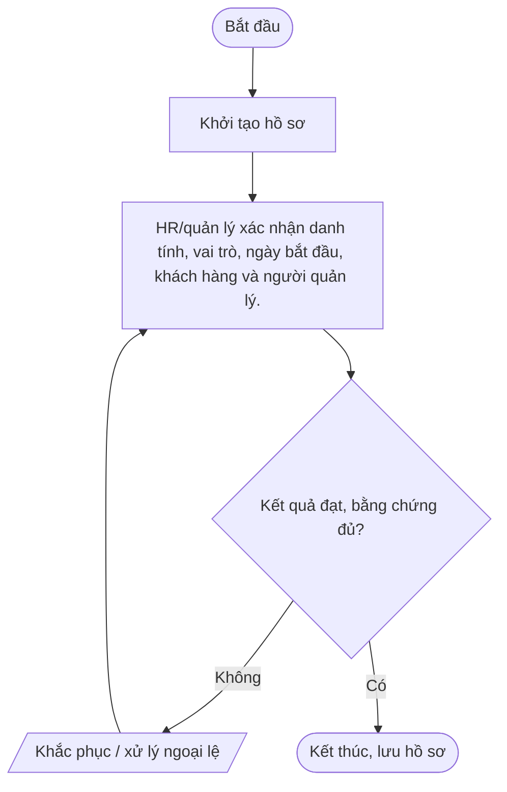
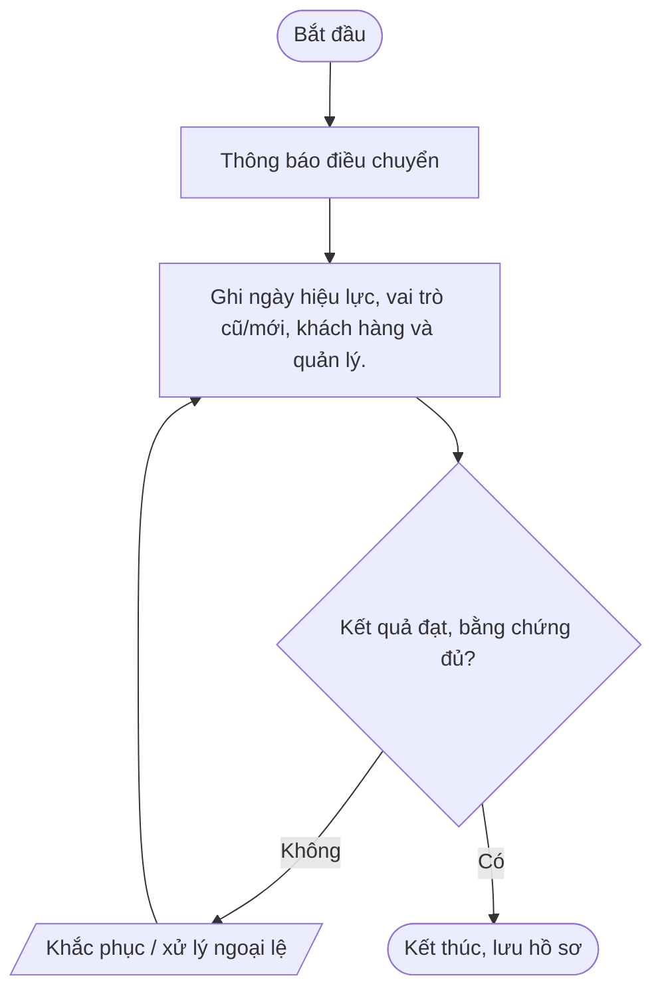
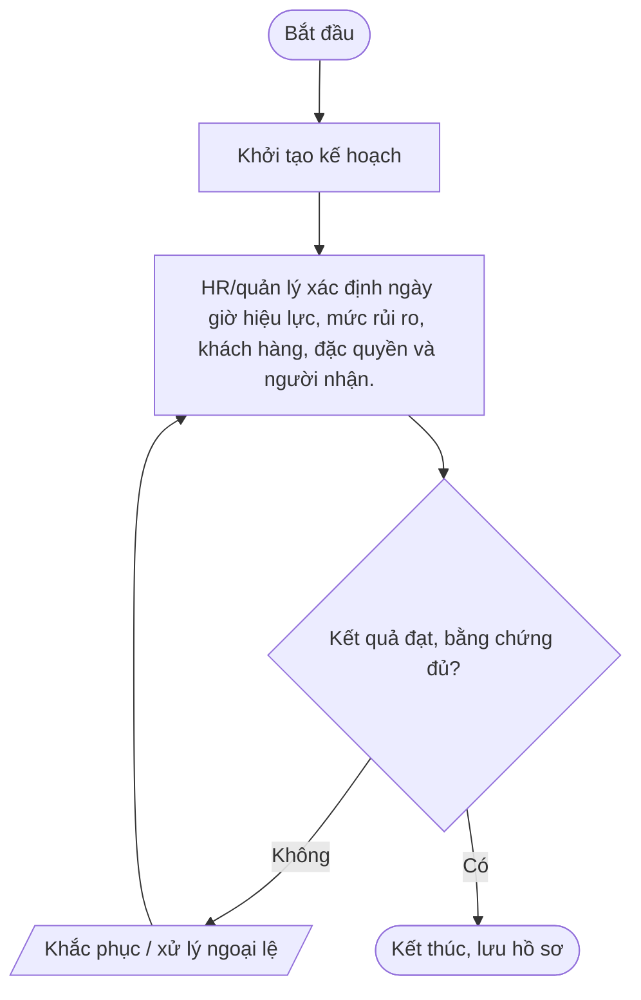
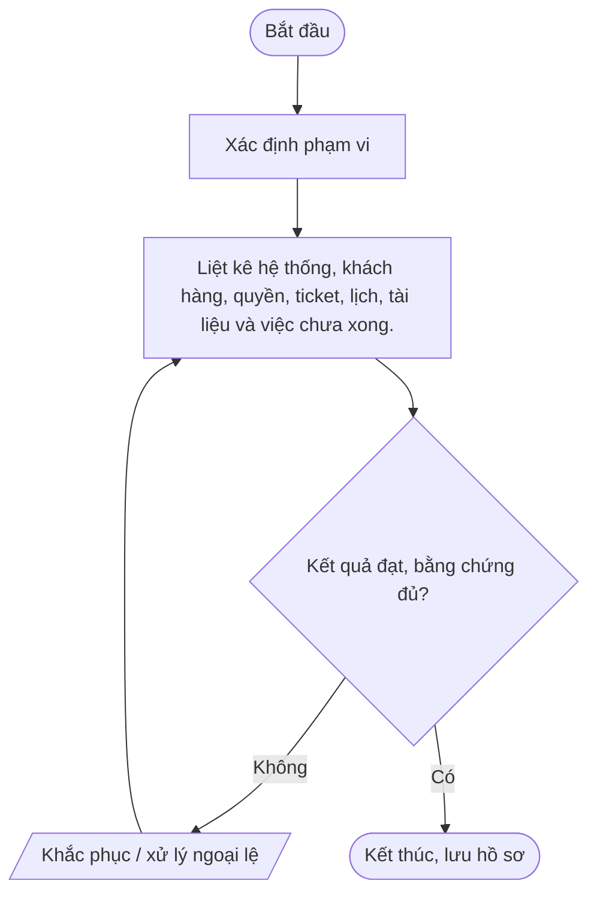
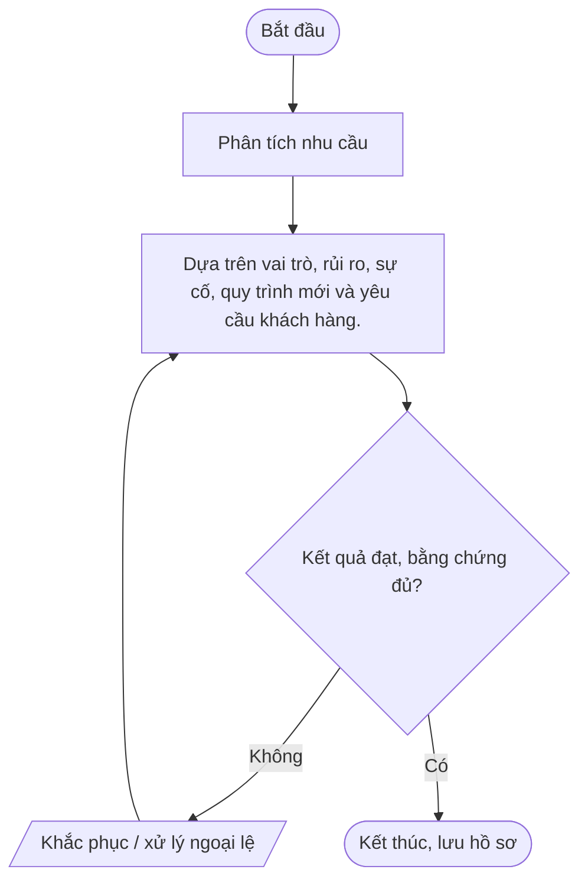

# Nhóm E — Nhân sự và bảo toàn thông tin

Bộ quy trình chuẩn Mstar — bản dự thảo ngày 2026-10-14. Tài liệu được thiết kế dùng chung cho dịch vụ IT Outsourcing; các yêu cầu cụ thể được cấu hình trong phụ lục khách hàng.

## Quy tắc áp dụng

- Quy trình lõi dùng chung; phụ lục khách hàng xác định phạm vi, SLA, đầu mối, quyền, retention, thông báo sự cố và yêu cầu phục hồi.
- Mọi thao tác trên hệ thống khách hàng phải được hợp đồng/ủy quyền cho phép.
- Bằng chứng phải có thể truy nguyên: ticket, phê duyệt, log, biên bản, kết quả kiểm tra.
- Không lưu mật khẩu, token, API key hoặc secret dạng rõ trong ticket/repository thông thường.
- Quy trình chỉ có hiệu lực sau khi được rà soát và phê duyệt; đây không phải tuyên bố Mstar đã được chứng nhận ISO.
- Tham chiếu: ISO/IEC 27001:2022 và ISO/IEC 27002:2022; mapping cuối cùng cần căn cứ risk assessment và SoA.

## Danh mục trong nhóm

| Mã | Quy trình | Mục đích |
|---|---|---|
| [QT-HR-01](#qt-hr-01) | Tiếp nhận nhân sự mới | Bảo đảm nhân sự/nhà thầu hoàn tất cam kết, đào tạo và được cấp thiết bị/quyền đúng vai trò. |
| [QT-HR-02](#qt-hr-02) | Điều chuyển nhân sự | Điều chỉnh quyền, thiết bị, trách nhiệm và đào tạo khi đổi vị trí/nhóm/khách hàng. |
| [QT-HR-03](#qt-hr-03) | Nhân viên nghỉ việc | Thu hồi quyền đúng thời điểm, thu hồi tài sản, bảo toàn thông tin và bàn giao tri thức khi nghỉ việc. |
| [QT-HR-04](#qt-hr-04) | Bàn giao kiến thức và tài liệu kỹ thuật | Giảm phụ thuộc cá nhân, giúp người thay thế vận hành hệ thống bằng tài liệu chuẩn thay vì tài khoản cũ. |
| [QT-HR-05](#qt-hr-05) | Đào tạo và nhận thức an toàn thông tin | Giúp nhân sự hiểu trách nhiệm, nhận diện nguy cơ và thực hiện quy trình theo vai trò. |

---
## QT-HR-01 — Tiếp nhận nhân sự mới

**Mục đích:** Bảo đảm nhân sự/nhà thầu hoàn tất cam kết, đào tạo và được cấp thiết bị/quyền đúng vai trò.

**Kích hoạt:** Khi có yêu cầu/sự kiện thuộc phạm vi; khi thay đổi đáng kể; theo chu kỳ; hoặc khi hợp đồng/khách hàng yêu cầu.

**Phạm vi:** Hoạt động Mstar và dịch vụ IT Outsourcing thuộc hợp đồng/ủy quyền. Chi tiết hệ thống, SLA, đầu mối, quyền, retention, thông báo và RTO/RPO phải được cấu hình trong phụ lục khách hàng.

**Vai trò:** Người yêu cầu; người thực hiện; người kiểm tra/chủ sở hữu hệ thống; chủ sở hữu quy trình; IT Lead; người phê duyệt theo ma trận thẩm quyền; đầu mối khách hàng khi hợp đồng yêu cầu. Người thực hiện không tự phê duyệt thay đổi/rủi ro trọng yếu của chính mình.

**Đầu vào:** Yêu cầu/ticket; hợp đồng/phụ lục; danh mục hệ thống/tài sản; quyền được ủy quyền; quy trình liên quan; dữ liệu/bằng chứng hiện có.

**Đầu ra:** Hồ sơ xử lý; kết quả đã xác minh; phê duyệt; ticket/biên bản đóng; việc tồn có owner và hạn.

### Các bước thực hiện

| Bước | Hoạt động | Vai trò chính | Hướng dẫn và kiểm soát | Bằng chứng cần lưu |
|---:|---|---|---|---|
| 1 | Khởi tạo hồ sơ | Người yêu cầu/đầu mối | Khởi tạo hồ sơ | Hồ sơ/ticket/log/phê duyệt tương ứng |
| 2 | HR/quản lý xác nhận danh tính, vai trò, ngày bắt đầu, khách hàng và người quản lý. | Chủ sở hữu quy trình/IT Lead | HR/quản lý xác nhận danh tính, vai trò, ngày bắt đầu, khách hàng và người quản lý. | Hồ sơ/ticket/log/phê duyệt tương ứng |

### Lưu đồ

### Biểu mẫu/hồ sơ

Cam kết/đào tạo|Cung cấp quy tắc bảo mật, xử lý dữ liệu, báo sự cố và nghĩa vụ khi nghỉ việc.

### KPI và giám sát

Xác định/cấp quyền|Quản lý yêu cầu quyền tối thiểu; IT cấp tài khoản riêng, MFA và thiết bị baseline sau phê duyệt.

### Ngoại lệ và an toàn thông tin

Kiểm tra sẵn sàng|Xác minh thiết bị, quyền, đào tạo, hướng dẫn và đầu mối hỗ trợ.

- Xác minh thẩm quyền/phạm vi trước khi thao tác; không tự mở rộng quyền.
- Không ghi mật khẩu, API key, token, khóa riêng hoặc mã khôi phục dạng rõ trong ticket, README, email thường hay tài liệu bàn giao.
- Thay đổi hệ thống phải theo QT-IT-13; nghi ngờ sự cố ATTT phải theo QT-ATTT-04; ngoại lệ phải theo QT-ISMS-04.
- Lưu hồ sơ ở kho được Mstar phê duyệt, phân quyền tối thiểu và giữ theo yêu cầu hợp đồng/pháp luật.
- Chỉ đóng việc khi kết quả được kiểm tra và bằng chứng cần thiết đã lưu.

### Phụ lục khách hàng cần cấu hình

| Trường | Giá trị cần xác nhận |
|---|---|
| Khách hàng/mã hợp đồng | Điền theo hợp đồng |
| Phạm vi hệ thống/dịch vụ | Hệ thống, tenant, site, tài sản, loại dịch vụ |
| SLA/lịch hỗ trợ | Theo hợp đồng/phụ lục |
| Đầu mối yêu cầu/phê duyệt | Chức danh, kênh và người thay thế |
| Quyền/kênh kỹ thuật | Phạm vi ủy quyền, MFA, VPN, thời hạn |
| Dữ liệu/lưu giữ | Phân loại, nơi lưu, thời hạn, trả/xóa |
| Thông báo sự cố | Kênh, người nhận, thời hạn |
| Ngoại lệ/rủi ro tồn dư | Mã hồ sơ, phê duyệt, biện pháp bù trừ, ngày hết hạn |

> **Trạng thái:** Dự thảo v0.1 — chờ Mstar rà soát, thử nghiệm và phê duyệt. Tham chiếu ISO chỉ là định hướng; cần xác nhận theo phạm vi ISMS, đánh giá rủi ro và SoA.

---

## QT-HR-02 — Điều chuyển nhân sự

**Mục đích:** Điều chỉnh quyền, thiết bị, trách nhiệm và đào tạo khi đổi vị trí/nhóm/khách hàng.

**Kích hoạt:** Khi có yêu cầu/sự kiện thuộc phạm vi; khi thay đổi đáng kể; theo chu kỳ; hoặc khi hợp đồng/khách hàng yêu cầu.

**Phạm vi:** Hoạt động Mstar và dịch vụ IT Outsourcing thuộc hợp đồng/ủy quyền. Chi tiết hệ thống, SLA, đầu mối, quyền, retention, thông báo và RTO/RPO phải được cấu hình trong phụ lục khách hàng.

**Vai trò:** Người yêu cầu; người thực hiện; người kiểm tra/chủ sở hữu hệ thống; chủ sở hữu quy trình; IT Lead; người phê duyệt theo ma trận thẩm quyền; đầu mối khách hàng khi hợp đồng yêu cầu. Người thực hiện không tự phê duyệt thay đổi/rủi ro trọng yếu của chính mình.

**Đầu vào:** Yêu cầu/ticket; hợp đồng/phụ lục; danh mục hệ thống/tài sản; quyền được ủy quyền; quy trình liên quan; dữ liệu/bằng chứng hiện có.

**Đầu ra:** Hồ sơ xử lý; kết quả đã xác minh; phê duyệt; ticket/biên bản đóng; việc tồn có owner và hạn.

### Các bước thực hiện

| Bước | Hoạt động | Vai trò chính | Hướng dẫn và kiểm soát | Bằng chứng cần lưu |
|---:|---|---|---|---|
| 1 | Thông báo điều chuyển | Người yêu cầu/đầu mối | Thông báo điều chuyển | Hồ sơ/ticket/log/phê duyệt tương ứng |
| 2 | Ghi ngày hiệu lực, vai trò cũ/mới, khách hàng và quản lý. | Chủ sở hữu quy trình/IT Lead | Ghi ngày hiệu lực, vai trò cũ/mới, khách hàng và quản lý. | Hồ sơ/ticket/log/phê duyệt tương ứng |

### Lưu đồ

### Biểu mẫu/hồ sơ

Rà quyền cũ|Liệt kê quyền, nhóm, token, đặc quyền và quyền khách hàng không còn cần.

### KPI và giám sát

Phê duyệt quyền mới|Quản lý mới/chủ sở hữu xác định quyền tối thiểu và xung đột nhiệm vụ.

### Ngoại lệ và an toàn thông tin

Thu hồi/cấp mới và bàn giao|Thu hồi quyền cũ đúng thời điểm, cấp mới sau duyệt, bàn giao ticket/tài sản/tài liệu.

- Xác minh thẩm quyền/phạm vi trước khi thao tác; không tự mở rộng quyền.
- Không ghi mật khẩu, API key, token, khóa riêng hoặc mã khôi phục dạng rõ trong ticket, README, email thường hay tài liệu bàn giao.
- Thay đổi hệ thống phải theo QT-IT-13; nghi ngờ sự cố ATTT phải theo QT-ATTT-04; ngoại lệ phải theo QT-ISMS-04.
- Lưu hồ sơ ở kho được Mstar phê duyệt, phân quyền tối thiểu và giữ theo yêu cầu hợp đồng/pháp luật.
- Chỉ đóng việc khi kết quả được kiểm tra và bằng chứng cần thiết đã lưu.

### Phụ lục khách hàng cần cấu hình

| Trường | Giá trị cần xác nhận |
|---|---|
| Khách hàng/mã hợp đồng | Điền theo hợp đồng |
| Phạm vi hệ thống/dịch vụ | Hệ thống, tenant, site, tài sản, loại dịch vụ |
| SLA/lịch hỗ trợ | Theo hợp đồng/phụ lục |
| Đầu mối yêu cầu/phê duyệt | Chức danh, kênh và người thay thế |
| Quyền/kênh kỹ thuật | Phạm vi ủy quyền, MFA, VPN, thời hạn |
| Dữ liệu/lưu giữ | Phân loại, nơi lưu, thời hạn, trả/xóa |
| Thông báo sự cố | Kênh, người nhận, thời hạn |
| Ngoại lệ/rủi ro tồn dư | Mã hồ sơ, phê duyệt, biện pháp bù trừ, ngày hết hạn |

> **Trạng thái:** Dự thảo v0.1 — chờ Mstar rà soát, thử nghiệm và phê duyệt. Tham chiếu ISO chỉ là định hướng; cần xác nhận theo phạm vi ISMS, đánh giá rủi ro và SoA.

---

## QT-HR-03 — Nhân viên nghỉ việc

**Mục đích:** Thu hồi quyền đúng thời điểm, thu hồi tài sản, bảo toàn thông tin và bàn giao tri thức khi nghỉ việc.

**Kích hoạt:** Khi có yêu cầu/sự kiện thuộc phạm vi; khi thay đổi đáng kể; theo chu kỳ; hoặc khi hợp đồng/khách hàng yêu cầu.

**Phạm vi:** Hoạt động Mstar và dịch vụ IT Outsourcing thuộc hợp đồng/ủy quyền. Chi tiết hệ thống, SLA, đầu mối, quyền, retention, thông báo và RTO/RPO phải được cấu hình trong phụ lục khách hàng.

**Vai trò:** Người yêu cầu; người thực hiện; người kiểm tra/chủ sở hữu hệ thống; chủ sở hữu quy trình; IT Lead; người phê duyệt theo ma trận thẩm quyền; đầu mối khách hàng khi hợp đồng yêu cầu. Người thực hiện không tự phê duyệt thay đổi/rủi ro trọng yếu của chính mình.

**Đầu vào:** Yêu cầu/ticket; hợp đồng/phụ lục; danh mục hệ thống/tài sản; quyền được ủy quyền; quy trình liên quan; dữ liệu/bằng chứng hiện có.

**Đầu ra:** Hồ sơ xử lý; kết quả đã xác minh; phê duyệt; ticket/biên bản đóng; việc tồn có owner và hạn.

### Các bước thực hiện

| Bước | Hoạt động | Vai trò chính | Hướng dẫn và kiểm soát | Bằng chứng cần lưu |
|---:|---|---|---|---|
| 1 | Khởi tạo kế hoạch | Người yêu cầu/đầu mối | Khởi tạo kế hoạch | Hồ sơ/ticket/log/phê duyệt tương ứng |
| 2 | HR/quản lý xác định ngày giờ hiệu lực, mức rủi ro, khách hàng, đặc quyền và người nhận. | Chủ sở hữu quy trình/IT Lead | HR/quản lý xác định ngày giờ hiệu lực, mức rủi ro, khách hàng, đặc quyền và người nhận. | Hồ sơ/ticket/log/phê duyệt tương ứng |

### Lưu đồ

### Biểu mẫu/hồ sơ

Kiểm kê quyền/tài sản|Tổng hợp tài khoản, VPN, cloud, email, vault, token, thiết bị, ticket và tài liệu.

### KPI và giám sát

Bàn giao tri thức|Bàn giao ticket, runbook, cấu hình, rủi ro, đầu mối và lịch vận hành.

### Ngoại lệ và an toàn thông tin

Thu hồi và thu tài sản|Khóa tài khoản/session, thu hồi token/SSH/VPN, thu thiết bị và xử lý dữ liệu theo phê duyệt.

- Xác minh thẩm quyền/phạm vi trước khi thao tác; không tự mở rộng quyền.
- Không ghi mật khẩu, API key, token, khóa riêng hoặc mã khôi phục dạng rõ trong ticket, README, email thường hay tài liệu bàn giao.
- Thay đổi hệ thống phải theo QT-IT-13; nghi ngờ sự cố ATTT phải theo QT-ATTT-04; ngoại lệ phải theo QT-ISMS-04.
- Lưu hồ sơ ở kho được Mstar phê duyệt, phân quyền tối thiểu và giữ theo yêu cầu hợp đồng/pháp luật.
- Chỉ đóng việc khi kết quả được kiểm tra và bằng chứng cần thiết đã lưu.

### Phụ lục khách hàng cần cấu hình

| Trường | Giá trị cần xác nhận |
|---|---|
| Khách hàng/mã hợp đồng | Điền theo hợp đồng |
| Phạm vi hệ thống/dịch vụ | Hệ thống, tenant, site, tài sản, loại dịch vụ |
| SLA/lịch hỗ trợ | Theo hợp đồng/phụ lục |
| Đầu mối yêu cầu/phê duyệt | Chức danh, kênh và người thay thế |
| Quyền/kênh kỹ thuật | Phạm vi ủy quyền, MFA, VPN, thời hạn |
| Dữ liệu/lưu giữ | Phân loại, nơi lưu, thời hạn, trả/xóa |
| Thông báo sự cố | Kênh, người nhận, thời hạn |
| Ngoại lệ/rủi ro tồn dư | Mã hồ sơ, phê duyệt, biện pháp bù trừ, ngày hết hạn |

> **Trạng thái:** Dự thảo v0.1 — chờ Mstar rà soát, thử nghiệm và phê duyệt. Tham chiếu ISO chỉ là định hướng; cần xác nhận theo phạm vi ISMS, đánh giá rủi ro và SoA.

---

## QT-HR-04 — Bàn giao kiến thức và tài liệu kỹ thuật

**Mục đích:** Giảm phụ thuộc cá nhân, giúp người thay thế vận hành hệ thống bằng tài liệu chuẩn thay vì tài khoản cũ.

**Kích hoạt:** Khi có yêu cầu/sự kiện thuộc phạm vi; khi thay đổi đáng kể; theo chu kỳ; hoặc khi hợp đồng/khách hàng yêu cầu.

**Phạm vi:** Hoạt động Mstar và dịch vụ IT Outsourcing thuộc hợp đồng/ủy quyền. Chi tiết hệ thống, SLA, đầu mối, quyền, retention, thông báo và RTO/RPO phải được cấu hình trong phụ lục khách hàng.

**Vai trò:** Người yêu cầu; người thực hiện; người kiểm tra/chủ sở hữu hệ thống; chủ sở hữu quy trình; IT Lead; người phê duyệt theo ma trận thẩm quyền; đầu mối khách hàng khi hợp đồng yêu cầu. Người thực hiện không tự phê duyệt thay đổi/rủi ro trọng yếu của chính mình.

**Đầu vào:** Yêu cầu/ticket; hợp đồng/phụ lục; danh mục hệ thống/tài sản; quyền được ủy quyền; quy trình liên quan; dữ liệu/bằng chứng hiện có.

**Đầu ra:** Hồ sơ xử lý; kết quả đã xác minh; phê duyệt; ticket/biên bản đóng; việc tồn có owner và hạn.

### Các bước thực hiện

| Bước | Hoạt động | Vai trò chính | Hướng dẫn và kiểm soát | Bằng chứng cần lưu |
|---:|---|---|---|---|
| 1 | Xác định phạm vi | Người yêu cầu/đầu mối | Xác định phạm vi | Hồ sơ/ticket/log/phê duyệt tương ứng |
| 2 | Liệt kê hệ thống, khách hàng, quyền, ticket, lịch, tài liệu và việc chưa xong. | Chủ sở hữu quy trình/IT Lead | Liệt kê hệ thống, khách hàng, quyền, ticket, lịch, tài liệu và việc chưa xong. | Hồ sơ/ticket/log/phê duyệt tương ứng |

### Lưu đồ

### Biểu mẫu/hồ sơ

Chuẩn hóa tài liệu|Cập nhật sơ đồ, inventory, runbook, cấu hình, backup/restore, vendor và cảnh báo.

### KPI và giám sát

Kiểm tra bí mật/quyền|Đưa secret vào vault; loại secret khỏi tài liệu; chuyển quyền bằng quy trình IAM.

### Ngoại lệ và an toàn thông tin

Walkthrough/kiểm thử|Giải thích vận hành và cho người nhận thực hiện mẫu; ghi gap/tài liệu thiếu.

- Xác minh thẩm quyền/phạm vi trước khi thao tác; không tự mở rộng quyền.
- Không ghi mật khẩu, API key, token, khóa riêng hoặc mã khôi phục dạng rõ trong ticket, README, email thường hay tài liệu bàn giao.
- Thay đổi hệ thống phải theo QT-IT-13; nghi ngờ sự cố ATTT phải theo QT-ATTT-04; ngoại lệ phải theo QT-ISMS-04.
- Lưu hồ sơ ở kho được Mstar phê duyệt, phân quyền tối thiểu và giữ theo yêu cầu hợp đồng/pháp luật.
- Chỉ đóng việc khi kết quả được kiểm tra và bằng chứng cần thiết đã lưu.

### Phụ lục khách hàng cần cấu hình

| Trường | Giá trị cần xác nhận |
|---|---|
| Khách hàng/mã hợp đồng | Điền theo hợp đồng |
| Phạm vi hệ thống/dịch vụ | Hệ thống, tenant, site, tài sản, loại dịch vụ |
| SLA/lịch hỗ trợ | Theo hợp đồng/phụ lục |
| Đầu mối yêu cầu/phê duyệt | Chức danh, kênh và người thay thế |
| Quyền/kênh kỹ thuật | Phạm vi ủy quyền, MFA, VPN, thời hạn |
| Dữ liệu/lưu giữ | Phân loại, nơi lưu, thời hạn, trả/xóa |
| Thông báo sự cố | Kênh, người nhận, thời hạn |
| Ngoại lệ/rủi ro tồn dư | Mã hồ sơ, phê duyệt, biện pháp bù trừ, ngày hết hạn |

> **Trạng thái:** Dự thảo v0.1 — chờ Mstar rà soát, thử nghiệm và phê duyệt. Tham chiếu ISO chỉ là định hướng; cần xác nhận theo phạm vi ISMS, đánh giá rủi ro và SoA.

---

## QT-HR-05 — Đào tạo và nhận thức an toàn thông tin

**Mục đích:** Giúp nhân sự hiểu trách nhiệm, nhận diện nguy cơ và thực hiện quy trình theo vai trò.

**Kích hoạt:** Khi có yêu cầu/sự kiện thuộc phạm vi; khi thay đổi đáng kể; theo chu kỳ; hoặc khi hợp đồng/khách hàng yêu cầu.

**Phạm vi:** Hoạt động Mstar và dịch vụ IT Outsourcing thuộc hợp đồng/ủy quyền. Chi tiết hệ thống, SLA, đầu mối, quyền, retention, thông báo và RTO/RPO phải được cấu hình trong phụ lục khách hàng.

**Vai trò:** Người yêu cầu; người thực hiện; người kiểm tra/chủ sở hữu hệ thống; chủ sở hữu quy trình; IT Lead; người phê duyệt theo ma trận thẩm quyền; đầu mối khách hàng khi hợp đồng yêu cầu. Người thực hiện không tự phê duyệt thay đổi/rủi ro trọng yếu của chính mình.

**Đầu vào:** Yêu cầu/ticket; hợp đồng/phụ lục; danh mục hệ thống/tài sản; quyền được ủy quyền; quy trình liên quan; dữ liệu/bằng chứng hiện có.

**Đầu ra:** Hồ sơ xử lý; kết quả đã xác minh; phê duyệt; ticket/biên bản đóng; việc tồn có owner và hạn.

### Các bước thực hiện

| Bước | Hoạt động | Vai trò chính | Hướng dẫn và kiểm soát | Bằng chứng cần lưu |
|---:|---|---|---|---|
| 1 | Phân tích nhu cầu | Người yêu cầu/đầu mối | Phân tích nhu cầu | Hồ sơ/ticket/log/phê duyệt tương ứng |
| 2 | Dựa trên vai trò, rủi ro, sự cố, quy trình mới và yêu cầu khách hàng. | Chủ sở hữu quy trình/IT Lead | Dựa trên vai trò, rủi ro, sự cố, quy trình mới và yêu cầu khách hàng. | Hồ sơ/ticket/log/phê duyệt tương ứng |

### Lưu đồ

### Biểu mẫu/hồ sơ

Lập kế hoạch/nội dung|Xác định lịch, hình thức, tài liệu, bài kiểm tra và tiêu chí đạt.

### KPI và giám sát

Tổ chức đào tạo|Thực hiện onboarding, định kỳ và chuyên đề; ghi nhận người tham gia.

### Ngoại lệ và an toàn thông tin

Đánh giá/bổ sung|Kiểm tra kiến thức; tổ chức đào tạo bù/coaching cho người chưa đạt.

- Xác minh thẩm quyền/phạm vi trước khi thao tác; không tự mở rộng quyền.
- Không ghi mật khẩu, API key, token, khóa riêng hoặc mã khôi phục dạng rõ trong ticket, README, email thường hay tài liệu bàn giao.
- Thay đổi hệ thống phải theo QT-IT-13; nghi ngờ sự cố ATTT phải theo QT-ATTT-04; ngoại lệ phải theo QT-ISMS-04.
- Lưu hồ sơ ở kho được Mstar phê duyệt, phân quyền tối thiểu và giữ theo yêu cầu hợp đồng/pháp luật.
- Chỉ đóng việc khi kết quả được kiểm tra và bằng chứng cần thiết đã lưu.

### Phụ lục khách hàng cần cấu hình

| Trường | Giá trị cần xác nhận |
|---|---|
| Khách hàng/mã hợp đồng | Điền theo hợp đồng |
| Phạm vi hệ thống/dịch vụ | Hệ thống, tenant, site, tài sản, loại dịch vụ |
| SLA/lịch hỗ trợ | Theo hợp đồng/phụ lục |
| Đầu mối yêu cầu/phê duyệt | Chức danh, kênh và người thay thế |
| Quyền/kênh kỹ thuật | Phạm vi ủy quyền, MFA, VPN, thời hạn |
| Dữ liệu/lưu giữ | Phân loại, nơi lưu, thời hạn, trả/xóa |
| Thông báo sự cố | Kênh, người nhận, thời hạn |
| Ngoại lệ/rủi ro tồn dư | Mã hồ sơ, phê duyệt, biện pháp bù trừ, ngày hết hạn |

> **Trạng thái:** Dự thảo v0.1 — chờ Mstar rà soát, thử nghiệm và phê duyệt. Tham chiếu ISO chỉ là định hướng; cần xác nhận theo phạm vi ISMS, đánh giá rủi ro và SoA.
