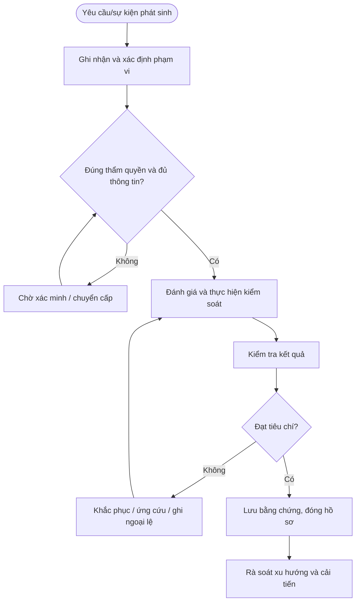

# QT-ATTT-03 — PHÂN LOẠI VÀ XỬ LÝ DỮ LIỆU

> **Trạng thái:** Dự thảo nâng cấp v0.2; cần rà soát, chạy thử và phê duyệt trước khi áp dụng.  
> **Chủ sở hữu:** Đầu mối ATTT / IT Lead theo phân công.  
> **Liên quan:** QT-IT-08, QT-IT-11, QT-IT-13, QT-ATTT-04, QT-ISMS-03/04, REG-01, MA-01, MA-02.

## 1. Kiểm soát tài liệu
| Trường | Nội dung |
|---|---|
| Mã | QT-ATTT-03 |
| Phiên bản | 0.2 — dự thảo nâng cấp |
| Chủ sở hữu | Đầu mối ATTT / IT Lead |
| Người rà soát | Chủ hệ thống và các bên liên quan |
| Người phê duyệt | Người có thẩm quyền theo quản trị tài liệu |
| Ngày hiệu lực | Điền sau khi phê duyệt |
| Rà soát | Tối thiểu hằng năm và sau sự cố/thay đổi trọng yếu |

## 2. Mục đích và phạm vi
Xác định mức nhạy cảm dữ liệu và quy tắc thu thập, truy cập, truyền, lưu, sao chép, chia sẻ, lưu giữ và tiêu hủy.
Áp dụng cho hệ thống, dữ liệu và hoạt động thuộc Mstar hoặc thuộc khách hàng mà Mstar được ủy quyền. Phụ lục khách hàng xác định phạm vi, công cụ, người phê duyệt, SLA, nơi lưu và thời hạn lưu. Không thực hiện kiểm tra/truy xuất dữ liệu ngoài phạm vi được duyệt.

## 3. Nguyên tắc bắt buộc
1. Chỉ thực hiện trong phạm vi quyền và mục đích được ủy quyền.
2. Áp dụng quyền tối thiểu, phân tách nhiệm vụ và lưu lịch sử thao tác.
3. Không lưu secret dạng rõ hoặc đưa dữ liệu nhạy cảm vào repository/tài liệu dùng chung.
4. Khi nghi ngờ sự cố ATTT, kích hoạt QT-ATTT-04; bảo toàn bằng chứng trước hành động có thể làm mất dấu vết.
5. Ngoại lệ phải có đánh giá rủi ro, biện pháp bù trừ, owner, thời hạn và người phê duyệt.
6. Không tự đặt thời hạn xử lý/retention chung khi chưa có chính sách, hợp đồng hoặc ma trận đã duyệt.

## 4. Vai trò
| Vai trò | Trách nhiệm |
|---|---|
| Người yêu cầu/tiếp nhận | Ghi nhận yêu cầu, xác minh phạm vi và thông tin đầu vào. |
| Người thực hiện | Thực hiện theo hướng dẫn, ghi nhật ký và báo sai lệch. |
| Owner hệ thống/dữ liệu | Xác nhận phạm vi, rủi ro, quyền và tiêu chí đạt. |
| Đầu mối ATTT | Đánh giá rủi ro, điều phối ứng phó và kiểm tra bằng chứng. |
| IT Lead | Phê duyệt trong thẩm quyền, điều phối nguồn lực và chuyển cấp. |
| Đầu mối khách hàng/Legal | Xác nhận nghĩa vụ hợp đồng/pháp lý và phê duyệt khi cần. |

## 5. Đầu vào và điều kiện bắt đầu
Hồ sơ phải xác định đối tượng, mục đích, phạm vi, người yêu cầu, owner, quyền cần dùng, người phê duyệt, công cụ, tiêu chí hoàn thành và nơi lưu bằng chứng. Nếu thiếu thông tin trọng yếu, chuyển Chờ xác nhận; không thực hiện hành động có thể ảnh hưởng dữ liệu/hệ thống khi chưa rõ thẩm quyền.

## 6. Trình tự thực hiện chi tiết

### Bước 1 — Xác định chủ sở hữu và mục đích
**Người thực hiện:** Người được phân công; owner hệ thống/ATTT rà soát theo mức độ.

Mỗi tập dữ liệu phải có owner, mục đích xử lý, hệ thống lưu, nhóm người dùng, nguồn, người nhận và căn cứ hợp đồng/pháp lý khi áp dụng. Chỉ thu thập dữ liệu cần thiết cho dịch vụ; không sao chép dữ liệu khách hàng về môi trường Mstar nếu chưa có mục đích và phê duyệt.

**Điều kiện đạt:** Kết quả được xác minh và hồ sơ truy nguyên được. **Nếu không đạt:** Giữ trạng thái chưa hoàn tất, ghi sai lệch, owner khắc phục và hạn xử lý.

### Bước 2 — Phân loại dữ liệu
**Người thực hiện:** Người được phân công; owner hệ thống/ATTT rà soát theo mức độ.

Áp dụng sơ đồ phân loại được phê duyệt (ví dụ: công khai, nội bộ, mật/nhạy cảm); xác định theo nội dung, hậu quả nếu lộ/sửa/mất, yêu cầu khách hàng và pháp luật. Nếu chưa rõ, tạm xử lý theo mức bảo vệ cao hơn cho đến khi owner xác nhận. Không tự gắn nhãn thấp để giảm kiểm soát.

**Điều kiện đạt:** Kết quả được xác minh và hồ sơ truy nguyên được. **Nếu không đạt:** Giữ trạng thái chưa hoàn tất, ghi sai lệch, owner khắc phục và hạn xử lý.

### Bước 3 — Gắn nhãn và chọn nơi lưu
**Người thực hiện:** Người được phân công; owner hệ thống/ATTT rà soát theo mức độ.

Gắn nhãn trên tài liệu/kho/hệ thống khi công cụ hỗ trợ; chọn nơi lưu được phê duyệt, có quyền truy cập, mã hóa/backup/log phù hợp. Không lưu dữ liệu mật ở thiết bị cá nhân hoặc kho công khai. Dữ liệu khách hàng phải tách biệt hợp lý giữa khách hàng/tenant theo kiến trúc dịch vụ.

**Điều kiện đạt:** Kết quả được xác minh và hồ sơ truy nguyên được. **Nếu không đạt:** Giữ trạng thái chưa hoàn tất, ghi sai lệch, owner khắc phục và hạn xử lý.

### Bước 4 — Cấp quyền và chia sẻ
**Người thực hiện:** Người được phân công; owner hệ thống/ATTT rà soát theo mức độ.

Xác định người nhận, mục đích, loại dữ liệu, kênh truyền, thời hạn và phê duyệt. Chỉ chia sẻ phần tối thiểu cần thiết; dùng kênh mã hóa được duyệt, giới hạn link và ngày hết hạn khi có. Xác minh người nhận trước khi gửi; không dùng link công khai cho dữ liệu hạn chế.

**Điều kiện đạt:** Kết quả được xác minh và hồ sơ truy nguyên được. **Nếu không đạt:** Giữ trạng thái chưa hoàn tất, ghi sai lệch, owner khắc phục và hạn xử lý.

### Bước 5 — Sử dụng môi trường thử nghiệm
**Người thực hiện:** Người được phân công; owner hệ thống/ATTT rà soát theo mức độ.

Ưu tiên dữ liệu tổng hợp/ẩn danh. Dữ liệu thực chỉ dùng khi có căn cứ, phê duyệt, môi trường kiểm soát và giới hạn truy cập; che/mask trường nhận dạng khi khả thi. Không đưa dữ liệu thật vào demo, AI bên ngoài hoặc công cụ không được khách hàng cho phép.

**Điều kiện đạt:** Kết quả được xác minh và hồ sơ truy nguyên được. **Nếu không đạt:** Giữ trạng thái chưa hoàn tất, ghi sai lệch, owner khắc phục và hạn xử lý.

### Bước 6 — Lưu giữ và sao chép
**Người thực hiện:** Người được phân công; owner hệ thống/ATTT rà soát theo mức độ.

Xác định thời hạn lưu theo mục đích, hợp đồng và yêu cầu pháp lý đã được rà soát. Hạn chế bản sao, ghi owner/vị trí và bảo đảm bản sao lưu tuân thủ cùng yêu cầu bảo mật. Khi chuyển hệ thống/nhà cung cấp, xác nhận quyền truy cập và vị trí dữ liệu mới.

**Điều kiện đạt:** Kết quả được xác minh và hồ sơ truy nguyên được. **Nếu không đạt:** Giữ trạng thái chưa hoàn tất, ghi sai lệch, owner khắc phục và hạn xử lý.

### Bước 7 — Tiêu hủy và kết thúc dịch vụ
**Người thực hiện:** Người được phân công; owner hệ thống/ATTT rà soát theo mức độ.

Khi hết mục đích/thời hạn hoặc chấm dứt dịch vụ, xác minh nghĩa vụ lưu giữ, legal hold và yêu cầu khách hàng trước khi xóa. Thực hiện xóa an toàn theo loại phương tiện/kho, xử lý cả bản sao/replica theo khả năng kỹ thuật, ghi người duyệt, phương pháp, thời gian và bằng chứng. Nếu không thể xóa ngay bản sao lưu, ghi lịch hết hạn và hạn chế khôi phục/truy cập.

**Điều kiện đạt:** Kết quả được xác minh và hồ sơ truy nguyên được. **Nếu không đạt:** Giữ trạng thái chưa hoàn tất, ghi sai lệch, owner khắc phục và hạn xử lý.

## 7. Xử lý ngoại lệ và chuyển cấp
Chuyển cấp khi phát hiện truy cập trái phép, secret bị lộ, dữ liệu có nguy cơ lộ/mất, log bị can thiệp, lỗ hổng có thể đã bị khai thác, không thể kiểm soát quyền, thiếu phê duyệt bắt buộc hoặc có rủi ro ảnh hưởng nhiều hệ thống/khách hàng. Ghi mã hồ sơ, thời điểm, phạm vi, bằng chứng, việc đã làm, tác động, người nhận và quyết định cần thiết.

## 8. Bằng chứng tối thiểu
| Bằng chứng | Nội dung |
|---|---|
| Yêu cầu/phạm vi | Người yêu cầu, đối tượng, mục đích và thẩm quyền |
| Cấu hình/kiểm tra ban đầu | Nguồn, thời điểm, trạng thái và phương pháp |
| Phê duyệt | Người duyệt, thời gian, phạm vi, điều kiện |
| Nhật ký thực hiện | Người làm, thao tác, kết quả, sai lệch |
| Kiểm tra sau xử lý | Tiêu chí, kết quả, bằng chứng và người xác nhận |
| Ngoại lệ/CAPA | Rủi ro, biện pháp bù trừ, owner, hạn, kiểm tra hiệu lực |

Lưu trong kho chính thức, hạn chế quyền theo nguyên tắc cần biết và thời hạn theo danh mục hồ sơ/hợp đồng. Bằng chứng sự cố phải giữ chain of custody khi áp dụng.

## 9. KPI và giám sát
| KPI | Định nghĩa |
|---|---|
| Tỷ lệ hồ sơ đủ | Hồ sơ đạt checklist / hồ sơ được lấy mẫu |
| Tỷ lệ xử lý đúng hạn | Hạng mục hoàn tất đúng hạn / hạng mục đến hạn theo chính sách đã duyệt |
| Hạng mục quá hạn | Số lượng và tuổi tồn, phân theo mức độ |
| Sai lệch lặp lại | Số sai lệch tái diễn cùng nguyên nhân |
| Hành động khắc phục đúng hạn | Hành động hoàn tất đúng hạn / hành động đến hạn |

Phải chốt công thức, nguồn, kỳ đo và ngưỡng trước khi báo cáo. Không loại các trường hợp chưa xử lý khỏi mẫu đo chỉ vì thiếu dữ liệu.

## 10. Lưu đồ

## 11. Điều kiện ban hành
- [ ] Xác định owner, công cụ, người phê duyệt và phạm vi.
- [ ] Chốt thời hạn/retention theo chính sách và hợp đồng.
- [ ] Đối chiếu biểu mẫu và nơi lưu bằng chứng.
- [ ] Chạy thử tình huống bình thường, ngoại lệ và chuyển cấp.
- [ ] Ghi nhận/khắc phục sai lệch, đào tạo người thực hiện.
- [ ] Phê duyệt và công bố phiên bản hiệu lực.

**Lưu ý:** Tài liệu là dự thảo kiểm soát ATTT, không tự chứng minh chứng nhận ISO; phải phù hợp phạm vi ISMS, đánh giá rủi ro, SoA, hợp đồng và pháp luật áp dụng.
