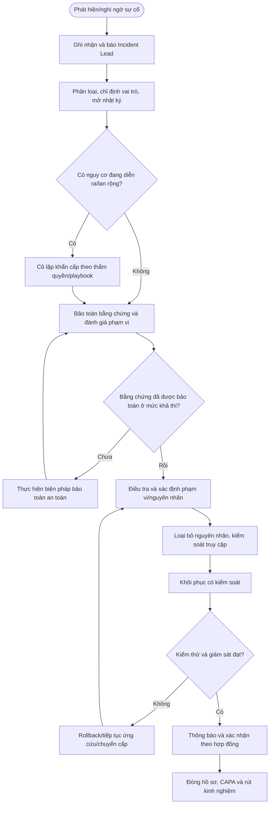

# QT-ATTT-04 — QUY TRÌNH QUẢN LÝ VÀ ỨNG CỨU SỰ CỐ AN TOÀN THÔNG TIN

> **Trạng thái:** Dự thảo nâng cấp v0.2 — phải thử nghiệm và phê duyệt trước khi áp dụng chính thức.  
> **Chủ sở hữu:** Đầu mối ATTT/Incident Lead được Mstar chỉ định.  
> **Tài liệu liên quan:** QT-IT-08 (hỗ trợ khách hàng), QT-IT-11 (tài khoản/quyền), QT-IT-13 (thay đổi), QT-ISMS-03 (rủi ro), QT-ISMS-04 (ngoại lệ), QT-BCP-01/02 (liên tục/khôi phục), REG-01 (bằng chứng vận hành), MA-01 (RACI), MA-02 (RBAC).

## 1. Kiểm soát tài liệu

| Trường | Nội dung |
|---|---|
| Mã | QT-ATTT-04 |
| Phiên bản | 0.2 — dự thảo nâng cấp |
| Chủ sở hữu | Đầu mối ATTT/Incident Lead |
| Người rà soát | IT Lead, chủ sở hữu hệ thống và đầu mối pháp lý/khách hàng khi liên quan |
| Người phê duyệt | Người có thẩm quyền theo cơ chế quản trị Mstar |
| Ngày hiệu lực | Điền sau khi phê duyệt |
| Rà soát | Tối thiểu hằng năm, sau sự cố nghiêm trọng, thay đổi dịch vụ hoặc thay đổi nghĩa vụ hợp đồng/pháp lý |

## 2. Mục đích và phạm vi

Quy định cách phát hiện, ghi nhận, phân loại, điều phối, cô lập, điều tra, loại bỏ nguyên nhân, khôi phục, thông báo, đóng hồ sơ và rút kinh nghiệm khi có sự cố hoặc nghi ngờ sự cố an toàn thông tin (ATTT). Áp dụng cho hệ thống, dữ liệu, tài khoản, thiết bị, mạng, dịch vụ đám mây và hoạt động hỗ trợ mà Mstar quản lý hoặc được khách hàng ủy quyền xử lý.

Sự cố có thể gồm: tài khoản bị chiếm dụng; đăng nhập bất thường; mã độc/ransomware; rò rỉ hoặc gửi nhầm dữ liệu; mất thiết bị; thay đổi trái phép; dịch vụ bị phá hoại; lỗ hổng bị khai thác; log bị xóa; thất lạc bản sao lưu; hoặc sự kiện khác ảnh hưởng tính bí mật, toàn vẹn hay sẵn sàng.

**Không được tự động áp dụng cùng một thời hạn thông báo cho mọi khách hàng.** Phụ lục hợp đồng phải xác định đầu mối, kênh, mức độ, thời hạn và nội dung thông báo. Khi chưa rõ nghĩa vụ, Incident Lead phải chuyển cấp ngay cho người phụ trách hợp đồng/pháp lý và đầu mối khách hàng; không trì hoãn biện pháp bảo vệ cần thiết để chờ kết luận pháp lý.

## 3. Định nghĩa và nguyên tắc ứng cứu

- **Sự kiện ATTT:** Hoạt động hoặc dấu hiệu có thể liên quan đến ATTT, chưa đủ căn cứ xác định là sự cố.
- **Sự cố ATTT:** Sự kiện đã hoặc có khả năng gây ảnh hưởng bất lợi đến dữ liệu, hệ thống, dịch vụ hay nghĩa vụ bảo mật.
- **Incident Lead:** Người được chỉ định điều phối quyết định, giao nhiệm vụ, truyền thông và tổng hợp tình hình.
- **Bằng chứng số:** Log, email, ảnh, tệp, bản sao ổ đĩa, snapshot, cấu hình, lịch sử truy cập hoặc dữ liệu liên quan có thể phục vụ điều tra.
- **Chain of Custody:** Nhật ký kiểm soát việc thu thập, truy cập, sao chép, bàn giao và lưu bằng chứng.

Nguyên tắc bắt buộc:
1. Ưu tiên an toàn con người, giới hạn thiệt hại và duy trì dịch vụ trọng yếu trong phạm vi cho phép.
2. Bảo toàn bằng chứng trước khi thực hiện hành động có thể ghi đè, xóa hoặc thay đổi dữ liệu; nếu cần cô lập khẩn cấp để ngăn thiệt hại, ghi lại lý do và thời điểm.
3. Chỉ người được ủy quyền mới được thu thập hoặc truy cập dữ liệu khách hàng; giới hạn phạm vi và ghi nhật ký.
4. Không tự ý xóa mã độc, định dạng thiết bị, xóa log, tắt hệ thống hoặc khôi phục bản sao lưu trước khi đánh giá tác động tới bằng chứng và được người có thẩm quyền đồng ý, trừ tình huống khẩn cấp theo playbook đã phê duyệt.
5. Không gửi bằng chứng chứa dữ liệu nhạy cảm qua kênh không được duyệt; không ghi mật khẩu, token, khóa riêng hoặc mã khôi phục dạng rõ vào ticket.
6. Không cam kết với truyền thông/bên thứ ba hoặc thừa nhận trách nhiệm pháp lý thay mặt Mstar/khách hàng nếu chưa được ủy quyền.
7. Mọi quyết định quan trọng phải có người quyết định, căn cứ, thời gian, tác động dự kiến và bằng chứng.

## 4. Vai trò và quyền quyết định

| Vai trò | Trách nhiệm |
|---|---|
| Người phát hiện/người dùng | Báo ngay dấu hiệu, không tự xóa bằng chứng hoặc lan truyền tệp nghi ngờ. |
| Service Desk/đầu mối tiếp nhận | Ghi nhận thời gian, kênh, hệ thống, người báo; tạo hồ sơ sự cố và thông báo Incident Lead theo tiêu chí kích hoạt. |
| Incident Lead | Phân loại ban đầu, điều phối nhóm ứng cứu, đặt nhịp cập nhật, xác định các quyết định cần phê duyệt và quản lý nhật ký quyết định. |
| Kỹ thuật viên ứng cứu | Thực hiện thu thập/cô lập/điều tra/khôi phục trong phạm vi được giao; ghi thao tác và kết quả. |
| Chủ hệ thống/IT Lead | Đánh giá tác động kinh doanh, phê duyệt kỹ thuật trong thẩm quyền, phối hợp khôi phục và phân bổ nguồn lực. |
| Đầu mối ATTT | Hướng dẫn xử lý, bảo toàn bằng chứng, đánh giá phạm vi và đề xuất biện pháp kiểm soát. |
| Contract Owner/Legal/Privacy | Xác định nghĩa vụ hợp đồng/pháp lý, thông báo, bảo toàn hồ sơ và phối hợp với khách hàng/cơ quan có thẩm quyền. |
| Đầu mối khách hàng | Xác nhận tác động, quyết định trong hệ thống thuộc quyền khách hàng và nhận thông báo theo phụ lục. |
| Nhà cung cấp | Hỗ trợ theo hợp đồng; chỉ nhận dữ liệu/bằng chứng cần thiết qua kênh được duyệt. |

Không để một người tự xác nhận toàn bộ quyết định rủi ro cao do chính mình thực hiện. Nếu ngoài giờ không thể tập hợp đủ vai trò, áp dụng danh sách liên lạc khẩn cấp đã phê duyệt; quyết định khẩn cấp phải được ghi lại và hậu kiểm khi có đủ người.

## 5. Kích hoạt và phân loại ban đầu

Kích hoạt quy trình khi có một trong các dấu hiệu: cảnh báo bảo mật đáng tin cậy; tài khoản đặc quyền đăng nhập bất thường; mã độc hoặc mã hóa dữ liệu; mất thiết bị có dữ liệu; dữ liệu bị gửi nhầm/tiết lộ; hệ thống bị truy cập trái phép; log bị can thiệp; nghi ngờ lỗ hổng bị khai thác; hoặc khách hàng/nhà cung cấp thông báo sự cố.

Người tiếp nhận không cần chứng minh đầy đủ sự cố mới được báo Incident Lead. Khi chưa rõ, tạo hồ sơ ở trạng thái **nghi ngờ** và ghi các dữ kiện đã biết cùng mức độ tin cậy.

Đánh giá sơ bộ:
- **Tác động:** hệ thống/dữ liệu/khách hàng bị ảnh hưởng; số người dùng; tính nhạy cảm; tính liên tục; hậu quả kinh doanh.
- **Mức độ lan rộng:** một thiết bị, một tài khoản, một hệ thống hay nhiều khách hàng/tenant.
- **Tính khẩn cấp:** hoạt động tấn công còn diễn ra không; dữ liệu có tiếp tục bị rò rỉ/mã hóa không; có thể cô lập an toàn không.
- **Bằng chứng:** log có nguy cơ bị ghi đè không; thiết bị/tài khoản nào cần bảo toàn.
- **Nghĩa vụ:** thời hạn báo nội bộ, khách hàng, nhà cung cấp hoặc cơ quan có thẩm quyền theo hợp đồng/pháp luật.

Mức P1–P4 (nếu dùng) và thời hạn phản hồi phải theo ma trận ứng cứu được phê duyệt. Không tự dùng ma trận SLA Helpdesk thay cho mức độ sự cố ATTT nếu chúng có tiêu chí khác nhau.

## 6. Trình tự ứng cứu chi tiết

### Bước 1 — Ghi nhận và báo động

**Ai:** Người phát hiện, Service Desk hoặc hệ thống giám sát.

1. Ghi thời điểm phát hiện và thời điểm sự kiện có thể bắt đầu; phân biệt dữ kiện xác nhận với suy đoán.
2. Ghi người báo, kênh, hệ thống/tài sản/tenant, tài khoản liên quan, triệu chứng, cảnh báo/log ban đầu và tác động đã biết.
3. Tạo mã sự cố duy nhất; liên kết ticket, cảnh báo monitoring, change hoặc tài sản liên quan.
4. Báo Incident Lead theo danh sách liên lạc. Nếu dấu hiệu cho thấy sự cố nghiêm trọng hoặc đang diễn ra, gọi kênh khẩn cấp đã được quy định, không chỉ gửi email.
5. Hạn chế chia sẻ chi tiết cho người không cần biết; không chuyển tiếp tệp nghi ngờ hoặc dữ liệu khách hàng rộng rãi.

**Đạt khi:** Có mã sự cố, mốc thời gian, hệ thống liên quan và người tiếp nhận điều phối.

**Nếu không liên lạc được Incident Lead:** Theo danh sách dự phòng; ghi rõ các lần liên hệ và người đã nhận việc. Không tự bỏ qua sự cố.

### Bước 2 — Phân loại, chỉ định chỉ huy và thiết lập nhật ký

**Ai:** Incident Lead cùng IT Lead/đầu mối ATTT.

1. Xác nhận sự kiện thuộc phạm vi nào và xác định khách hàng/hệ thống bị ảnh hưởng.
2. Phân loại nghi ngờ/sự cố xác nhận; đánh giá mức độ ban đầu, tác động, khả năng lan rộng, trạng thái đang diễn ra và nghĩa vụ thông báo.
3. Chỉ định người điều phối, người phụ trách kỹ thuật, người phụ trách truyền thông, người ghi nhật ký quyết định và người kiểm soát bằng chứng.
4. Mở nhật ký sự cố với các cột: thời điểm, sự kiện/quyết định, căn cứ, người quyết định, người thực hiện, kết quả, bằng chứng, việc tiếp theo/hạn.
5. Đặt chu kỳ cập nhật theo mức độ và phụ lục khách hàng; mọi thay đổi về mức độ phải có căn cứ ghi nhận.

**Đạt khi:** Vai trò rõ, mức độ và phạm vi sơ bộ được ghi, lịch cập nhật và kênh phối hợp được thiết lập.

### Bước 3 — Bảo toàn bằng chứng

**Ai:** Người được phân công thu thập; người kiểm soát bằng chứng rà soát.

1. Xác định loại bằng chứng cần bảo toàn: log hệ thống/đám mây, log xác thực, email header, cảnh báo EDR, snapshot, cấu hình, lịch sử thay đổi, hình ảnh màn hình hoặc thiết bị liên quan.
2. Ghi nguồn, múi giờ/đồng hồ hệ thống nếu biết, thời điểm thu thập, người thu thập, phương pháp/công cụ, phạm vi và lý do.
3. Ưu tiên bản sao chỉ đọc hoặc export được hỗ trợ; không chỉnh sửa bản gốc. Khi phù hợp và công cụ cho phép, tính hash (ví dụ SHA-256) cho tệp bằng chứng và ghi công cụ/giá trị hash.
4. Ghi mỗi lần truy cập, sao chép, chuyển giao, người giao/nhận, thời gian, mục đích và nơi lưu vào Chain of Custody.
5. Lưu trong kho được duyệt, hạn chế quyền theo nguyên tắc cần biết; không lưu ở máy cá nhân hoặc chia sẻ công khai.
6. Nếu phải cô lập/tắt thiết bị trước khi thu thập để ngăn thiệt hại, ghi quyết định, lý do, thời điểm và tác động có thể xảy ra tới bằng chứng.

**Đạt khi:** Bằng chứng có nguồn gốc và lịch sử bàn giao truy nguyên được, quyền truy cập được giới hạn.

### Bước 4 — Cô lập và hạn chế thiệt hại

**Ai:** Kỹ thuật viên được ủy quyền; Incident Lead/owner phê duyệt theo mức độ, trừ tình huống khẩn cấp đã có playbook.

1. Chọn biện pháp tương xứng: khóa/thu hồi phiên tài khoản, cô lập endpoint, chặn IOC, tạm ngắt kết nối, hạn chế truy cập hoặc vô hiệu hóa tích hợp bị nghi ngờ.
2. Trước khi thực hiện, đánh giá ảnh hưởng tới hoạt động kinh doanh, phụ thuộc hệ thống, khả năng khôi phục và rủi ro mất bằng chứng.
3. Với hành động gây gián đoạn, ghi phạm vi, lý do, người duyệt, thời điểm bắt đầu, cách hoàn tác và tiêu chí mở lại.
4. Thực hiện trong phạm vi quyền đã cấp; xác minh biện pháp đã có hiệu lực bằng log/trạng thái kỹ thuật.
5. Kiểm tra xem sự cố có lan sang tài khoản, máy, tenant, hệ thống hoặc khách hàng khác không; mở rộng phạm vi điều tra khi có căn cứ.
6. Cập nhật Incident Lead và đầu mối khách hàng theo quy định, không tiết lộ thông tin chưa xác minh như sự thật.

**Đạt khi:** Hoạt động gây hại được ngăn chặn hoặc giới hạn; có bằng chứng xác nhận; rủi ro còn lại được ghi rõ.

### Bước 5 — Điều tra và xác định phạm vi/nguyên nhân

**Ai:** Nhóm ứng cứu, chủ hệ thống, nhà cung cấp theo phân công.

1. Dựng dòng thời gian từ dữ liệu có thể xác minh; đánh dấu mốc chưa chắc chắn.
2. Xác định tài khoản, thiết bị, hệ thống, dữ liệu, khách hàng và khoảng thời gian có thể bị ảnh hưởng.
3. Xem xét vector ban đầu, quyền đã bị lợi dụng, thay đổi trái phép, IOC và các hoạt động tiếp theo.
4. Đối chiếu log từ nhiều nguồn; ghi nguồn và thời điểm. Không kết luận nguyên nhân chỉ dựa vào một dấu hiệu chưa được kiểm chứng.
5. Đánh giá khả năng tồn tại bền vững (persistence), tài khoản/khóa bị lộ, bản sao lưu bị ảnh hưởng và nguy cơ tái diễn.
6. Nếu cần chuyên gia/vendor, ghi yêu cầu, dữ liệu đã cung cấp, phê duyệt chia sẻ và kết quả nhận về.

**Đạt khi:** Có phạm vi ảnh hưởng tạm thời hoặc kết luận được mức độ chưa thể xác định, kèm dữ liệu thiếu và bước tiếp theo.

### Bước 6 — Loại bỏ nguyên nhân và xử lý triệt để

**Ai:** Kỹ thuật viên theo phương án được Incident Lead/chủ hệ thống phê duyệt.

1. Lập kế hoạch xử lý gồm nguyên nhân cần loại bỏ, hệ thống/tài khoản bị tác động, bước thực hiện, thứ tự, rủi ro, kiểm thử và rollback.
2. Thu hồi/đổi thông tin xác thực bị lộ bằng quy trình an toàn; rà soát phiên, khóa, quyền và tích hợp liên quan. Không gửi secret mới qua ticket/email thường.
3. Loại bỏ mã độc hoặc cấu hình trái phép bằng công cụ/runbook được phê duyệt; vá lỗ hổng hoặc sửa cấu hình theo QT-IT-13 khi thuộc phạm vi change.
4. Kiểm tra điểm vào ban đầu và các đường truy cập liên quan; không chỉ xử lý triệu chứng hiển thị.
5. Kiểm tra biện pháp đã hoàn tất bằng log/trạng thái/kết quả quét phù hợp; ghi rõ phần nào chưa thể xác nhận.
6. Nếu chưa loại bỏ được nguyên nhân, không tuyên bố đã xử lý triệt để; duy trì biện pháp cô lập, đánh giá rủi ro tồn dư và chuyển cấp.

### Bước 7 — Khôi phục dịch vụ có kiểm soát

**Ai:** Chủ hệ thống/IT Lead và nhóm kỹ thuật; đầu mối khách hàng phê duyệt theo hợp đồng.

1. Xác định điều kiện sẵn sàng khôi phục: mối đe dọa đã được kiểm soát ở mức chấp nhận; tài khoản/khóa được xử lý; bản sao lưu/nguồn phục hồi được đánh giá; kế hoạch rollback và giám sát đã sẵn sàng.
2. Chọn nguồn phục hồi sạch, thời điểm khôi phục, hệ thống phụ thuộc và thứ tự phục hồi theo BCP/DR, RTO/RPO đã được phê duyệt.
3. Kiểm tra tính toàn vẹn và quyền truy cập trước khi đưa dịch vụ trở lại; không ghi đè bằng bản sao lưu chưa xác minh.
4. Khôi phục theo từng bước; xác minh chức năng, dữ liệu, xác thực, log và giám sát sau khôi phục.
5. Theo dõi tăng cường trong thời gian do Incident Lead/owner xác định; ghi chỉ số, cảnh báo và quyết định tiếp tục/rollback.
6. Chỉ đưa hệ thống về hoạt động bình thường khi người có thẩm quyền xác nhận tiêu chí đã đạt. Nếu còn rủi ro tồn dư, ghi rõ chấp nhận rủi ro, biện pháp bù trừ, owner và hạn.

### Bước 8 — Thông báo và quản lý truyền thông

**Ai:** Người được ủy quyền theo phụ lục khách hàng; Incident Lead cung cấp thông tin kỹ thuật đã xác minh.

1. Tra cứu nghĩa vụ thông báo theo hợp đồng, phụ lục khách hàng và quy định pháp lý đã được người phụ trách xác nhận.
2. Xác định người nhận, kênh, thời hạn, nội dung tối thiểu và người duyệt thông báo.
3. Thông báo theo sự thật đã xác minh: thời điểm phát hiện, dịch vụ/dữ liệu có thể ảnh hưởng, tác động hiện tại, hành động đã làm, việc đang làm, biện pháp khách hàng cần thực hiện và mốc cập nhật tiếp theo.
4. Phân biệt rõ dữ kiện xác nhận, phạm vi đang điều tra và thông tin chưa thể kết luận; không suy đoán thủ phạm hoặc mức độ dữ liệu bị lộ.
5. Ghi thời điểm gửi, người duyệt, người nhận, kênh và bản thông báo; cập nhật khi có thông tin trọng yếu mới.
6. Không thông báo cho bên ngoài hoặc cơ quan có thẩm quyền thay mặt khách hàng nếu không có thẩm quyền/ủy quyền; chuyển Legal/Contract Owner xử lý nghĩa vụ tương ứng.

### Bước 9 — Xác minh kết thúc và đóng sự cố

Chỉ đóng sự cố khi:
- Tình trạng gây hại đã được kiểm soát hoặc rủi ro tồn dư đã được người có thẩm quyền chấp nhận bằng văn bản.
- Dịch vụ được khôi phục và kiểm thử đạt tiêu chí đã duyệt, hoặc đã có quyết định chính thức về trạng thái còn gián đoạn.
- Phạm vi ảnh hưởng và các điểm chưa xác định được ghi rõ.
- Bằng chứng và Chain of Custody được lưu; quyền truy cập bằng chứng đã được rà soát.
- Nghĩa vụ thông báo đã hoàn thành hoặc có owner/hạn xử lý tiếp được phê duyệt.
- Các công việc tồn có owner, hạn, mức ưu tiên và hồ sơ theo dõi.
- Incident Lead, chủ hệ thống và đầu mối khách hàng (khi cần) xác nhận điều kiện đóng.

Nếu tái xuất hiện dấu hiệu liên quan, mở lại hồ sơ hoặc tạo sự cố liên kết và bảo đảm truy nguyên được hồ sơ ban đầu.

### Bước 10 — Họp rút kinh nghiệm và hành động khắc phục

Với sự cố nghiêm trọng, sự cố lặp lại hoặc theo yêu cầu quản trị, tổ chức đánh giá sau sự cố. Nội dung tối thiểu:
- Dòng thời gian và tác động đã xác nhận.
- Điều gì phát hiện tốt/chậm; kiểm soát nào hoạt động/không hoạt động.
- Nguyên nhân gốc và yếu tố góp phần; phân biệt nguyên nhân đã chứng minh với giả thuyết.
- Cải tiến cần thực hiện: cấu hình, quyền, giám sát, backup, đào tạo, hợp đồng, runbook hoặc quy trình.
- Mỗi hành động có owner, hạn, mức ưu tiên, tiêu chí hoàn thành và người kiểm tra hiệu lực.

Không đóng hành động chỉ vì đã thực hiện một thay đổi; cần bằng chứng cho thấy biện pháp có hiệu lực hoặc ghi nhận rủi ro còn lại và phê duyệt.

## 7. Điều kiện dừng và chuyển cấp ngay

Chuyển cấp ngay nếu có: dấu hiệu ransomware/mã hóa dữ liệu; tài khoản đặc quyền bị chiếm; nghi rò rỉ dữ liệu cá nhân/bí mật; ảnh hưởng nhiều khách hàng/tenant; log hoặc bằng chứng bị xóa; hệ thống trọng yếu ngừng hoạt động; nguy cơ lan rộng; không kiểm soát được quyền truy cập; hoặc nghĩa vụ thông báo sắp đến hạn.

Dừng thao tác không cần thiết nếu: chưa rõ thẩm quyền; thao tác có thể phá hủy bằng chứng; không có phương án rollback cho hành động rủi ro cao; cần chia sẻ dữ liệu ra ngoài nhưng chưa được duyệt; hoặc phạm vi thay đổi vượt phương án được phê duyệt. Việc dừng phải đi kèm thông báo Incident Lead và kế hoạch xử lý tiếp theo, không được bỏ mặc sự cố.

## 8. Nhật ký quyết định và Chain of Custody

Mỗi quyết định quan trọng cần ghi: mã sự cố; thời gian và múi giờ; dữ kiện/căn cứ; các phương án đã cân nhắc; người quyết định và thẩm quyền; người thực hiện; rủi ro/tác động dự kiến; kết quả; bằng chứng liên kết; việc tiếp theo và hạn.

Mỗi bằng chứng cần ghi: mã bằng chứng; mô tả; nguồn/hệ thống; người thu thập; thời gian; phương pháp/công cụ; hash khi phù hợp; nơi lưu; phân loại; quyền truy cập; các lần sao chép/bàn giao; người giao/nhận; mục đích và thời gian. Không khẳng định tính toàn vẹn bằng hash nếu thực tế chưa tính hash hoặc không thể xác minh.

## 9. Bằng chứng vận hành tối thiểu

| Bằng chứng | Nội dung cần có |
|---|---|
| Hồ sơ tiếp nhận | Mã sự cố, thời gian phát hiện/báo, nguồn báo, hệ thống và triệu chứng |
| Phân loại và chỉ huy | Mức độ, phạm vi sơ bộ, Incident Lead, vai trò, lịch cập nhật |
| Nhật ký quyết định | Căn cứ, người duyệt, người thực hiện, thời gian, kết quả |
| Bằng chứng kỹ thuật | Log/snapshot/export, nguồn, thời gian, hash khi phù hợp, nơi lưu |
| Chain of Custody | Thu thập, truy cập, sao chép, bàn giao và người nhận |
| Cô lập/khắc phục | Phương án, phê duyệt, thao tác, kiểm chứng, rollback nếu có |
| Khôi phục | Nguồn phục hồi, tiêu chí kiểm thử, RTO/RPO nếu áp dụng, người xác nhận |
| Thông báo | Người duyệt/nhận, kênh, thời điểm, nội dung và cập nhật tiếp theo |
| Đóng và cải tiến | Điều kiện đóng, rủi ro tồn dư, hành động, owner/hạn và kiểm tra hiệu lực |

Lưu hồ sơ trong kho chính thức, hạn chế quyền theo nguyên tắc cần biết và thời hạn lưu theo danh mục hồ sơ, hợp đồng, yêu cầu pháp lý. Không đưa dữ liệu nhạy cảm/bằng chứng khách hàng vào repository mã nguồn công khai.

## 10. KPI và kiểm soát hiệu lực

Các KPI cần được định nghĩa trước khi áp dụng:
- Thời gian từ phát hiện đến tiếp nhận/điều phối.
- Tỷ lệ sự cố được phân loại và chỉ định Incident Lead đúng quy định.
- Tỷ lệ hồ sơ có nhật ký quyết định và bằng chứng truy nguyên.
- Tỷ lệ thông báo đáp ứng đúng thời hạn theo hợp đồng/pháp luật áp dụng.
- Thời gian khôi phục so với RTO mục tiêu khi có RTO được phê duyệt.
- Tỷ lệ hành động sau sự cố hoàn thành đúng hạn.
- Tỷ lệ sự cố tái diễn cùng nguyên nhân trong kỳ.

Nguồn đo gồm ticket/incident register, log thời gian, hồ sơ thông báo, báo cáo khôi phục và CAPA. Phải phân tích các trường hợp trễ và có hành động khắc phục; không tự đặt ngưỡng SLA chung khi chưa có thỏa thuận.

## 11. Phụ lục bắt buộc theo khách hàng

Trước khi vận hành, xác định: đầu mối khẩn cấp và người thay thế; hệ thống/dữ liệu thuộc phạm vi; mức độ sự cố và kênh thông báo; thời hạn thông báo; người có thẩm quyền cô lập/khôi phục; yêu cầu pháp lý/hợp đồng; giới hạn thu thập dữ liệu; nhà cung cấp liên quan; nơi lưu bằng chứng; yêu cầu Chain of Custody; RTO/RPO; tiêu chí đưa hệ thống hoạt động trở lại; quy tắc truyền thông; và người phê duyệt đóng sự cố.

Không ghi một thời hạn thông báo chung cho mọi khách hàng. Nếu thông tin bắt buộc chưa có, Contract Owner và Incident Lead phải xử lý như một khoảng trống kiểm soát trước khi cung cấp dịch vụ, hoặc xin ngoại lệ có thời hạn và biện pháp bù trừ.

## 12. Lưu đồ ứng cứu

## 13. Biểu mẫu liên quan

[Mở bộ biểu mẫu QT-ATTT-04](../../bieu-mau/QT-ATTT-04-Bieu-mau.md). Trước khi ban hành, xác nhận các mẫu tiếp nhận sự cố, phân loại, nhật ký quyết định, Chain of Custody, thông báo, khôi phục và báo cáo sau sự cố có đủ trường cần thiết, đúng người duyệt, đúng nơi lưu và thời hạn lưu.

## 14. Điều kiện để ban hành

- [ ] Điền người soạn, rà soát, phê duyệt và ngày hiệu lực.
- [ ] Chốt danh sách liên lạc khẩn cấp và người thay thế.
- [ ] Chốt ma trận mức độ và lịch cập nhật; không mâu thuẫn hợp đồng khách hàng.
- [ ] Xác nhận nghĩa vụ thông báo theo từng khách hàng/hợp đồng.
- [ ] Xác nhận nơi lưu bằng chứng, phân quyền và Chain of Custody.
- [ ] Diễn tập tối thiểu một kịch bản mất tài khoản/thiết bị và một kịch bản mã độc/rò rỉ dữ liệu theo phạm vi phù hợp.
- [ ] Ghi nhận kết quả diễn tập, vấn đề, hành động khắc phục và phê duyệt phiên bản cuối.

**Tuyên bố:** Quy trình được xây dựng theo định hướng quản trị ATTT và ứng cứu sự cố; không tự nó chứng minh việc tuân thủ hoặc chứng nhận ISO. Phải xác nhận với phạm vi ISMS, đánh giá rủi ro, SoA, luật áp dụng và hợp đồng thực tế.
