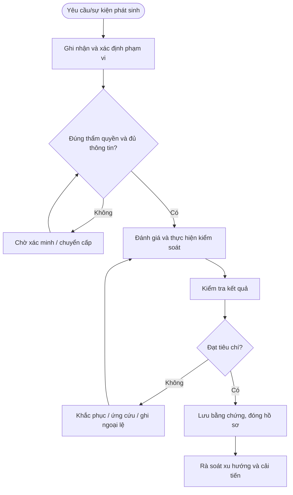

# QT-ATTT-06 — QUẢN LÝ LỖ HỔNG VÀ BẢN VÁ

> **Trạng thái:** Dự thảo nâng cấp v0.2; cần rà soát, chạy thử và phê duyệt trước khi áp dụng.  
> **Chủ sở hữu:** Đầu mối ATTT / IT Lead theo phân công.  
> **Liên quan:** QT-IT-08, QT-IT-11, QT-IT-13, QT-ATTT-04, QT-ISMS-03/04, REG-01, MA-01, MA-02.

## 1. Kiểm soát tài liệu
| Trường | Nội dung |
|---|---|
| Mã | QT-ATTT-06 |
| Phiên bản | 0.2 — dự thảo nâng cấp |
| Chủ sở hữu | Đầu mối ATTT / IT Lead |
| Người rà soát | Chủ hệ thống và các bên liên quan |
| Người phê duyệt | Người có thẩm quyền theo quản trị tài liệu |
| Ngày hiệu lực | Điền sau khi phê duyệt |
| Rà soát | Tối thiểu hằng năm và sau sự cố/thay đổi trọng yếu |

## 2. Mục đích và phạm vi
Phát hiện, phân loại, ưu tiên, khắc phục và xác minh lỗ hổng theo mức rủi ro, khả năng khai thác và mức trọng yếu hệ thống.
Áp dụng cho hệ thống, dữ liệu và hoạt động thuộc Mstar hoặc thuộc khách hàng mà Mstar được ủy quyền. Phụ lục khách hàng xác định phạm vi, công cụ, người phê duyệt, SLA, nơi lưu và thời hạn lưu. Không thực hiện kiểm tra/truy xuất dữ liệu ngoài phạm vi được duyệt.

## 3. Nguyên tắc bắt buộc
1. Chỉ thực hiện trong phạm vi quyền và mục đích được ủy quyền.
2. Áp dụng quyền tối thiểu, phân tách nhiệm vụ và lưu lịch sử thao tác.
3. Không lưu secret dạng rõ hoặc đưa dữ liệu nhạy cảm vào repository/tài liệu dùng chung.
4. Khi nghi ngờ sự cố ATTT, kích hoạt QT-ATTT-04; bảo toàn bằng chứng trước hành động có thể làm mất dấu vết.
5. Ngoại lệ phải có đánh giá rủi ro, biện pháp bù trừ, owner, thời hạn và người phê duyệt.
6. Không tự đặt thời hạn xử lý/retention chung khi chưa có chính sách, hợp đồng hoặc ma trận đã duyệt.

## 4. Vai trò
| Vai trò | Trách nhiệm |
|---|---|
| Người yêu cầu/tiếp nhận | Ghi nhận yêu cầu, xác minh phạm vi và thông tin đầu vào. |
| Người thực hiện | Thực hiện theo hướng dẫn, ghi nhật ký và báo sai lệch. |
| Owner hệ thống/dữ liệu | Xác nhận phạm vi, rủi ro, quyền và tiêu chí đạt. |
| Đầu mối ATTT | Đánh giá rủi ro, điều phối ứng phó và kiểm tra bằng chứng. |
| IT Lead | Phê duyệt trong thẩm quyền, điều phối nguồn lực và chuyển cấp. |
| Đầu mối khách hàng/Legal | Xác nhận nghĩa vụ hợp đồng/pháp lý và phê duyệt khi cần. |

## 5. Đầu vào và điều kiện bắt đầu
Hồ sơ phải xác định đối tượng, mục đích, phạm vi, người yêu cầu, owner, quyền cần dùng, người phê duyệt, công cụ, tiêu chí hoàn thành và nơi lưu bằng chứng. Nếu thiếu thông tin trọng yếu, chuyển Chờ xác nhận; không thực hiện hành động có thể ảnh hưởng dữ liệu/hệ thống khi chưa rõ thẩm quyền.

## 6. Trình tự thực hiện chi tiết

### Bước 1 — Lập danh mục tài sản và nguồn phát hiện
**Người thực hiện:** Người được phân công; owner hệ thống/ATTT rà soát theo mức độ.

Đối chiếu phạm vi tài sản/CI với nguồn quét lỗ hổng, cảnh báo vendor, thông báo bảo mật, EDR/cloud và kiểm tra thủ công. Ghi hệ thống, phiên bản, thời điểm phát hiện, nguồn, bằng chứng, mức độ tin cậy và owner. Không quét hệ thống khách hàng nếu chưa có ủy quyền/phạm vi rõ.

**Điều kiện đạt:** Kết quả được xác minh và hồ sơ truy nguyên được. **Nếu không đạt:** Giữ trạng thái chưa hoàn tất, ghi sai lệch, owner khắc phục và hạn xử lý.

### Bước 2 — Xác minh phát hiện
**Người thực hiện:** Người được phân công; owner hệ thống/ATTT rà soát theo mức độ.

Loại bỏ false positive bằng cách kiểm tra phiên bản, cấu hình, điều kiện khai thác và bằng chứng. Ghi cách xác minh; không đóng lỗ hổng chỉ vì không tái hiện được trong một lần thử. Nếu phát hiện có dấu hiệu đã bị khai thác, kích hoạt QT-ATTT-04.

**Điều kiện đạt:** Kết quả được xác minh và hồ sơ truy nguyên được. **Nếu không đạt:** Giữ trạng thái chưa hoàn tất, ghi sai lệch, owner khắc phục và hạn xử lý.

### Bước 3 — Đánh giá rủi ro và ưu tiên
**Người thực hiện:** Người được phân công; owner hệ thống/ATTT rà soát theo mức độ.

Cân nhắc mức nghiêm trọng từ nguồn đáng tin cậy, khả năng khai thác thực tế, phơi nhiễm Internet, dữ liệu, quyền hệ thống, mức trọng yếu, biện pháp bù trừ và yêu cầu hợp đồng. Gán owner, hạn xử lý theo ma trận đã duyệt; không áp dụng một SLA vá chung nếu chưa được phê duyệt.

**Điều kiện đạt:** Kết quả được xác minh và hồ sơ truy nguyên được. **Nếu không đạt:** Giữ trạng thái chưa hoàn tất, ghi sai lệch, owner khắc phục và hạn xử lý.

### Bước 4 — Lập kế hoạch khắc phục
**Người thực hiện:** Người được phân công; owner hệ thống/ATTT rà soát theo mức độ.

Chọn bản vá, nâng cấp, cấu hình giảm thiểu, cô lập hoặc chấp nhận rủi ro có thời hạn. Đánh giá tương thích, downtime, phụ thuộc, backup, test và rollback; thay đổi sản xuất phải theo QT-IT-13. Với hệ thống không thể vá, ghi lý do, biện pháp bù trừ, người chấp nhận rủi ro và ngày đánh giá lại.

**Điều kiện đạt:** Kết quả được xác minh và hồ sơ truy nguyên được. **Nếu không đạt:** Giữ trạng thái chưa hoàn tất, ghi sai lệch, owner khắc phục và hạn xử lý.

### Bước 5 — Thực hiện khắc phục
**Người thực hiện:** Người được phân công; owner hệ thống/ATTT rà soát theo mức độ.

Thực hiện trong cửa sổ được duyệt; ghi phiên bản/cấu hình trước-sau, người làm, thời điểm và kết quả. Theo dõi lỗi dịch vụ, cảnh báo và khả năng rollback. Nếu phát sinh sự cố hoặc nghi ngờ khai thác, dừng theo điểm an toàn và kích hoạt quy trình liên quan.

**Điều kiện đạt:** Kết quả được xác minh và hồ sơ truy nguyên được. **Nếu không đạt:** Giữ trạng thái chưa hoàn tất, ghi sai lệch, owner khắc phục và hạn xử lý.

### Bước 6 — Xác minh đóng lỗ hổng
**Người thực hiện:** Người được phân công; owner hệ thống/ATTT rà soát theo mức độ.

Quét/kiểm tra lại bằng phương pháp phù hợp; xác minh phiên bản, cấu hình hoặc điều kiện đã khắc phục. Lưu bằng chứng sau xử lý, ngày kiểm tra và người xác nhận. Nếu chưa xác minh được, giữ trạng thái đang xử lý hoặc chờ kiểm chứng; không đóng chỉ vì đã cài bản vá.

**Điều kiện đạt:** Kết quả được xác minh và hồ sơ truy nguyên được. **Nếu không đạt:** Giữ trạng thái chưa hoàn tất, ghi sai lệch, owner khắc phục và hạn xử lý.

### Bước 7 — Theo dõi ngoại lệ và xu hướng
**Người thực hiện:** Người được phân công; owner hệ thống/ATTT rà soát theo mức độ.

Rà soát lỗ hổng quá hạn, hệ thống không được hỗ trợ, lặp lại, không có owner và ngoại lệ sắp hết hạn. Báo cáo xu hướng theo tài sản/owner/khách hàng, mở CAPA khi nguyên nhân hệ thống, và yêu cầu quyết định gia hạn/từ chối rủi ro trước ngày hết hạn.

**Điều kiện đạt:** Kết quả được xác minh và hồ sơ truy nguyên được. **Nếu không đạt:** Giữ trạng thái chưa hoàn tất, ghi sai lệch, owner khắc phục và hạn xử lý.

## 7. Xử lý ngoại lệ và chuyển cấp
Chuyển cấp khi phát hiện truy cập trái phép, secret bị lộ, dữ liệu có nguy cơ lộ/mất, log bị can thiệp, lỗ hổng có thể đã bị khai thác, không thể kiểm soát quyền, thiếu phê duyệt bắt buộc hoặc có rủi ro ảnh hưởng nhiều hệ thống/khách hàng. Ghi mã hồ sơ, thời điểm, phạm vi, bằng chứng, việc đã làm, tác động, người nhận và quyết định cần thiết.

## 8. Bằng chứng tối thiểu
| Bằng chứng | Nội dung |
|---|---|
| Yêu cầu/phạm vi | Người yêu cầu, đối tượng, mục đích và thẩm quyền |
| Cấu hình/kiểm tra ban đầu | Nguồn, thời điểm, trạng thái và phương pháp |
| Phê duyệt | Người duyệt, thời gian, phạm vi, điều kiện |
| Nhật ký thực hiện | Người làm, thao tác, kết quả, sai lệch |
| Kiểm tra sau xử lý | Tiêu chí, kết quả, bằng chứng và người xác nhận |
| Ngoại lệ/CAPA | Rủi ro, biện pháp bù trừ, owner, hạn, kiểm tra hiệu lực |

Lưu trong kho chính thức, hạn chế quyền theo nguyên tắc cần biết và thời hạn theo danh mục hồ sơ/hợp đồng. Bằng chứng sự cố phải giữ chain of custody khi áp dụng.

## 9. KPI và giám sát
| KPI | Định nghĩa |
|---|---|
| Tỷ lệ hồ sơ đủ | Hồ sơ đạt checklist / hồ sơ được lấy mẫu |
| Tỷ lệ xử lý đúng hạn | Hạng mục hoàn tất đúng hạn / hạng mục đến hạn theo chính sách đã duyệt |
| Hạng mục quá hạn | Số lượng và tuổi tồn, phân theo mức độ |
| Sai lệch lặp lại | Số sai lệch tái diễn cùng nguyên nhân |
| Hành động khắc phục đúng hạn | Hành động hoàn tất đúng hạn / hành động đến hạn |

Phải chốt công thức, nguồn, kỳ đo và ngưỡng trước khi báo cáo. Không loại các trường hợp chưa xử lý khỏi mẫu đo chỉ vì thiếu dữ liệu.

## 10. Lưu đồ

## 11. Điều kiện ban hành
- [ ] Xác định owner, công cụ, người phê duyệt và phạm vi.
- [ ] Chốt thời hạn/retention theo chính sách và hợp đồng.
- [ ] Đối chiếu biểu mẫu và nơi lưu bằng chứng.
- [ ] Chạy thử tình huống bình thường, ngoại lệ và chuyển cấp.
- [ ] Ghi nhận/khắc phục sai lệch, đào tạo người thực hiện.
- [ ] Phê duyệt và công bố phiên bản hiệu lực.

**Lưu ý:** Tài liệu là dự thảo kiểm soát ATTT, không tự chứng minh chứng nhận ISO; phải phù hợp phạm vi ISMS, đánh giá rủi ro, SoA, hợp đồng và pháp luật áp dụng.
