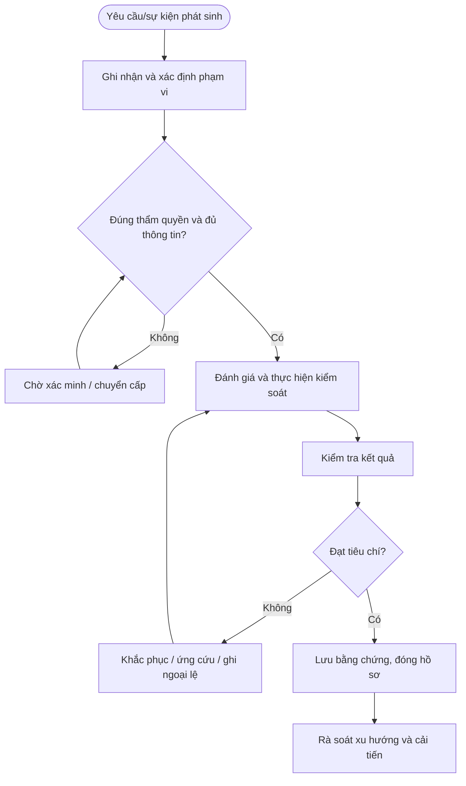

# QT-ATTT-07 — BẢO VỆ THIẾT BỊ ĐẦU CUỐI

> **Trạng thái:** Dự thảo nâng cấp v0.2; cần rà soát, chạy thử và phê duyệt trước khi áp dụng.  
> **Chủ sở hữu:** Đầu mối ATTT / IT Lead theo phân công.  
> **Liên quan:** QT-IT-08, QT-IT-11, QT-IT-13, QT-ATTT-04, QT-ISMS-03/04, REG-01, MA-01, MA-02.

## 1. Kiểm soát tài liệu
| Trường | Nội dung |
|---|---|
| Mã | QT-ATTT-07 |
| Phiên bản | 0.2 — dự thảo nâng cấp |
| Chủ sở hữu | Đầu mối ATTT / IT Lead |
| Người rà soát | Chủ hệ thống và các bên liên quan |
| Người phê duyệt | Người có thẩm quyền theo quản trị tài liệu |
| Ngày hiệu lực | Điền sau khi phê duyệt |
| Chu kỳ rà soát | Tối thiểu hằng năm và sau sự cố/thay đổi trọng yếu |

## 2. Mục đích và phạm vi
Bảo vệ máy tính, máy chủ, thiết bị di động và thiết bị truy cập dịch vụ khách hàng bằng cấu hình chuẩn, mã hóa, cập nhật, EDR và kiểm soát vòng đời.
Áp dụng cho hệ thống, dữ liệu và hoạt động thuộc Mstar hoặc khách hàng mà Mstar được ủy quyền. Phụ lục khách hàng xác định phạm vi, công cụ, người phê duyệt, SLA, nơi lưu và thời hạn lưu. Không thực hiện truy cập hoặc thay đổi ngoài phạm vi được duyệt.

## 3. Nguyên tắc bắt buộc
1. Chỉ thực hiện trong phạm vi quyền và mục đích được ủy quyền.
2. Áp dụng quyền tối thiểu, phân tách nhiệm vụ và lưu lịch sử thao tác.
3. Không lưu secret dạng rõ hoặc đưa dữ liệu nhạy cảm vào repository/tài liệu dùng chung.
4. Khi nghi ngờ sự cố ATTT, kích hoạt QT-ATTT-04 và bảo toàn bằng chứng.
5. Ngoại lệ phải có đánh giá rủi ro, biện pháp bù trừ, owner, thời hạn và người phê duyệt.
6. Không tự đặt thời hạn xử lý/retention chung khi chưa có chính sách, hợp đồng hoặc ma trận đã duyệt.

## 4. Vai trò
| Vai trò | Trách nhiệm |
|---|---|
| Người yêu cầu/tiếp nhận | Ghi nhận yêu cầu, xác minh phạm vi và thông tin đầu vào. |
| Người thực hiện | Thực hiện theo hướng dẫn, ghi nhật ký và báo sai lệch. |
| Owner hệ thống/dữ liệu | Xác nhận phạm vi, rủi ro, quyền và tiêu chí đạt. |
| Đầu mối ATTT | Đánh giá rủi ro, điều phối ứng phó và kiểm tra bằng chứng. |
| IT Lead | Phê duyệt trong thẩm quyền, điều phối nguồn lực và chuyển cấp. |
| Đầu mối khách hàng/Legal | Xác nhận nghĩa vụ hợp đồng/pháp lý và phê duyệt khi cần. |

## 5. Đầu vào và điều kiện bắt đầu
Hồ sơ phải xác định đối tượng, mục đích, phạm vi, người yêu cầu, owner, quyền cần dùng, người phê duyệt, công cụ, tiêu chí hoàn thành và nơi lưu bằng chứng. Nếu thiếu thông tin trọng yếu, chuyển Chờ xác nhận; không thực hiện hành động có thể ảnh hưởng dữ liệu/hệ thống khi chưa rõ thẩm quyền.

## 6. Trình tự thực hiện chi tiết

### Bước 1 — Đăng ký và xác định owner
**Người thực hiện:** Người được phân công; owner hệ thống/ATTT rà soát theo mức độ.

Mọi endpoint thuộc phạm vi phải có mã/hostname, serial khi có, người dùng/owner, hệ điều hành, trạng thái quản lý, mức độ dữ liệu, vị trí và khách hàng liên quan. Thiết bị không rõ nguồn gốc hoặc không được phép phải được cách ly khỏi hệ thống nhạy cảm cho đến khi xác minh.

**Điều kiện đạt:** Kết quả được xác minh, người chịu trách nhiệm và bằng chứng được ghi nhận. **Nếu không đạt:** Dừng hành động rủi ro, ghi sai lệch và chuyển cấp theo thẩm quyền.

### Bước 2 — Áp dụng cấu hình chuẩn
**Người thực hiện:** Người được phân công; owner hệ thống/ATTT rà soát theo mức độ.

Trước khi đưa vào sử dụng, cập nhật hệ điều hành/firmware, bật tường lửa, mã hóa ổ đĩa khi hỗ trợ, EDR/antimalware, khóa màn hình, quản lý thiết bị, logging và chính sách ứng dụng. Tắt dịch vụ/tài khoản mặc định không cần thiết. Cấu hình phải theo baseline đã duyệt; ngoại lệ ghi owner/hạn.

**Điều kiện đạt:** Kết quả được xác minh, người chịu trách nhiệm và bằng chứng được ghi nhận. **Nếu không đạt:** Dừng hành động rủi ro, ghi sai lệch và chuyển cấp theo thẩm quyền.

### Bước 3 — Quản lý bản vá và phần mềm
**Người thực hiện:** Người được phân công; owner hệ thống/ATTT rà soát theo mức độ.

Theo dõi phiên bản, bản vá bảo mật, phần mềm hết hỗ trợ và ứng dụng được phép. Đánh giá tương thích và triển khai theo QT-IT-13 khi có tác động. Phần mềm không được cấp phép hoặc không rõ nguồn phải được cách ly/gỡ theo quy trình; không tự cài công cụ điều khiển từ xa chưa được duyệt.

**Điều kiện đạt:** Kết quả được xác minh, người chịu trách nhiệm và bằng chứng được ghi nhận. **Nếu không đạt:** Dừng hành động rủi ro, ghi sai lệch và chuyển cấp theo thẩm quyền.

### Bước 4 — Kiểm soát truy cập và sử dụng
**Người thực hiện:** Người được phân công; owner hệ thống/ATTT rà soát theo mức độ.

Dùng tài khoản cá nhân, MFA và quyền tối thiểu; không dùng tài khoản quản trị cho công việc thường ngày nếu có lựa chọn khác. Hạn chế USB/removable media, local admin, macro và ứng dụng theo chính sách. Thiết bị dùng từ xa phải theo yêu cầu VPN/conditional access của khách hàng.

**Điều kiện đạt:** Kết quả được xác minh, người chịu trách nhiệm và bằng chứng được ghi nhận. **Nếu không đạt:** Dừng hành động rủi ro, ghi sai lệch và chuyển cấp theo thẩm quyền.

### Bước 5 — Phát hiện và xử lý cảnh báo
**Người thực hiện:** Người được phân công; owner hệ thống/ATTT rà soát theo mức độ.

Khi EDR/antivirus báo malware hoặc hành vi bất thường, ghi cảnh báo, thiết bị, người dùng, thời gian và bằng chứng; cách ly theo playbook/thẩm quyền, không tự xóa log hoặc định dạng. Kích hoạt QT-ATTT-04 khi nghi sự cố, kiểm tra tài khoản và thiết bị liên quan.

**Điều kiện đạt:** Kết quả được xác minh, người chịu trách nhiệm và bằng chứng được ghi nhận. **Nếu không đạt:** Dừng hành động rủi ro, ghi sai lệch và chuyển cấp theo thẩm quyền.

### Bước 6 — Mất thiết bị hoặc rời nhân sự
**Người thực hiện:** Người được phân công; owner hệ thống/ATTT rà soát theo mức độ.

Tiếp nhận báo mất, đánh giá dữ liệu/phiên/token có thể bị truy cập, khóa phiên/thu hồi token và remote wipe khi có thẩm quyền, cân nhắc bảo toàn bằng chứng. Khi nhân sự nghỉ/chuyển việc, thu hồi thiết bị, quyền và dữ liệu theo QT-IT-10/11; ghi biên bản tình trạng và thiếu hụt.

**Điều kiện đạt:** Kết quả được xác minh, người chịu trách nhiệm và bằng chứng được ghi nhận. **Nếu không đạt:** Dừng hành động rủi ro, ghi sai lệch và chuyển cấp theo thẩm quyền.

### Bước 7 — Kiểm tra tuân thủ
**Người thực hiện:** Người được phân công; owner hệ thống/ATTT rà soát theo mức độ.

Định kỳ đối chiếu thiết bị đang hoạt động với danh mục, trạng thái EDR, mã hóa, bản vá, OS support, local admin và thời điểm check-in. Thiết bị không tuân thủ phải có owner, hành động, hạn và biện pháp giảm thiểu; không đánh dấu tuân thủ nếu agent không liên lạc hoặc dữ liệu kiểm tra quá cũ.

**Điều kiện đạt:** Kết quả được xác minh, người chịu trách nhiệm và bằng chứng được ghi nhận. **Nếu không đạt:** Dừng hành động rủi ro, ghi sai lệch và chuyển cấp theo thẩm quyền.

## 7. Xử lý ngoại lệ và chuyển cấp
Chuyển cấp khi phát hiện truy cập trái phép, dữ liệu có nguy cơ lộ/mất, rule không được duyệt, quyền vendor không còn hợp lệ, hệ thống bị ảnh hưởng hoặc thiếu phê duyệt bắt buộc. Ghi hồ sơ, thời điểm, phạm vi, bằng chứng, tác động, việc đã làm, người nhận và quyết định cần thiết. Ngoại lệ phải có lý do, rủi ro, biện pháp bù trừ, owner, ngày hết hạn và người chấp nhận theo QT-ISMS-04.

## 8. Bằng chứng tối thiểu
| Bằng chứng | Nội dung |
|---|---|
| Yêu cầu/phạm vi | Người yêu cầu, đối tượng, mục đích và thẩm quyền |
| Danh mục/cấu hình ban đầu | Nguồn, thời điểm, trạng thái và phương pháp |
| Phê duyệt | Người duyệt, thời gian, phạm vi, điều kiện |
| Nhật ký thực hiện | Người làm, thao tác, kết quả và sai lệch |
| Kiểm tra sau xử lý | Tiêu chí, kết quả, bằng chứng và người xác nhận |
| Ngoại lệ/CAPA | Rủi ro, biện pháp bù trừ, owner, hạn, kiểm tra hiệu lực |

Lưu trong kho chính thức, hạn chế quyền theo nguyên tắc cần biết và thời hạn theo danh mục hồ sơ/hợp đồng. Bằng chứng sự cố phải giữ chain of custody khi áp dụng.

## 9. KPI và giám sát
| KPI | Định nghĩa |
|---|---|
| Tỷ lệ hồ sơ đủ | Hồ sơ đạt checklist / hồ sơ được lấy mẫu |
| Tỷ lệ xử lý đúng hạn | Hạng mục hoàn tất đúng hạn / hạng mục đến hạn theo chính sách |
| Hạng mục quá hạn | Số lượng và tuổi tồn, phân theo mức độ |
| Sai lệch lặp lại | Sai lệch tái diễn cùng nguyên nhân |
| Hành động khắc phục đúng hạn | Hành động hoàn tất đúng hạn / hành động đến hạn |

Phải chốt công thức, nguồn, kỳ đo và ngưỡng trước khi báo cáo. Không loại trường hợp chưa xử lý khỏi mẫu đo chỉ vì thiếu dữ liệu.

## 10. Lưu đồ

## 11. Điều kiện ban hành
- [ ] Xác định owner, công cụ, người phê duyệt và phạm vi.
- [ ] Chốt thời hạn/retention theo chính sách và hợp đồng.
- [ ] Đối chiếu biểu mẫu và nơi lưu bằng chứng.
- [ ] Chạy thử tình huống bình thường, ngoại lệ và chuyển cấp.
- [ ] Ghi nhận/khắc phục sai lệch, đào tạo người thực hiện.
- [ ] Phê duyệt và công bố phiên bản hiệu lực.

**Lưu ý:** Tài liệu là dự thảo kiểm soát ATTT, không tự chứng minh chứng nhận ISO; phải phù hợp phạm vi ISMS, đánh giá rủi ro, SoA, hợp đồng và pháp luật áp dụng.
