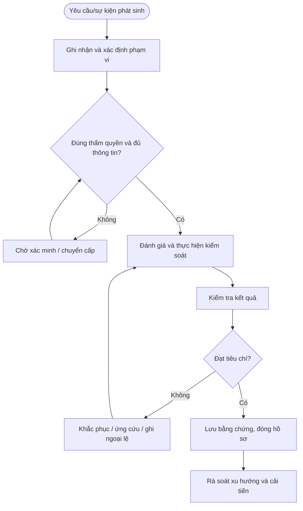

# QT-ATTT-08 — QUẢN LÝ MẠNG, FIREWALL VÀ TRUY CẬP TỪ XA

> **Trạng thái:** Dự thảo nâng cấp v0.2; cần rà soát, chạy thử và phê duyệt trước khi áp dụng.  
> **Chủ sở hữu:** Đầu mối ATTT / IT Lead theo phân công.  
> **Liên quan:** QT-IT-08, QT-IT-11, QT-IT-13, QT-ATTT-04, QT-ISMS-03/04, REG-01, MA-01, MA-02.

## 1. Kiểm soát tài liệu
| Trường | Nội dung |
|---|---|
| Mã | QT-ATTT-08 |
| Phiên bản | 0.2 — dự thảo nâng cấp |
| Chủ sở hữu | Đầu mối ATTT / IT Lead |
| Người rà soát | Chủ hệ thống và các bên liên quan |
| Người phê duyệt | Người có thẩm quyền theo quản trị tài liệu |
| Ngày hiệu lực | Điền sau khi phê duyệt |
| Chu kỳ rà soát | Tối thiểu hằng năm và sau sự cố/thay đổi trọng yếu |

## 2. Mục đích và phạm vi
Kiểm soát thay đổi mạng, rule firewall, VPN và đường truy cập quản trị để giới hạn bề mặt tấn công và bảo đảm truy nguyên.
Áp dụng cho hệ thống, dữ liệu và hoạt động thuộc Mstar hoặc khách hàng mà Mstar được ủy quyền. Phụ lục khách hàng xác định phạm vi, công cụ, người phê duyệt, SLA, nơi lưu và thời hạn lưu. Không thực hiện truy cập hoặc thay đổi ngoài phạm vi được duyệt.

## 3. Nguyên tắc bắt buộc
1. Chỉ thực hiện trong phạm vi quyền và mục đích được ủy quyền.
2. Áp dụng quyền tối thiểu, phân tách nhiệm vụ và lưu lịch sử thao tác.
3. Không lưu secret dạng rõ hoặc đưa dữ liệu nhạy cảm vào repository/tài liệu dùng chung.
4. Khi nghi ngờ sự cố ATTT, kích hoạt QT-ATTT-04 và bảo toàn bằng chứng.
5. Ngoại lệ phải có đánh giá rủi ro, biện pháp bù trừ, owner, thời hạn và người phê duyệt.
6. Không tự đặt thời hạn xử lý/retention chung khi chưa có chính sách, hợp đồng hoặc ma trận đã duyệt.

## 4. Vai trò
| Vai trò | Trách nhiệm |
|---|---|
| Người yêu cầu/tiếp nhận | Ghi nhận yêu cầu, xác minh phạm vi và thông tin đầu vào. |
| Người thực hiện | Thực hiện theo hướng dẫn, ghi nhật ký và báo sai lệch. |
| Owner hệ thống/dữ liệu | Xác nhận phạm vi, rủi ro, quyền và tiêu chí đạt. |
| Đầu mối ATTT | Đánh giá rủi ro, điều phối ứng phó và kiểm tra bằng chứng. |
| IT Lead | Phê duyệt trong thẩm quyền, điều phối nguồn lực và chuyển cấp. |
| Đầu mối khách hàng/Legal | Xác nhận nghĩa vụ hợp đồng/pháp lý và phê duyệt khi cần. |

## 5. Đầu vào và điều kiện bắt đầu
Hồ sơ phải xác định đối tượng, mục đích, phạm vi, người yêu cầu, owner, quyền cần dùng, người phê duyệt, công cụ, tiêu chí hoàn thành và nơi lưu bằng chứng. Nếu thiếu thông tin trọng yếu, chuyển Chờ xác nhận; không thực hiện hành động có thể ảnh hưởng dữ liệu/hệ thống khi chưa rõ thẩm quyền.

## 6. Trình tự thực hiện chi tiết

### Bước 1 — Lập danh mục và sơ đồ mạng
**Người thực hiện:** Người được phân công; owner hệ thống/ATTT rà soát theo mức độ.

Duy trì danh mục thiết bị mạng, firewall, VPN, VLAN/segment, IP/subnet, điểm kết nối Internet, quản trị, site-to-site và đường truy cập vendor. Ghi owner, phiên bản firmware, vị trí, phụ thuộc và mức trọng yếu. Sơ đồ nhạy cảm phải lưu trong kho có phân quyền.

**Điều kiện đạt:** Kết quả được xác minh, người chịu trách nhiệm và bằng chứng được ghi nhận. **Nếu không đạt:** Dừng hành động rủi ro, ghi sai lệch và chuyển cấp theo thẩm quyền.

### Bước 2 — Tiếp nhận yêu cầu rule/kết nối
**Người thực hiện:** Người được phân công; owner hệ thống/ATTT rà soát theo mức độ.

Yêu cầu phải nêu nguồn, đích, giao thức/cổng, hướng kết nối, mục đích kinh doanh, người dùng/hệ thống, thời hạn, owner và người phê duyệt. Không chấp nhận yêu cầu kiểu “mở toàn bộ” nếu không có phân tích/ngoại lệ được duyệt. Xác minh người yêu cầu và quyền sở hữu hệ thống.

**Điều kiện đạt:** Kết quả được xác minh, người chịu trách nhiệm và bằng chứng được ghi nhận. **Nếu không đạt:** Dừng hành động rủi ro, ghi sai lệch và chuyển cấp theo thẩm quyền.

### Bước 3 — Đánh giá và phê duyệt
**Người thực hiện:** Người được phân công; owner hệ thống/ATTT rà soát theo mức độ.

Rà soát nguyên tắc deny-by-default, phạm vi tối thiểu, phơi nhiễm Internet, dữ liệu, logging, nguy cơ lateral movement, phụ thuộc và thời hạn. Rule tạm thời phải có ngày hết hạn và owner. Thay đổi firewall/routing/VPN sản xuất phải theo QT-IT-13 và phê duyệt khách hàng khi hợp đồng yêu cầu.

**Điều kiện đạt:** Kết quả được xác minh, người chịu trách nhiệm và bằng chứng được ghi nhận. **Nếu không đạt:** Dừng hành động rủi ro, ghi sai lệch và chuyển cấp theo thẩm quyền.

### Bước 4 — Triển khai và kiểm tra
**Người thực hiện:** Người được phân công; owner hệ thống/ATTT rà soát theo mức độ.

Lưu cấu hình trước thay đổi, thực hiện trong cửa sổ đã duyệt, ghi rule ID/người làm/thời điểm và kết quả. Kiểm tra kết nối đúng mục tiêu, xác minh không mở rộng ngoài phạm vi, rà soát log và các rule shadow/duplicate. Nếu phát sinh gián đoạn hoặc lộ dịch vụ, rollback theo kế hoạch.

**Điều kiện đạt:** Kết quả được xác minh, người chịu trách nhiệm và bằng chứng được ghi nhận. **Nếu không đạt:** Dừng hành động rủi ro, ghi sai lệch và chuyển cấp theo thẩm quyền.

### Bước 5 — Quản lý VPN và truy cập từ xa
**Người thực hiện:** Người được phân công; owner hệ thống/ATTT rà soát theo mức độ.

Chỉ cấp VPN/remote access cho danh tính được duyệt, MFA, thiết bị phù hợp và phạm vi cần thiết. Tách quyền người dùng/vendor/quản trị; giới hạn theo nhóm, thời gian, nguồn hoặc jump host khi có. Không dùng tài khoản chung; ghi log phiên và thu hồi ngay khi hết nhu cầu/hợp đồng.

**Điều kiện đạt:** Kết quả được xác minh, người chịu trách nhiệm và bằng chứng được ghi nhận. **Nếu không đạt:** Dừng hành động rủi ro, ghi sai lệch và chuyển cấp theo thẩm quyền.

### Bước 6 — Rà soát rule định kỳ
**Người thực hiện:** Người được phân công; owner hệ thống/ATTT rà soát theo mức độ.

Owner xác nhận mục đích, người dùng, nguồn/đích, last-used nếu có, thời hạn và tiếp tục cần thiết. Rule không owner, không còn mục đích, quá hạn hoặc quá rộng phải được loại bỏ/thu hẹp qua change được duyệt. Lưu kết quả rà soát và các ngoại lệ.

**Điều kiện đạt:** Kết quả được xác minh, người chịu trách nhiệm và bằng chứng được ghi nhận. **Nếu không đạt:** Dừng hành động rủi ro, ghi sai lệch và chuyển cấp theo thẩm quyền.

### Bước 7 — Ứng phó sự cố mạng
**Người thực hiện:** Người được phân công; owner hệ thống/ATTT rà soát theo mức độ.

Khi có truy cập bất thường, scan, DDoS, rule trái phép hoặc VPN account nghi bị chiếm, bảo toàn log, đánh giá phạm vi và kích hoạt QT-ATTT-04. Chỉ chặn/cô lập trong thẩm quyền hoặc playbook; ghi quyết định, tác động và phương án phục hồi.

**Điều kiện đạt:** Kết quả được xác minh, người chịu trách nhiệm và bằng chứng được ghi nhận. **Nếu không đạt:** Dừng hành động rủi ro, ghi sai lệch và chuyển cấp theo thẩm quyền.

## 7. Xử lý ngoại lệ và chuyển cấp
Chuyển cấp khi phát hiện truy cập trái phép, dữ liệu có nguy cơ lộ/mất, rule không được duyệt, quyền vendor không còn hợp lệ, hệ thống bị ảnh hưởng hoặc thiếu phê duyệt bắt buộc. Ghi hồ sơ, thời điểm, phạm vi, bằng chứng, tác động, việc đã làm, người nhận và quyết định cần thiết. Ngoại lệ phải có lý do, rủi ro, biện pháp bù trừ, owner, ngày hết hạn và người chấp nhận theo QT-ISMS-04.

## 8. Bằng chứng tối thiểu
| Bằng chứng | Nội dung |
|---|---|
| Yêu cầu/phạm vi | Người yêu cầu, đối tượng, mục đích và thẩm quyền |
| Danh mục/cấu hình ban đầu | Nguồn, thời điểm, trạng thái và phương pháp |
| Phê duyệt | Người duyệt, thời gian, phạm vi, điều kiện |
| Nhật ký thực hiện | Người làm, thao tác, kết quả và sai lệch |
| Kiểm tra sau xử lý | Tiêu chí, kết quả, bằng chứng và người xác nhận |
| Ngoại lệ/CAPA | Rủi ro, biện pháp bù trừ, owner, hạn, kiểm tra hiệu lực |

Lưu trong kho chính thức, hạn chế quyền theo nguyên tắc cần biết và thời hạn theo danh mục hồ sơ/hợp đồng. Bằng chứng sự cố phải giữ chain of custody khi áp dụng.

## 9. KPI và giám sát
| KPI | Định nghĩa |
|---|---|
| Tỷ lệ hồ sơ đủ | Hồ sơ đạt checklist / hồ sơ được lấy mẫu |
| Tỷ lệ xử lý đúng hạn | Hạng mục hoàn tất đúng hạn / hạng mục đến hạn theo chính sách |
| Hạng mục quá hạn | Số lượng và tuổi tồn, phân theo mức độ |
| Sai lệch lặp lại | Sai lệch tái diễn cùng nguyên nhân |
| Hành động khắc phục đúng hạn | Hành động hoàn tất đúng hạn / hành động đến hạn |

Phải chốt công thức, nguồn, kỳ đo và ngưỡng trước khi báo cáo. Không loại trường hợp chưa xử lý khỏi mẫu đo chỉ vì thiếu dữ liệu.

## 10. Lưu đồ

## 11. Điều kiện ban hành
- [ ] Xác định owner, công cụ, người phê duyệt và phạm vi.
- [ ] Chốt thời hạn/retention theo chính sách và hợp đồng.
- [ ] Đối chiếu biểu mẫu và nơi lưu bằng chứng.
- [ ] Chạy thử tình huống bình thường, ngoại lệ và chuyển cấp.
- [ ] Ghi nhận/khắc phục sai lệch, đào tạo người thực hiện.
- [ ] Phê duyệt và công bố phiên bản hiệu lực.

**Lưu ý:** Tài liệu là dự thảo kiểm soát ATTT, không tự chứng minh chứng nhận ISO; phải phù hợp phạm vi ISMS, đánh giá rủi ro, SoA, hợp đồng và pháp luật áp dụng.
