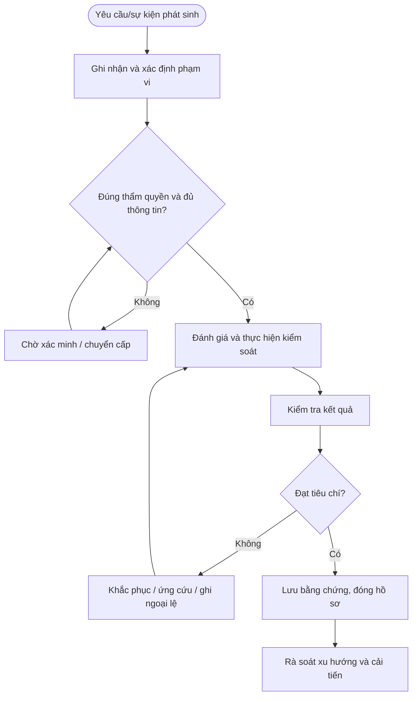

# QT-ATTT-09 — QUẢN LÝ NHÀ CUNG CẤP VÀ BÊN THỨ BA

> **Trạng thái:** Dự thảo nâng cấp v0.2; cần rà soát, chạy thử và phê duyệt trước khi áp dụng.  
> **Chủ sở hữu:** Đầu mối ATTT / IT Lead theo phân công.  
> **Liên quan:** QT-IT-08, QT-IT-11, QT-IT-13, QT-ATTT-04, QT-ISMS-03/04, REG-01, MA-01, MA-02.

## 1. Kiểm soát tài liệu
| Trường | Nội dung |
|---|---|
| Mã | QT-ATTT-09 |
| Phiên bản | 0.2 — dự thảo nâng cấp |
| Chủ sở hữu | Đầu mối ATTT / IT Lead |
| Người rà soát | Chủ hệ thống và các bên liên quan |
| Người phê duyệt | Người có thẩm quyền theo quản trị tài liệu |
| Ngày hiệu lực | Điền sau khi phê duyệt |
| Chu kỳ rà soát | Tối thiểu hằng năm và sau sự cố/thay đổi trọng yếu |

## 2. Mục đích và phạm vi
Đánh giá rủi ro, phê duyệt, kiểm soát quyền và dữ liệu, theo dõi hiệu suất và kết thúc an toàn quan hệ với vendor/subcontractor.
Áp dụng cho hệ thống, dữ liệu và hoạt động thuộc Mstar hoặc khách hàng mà Mstar được ủy quyền. Phụ lục khách hàng xác định phạm vi, công cụ, người phê duyệt, SLA, nơi lưu và thời hạn lưu. Không thực hiện truy cập hoặc thay đổi ngoài phạm vi được duyệt.

## 3. Nguyên tắc bắt buộc
1. Chỉ thực hiện trong phạm vi quyền và mục đích được ủy quyền.
2. Áp dụng quyền tối thiểu, phân tách nhiệm vụ và lưu lịch sử thao tác.
3. Không lưu secret dạng rõ hoặc đưa dữ liệu nhạy cảm vào repository/tài liệu dùng chung.
4. Khi nghi ngờ sự cố ATTT, kích hoạt QT-ATTT-04 và bảo toàn bằng chứng.
5. Ngoại lệ phải có đánh giá rủi ro, biện pháp bù trừ, owner, thời hạn và người phê duyệt.
6. Không tự đặt thời hạn xử lý/retention chung khi chưa có chính sách, hợp đồng hoặc ma trận đã duyệt.

## 4. Vai trò
| Vai trò | Trách nhiệm |
|---|---|
| Người yêu cầu/tiếp nhận | Ghi nhận yêu cầu, xác minh phạm vi và thông tin đầu vào. |
| Người thực hiện | Thực hiện theo hướng dẫn, ghi nhật ký và báo sai lệch. |
| Owner hệ thống/dữ liệu | Xác nhận phạm vi, rủi ro, quyền và tiêu chí đạt. |
| Đầu mối ATTT | Đánh giá rủi ro, điều phối ứng phó và kiểm tra bằng chứng. |
| IT Lead | Phê duyệt trong thẩm quyền, điều phối nguồn lực và chuyển cấp. |
| Đầu mối khách hàng/Legal | Xác nhận nghĩa vụ hợp đồng/pháp lý và phê duyệt khi cần. |

## 5. Đầu vào và điều kiện bắt đầu
Hồ sơ phải xác định đối tượng, mục đích, phạm vi, người yêu cầu, owner, quyền cần dùng, người phê duyệt, công cụ, tiêu chí hoàn thành và nơi lưu bằng chứng. Nếu thiếu thông tin trọng yếu, chuyển Chờ xác nhận; không thực hiện hành động có thể ảnh hưởng dữ liệu/hệ thống khi chưa rõ thẩm quyền.

## 6. Trình tự thực hiện chi tiết

### Bước 1 — Đề xuất và phân loại vendor
**Người thực hiện:** Người được phân công; owner hệ thống/ATTT rà soát theo mức độ.

Ghi dịch vụ, dữ liệu/hệ thống được truy cập, mức độ trọng yếu, vị trí xử lý dữ liệu, phụ thuộc, quyền quản trị, subprocessor và khả năng ảnh hưởng liên tục. Phân loại rủi ro theo tiêu chí được duyệt; vendor có quyền vào hệ thống sản xuất/dữ liệu nhạy cảm cần đánh giá tăng cường.

**Điều kiện đạt:** Kết quả được xác minh, người chịu trách nhiệm và bằng chứng được ghi nhận. **Nếu không đạt:** Dừng hành động rủi ro, ghi sai lệch và chuyển cấp theo thẩm quyền.

### Bước 2 — Thẩm định trước khi ký
**Người thực hiện:** Người được phân công; owner hệ thống/ATTT rà soát theo mức độ.

Rà soát năng lực, bảo mật, chứng nhận/báo cáo nếu có, quản lý lỗ hổng, backup/DR, incident response, nhân sự, quyền truy cập, vị trí dữ liệu, sử dụng bên phụ, xóa dữ liệu và hỗ trợ thoát dịch vụ. Thu thập bằng chứng phù hợp mức rủi ro; không coi câu trả lời tự khai là bằng chứng độc lập đầy đủ.

**Điều kiện đạt:** Kết quả được xác minh, người chịu trách nhiệm và bằng chứng được ghi nhận. **Nếu không đạt:** Dừng hành động rủi ro, ghi sai lệch và chuyển cấp theo thẩm quyền.

### Bước 3 — Rà soát hợp đồng
**Người thực hiện:** Người được phân công; owner hệ thống/ATTT rà soát theo mức độ.

Đảm bảo hợp đồng/SLA quy định phạm vi, quyền truy cập, bảo mật, xử lý dữ liệu, thông báo sự cố, hỗ trợ điều tra, audit/evidence, BCP/DR, subprocessor, trả/xóa dữ liệu, hỗ trợ chuyển đổi và trách nhiệm khi chấm dứt. Legal/Contract Owner rà soát điều khoản; kỹ thuật không tự chấp nhận điều khoản thương mại/pháp lý.

**Điều kiện đạt:** Kết quả được xác minh, người chịu trách nhiệm và bằng chứng được ghi nhận. **Nếu không đạt:** Dừng hành động rủi ro, ghi sai lệch và chuyển cấp theo thẩm quyền.

### Bước 4 — Phê duyệt và onboarding
**Người thực hiện:** Người được phân công; owner hệ thống/ATTT rà soát theo mức độ.

Ghi quyết định chấp thuận/từ chối, rủi ro tồn dư, điều kiện và người duyệt. Cấp tài khoản theo QT-IT-11, giới hạn thời hạn/quyền, MFA, logging và người bảo trợ nội bộ. Không cấp quyền trước khi hoàn thành phê duyệt bắt buộc.

**Điều kiện đạt:** Kết quả được xác minh, người chịu trách nhiệm và bằng chứng được ghi nhận. **Nếu không đạt:** Dừng hành động rủi ro, ghi sai lệch và chuyển cấp theo thẩm quyền.

### Bước 5 — Theo dõi hiệu suất và rủi ro
**Người thực hiện:** Người được phân công; owner hệ thống/ATTT rà soát theo mức độ.

Theo dõi SLA, sự cố, thay đổi dịch vụ, lỗ hổng, báo cáo kiểm soát, thay đổi sở hữu/subprocessor và tình trạng tài chính/dịch vụ khi phù hợp. Tần suất rà soát theo mức rủi ro. Ghi vấn đề, yêu cầu khắc phục, owner/hạn và quyết định chấp nhận rủi ro.

**Điều kiện đạt:** Kết quả được xác minh, người chịu trách nhiệm và bằng chứng được ghi nhận. **Nếu không đạt:** Dừng hành động rủi ro, ghi sai lệch và chuyển cấp theo thẩm quyền.

### Bước 6 — Xử lý sự cố vendor
**Người thực hiện:** Người được phân công; owner hệ thống/ATTT rà soát theo mức độ.

Khi vendor thông báo sự cố hoặc phát hiện dấu hiệu ảnh hưởng, mở hồ sơ, xác định dữ liệu/hệ thống liên quan, nghĩa vụ thông báo và bằng chứng cần bảo toàn. Phối hợp QT-ATTT-04, giữ liên lạc và yêu cầu báo cáo nguyên nhân/phạm vi/khắc phục. Không tự công bố thông tin thay vendor/khách hàng nếu chưa được ủy quyền.

**Điều kiện đạt:** Kết quả được xác minh, người chịu trách nhiệm và bằng chứng được ghi nhận. **Nếu không đạt:** Dừng hành động rủi ro, ghi sai lệch và chuyển cấp theo thẩm quyền.

### Bước 7 — Gia hạn hoặc chấm dứt
**Người thực hiện:** Người được phân công; owner hệ thống/ATTT rà soát theo mức độ.

Trước gia hạn, rà soát hiệu suất, rủi ro, điều khoản và nhu cầu tiếp tục. Khi chấm dứt, thu hồi quyền/token/VPN, chuyển dữ liệu, lấy lại tài sản, xác nhận trả/xóa dữ liệu và bản sao theo hợp đồng, lưu chứng nhận/xác nhận, cập nhật danh mục và kế hoạch chuyển đổi. Kiểm tra không còn tài khoản vendor hoạt động.

**Điều kiện đạt:** Kết quả được xác minh, người chịu trách nhiệm và bằng chứng được ghi nhận. **Nếu không đạt:** Dừng hành động rủi ro, ghi sai lệch và chuyển cấp theo thẩm quyền.

## 7. Xử lý ngoại lệ và chuyển cấp
Chuyển cấp khi phát hiện truy cập trái phép, dữ liệu có nguy cơ lộ/mất, rule không được duyệt, quyền vendor không còn hợp lệ, hệ thống bị ảnh hưởng hoặc thiếu phê duyệt bắt buộc. Ghi hồ sơ, thời điểm, phạm vi, bằng chứng, tác động, việc đã làm, người nhận và quyết định cần thiết. Ngoại lệ phải có lý do, rủi ro, biện pháp bù trừ, owner, ngày hết hạn và người chấp nhận theo QT-ISMS-04.

## 8. Bằng chứng tối thiểu
| Bằng chứng | Nội dung |
|---|---|
| Yêu cầu/phạm vi | Người yêu cầu, đối tượng, mục đích và thẩm quyền |
| Danh mục/cấu hình ban đầu | Nguồn, thời điểm, trạng thái và phương pháp |
| Phê duyệt | Người duyệt, thời gian, phạm vi, điều kiện |
| Nhật ký thực hiện | Người làm, thao tác, kết quả và sai lệch |
| Kiểm tra sau xử lý | Tiêu chí, kết quả, bằng chứng và người xác nhận |
| Ngoại lệ/CAPA | Rủi ro, biện pháp bù trừ, owner, hạn, kiểm tra hiệu lực |

Lưu trong kho chính thức, hạn chế quyền theo nguyên tắc cần biết và thời hạn theo danh mục hồ sơ/hợp đồng. Bằng chứng sự cố phải giữ chain of custody khi áp dụng.

## 9. KPI và giám sát
| KPI | Định nghĩa |
|---|---|
| Tỷ lệ hồ sơ đủ | Hồ sơ đạt checklist / hồ sơ được lấy mẫu |
| Tỷ lệ xử lý đúng hạn | Hạng mục hoàn tất đúng hạn / hạng mục đến hạn theo chính sách |
| Hạng mục quá hạn | Số lượng và tuổi tồn, phân theo mức độ |
| Sai lệch lặp lại | Sai lệch tái diễn cùng nguyên nhân |
| Hành động khắc phục đúng hạn | Hành động hoàn tất đúng hạn / hành động đến hạn |

Phải chốt công thức, nguồn, kỳ đo và ngưỡng trước khi báo cáo. Không loại trường hợp chưa xử lý khỏi mẫu đo chỉ vì thiếu dữ liệu.

## 10. Lưu đồ

## 11. Điều kiện ban hành
- [ ] Xác định owner, công cụ, người phê duyệt và phạm vi.
- [ ] Chốt thời hạn/retention theo chính sách và hợp đồng.
- [ ] Đối chiếu biểu mẫu và nơi lưu bằng chứng.
- [ ] Chạy thử tình huống bình thường, ngoại lệ và chuyển cấp.
- [ ] Ghi nhận/khắc phục sai lệch, đào tạo người thực hiện.
- [ ] Phê duyệt và công bố phiên bản hiệu lực.

**Lưu ý:** Tài liệu là dự thảo kiểm soát ATTT, không tự chứng minh chứng nhận ISO; phải phù hợp phạm vi ISMS, đánh giá rủi ro, SoA, hợp đồng và pháp luật áp dụng.
