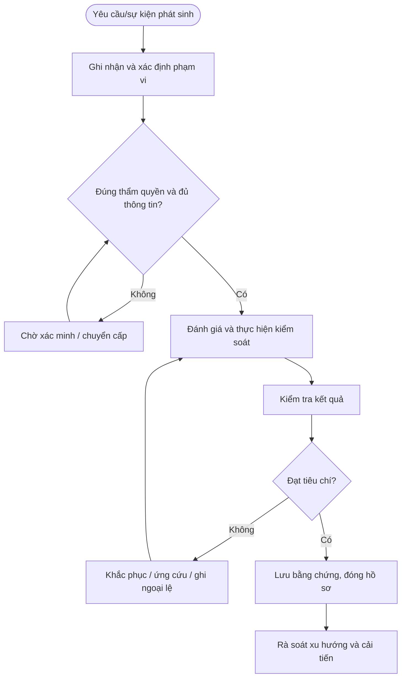

# QT-ATTT-10 — KIỂM SOÁT DỮ LIỆU KHÁCH HÀNG

> **Trạng thái:** Dự thảo nâng cấp v0.2; cần rà soát, chạy thử và phê duyệt trước khi áp dụng.  
> **Chủ sở hữu:** Đầu mối ATTT / IT Lead theo phân công.  
> **Liên quan:** QT-IT-08, QT-IT-11, QT-IT-13, QT-ATTT-04, QT-ISMS-03/04, REG-01, MA-01, MA-02.

## 1. Kiểm soát tài liệu
| Trường | Nội dung |
|---|---|
| Mã | QT-ATTT-10 |
| Phiên bản | 0.2 — dự thảo nâng cấp |
| Chủ sở hữu | Đầu mối ATTT / IT Lead |
| Người rà soát | Chủ hệ thống và các bên liên quan |
| Người phê duyệt | Người có thẩm quyền theo quản trị tài liệu |
| Ngày hiệu lực | Điền sau khi phê duyệt |
| Chu kỳ rà soát | Tối thiểu hằng năm và sau sự cố/thay đổi trọng yếu |

## 2. Mục đích và phạm vi
Bảo đảm dữ liệu khách hàng được truy cập, sử dụng, chuyển giao, lưu trữ và xóa đúng phạm vi hợp đồng, mục đích và quyền được duyệt.
Áp dụng cho hệ thống, dữ liệu và hoạt động thuộc Mstar hoặc khách hàng mà Mstar được ủy quyền. Phụ lục khách hàng xác định phạm vi, công cụ, người phê duyệt, SLA, nơi lưu và thời hạn lưu. Không thực hiện truy cập hoặc thay đổi ngoài phạm vi được duyệt.

## 3. Nguyên tắc bắt buộc
1. Chỉ thực hiện trong phạm vi quyền và mục đích được ủy quyền.
2. Áp dụng quyền tối thiểu, phân tách nhiệm vụ và lưu lịch sử thao tác.
3. Không lưu secret dạng rõ hoặc đưa dữ liệu nhạy cảm vào repository/tài liệu dùng chung.
4. Khi nghi ngờ sự cố ATTT, kích hoạt QT-ATTT-04 và bảo toàn bằng chứng.
5. Ngoại lệ phải có đánh giá rủi ro, biện pháp bù trừ, owner, thời hạn và người phê duyệt.
6. Không tự đặt thời hạn xử lý/retention chung khi chưa có chính sách, hợp đồng hoặc ma trận đã duyệt.

## 4. Vai trò
| Vai trò | Trách nhiệm |
|---|---|
| Người yêu cầu/tiếp nhận | Ghi nhận yêu cầu, xác minh phạm vi và thông tin đầu vào. |
| Người thực hiện | Thực hiện theo hướng dẫn, ghi nhật ký và báo sai lệch. |
| Owner hệ thống/dữ liệu | Xác nhận phạm vi, rủi ro, quyền và tiêu chí đạt. |
| Đầu mối ATTT | Đánh giá rủi ro, điều phối ứng phó và kiểm tra bằng chứng. |
| IT Lead | Phê duyệt trong thẩm quyền, điều phối nguồn lực và chuyển cấp. |
| Đầu mối khách hàng/Legal | Xác nhận nghĩa vụ hợp đồng/pháp lý và phê duyệt khi cần. |

## 5. Đầu vào và điều kiện bắt đầu
Hồ sơ phải xác định đối tượng, mục đích, phạm vi, người yêu cầu, owner, quyền cần dùng, người phê duyệt, công cụ, tiêu chí hoàn thành và nơi lưu bằng chứng. Nếu thiếu thông tin trọng yếu, chuyển Chờ xác nhận; không thực hiện hành động có thể ảnh hưởng dữ liệu/hệ thống khi chưa rõ thẩm quyền.

## 6. Trình tự thực hiện chi tiết

### Bước 1 — Xác định dữ liệu và chủ sở hữu
**Người thực hiện:** Người được phân công; owner hệ thống/ATTT rà soát theo mức độ.

Lập danh mục loại dữ liệu, hệ thống lưu, khách hàng sở hữu, mục đích xử lý, mức phân loại, người có quyền quyết định và yêu cầu hợp đồng. Không tự coi dữ liệu khách hàng là dữ liệu Mstar có thể sử dụng cho mục đích khác.

**Điều kiện đạt:** Kết quả được xác minh, người chịu trách nhiệm và bằng chứng được ghi nhận. **Nếu không đạt:** Dừng hành động rủi ro, ghi sai lệch và chuyển cấp theo thẩm quyền.

### Bước 2 — Xác nhận căn cứ và phạm vi
**Người thực hiện:** Người được phân công; owner hệ thống/ATTT rà soát theo mức độ.

Trước truy cập/xuất/chuyển dữ liệu, xác minh yêu cầu thuộc hợp đồng, mục đích hợp lệ, người yêu cầu có thẩm quyền, trường dữ liệu và thời gian cần thiết. Yêu cầu ngoài phạm vi phải dừng và chuyển Contract Owner/đầu mối khách hàng.

**Điều kiện đạt:** Kết quả được xác minh, người chịu trách nhiệm và bằng chứng được ghi nhận. **Nếu không đạt:** Dừng hành động rủi ro, ghi sai lệch và chuyển cấp theo thẩm quyền.

### Bước 3 — Cấp quyền truy cập
**Người thực hiện:** Người được phân công; owner hệ thống/ATTT rà soát theo mức độ.

Cấp quyền theo QT-IT-11, giới hạn dataset, môi trường, thao tác và thời hạn. Dùng tài khoản cá nhân, MFA và audit log; tránh tải dữ liệu về thiết bị local. Quyền trích xuất hàng loạt, dữ liệu nhạy cảm hoặc quyền quản trị phải được phê duyệt bổ sung.

**Điều kiện đạt:** Kết quả được xác minh, người chịu trách nhiệm và bằng chứng được ghi nhận. **Nếu không đạt:** Dừng hành động rủi ro, ghi sai lệch và chuyển cấp theo thẩm quyền.

### Bước 4 — Truy xuất và chuyển dữ liệu
**Người thực hiện:** Người được phân công; owner hệ thống/ATTT rà soát theo mức độ.

Ghi dữ liệu nào, lý do, người phê duyệt, nguồn, người nhận, kênh, thời gian, dung lượng/phạm vi và bằng chứng. Xác minh người nhận và kênh mã hóa; giới hạn link và thời hạn; kiểm tra file không chứa trường không cần thiết. Không gửi qua email cá nhân hoặc kho công khai.

**Điều kiện đạt:** Kết quả được xác minh, người chịu trách nhiệm và bằng chứng được ghi nhận. **Nếu không đạt:** Dừng hành động rủi ro, ghi sai lệch và chuyển cấp theo thẩm quyền.

### Bước 5 — Dùng dữ liệu trong hỗ trợ/phát triển
**Người thực hiện:** Người được phân công; owner hệ thống/ATTT rà soát theo mức độ.

Chỉ dùng dữ liệu thực khi cần, được phép và có biện pháp kiểm soát. Ưu tiên dữ liệu tổng hợp/ẩn danh; che trường nhận dạng; không đưa dữ liệu khách hàng vào công cụ AI bên ngoài, môi trường demo, log hoặc repo nếu chưa được phê duyệt.

**Điều kiện đạt:** Kết quả được xác minh, người chịu trách nhiệm và bằng chứng được ghi nhận. **Nếu không đạt:** Dừng hành động rủi ro, ghi sai lệch và chuyển cấp theo thẩm quyền.

### Bước 6 — Quản lý sự cố dữ liệu
**Người thực hiện:** Người được phân công; owner hệ thống/ATTT rà soát theo mức độ.

Khi gửi nhầm, mất, truy cập sai hoặc nghi rò rỉ, dừng chia sẻ/thu hồi link, ghi thời gian/phạm vi/người nhận, bảo toàn bằng chứng và kích hoạt QT-ATTT-04. Không xóa email/log trước khi đánh giá nghĩa vụ thông báo. Contract Owner/Legal xác định nghĩa vụ và thời hạn theo hợp đồng/pháp luật.

**Điều kiện đạt:** Kết quả được xác minh, người chịu trách nhiệm và bằng chứng được ghi nhận. **Nếu không đạt:** Dừng hành động rủi ro, ghi sai lệch và chuyển cấp theo thẩm quyền.

### Bước 7 — Trả, lưu giữ và xóa
**Người thực hiện:** Người được phân công; owner hệ thống/ATTT rà soát theo mức độ.

Khi kết thúc yêu cầu/dịch vụ, xác định dữ liệu cần trả, dữ liệu phải lưu theo legal hold/hợp đồng và dữ liệu cần xóa. Xóa an toàn theo khả năng nền tảng, xử lý bản sao/replica theo lịch, thu hồi quyền, lưu bằng chứng và xin xác nhận khách hàng khi yêu cầu. Nếu không thể xóa ngay, ghi lý do, hạn và kiểm soát truy cập.

**Điều kiện đạt:** Kết quả được xác minh, người chịu trách nhiệm và bằng chứng được ghi nhận. **Nếu không đạt:** Dừng hành động rủi ro, ghi sai lệch và chuyển cấp theo thẩm quyền.

## 7. Xử lý ngoại lệ và chuyển cấp
Chuyển cấp khi phát hiện truy cập trái phép, dữ liệu có nguy cơ lộ/mất, rule không được duyệt, quyền vendor không còn hợp lệ, hệ thống bị ảnh hưởng hoặc thiếu phê duyệt bắt buộc. Ghi hồ sơ, thời điểm, phạm vi, bằng chứng, tác động, việc đã làm, người nhận và quyết định cần thiết. Ngoại lệ phải có lý do, rủi ro, biện pháp bù trừ, owner, ngày hết hạn và người chấp nhận theo QT-ISMS-04.

## 8. Bằng chứng tối thiểu
| Bằng chứng | Nội dung |
|---|---|
| Yêu cầu/phạm vi | Người yêu cầu, đối tượng, mục đích và thẩm quyền |
| Danh mục/cấu hình ban đầu | Nguồn, thời điểm, trạng thái và phương pháp |
| Phê duyệt | Người duyệt, thời gian, phạm vi, điều kiện |
| Nhật ký thực hiện | Người làm, thao tác, kết quả và sai lệch |
| Kiểm tra sau xử lý | Tiêu chí, kết quả, bằng chứng và người xác nhận |
| Ngoại lệ/CAPA | Rủi ro, biện pháp bù trừ, owner, hạn, kiểm tra hiệu lực |

Lưu trong kho chính thức, hạn chế quyền theo nguyên tắc cần biết và thời hạn theo danh mục hồ sơ/hợp đồng. Bằng chứng sự cố phải giữ chain of custody khi áp dụng.

## 9. KPI và giám sát
| KPI | Định nghĩa |
|---|---|
| Tỷ lệ hồ sơ đủ | Hồ sơ đạt checklist / hồ sơ được lấy mẫu |
| Tỷ lệ xử lý đúng hạn | Hạng mục hoàn tất đúng hạn / hạng mục đến hạn theo chính sách |
| Hạng mục quá hạn | Số lượng và tuổi tồn, phân theo mức độ |
| Sai lệch lặp lại | Sai lệch tái diễn cùng nguyên nhân |
| Hành động khắc phục đúng hạn | Hành động hoàn tất đúng hạn / hành động đến hạn |

Phải chốt công thức, nguồn, kỳ đo và ngưỡng trước khi báo cáo. Không loại trường hợp chưa xử lý khỏi mẫu đo chỉ vì thiếu dữ liệu.

## 10. Lưu đồ

## 11. Điều kiện ban hành
- [ ] Xác định owner, công cụ, người phê duyệt và phạm vi.
- [ ] Chốt thời hạn/retention theo chính sách và hợp đồng.
- [ ] Đối chiếu biểu mẫu và nơi lưu bằng chứng.
- [ ] Chạy thử tình huống bình thường, ngoại lệ và chuyển cấp.
- [ ] Ghi nhận/khắc phục sai lệch, đào tạo người thực hiện.
- [ ] Phê duyệt và công bố phiên bản hiệu lực.

**Lưu ý:** Tài liệu là dự thảo kiểm soát ATTT, không tự chứng minh chứng nhận ISO; phải phù hợp phạm vi ISMS, đánh giá rủi ro, SoA, hợp đồng và pháp luật áp dụng.
