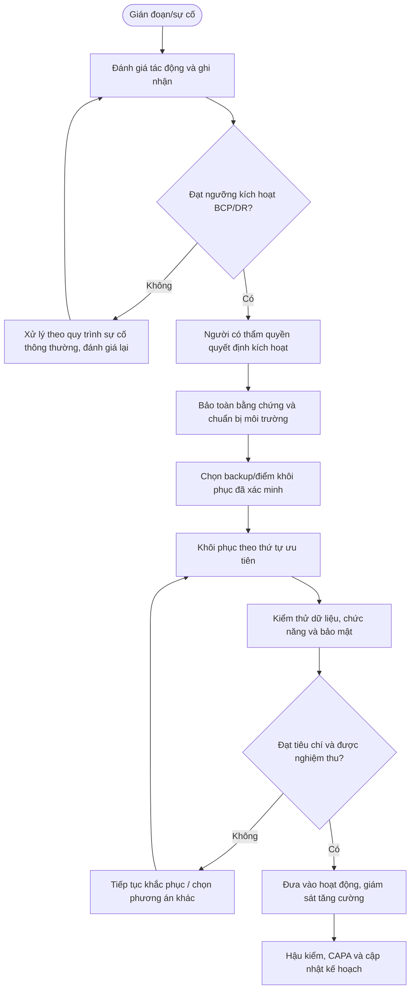

# QT-BCP-01 — DUY TRÌ HOẠT ĐỘNG KINH DOANH

> **Trạng thái:** Dự thảo nâng cấp v0.2; cần rà soát, diễn tập và phê duyệt trước khi áp dụng.  
> **Chủ sở hữu:** IT Lead / đầu mối ATTT hoặc BCP được chỉ định.  
> **Liên quan:** QT-ATTT-04, QT-IT-08, QT-IT-11, QT-IT-13, QT-IT-15, QT-ISMS-03/04, REG-01, MA-01, MA-02.

## 1. Kiểm soát tài liệu
| Trường | Nội dung |
|---|---|
| Mã | QT-BCP-01 |
| Phiên bản | 0.2 — dự thảo nâng cấp |
| Chủ sở hữu | IT Lead / BCP Lead |
| Người rà soát | Owner hệ thống, ATTT, Service Owner và khách hàng khi liên quan |
| Người phê duyệt | Người có thẩm quyền theo cơ chế quản trị |
| Ngày hiệu lực | Điền sau khi phê duyệt |
| Rà soát | Tối thiểu hằng năm, sau diễn tập hoặc sự cố nghiêm trọng |

## 2. Mục đích và phạm vi
Chuẩn bị và điều phối duy trì dịch vụ trọng yếu khi có gián đoạn nhân sự, địa điểm, hạ tầng, nhà cung cấp hoặc hệ thống CNTT.
Áp dụng cho dịch vụ thuộc Mstar và dịch vụ khách hàng trong phạm vi hợp đồng/ủy quyền. Phụ lục từng khách hàng phải xác định hệ thống, đầu mối, RTO/RPO, thứ tự ưu tiên, kênh thông báo và trách nhiệm quyết định. Không cam kết RTO/RPO chưa được phân tích, phê duyệt và kiểm thử.

## 3. Nguyên tắc bắt buộc
1. An toàn con người và hạn chế thiệt hại được ưu tiên.
2. Chỉ người có thẩm quyền mới kích hoạt kế hoạch hoặc chấp nhận rủi ro trọng yếu.
3. Bảo toàn bằng chứng trước hành động có thể phá hủy khi khả thi; nếu phải hành động ngay, ghi lý do/thời điểm.
4. Bản sao lưu phải được xác minh; không mặc định backup thành công đồng nghĩa restore thành công.
5. RTO/RPO là mục tiêu được duyệt, không phải cam kết chung cho mọi hệ thống.
6. Mọi hành động khẩn cấp phải có nhật ký, người chịu trách nhiệm và hậu kiểm.
7. Khi có dấu hiệu ATTT, phối hợp QT-ATTT-04; không đưa hệ thống chưa an toàn trở lại mạng sản xuất.

## 4. Vai trò
| Vai trò | Trách nhiệm |
|---|---|
| Incident/BCP/DR Lead | Điều phối, duy trì nhật ký, cập nhật tình hình và đề xuất quyết định. |
| Owner hệ thống/dịch vụ | Xác định mức độ trọng yếu, tiêu chí phục hồi và nghiệm thu. |
| Nhóm kỹ thuật | Thực hiện phương án, ghi thao tác, kiểm thử và báo sai lệch. |
| Đầu mối ATTT | Đánh giá an toàn, bảo toàn bằng chứng và kiểm tra trước khi tái kết nối. |
| Ban lãnh đạo/người có thẩm quyền | Kích hoạt, ưu tiên nguồn lực và chấp nhận rủi ro trong thẩm quyền. |
| Đầu mối khách hàng/vendor | Phối hợp, xác nhận quyết định và hỗ trợ theo hợp đồng. |

## 5. Điều kiện kích hoạt/đầu vào
Hồ sơ phải có dấu hiệu sự cố, hệ thống/dịch vụ bị ảnh hưởng, thời điểm, tác động, người báo, mức độ ban đầu, phụ thuộc và phương án liên lạc. Kích hoạt khi gián đoạn vượt ngưỡng đã duyệt, có nguy cơ không đạt RTO/RPO hoặc sự cố ảnh hưởng nhiều dịch vụ/khách hàng. Nếu chưa đủ dữ liệu, ghi giả định và đánh giá lại theo mốc do Incident Lead quyết định.

## 6. Trình tự thực hiện chi tiết

### Bước 1 — Xác định dịch vụ trọng yếu
**Người thực hiện:** Owner hệ thống/đầu mối ATTT/BCP được phân công; người có thẩm quyền phê duyệt các quyết định trọng yếu.

Cùng chủ dịch vụ/khách hàng lập danh mục quy trình kinh doanh và dịch vụ IT hỗ trợ; xác định chủ sở hữu, người dùng, phụ thuộc, thời gian gián đoạn có thể chấp nhận và tác động nếu dừng. Phân biệt dịch vụ nội bộ Mstar với dịch vụ theo hợp đồng khách hàng.

**Điều kiện đạt:** Có quyết định, kết quả kiểm tra và bằng chứng truy nguyên. **Nếu không đạt:** Ghi sai lệch, giữ trạng thái chưa hoàn tất và chuyển cấp.

### Bước 2 — Phân tích tác động kinh doanh
**Người thực hiện:** Owner hệ thống/đầu mối ATTT/BCP được phân công; người có thẩm quyền phê duyệt các quyết định trọng yếu.

Thực hiện BIA theo phương pháp được duyệt: tác động tài chính, pháp lý, vận hành, khách hàng, dữ liệu, uy tín; thời điểm tác động tăng; phụ thuộc nhân sự, nhà cung cấp, địa điểm, mạng, cloud và dữ liệu. Ghi giả định, nguồn và người xác nhận.

**Điều kiện đạt:** Có quyết định, kết quả kiểm tra và bằng chứng truy nguyên. **Nếu không đạt:** Ghi sai lệch, giữ trạng thái chưa hoàn tất và chuyển cấp.

### Bước 3 — Xác định mục tiêu phục hồi
**Người thực hiện:** Owner hệ thống/đầu mối ATTT/BCP được phân công; người có thẩm quyền phê duyệt các quyết định trọng yếu.

Chốt RTO (thời gian mục tiêu khôi phục) và RPO (mức mất dữ liệu tối đa theo thời gian) với chủ dịch vụ/khách hàng dựa trên BIA, kiến trúc và khả năng thực tế. Không tự hứa RTO/RPO khi chưa chứng minh được năng lực; ghi khoảng cách giữa mục tiêu và hiện trạng.

**Điều kiện đạt:** Có quyết định, kết quả kiểm tra và bằng chứng truy nguyên. **Nếu không đạt:** Ghi sai lệch, giữ trạng thái chưa hoàn tất và chuyển cấp.

### Bước 4 — Lập chiến lược duy trì
**Người thực hiện:** Owner hệ thống/đầu mối ATTT/BCP được phân công; người có thẩm quyền phê duyệt các quyết định trọng yếu.

Xác định phương án nhân sự thay thế, làm việc từ xa, địa điểm thay thế, nhà cung cấp thay thế, thủ tục thủ công, kênh liên lạc, ưu tiên hệ thống và nguồn lực tối thiểu. Với mỗi phương án, nêu điều kiện kích hoạt, owner, thời gian, rủi ro và chi phí/ủy quyền cần có.

**Điều kiện đạt:** Có quyết định, kết quả kiểm tra và bằng chứng truy nguyên. **Nếu không đạt:** Ghi sai lệch, giữ trạng thái chưa hoàn tất và chuyển cấp.

### Bước 5 — Xây dựng kế hoạch và danh bạ
**Người thực hiện:** Owner hệ thống/đầu mối ATTT/BCP được phân công; người có thẩm quyền phê duyệt các quyết định trọng yếu.

Lập runbook theo kịch bản, danh sách liên lạc chính/dự phòng, người có quyền tuyên bố kích hoạt, người điều phối, kênh liên lạc ngoài băng khi hệ thống chính hỏng, danh sách tài sản/tài liệu và bước duy trì tối thiểu. Kiểm tra danh bạ theo chu kỳ; không để thông tin liên hệ khẩn cấp chỉ nằm trong hệ thống có thể bị mất.

**Điều kiện đạt:** Có quyết định, kết quả kiểm tra và bằng chứng truy nguyên. **Nếu không đạt:** Ghi sai lệch, giữ trạng thái chưa hoàn tất và chuyển cấp.

### Bước 6 — Kích hoạt kế hoạch
**Người thực hiện:** Owner hệ thống/đầu mối ATTT/BCP được phân công; người có thẩm quyền phê duyệt các quyết định trọng yếu.

Khi sự cố vượt ngưỡng thông thường, người phát hiện báo Incident/BCP Lead. Đánh giá phạm vi, thời gian gián đoạn, an toàn con người, tác động và điều kiện kích hoạt. Người có thẩm quyền quyết định kích hoạt, ghi thời điểm/lý do/phạm vi, thông báo cho các vai trò và khách hàng theo phụ lục.

**Điều kiện đạt:** Có quyết định, kết quả kiểm tra và bằng chứng truy nguyên. **Nếu không đạt:** Ghi sai lệch, giữ trạng thái chưa hoàn tất và chuyển cấp.

### Bước 7 — Duy trì hoạt động và cập nhật
**Người thực hiện:** Owner hệ thống/đầu mối ATTT/BCP được phân công; người có thẩm quyền phê duyệt các quyết định trọng yếu.

Ưu tiên dịch vụ theo BIA; giao người, kênh và lịch cập nhật. Ghi quyết định, nguồn lực, việc thủ công, dữ liệu tạm, kiểm soát bù trừ và rủi ro. Không dùng biện pháp khẩn cấp để bỏ qua kiểm soát bảo mật; nếu phải áp dụng ngoại lệ, ghi owner/hạn/phê duyệt.

**Điều kiện đạt:** Có quyết định, kết quả kiểm tra và bằng chứng truy nguyên. **Nếu không đạt:** Ghi sai lệch, giữ trạng thái chưa hoàn tất và chuyển cấp.

### Bước 8 — Chuyển về vận hành bình thường
**Người thực hiện:** Owner hệ thống/đầu mối ATTT/BCP được phân công; người có thẩm quyền phê duyệt các quyết định trọng yếu.

Chỉ chuyển khi dịch vụ ổn định, dữ liệu được đối soát, các kiểm soát bảo mật hoạt động và chủ dịch vụ chấp thuận. Lập kế hoạch chuyển đổi, thông báo người dùng, xác minh giao dịch/công việc phát sinh trong thời gian gián đoạn và lưu hồ sơ sai lệch.

**Điều kiện đạt:** Có quyết định, kết quả kiểm tra và bằng chứng truy nguyên. **Nếu không đạt:** Ghi sai lệch, giữ trạng thái chưa hoàn tất và chuyển cấp.

### Bước 9 — Diễn tập và cải tiến
**Người thực hiện:** Owner hệ thống/đầu mối ATTT/BCP được phân công; người có thẩm quyền phê duyệt các quyết định trọng yếu.

Lập lịch diễn tập theo rủi ro: tabletop, liên lạc, làm việc từ xa, mất nhà cung cấp hoặc mất hệ thống. Ghi mục tiêu, người tham gia, kịch bản, thời gian, kết quả so với RTO/RPO, vấn đề, owner/hạn và kiểm tra lại. Kế hoạch chỉ được coi là sẵn sàng khi lỗi trọng yếu đã được xử lý hoặc rủi ro được chấp nhận.

**Điều kiện đạt:** Có quyết định, kết quả kiểm tra và bằng chứng truy nguyên. **Nếu không đạt:** Ghi sai lệch, giữ trạng thái chưa hoàn tất và chuyển cấp.

## 7. Chuyển cấp và ngoại lệ
Chuyển cấp ngay khi hệ thống trọng yếu ngừng hoạt động, backup không đọc được, nghi bản sao lưu bị nhiễm, dữ liệu không nhất quán, mục tiêu phục hồi có nguy cơ không đạt, thiếu quyền/nguồn lực hoặc có nghĩa vụ thông báo khẩn. Ghi thời điểm, tác động, lựa chọn, người quyết định, việc đã làm và mốc cập nhật tiếp theo.

Mọi ngoại lệ về mục tiêu phục hồi, bảo mật, lưu dữ liệu hoặc thời gian gián đoạn phải có đánh giá rủi ro, biện pháp bù trừ, owner, hạn và người chấp nhận. Không dùng ngoại lệ để che giấu việc kế hoạch chưa được kiểm thử.

## 8. Bằng chứng vận hành
| Hồ sơ | Nội dung tối thiểu |
|---|---|
| Đánh giá tác động | Dịch vụ, phụ thuộc, mức độ, RTO/RPO mục tiêu |
| Quyết định kích hoạt | Người quyết định, thời gian, lý do, phạm vi |
| Nhật ký ứng cứu | Mốc thời gian, hành động, kết quả, người làm |
| Bằng chứng backup/restore | Nguồn, điểm khôi phục, kiểm tra tính toàn vẹn |
| Kiểm thử/nghiệm thu | Tiêu chí, kết quả, người xác nhận |
| Thông báo | Người nhận, kênh, thời điểm, nội dung |
| Hậu kiểm/CAPA | Sai lệch, nguyên nhân, owner, hạn, kiểm tra hiệu lực |

Lưu trong kho chính thức, phân quyền theo nhu cầu công việc và thời hạn theo danh mục hồ sơ/hợp đồng. Không đưa bản backup hoặc dữ liệu khách hàng vào repository mã nguồn.

## 9. KPI và giám sát
| KPI | Định nghĩa |
|---|---|
| RTO thực tế so với mục tiêu | Thời gian khôi phục thực tế so với RTO được duyệt |
| RPO thực tế so với mục tiêu | Mức mất dữ liệu thực tế so với RPO được duyệt |
| Tỷ lệ diễn tập đạt | Kịch bản đạt tiêu chí / kịch bản được thực hiện |
| Tỷ lệ backup phục hồi thành công | Bài test restore đạt / bài test restore thực hiện |
| Hành động sau diễn tập/sự cố quá hạn | Số hành động chưa hoàn thành đến hạn |

Cần xác định cách đo, hệ thống nguồn và tiêu chí đạt trước khi báo cáo. Nếu không có RTO/RPO được duyệt thì không được báo cáo là đạt mục tiêu.

## 10. Lưu đồ

## 11. Điều kiện ban hành
- [ ] Xác định dịch vụ trọng yếu, owner và người có quyền kích hoạt.
- [ ] Phê duyệt BIA, RTO/RPO, thứ tự phục hồi và phụ thuộc.
- [ ] Xác minh danh bạ khẩn cấp, vendor và kênh liên lạc dự phòng.
- [ ] Chạy thử/diễn tập, kiểm tra backup và phục hồi.
- [ ] Ghi nhận vấn đề, khắc phục và kiểm tra lại.
- [ ] Đào tạo người tham gia, phê duyệt và công bố phiên bản hiệu lực.

**Lưu ý:** Quy trình là dự thảo quản trị liên tục/khôi phục; không tự chứng minh chứng nhận ISO hoặc năng lực đạt RTO/RPO nếu chưa được kiểm thử.
