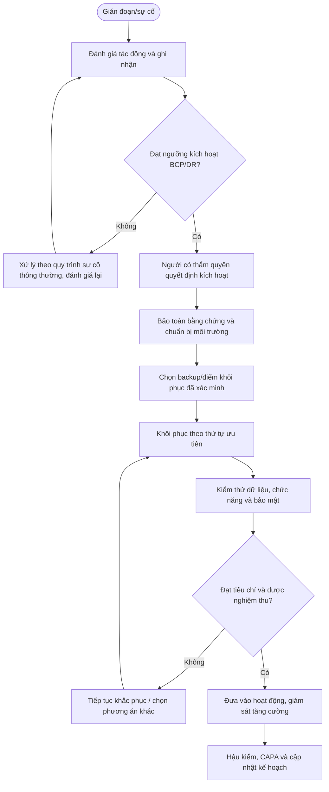

# QT-BCP-02 — KHÔI PHỤC SAU THẢM HỌA CNTT

> **Trạng thái:** Dự thảo nâng cấp v0.2; cần rà soát, diễn tập và phê duyệt trước khi áp dụng.  
> **Chủ sở hữu:** IT Lead / đầu mối ATTT hoặc BCP được chỉ định.  
> **Liên quan:** QT-ATTT-04, QT-IT-08, QT-IT-11, QT-IT-13, QT-IT-15, QT-ISMS-03/04, REG-01, MA-01, MA-02.

## 1. Kiểm soát tài liệu
| Trường | Nội dung |
|---|---|
| Mã | QT-BCP-02 |
| Phiên bản | 0.2 — dự thảo nâng cấp |
| Chủ sở hữu | IT Lead / BCP Lead |
| Người rà soát | Owner hệ thống, ATTT, Service Owner và khách hàng khi liên quan |
| Người phê duyệt | Người có thẩm quyền theo cơ chế quản trị |
| Ngày hiệu lực | Điền sau khi phê duyệt |
| Rà soát | Tối thiểu hằng năm, sau diễn tập hoặc sự cố nghiêm trọng |

## 2. Mục đích và phạm vi
Khôi phục hệ thống, dữ liệu và dịch vụ IT sau sự cố nghiêm trọng theo thứ tự ưu tiên, mục tiêu RTO/RPO và phương án đã được kiểm thử.
Áp dụng cho dịch vụ thuộc Mstar và dịch vụ khách hàng trong phạm vi hợp đồng/ủy quyền. Phụ lục từng khách hàng phải xác định hệ thống, đầu mối, RTO/RPO, thứ tự ưu tiên, kênh thông báo và trách nhiệm quyết định. Không cam kết RTO/RPO chưa được phân tích, phê duyệt và kiểm thử.

## 3. Nguyên tắc bắt buộc
1. An toàn con người và hạn chế thiệt hại được ưu tiên.
2. Chỉ người có thẩm quyền mới kích hoạt kế hoạch hoặc chấp nhận rủi ro trọng yếu.
3. Bảo toàn bằng chứng trước hành động có thể phá hủy khi khả thi; nếu phải hành động ngay, ghi lý do/thời điểm.
4. Bản sao lưu phải được xác minh; không mặc định backup thành công đồng nghĩa restore thành công.
5. RTO/RPO là mục tiêu được duyệt, không phải cam kết chung cho mọi hệ thống.
6. Mọi hành động khẩn cấp phải có nhật ký, người chịu trách nhiệm và hậu kiểm.
7. Khi có dấu hiệu ATTT, phối hợp QT-ATTT-04; không đưa hệ thống chưa an toàn trở lại mạng sản xuất.

## 4. Vai trò
| Vai trò | Trách nhiệm |
|---|---|
| Incident/BCP/DR Lead | Điều phối, duy trì nhật ký, cập nhật tình hình và đề xuất quyết định. |
| Owner hệ thống/dịch vụ | Xác định mức độ trọng yếu, tiêu chí phục hồi và nghiệm thu. |
| Nhóm kỹ thuật | Thực hiện phương án, ghi thao tác, kiểm thử và báo sai lệch. |
| Đầu mối ATTT | Đánh giá an toàn, bảo toàn bằng chứng và kiểm tra trước khi tái kết nối. |
| Ban lãnh đạo/người có thẩm quyền | Kích hoạt, ưu tiên nguồn lực và chấp nhận rủi ro trong thẩm quyền. |
| Đầu mối khách hàng/vendor | Phối hợp, xác nhận quyết định và hỗ trợ theo hợp đồng. |

## 5. Điều kiện kích hoạt/đầu vào
Hồ sơ phải có dấu hiệu sự cố, hệ thống/dịch vụ bị ảnh hưởng, thời điểm, tác động, người báo, mức độ ban đầu, phụ thuộc và phương án liên lạc. Kích hoạt khi gián đoạn vượt ngưỡng đã duyệt, có nguy cơ không đạt RTO/RPO hoặc sự cố ảnh hưởng nhiều dịch vụ/khách hàng. Nếu chưa đủ dữ liệu, ghi giả định và đánh giá lại theo mốc do Incident Lead quyết định.

## 6. Trình tự thực hiện chi tiết

### Bước 1 — Xác định phạm vi thảm họa
**Người thực hiện:** Owner hệ thống/đầu mối ATTT/BCP được phân công; người có thẩm quyền phê duyệt các quyết định trọng yếu.

Đánh giá hệ thống/site/cloud/tenant bị ảnh hưởng, tình trạng dữ liệu, phụ thuộc, khả năng lan rộng và thời gian gián đoạn. Phối hợp QT-ATTT-04 nếu có mã độc/rò rỉ/truy cập trái phép. Bảo toàn bằng chứng trước khi rebuild/wipe nếu có thể; không kết nối lại môi trường chưa được xác nhận an toàn.

**Điều kiện đạt:** Có quyết định, kết quả kiểm tra và bằng chứng truy nguyên. **Nếu không đạt:** Ghi sai lệch, giữ trạng thái chưa hoàn tất và chuyển cấp.

### Bước 2 — Kích hoạt DR
**Người thực hiện:** Owner hệ thống/đầu mối ATTT/BCP được phân công; người có thẩm quyền phê duyệt các quyết định trọng yếu.

Incident/DR Lead trình bày tình trạng, tác động, lựa chọn và điều kiện kích hoạt cho người có thẩm quyền. Ghi quyết định, thời điểm, phạm vi, người điều phối và thông báo. Nếu chưa đạt ngưỡng DR, vẫn phải ghi phương án xử lý incident thông thường và thời điểm đánh giá lại.

**Điều kiện đạt:** Có quyết định, kết quả kiểm tra và bằng chứng truy nguyên. **Nếu không đạt:** Ghi sai lệch, giữ trạng thái chưa hoàn tất và chuyển cấp.

### Bước 3 — Chuẩn bị môi trường phục hồi
**Người thực hiện:** Owner hệ thống/đầu mối ATTT/BCP được phân công; người có thẩm quyền phê duyệt các quyết định trọng yếu.

Xác minh môi trường thay thế, tài khoản quản trị an toàn, network segmentation, DNS/certificates, license, capacity, phụ thuộc và quyền truy cập. Ưu tiên dựng từ baseline sạch; kiểm tra lỗ hổng/cấu hình bảo mật trước khi kết nối dữ liệu/sản xuất.

**Điều kiện đạt:** Có quyết định, kết quả kiểm tra và bằng chứng truy nguyên. **Nếu không đạt:** Ghi sai lệch, giữ trạng thái chưa hoàn tất và chuyển cấp.

### Bước 4 — Chọn và xác minh bản sao lưu
**Người thực hiện:** Owner hệ thống/đầu mối ATTT/BCP được phân công; người có thẩm quyền phê duyệt các quyết định trọng yếu.

Chọn điểm khôi phục theo RPO, kiểm tra thời điểm, nguồn, tính toàn vẹn, khả năng đọc và nguy cơ bản sao lưu đã bị mã hóa/nhiễm. Kiểm tra log backup, checksum khi có, catalog và quyền truy cập. Không mặc định bản backup mới nhất là bản sạch hoặc tốt nhất.

**Điều kiện đạt:** Có quyết định, kết quả kiểm tra và bằng chứng truy nguyên. **Nếu không đạt:** Ghi sai lệch, giữ trạng thái chưa hoàn tất và chuyển cấp.

### Bước 5 — Khôi phục theo thứ tự
**Người thực hiện:** Owner hệ thống/đầu mối ATTT/BCP được phân công; người có thẩm quyền phê duyệt các quyết định trọng yếu.

Theo runbook đã duyệt, phục hồi nền tảng/phụ thuộc trước rồi đến dữ liệu/ứng dụng/dịch vụ. Ghi hệ thống, bản backup, điểm khôi phục, thời điểm, người thực hiện và lỗi. Kiểm soát truy cập, secret, network và logging trước khi đưa từng thành phần hoạt động.

**Điều kiện đạt:** Có quyết định, kết quả kiểm tra và bằng chứng truy nguyên. **Nếu không đạt:** Ghi sai lệch, giữ trạng thái chưa hoàn tất và chuyển cấp.

### Bước 6 — Đối soát dữ liệu và kiểm thử
**Người thực hiện:** Owner hệ thống/đầu mối ATTT/BCP được phân công; người có thẩm quyền phê duyệt các quyết định trọng yếu.

Kiểm tra tính toàn vẹn dữ liệu, số lượng/bản ghi trọng yếu, chức năng nghiệp vụ, xác thực, tích hợp, monitoring, bảo mật và kết nối. Đối soát dữ liệu phát sinh ngoài hệ thống trong thời gian gián đoạn. Chủ dịch vụ/khách hàng nghiệm thu theo tiêu chí đã thống nhất.

**Điều kiện đạt:** Có quyết định, kết quả kiểm tra và bằng chứng truy nguyên. **Nếu không đạt:** Ghi sai lệch, giữ trạng thái chưa hoàn tất và chuyển cấp.

### Bước 7 — Quyết định đưa vào hoạt động
**Người thực hiện:** Owner hệ thống/đầu mối ATTT/BCP được phân công; người có thẩm quyền phê duyệt các quyết định trọng yếu.

Người có thẩm quyền xác nhận các tiêu chí: nguyên nhân đã kiểm soát, hệ thống đủ an toàn, dữ liệu nhất quán, dịch vụ đạt test, giám sát hoạt động và đầu mối hỗ trợ sẵn sàng. Nếu chưa đạt, tiếp tục phục hồi hoặc rollback; ghi rõ rủi ro tồn dư và không tuyên bố phục hồi hoàn toàn.

**Điều kiện đạt:** Có quyết định, kết quả kiểm tra và bằng chứng truy nguyên. **Nếu không đạt:** Ghi sai lệch, giữ trạng thái chưa hoàn tất và chuyển cấp.

### Bước 8 — Theo dõi tăng cường
**Người thực hiện:** Owner hệ thống/đầu mối ATTT/BCP được phân công; người có thẩm quyền phê duyệt các quyết định trọng yếu.

Sau khôi phục, theo dõi lỗi, hiệu năng, bảo mật, dữ liệu, backup mới và hoạt động bất thường trong thời gian được xác định theo rủi ro. Ghi kết quả, cảnh báo, quyết định và tiêu chí kết thúc giám sát tăng cường.

**Điều kiện đạt:** Có quyết định, kết quả kiểm tra và bằng chứng truy nguyên. **Nếu không đạt:** Ghi sai lệch, giữ trạng thái chưa hoàn tất và chuyển cấp.

### Bước 9 — Hậu kiểm và kiểm thử lại
**Người thực hiện:** Owner hệ thống/đầu mối ATTT/BCP được phân công; người có thẩm quyền phê duyệt các quyết định trọng yếu.

Đánh giá thời gian thực tế so với RTO/RPO, điểm thất bại, chất lượng backup, phụ thuộc và khả năng điều phối. Tạo CAPA có owner/hạn, cập nhật runbook và kế hoạch backup. Diễn tập lại phần không đạt để chứng minh hiệu lực.

**Điều kiện đạt:** Có quyết định, kết quả kiểm tra và bằng chứng truy nguyên. **Nếu không đạt:** Ghi sai lệch, giữ trạng thái chưa hoàn tất và chuyển cấp.

## 7. Chuyển cấp và ngoại lệ
Chuyển cấp ngay khi hệ thống trọng yếu ngừng hoạt động, backup không đọc được, nghi bản sao lưu bị nhiễm, dữ liệu không nhất quán, mục tiêu phục hồi có nguy cơ không đạt, thiếu quyền/nguồn lực hoặc có nghĩa vụ thông báo khẩn. Ghi thời điểm, tác động, lựa chọn, người quyết định, việc đã làm và mốc cập nhật tiếp theo.

Mọi ngoại lệ về mục tiêu phục hồi, bảo mật, lưu dữ liệu hoặc thời gian gián đoạn phải có đánh giá rủi ro, biện pháp bù trừ, owner, hạn và người chấp nhận. Không dùng ngoại lệ để che giấu việc kế hoạch chưa được kiểm thử.

## 8. Bằng chứng vận hành
| Hồ sơ | Nội dung tối thiểu |
|---|---|
| Đánh giá tác động | Dịch vụ, phụ thuộc, mức độ, RTO/RPO mục tiêu |
| Quyết định kích hoạt | Người quyết định, thời gian, lý do, phạm vi |
| Nhật ký ứng cứu | Mốc thời gian, hành động, kết quả, người làm |
| Bằng chứng backup/restore | Nguồn, điểm khôi phục, kiểm tra tính toàn vẹn |
| Kiểm thử/nghiệm thu | Tiêu chí, kết quả, người xác nhận |
| Thông báo | Người nhận, kênh, thời điểm, nội dung |
| Hậu kiểm/CAPA | Sai lệch, nguyên nhân, owner, hạn, kiểm tra hiệu lực |

Lưu trong kho chính thức, phân quyền theo nhu cầu công việc và thời hạn theo danh mục hồ sơ/hợp đồng. Không đưa bản backup hoặc dữ liệu khách hàng vào repository mã nguồn.

## 9. KPI và giám sát
| KPI | Định nghĩa |
|---|---|
| RTO thực tế so với mục tiêu | Thời gian khôi phục thực tế so với RTO được duyệt |
| RPO thực tế so với mục tiêu | Mức mất dữ liệu thực tế so với RPO được duyệt |
| Tỷ lệ diễn tập đạt | Kịch bản đạt tiêu chí / kịch bản được thực hiện |
| Tỷ lệ backup phục hồi thành công | Bài test restore đạt / bài test restore thực hiện |
| Hành động sau diễn tập/sự cố quá hạn | Số hành động chưa hoàn thành đến hạn |

Cần xác định cách đo, hệ thống nguồn và tiêu chí đạt trước khi báo cáo. Nếu không có RTO/RPO được duyệt thì không được báo cáo là đạt mục tiêu.

## 10. Lưu đồ

## 11. Điều kiện ban hành
- [ ] Xác định dịch vụ trọng yếu, owner và người có quyền kích hoạt.
- [ ] Phê duyệt BIA, RTO/RPO, thứ tự phục hồi và phụ thuộc.
- [ ] Xác minh danh bạ khẩn cấp, vendor và kênh liên lạc dự phòng.
- [ ] Chạy thử/diễn tập, kiểm tra backup và phục hồi.
- [ ] Ghi nhận vấn đề, khắc phục và kiểm tra lại.
- [ ] Đào tạo người tham gia, phê duyệt và công bố phiên bản hiệu lực.

**Lưu ý:** Quy trình là dự thảo quản trị liên tục/khôi phục; không tự chứng minh chứng nhận ISO hoặc năng lực đạt RTO/RPO nếu chưa được kiểm thử.
