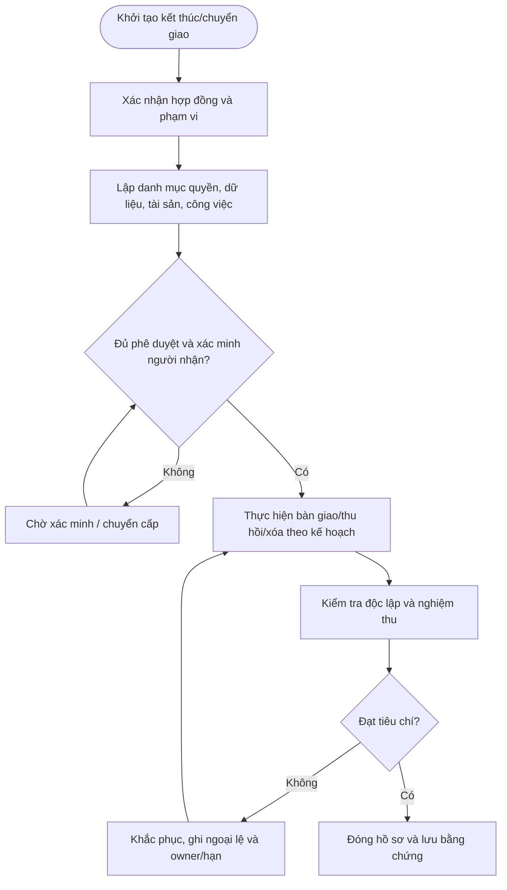

# QT-CS-02 — BÀN GIAO HỆ THỐNG CHO KHÁCH HÀNG/NHÀ CUNG CẤP MỚI

> **Trạng thái:** Dự thảo nâng cấp v0.2; cần rà soát, chạy thử và phê duyệt trước khi áp dụng.  
> **Chủ sở hữu:** Contract Owner / Service Owner.  
> **Liên quan:** QT-IT-08, QT-IT-11, QT-IT-12, QT-ATTT-04, QT-ISMS-02, MA-01, MA-02.

## 1. Kiểm soát tài liệu

| Trường | Nội dung |
|---|---|
| Mã | QT-CS-02 |
| Phiên bản | 0.2 — dự thảo nâng cấp |
| Chủ sở hữu | Contract Owner / Service Owner |
| Người rà soát | IT Lead, ATTT và Legal khi liên quan |
| Người phê duyệt | Người có thẩm quyền theo quản trị tài liệu/hợp đồng |
| Ngày hiệu lực | Điền sau khi phê duyệt |
| Chu kỳ rà soát | Khi có thay đổi hợp đồng và trước/sau kết thúc dịch vụ |

## 2. Mục đích và phạm vi

Chuyển giao vận hành hoặc hệ thống sang khách hàng/nhà cung cấp khác mà vẫn bảo đảm tính toàn vẹn dữ liệu, bảo mật và liên tục dịch vụ.

Áp dụng theo hợp đồng/phụ lục và phạm vi ủy quyền. Không tự đặt thời hạn lưu, nghĩa vụ xóa hoặc thời hạn thông báo; phải đối chiếu hợp đồng, yêu cầu pháp lý đã được rà soát và quyết định người có thẩm quyền.

## 3. Nguyên tắc bắt buộc

1. Xác minh phạm vi, chủ sở hữu và người nhận trước khi chuyển dữ liệu/tài sản hoặc thu hồi dịch vụ.
2. Quyền truy cập phải được thu hồi hoặc có ủy quyền mới ghi nhận rõ; không để quyền tồn vô chủ.
3. Kiểm tra legal hold/nghĩa vụ lưu trước khi xóa dữ liệu.
4. Không ghi secret dạng rõ vào biên bản hoặc file bàn giao.
5. Nếu nghi có truy cập trái phép hoặc rò rỉ dữ liệu, kích hoạt QT-ATTT-04 và bảo toàn bằng chứng.
6. Mỗi việc tồn phải có owner, hạn và người chấp nhận rủi ro.

## 4. Vai trò

| Vai trò | Trách nhiệm |
|---|---|
| Contract Owner | Xác nhận hợp đồng, nghĩa vụ, ngày hiệu lực và phạm vi thương mại. |
| Service Owner/IT Lead | Điều phối chuyển giao, kỹ thuật, quyền và chất lượng. |
| Kỹ thuật viên | Thực hiện thao tác được duyệt, ghi log và kết quả. |
| Đầu mối khách hàng/bên nhận | Xác nhận quyền, nhận dữ liệu/tài liệu và nghiệm thu. |
| ATTT/Legal | Rà soát dữ liệu, sự cố, retention và nghĩa vụ pháp lý khi liên quan. |

## 5. Đầu vào và điều kiện bắt đầu

Hồ sơ cần có hợp đồng/phụ lục, ngày hiệu lực, danh mục hệ thống/tài sản/dữ liệu/quyền, đầu mối, người phê duyệt, kế hoạch, tiêu chí nghiệm thu và nơi lưu bằng chứng. Nếu thông tin mâu thuẫn hoặc người nhận chưa được xác minh, dừng việc chuyển/xóa/thu hồi có rủi ro và chuyển cấp.

## 6. Trình tự thực hiện chi tiết

### Bước 1 — Xác định phạm vi
**Người thực hiện:** Contract Owner/Service Owner/IT theo phân công.

Lập danh mục hệ thống, tài sản, dịch vụ, dữ liệu, cấu hình, domain/DNS, chứng thư, license, backup, tài liệu, ticket và phụ thuộc sẽ chuyển. Xác định rõ nội dung không bàn giao và quyền sở hữu; Contract Owner xác nhận phạm vi.

**Điều kiện đạt:** Có xác nhận và bằng chứng truy nguyên. **Nếu không đạt:** Giữ hồ sơ mở, ghi sai lệch, owner và hạn khắc phục.

### Bước 2 — Xác minh bên nhận
**Người thực hiện:** Contract Owner/Service Owner/IT theo phân công.

Xác minh tổ chức/người nhận, thẩm quyền, kênh truyền, yêu cầu bảo mật, năng lực tiếp nhận và đầu mối kỹ thuật. Không gửi dữ liệu hoặc thông tin truy cập cho người chưa xác minh.

**Điều kiện đạt:** Có xác nhận và bằng chứng truy nguyên. **Nếu không đạt:** Giữ hồ sơ mở, ghi sai lệch, owner và hạn khắc phục.

### Bước 3 — Lập kế hoạch chuyển
**Người thực hiện:** Contract Owner/Service Owner/IT theo phân công.

Chốt lịch, thứ tự, phương pháp, trách nhiệm, thời gian gián đoạn, kiểm thử, rollback, thông báo, điều kiện hoàn tất và hỗ trợ sau chuyển. Mọi thay đổi production phải theo QT-IT-13.

**Điều kiện đạt:** Có xác nhận và bằng chứng truy nguyên. **Nếu không đạt:** Giữ hồ sơ mở, ghi sai lệch, owner và hạn khắc phục.

### Bước 4 — Chuẩn bị dữ liệu/cấu hình
**Người thực hiện:** Contract Owner/Service Owner/IT theo phân công.

Rà soát dữ liệu cần chuyển, loại bỏ dữ liệu ngoài phạm vi, xử lý secret và khóa, xuất cấu hình an toàn, ghi phiên bản và kiểm tra toàn vẹn. Không chuyển mật khẩu dùng chung/private key không cần thiết; ưu tiên cấp credential mới.

**Điều kiện đạt:** Có xác nhận và bằng chứng truy nguyên. **Nếu không đạt:** Giữ hồ sơ mở, ghi sai lệch, owner và hạn khắc phục.

### Bước 5 — Thực hiện chuyển giao
**Người thực hiện:** Contract Owner/Service Owner/IT theo phân công.

Dùng kênh được duyệt, mã hóa, kiểm soát người gửi/nhận và thời gian. Ghi danh mục, hash khi phù hợp, người giao/nhận và kết quả. Dừng nếu sai người nhận, thiếu dữ liệu hoặc có rủi ro bảo mật.

**Điều kiện đạt:** Có xác nhận và bằng chứng truy nguyên. **Nếu không đạt:** Giữ hồ sơ mở, ghi sai lệch, owner và hạn khắc phục.

### Bước 6 — Kiểm tra và nghiệm thu
**Người thực hiện:** Contract Owner/Service Owner/IT theo phân công.

Bên nhận kiểm tra dữ liệu, cấu hình, truy cập, chức năng, tài liệu và phụ thuộc. Ghi sai lệch, owner/hạn và quyết định. Gửi file thành công không đồng nghĩa nghiệm thu kỹ thuật.

**Điều kiện đạt:** Có xác nhận và bằng chứng truy nguyên. **Nếu không đạt:** Giữ hồ sơ mở, ghi sai lệch, owner và hạn khắc phục.

### Bước 7 — Chuyển quyền vận hành
**Người thực hiện:** Contract Owner/Service Owner/IT theo phân công.

Chuyển quyền theo thời điểm đã duyệt; xác nhận bên nhận có quyền/công cụ trước khi thu hồi quyền Mstar. Quyền tạm thời cần phê duyệt, thời hạn và giám sát.

**Điều kiện đạt:** Có xác nhận và bằng chứng truy nguyên. **Nếu không đạt:** Giữ hồ sơ mở, ghi sai lệch, owner và hạn khắc phục.

### Bước 8 — Đóng bàn giao
**Người thực hiện:** Contract Owner/Service Owner/IT theo phân công.

Lưu biên bản, bằng chứng truyền/nhận, kiểm tra, ticket tồn, quyền đã chuyển/thu hồi, lịch hỗ trợ và trách nhiệm sau bàn giao.

**Điều kiện đạt:** Có xác nhận và bằng chứng truy nguyên. **Nếu không đạt:** Giữ hồ sơ mở, ghi sai lệch, owner và hạn khắc phục.

## 7. Xử lý ngoại lệ và chuyển cấp

Chuyển cấp khi có tranh chấp về quyền sở hữu dữ liệu, yêu cầu xóa mâu thuẫn nghĩa vụ lưu, không thể thu hồi tài khoản, vendor không xác nhận xóa, dữ liệu chuyển không toàn vẹn hoặc có nguy cơ gián đoạn. Ghi vấn đề, tác động, bằng chứng, người quyết định, phương án bù trừ, owner và hạn. Không tự xác nhận hoàn tất khi còn quyền/dữ liệu chưa được kiểm tra.

## 8. Bằng chứng vận hành

| Hồ sơ | Nội dung tối thiểu |
|---|---|
| Hợp đồng/phạm vi | Ngày kết thúc/chuyển giao, dịch vụ, nghĩa vụ |
| Danh mục quyền/tài sản/dữ liệu | Đối tượng, owner, trạng thái, người nhận |
| Kế hoạch và phê duyệt | Bước, lịch, người duyệt, điều kiện |
| Bằng chứng chuyển/thu hồi/xóa | Thời điểm, người làm, kết quả, log/xác nhận |
| Nghiệm thu/đóng hồ sơ | Người nhận, việc tồn, rủi ro và xác nhận |

Lưu tại kho chính thức, giới hạn quyền truy cập và retention theo danh mục/hợp đồng. Không đưa dữ liệu khách hàng hoặc secret vào repository mã nguồn.

## 9. KPI và giám sát

| KPI | Định nghĩa |
|---|---|
| Tỷ lệ checklist hoàn tất đúng hạn | Checklist hoàn tất đúng hạn / checklist đến hạn |
| Tỷ lệ quyền thu hồi được xác minh | Quyền đã xác minh thu hồi / quyền phải thu hồi |
| Tỷ lệ dữ liệu được đối soát | Dữ liệu trả/xóa/lưu có bằng chứng / dữ liệu thuộc danh mục |
| Ngoại lệ quá hạn | Số ngoại lệ hết hạn chưa đóng |
| Hồ sơ thiếu xác nhận | Hồ sơ chưa có nghiệm thu/xác nhận bắt buộc |

## 10. Lưu đồ

## 11. Điều kiện ban hành

- [ ] Xác nhận ngày hiệu lực, phạm vi hợp đồng và người có thẩm quyền.
- [ ] Đối chiếu danh mục quyền, tài sản, dữ liệu và nghĩa vụ lưu/xóa.
- [ ] Kiểm tra biểu mẫu và kho lưu bằng chứng.
- [ ] Chạy thử kịch bản chuyển giao/kết thúc, bao gồm ngoại lệ.
- [ ] Khắc phục sai lệch, đào tạo người tham gia và lưu bằng chứng.
- [ ] Phê duyệt và công bố phiên bản hiệu lực.

**Lưu ý:** Dự thảo cần được rà soát theo hợp đồng, pháp luật áp dụng và phạm vi ISMS; không tự chứng minh chứng nhận ISO.