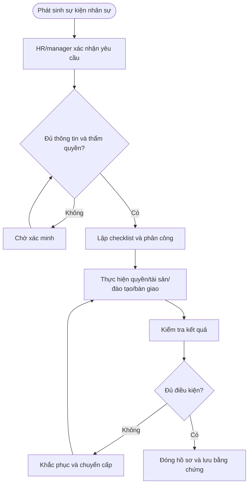

# QT-HR-02 — ĐIỀU CHUYỂN NHÂN SỰ

> **Trạng thái:** Dự thảo nâng cấp v0.2; cần rà soát, chạy thử và phê duyệt trước khi áp dụng.  
> **Chủ sở hữu:** HR / IT Lead / Service Owner theo phân công.  
> **Liên quan:** QT-IT-10, QT-IT-11, QT-IT-12, QT-ATTT-04, QT-HR-04/05, MA-01, MA-02.

## 1. Kiểm soát tài liệu

| Trường | Nội dung |
|---|---|
| Mã | QT-HR-02 |
| Phiên bản | 0.2 — dự thảo nâng cấp |
| Chủ sở hữu | Owner quy trình được phân công |
| Người rà soát | HR, IT Lead và bên liên quan |
| Người phê duyệt | Người có thẩm quyền theo quản trị tài liệu |
| Ngày hiệu lực | Điền sau khi phê duyệt |
| Rà soát | Tối thiểu hằng năm và khi thay đổi chính sách/công cụ |

## 2. Mục đích và phạm vi

ĐIỀU CHUYỂN NHÂN SỰ. Áp dụng cho nhân sự Mstar và nhân sự/vendor được cấp quyền vào hệ thống thuộc phạm vi quản lý; với nhân sự khách hàng, áp dụng theo trách nhiệm trong hợp đồng/phụ lục. Hồ sơ nhân sự phải được bảo vệ theo phân quyền.

## 3. Nguyên tắc bắt buộc

1. HR/manager là nguồn xác nhận chính thức về trạng thái nhân sự; IT không tự suy đoán ngày hiệu lực.
2. Cấp, đổi và thu hồi quyền theo QT-IT-11 và ma trận RBAC; không cấp quyền chỉ từ yêu cầu miệng.
3. Quyền/tài sản phải có người nhận, ngày hiệu lực và bằng chứng kiểm tra.
4. Thông tin nhân sự chỉ chia sẻ theo nguyên tắc cần biết.
5. Không ghi mật khẩu/token vào checklist hoặc tài liệu bàn giao.
6. Nếu nghi truy cập trái phép, mất thiết bị hoặc lộ dữ liệu, kích hoạt QT-ATTT-04.

## 4. Vai trò

| Vai trò | Trách nhiệm |
|---|---|
| HR | Xác nhận trạng thái nhân sự, ngày hiệu lực và yêu cầu chính thức. |
| Manager | Xác định nhiệm vụ, quyền cần thiết, bàn giao và xác nhận hoàn tất. |
| IT | Cấp/đổi/thu hồi quyền, quản lý tài sản, kiểm tra kỹ thuật và lưu bằng chứng. |
| Nhân sự/người bàn giao | Hoàn thành đào tạo, nhận tài sản/quyền hoặc bàn giao công việc. |
| Owner hệ thống/ATTT | Phê duyệt quyền nhạy cảm và đánh giá rủi ro khi liên quan. |

## 5. Đầu vào và điều kiện bắt đầu

Hồ sơ phải có yêu cầu chính thức, danh tính, vai trò/trạng thái, ngày hiệu lực, manager, hệ thống/tài sản, quyền cần xử lý và người phê duyệt. Nếu thông tin mâu thuẫn, yêu cầu HR/manager xác minh trước khi thay đổi quyền ngoài cơ chế khẩn cấp đã duyệt.

## 6. Trình tự thực hiện chi tiết

### Bước 1 — Thông báo điều chuyển
**Người thực hiện:** HR/manager/IT/owner theo phân công.

HR/manager ghi người được điều chuyển, vị trí cũ/mới, ngày hiệu lực, quản lý mới, phạm vi khách hàng và lý do. Thông báo IT/owner dịch vụ qua kênh chính thức.

**Điều kiện đạt:** Có xác nhận, kết quả và bằng chứng. **Nếu không đạt:** Giữ checklist mở, giao owner/hạn và chuyển cấp nếu ảnh hưởng bảo mật hoặc liên tục dịch vụ.

### Bước 2 — Rà soát quyền hiện tại và mới
**Người thực hiện:** HR/manager/IT/owner theo phân công.

Xuất danh sách quyền, nhóm, tài khoản đặc quyền, VPN, hệ thống khách hàng và quyền vendor. Manager mới xác định quyền cần cho nhiệm vụ mới; không mặc định giữ toàn bộ quyền cũ.

**Điều kiện đạt:** Có xác nhận, kết quả và bằng chứng. **Nếu không đạt:** Giữ checklist mở, giao owner/hạn và chuyển cấp nếu ảnh hưởng bảo mật hoặc liên tục dịch vụ.

### Bước 3 — Lập kế hoạch chuyển đổi
**Người thực hiện:** HR/manager/IT/owner theo phân công.

Xác định thời điểm thu hồi quyền cũ, cấp quyền mới, chuyển tài sản, dữ liệu, ticket, lịch trực và trách nhiệm. Với chuyển khách hàng, kiểm tra điều khoản và quyền giữa tenant.

**Điều kiện đạt:** Có xác nhận, kết quả và bằng chứng. **Nếu không đạt:** Giữ checklist mở, giao owner/hạn và chuyển cấp nếu ảnh hưởng bảo mật hoặc liên tục dịch vụ.

### Bước 4 — Thực hiện thay đổi
**Người thực hiện:** HR/manager/IT/owner theo phân công.

Thu hồi quyền không còn cần và cấp quyền mới sau phê duyệt QT-IT-11. Cập nhật nhóm, thiết bị, hồ sơ tài sản và phân công. Quyền cũ giữ tạm phải có lý do, owner, hạn và người duyệt.

**Điều kiện đạt:** Có xác nhận, kết quả và bằng chứng. **Nếu không đạt:** Giữ checklist mở, giao owner/hạn và chuyển cấp nếu ảnh hưởng bảo mật hoặc liên tục dịch vụ.

### Bước 5 — Kiểm tra và bàn giao
**Người thực hiện:** HR/manager/IT/owner theo phân công.

Xác minh người dùng chỉ còn quyền được duyệt; bàn giao ticket/Work Item, tài liệu, tài sản và đầu mối. Người nhận xác nhận, ghi bằng chứng.

**Điều kiện đạt:** Có xác nhận, kết quả và bằng chứng. **Nếu không đạt:** Giữ checklist mở, giao owner/hạn và chuyển cấp nếu ảnh hưởng bảo mật hoặc liên tục dịch vụ.

### Bước 6 — Đóng và rà soát
**Người thực hiện:** HR/manager/IT/owner theo phân công.

HR/manager/IT xác nhận checklist, xử lý lỗi quyền/tài sản/phân công. Thu hồi quyền tạm trước ngày hết hạn nếu không có phê duyệt mới.

**Điều kiện đạt:** Có xác nhận, kết quả và bằng chứng. **Nếu không đạt:** Giữ checklist mở, giao owner/hạn và chuyển cấp nếu ảnh hưởng bảo mật hoặc liên tục dịch vụ.

## 7. Ngoại lệ và chuyển cấp

Chuyển cấp khi ngày hiệu lực không rõ, có tranh chấp, quyền đặc quyền thiếu phê duyệt, tài sản không thu hồi được, có dấu hiệu sao chép dữ liệu trái phép hoặc checklist không hoàn tất đúng thời điểm. Ghi tác động, biện pháp giảm thiểu, người quyết định và hạn. Ngoại lệ phải được phê duyệt, có owner và ngày hết hạn.

## 8. Bằng chứng và lưu hồ sơ

| Hồ sơ | Nội dung |
|---|---|
| Yêu cầu HR/manager | Danh tính, vai trò, ngày hiệu lực, người xác nhận |
| Checklist | Công việc, owner, trạng thái và hạn |
| Quyền/tài sản | Danh sách cấp/thu hồi, biên bản, kết quả kiểm tra |
| Đào tạo/cam kết | Nội dung, phiên bản, người tham dự, kết quả |
| Bàn giao/nghiệm thu | Người giao/nhận, việc tồn, xác nhận |
| Ngoại lệ/CAPA | Lý do, rủi ro, biện pháp, owner/hạn |

Lưu tại hệ thống HR/ticket/kho hồ sơ được phê duyệt; phân quyền hạn chế và retention theo chính sách/hợp đồng/pháp luật đã rà soát.

## 9. KPI và giám sát

| KPI | Định nghĩa |
|---|---|
| Checklist đúng hạn | Checklist đủ mục và đúng hạn / checklist đến hạn |
| Thu hồi quyền đúng thời điểm | Quyền thu hồi theo ngày hiệu lực / quyền phải thu hồi |
| Tài sản bàn giao đủ | Tài sản có xác nhận / tài sản phải bàn giao |
| Đào tạo hoàn thành | Người hoàn thành đạt tiêu chí / người thuộc diện bắt buộc |
| Sai lệch tồn | Checklist/quyền/tài sản còn sai lệch quá hạn |

Nguồn dữ liệu, chu kỳ và ngưỡng phải được thống nhất trước khi báo cáo; không dùng KPI tổng hợp để che khuất tài khoản chưa thu hồi hoặc quyền đặc quyền tồn.

## 10. Lưu đồ

## 11. Điều kiện ban hành

- [ ] Xác định owner và kênh yêu cầu HR/manager chính thức.
- [ ] Chốt checklist, người duyệt quyền và ngày hiệu lực.
- [ ] Kiểm tra biểu mẫu, nơi lưu và phân quyền hồ sơ.
- [ ] Chạy thử tình huống phù hợp và xử lý sai lệch.
- [ ] Đào tạo người tham gia, lưu bằng chứng và phê duyệt phiên bản hiệu lực.

**Lưu ý:** Dự thảo cần rà soát theo chính sách nội bộ, hợp đồng và pháp luật áp dụng.