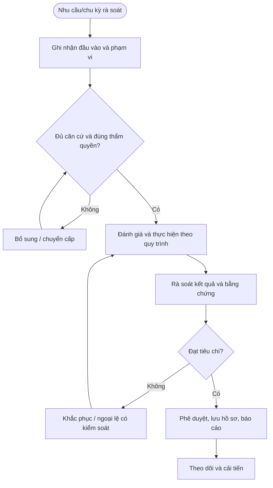

# QT-ISMS-02 — QUẢN LÝ TÀI LIỆU VÀ HỒ SƠ

> **Trạng thái:** Dự thảo nâng cấp v0.2; cần rà soát, chạy thử và phê duyệt trước khi áp dụng.  
> **Chủ sở hữu:** Owner quy trình / IT Lead / ISMS Owner theo phân công.  
> **Liên quan:** QT-ISMS-03/04/05/06, REG-01/02/03/04, MA-01 và phụ lục khách hàng khi áp dụng.

## 1. Kiểm soát tài liệu
| Trường | Nội dung |
|---|---|
| Mã | QT-ISMS-02 |
| Phiên bản | 0.2 — dự thảo nâng cấp |
| Chủ sở hữu | Owner quy trình được phân công |
| Người rà soát | IT Lead/ISMS Owner và bên liên quan |
| Người phê duyệt | Người có thẩm quyền theo quản trị tài liệu |
| Ngày hiệu lực | Điền sau khi phê duyệt |
| Chu kỳ rà soát | Tối thiểu hằng năm và khi có thay đổi trọng yếu |

## 2. Mục đích và phạm vi
Kiểm soát vòng đời tài liệu và hồ sơ để người dùng sử dụng đúng phiên bản, bảo vệ thông tin và truy nguyên bằng chứng.
Áp dụng theo phạm vi ISMS đã xác định và các dịch vụ Mstar/khách hàng liên quan. Mọi tiêu chí chấm điểm, retention, thẩm quyền và thời hạn phải lấy từ chính sách/hợp đồng được duyệt; không tự đặt yêu cầu pháp lý hoặc cam kết chưa xác minh.

## 3. Nguyên tắc bắt buộc
1. Xác định rõ owner, thẩm quyền và phạm vi trước khi bắt đầu.
2. Mọi quyết định trọng yếu phải có căn cứ, người quyết định, ngày và hành động tiếp theo.
3. Tách biệt người thực hiện với người phê duyệt khi có thể; nếu không thể, ghi kiểm soát bù trừ.
4. Không coi tài liệu đã viết là bằng chứng kiểm soát đã vận hành; cần bằng chứng thực tế.
5. Khi phát hiện sự cố ATTT, bảo toàn bằng chứng và phối hợp QT-ATTT-04.
6. Hồ sơ phải được lưu tại kho chính thức, có phân quyền và truy nguyên.

## 4. Vai trò
| Vai trò | Trách nhiệm |
|---|---|
| Owner quy trình | Duy trì nội dung, biểu mẫu, hiệu lực và cải tiến. |
| Người thực hiện | Thực hiện theo quy trình, lưu hồ sơ và báo sai lệch. |
| Người rà soát | Kiểm tra tính đầy đủ, khả thi, rủi ro và liên kết tài liệu. |
| Người phê duyệt | Quyết định hiệu lực/chấp nhận rủi ro trong thẩm quyền. |
| ISMS Owner/IT Lead | Điều phối, theo dõi tuân thủ và báo cáo lãnh đạo. |
| Khách hàng/Legal/HR/Finance | Tham gia khi nội dung thuộc hợp đồng, pháp lý, nhân sự hoặc chi phí. |

## 5. Đầu vào và điều kiện bắt đầu
Hồ sơ phải có mục tiêu, phạm vi, dữ liệu nguồn, người chịu trách nhiệm, tiêu chí đánh giá, người phê duyệt và nơi lưu. Nếu thiếu căn cứ hoặc có xung đột giữa quy trình với hợp đồng/pháp luật, ghi rõ điểm cần xác minh và chuyển người có thẩm quyền; không tự chọn cách diễn giải có lợi cho tiến độ.

## 6. Trình tự thực hiện chi tiết

### Bước 1 — Đề nghị tạo/sửa tài liệu
**Người thực hiện:** Owner được phân công; IT Lead/ATTT/đầu mối nghiệp vụ rà soát theo nội dung.

Chủ sở hữu nêu mục đích, phạm vi, người dùng, tài liệu liên quan, lý do thay đổi và mức phân loại. Gán mã theo quy tắc; xác định đây là chính sách, quy trình, hướng dẫn, biểu mẫu hay hồ sơ vận hành. Không tạo mã trùng hoặc phát hành bản nháp như bản có hiệu lực.

**Điều kiện đạt:** Hồ sơ cập nhật, quyết định và bằng chứng có thể truy nguyên. **Nếu không đạt:** Giữ trạng thái chưa hoàn tất, ghi nguyên nhân và giao hành động khắc phục.

### Bước 2 — Soạn thảo và rà soát
**Người thực hiện:** Owner được phân công; IT Lead/ATTT/đầu mối nghiệp vụ rà soát theo nội dung.

Dùng mẫu chuẩn; ghi trách nhiệm, đầu vào/đầu ra, từng bước, tiêu chí đạt/không đạt, bằng chứng, ngoại lệ và biểu mẫu. Rà soát nghiệp vụ, ATTT, hợp đồng/pháp lý khi liên quan. Người rà soát kiểm tra tính đúng, rõ, khả thi và liên kết với quy trình khác.

**Điều kiện đạt:** Hồ sơ cập nhật, quyết định và bằng chứng có thể truy nguyên. **Nếu không đạt:** Giữ trạng thái chưa hoàn tất, ghi nguyên nhân và giao hành động khắc phục.

### Bước 3 — Phê duyệt và công bố
**Người thực hiện:** Owner được phân công; IT Lead/ATTT/đầu mối nghiệp vụ rà soát theo nội dung.

Chỉ người có thẩm quyền phê duyệt mới được đưa tài liệu vào trạng thái hiệu lực. Ghi phiên bản, người duyệt, ngày hiệu lực, phạm vi áp dụng và nơi công bố. Thông báo/đào tạo người dùng bị ảnh hưởng; thu hồi bản cũ khỏi nơi sử dụng nhưng vẫn giữ lịch sử theo quy định.

**Điều kiện đạt:** Hồ sơ cập nhật, quyết định và bằng chứng có thể truy nguyên. **Nếu không đạt:** Giữ trạng thái chưa hoàn tất, ghi nguyên nhân và giao hành động khắc phục.

### Bước 4 — Kiểm soát truy cập
**Người thực hiện:** Owner được phân công; IT Lead/ATTT/đầu mối nghiệp vụ rà soát theo nội dung.

Phân loại tài liệu, giới hạn đọc/sửa/phê duyệt theo vai trò, bật version history/audit log khi có. Tài liệu có sơ đồ mạng, thông tin khách hàng hoặc nội dung nhạy cảm phải lưu kho hạn chế. Không đưa secret hoặc dữ liệu thực không cần thiết vào tài liệu chuẩn/repository.

**Điều kiện đạt:** Hồ sơ cập nhật, quyết định và bằng chứng có thể truy nguyên. **Nếu không đạt:** Giữ trạng thái chưa hoàn tất, ghi nguyên nhân và giao hành động khắc phục.

### Bước 5 — Quản lý hồ sơ vận hành
**Người thực hiện:** Owner được phân công; IT Lead/ATTT/đầu mối nghiệp vụ rà soát theo nội dung.

Mỗi hồ sơ có mã hoặc liên kết tới ticket/change/incident/asset/vendor, ngày giờ, người lập, trạng thái, phê duyệt và bằng chứng. Lưu vào kho chính thức, bảo vệ tính toàn vẹn, quyền truy cập và khả năng tìm kiếm. Không thay hồ sơ gốc mà không giữ lịch sử sửa đổi.

**Điều kiện đạt:** Hồ sơ cập nhật, quyết định và bằng chứng có thể truy nguyên. **Nếu không đạt:** Giữ trạng thái chưa hoàn tất, ghi nguyên nhân và giao hành động khắc phục.

### Bước 6 — Lưu giữ và tiêu hủy
**Người thực hiện:** Owner được phân công; IT Lead/ATTT/đầu mối nghiệp vụ rà soát theo nội dung.

Lập retention schedule theo loại hồ sơ, hợp đồng, pháp luật và nhu cầu kiểm toán. Trước khi xóa, kiểm tra legal hold, tranh chấp, điều tra và nghĩa vụ khách hàng. Xóa theo phương pháp được duyệt, ghi người duyệt, phạm vi, thời điểm và bằng chứng khi yêu cầu.

**Điều kiện đạt:** Hồ sơ cập nhật, quyết định và bằng chứng có thể truy nguyên. **Nếu không đạt:** Giữ trạng thái chưa hoàn tất, ghi nguyên nhân và giao hành động khắc phục.

### Bước 7 — Rà soát định kỳ
**Người thực hiện:** Owner được phân công; IT Lead/ATTT/đầu mối nghiệp vụ rà soát theo nội dung.

Owner rà soát tài liệu đến hạn, liên kết hỏng, nội dung lỗi thời, người duyệt không còn phù hợp và thay đổi hệ thống/hợp đồng. Ghi quyết định giữ/sửa/thu hồi, owner/hạn và phiên bản mới. Không để bản hết hiệu lực được dùng trong vận hành.

**Điều kiện đạt:** Hồ sơ cập nhật, quyết định và bằng chứng có thể truy nguyên. **Nếu không đạt:** Giữ trạng thái chưa hoàn tất, ghi nguyên nhân và giao hành động khắc phục.

## 7. Ngoại lệ và chuyển cấp
Chuyển cấp khi thiếu thẩm quyền, có rủi ro vượt ngưỡng, nghĩa vụ pháp lý/hợp đồng chưa rõ, bằng chứng thiếu hoặc bị can thiệp, hành động quá hạn hoặc phát hiện kiểm soát không hiệu lực. Ghi nội dung, căn cứ, tác động, người nhận, quyết định cần thiết và hạn phản hồi. Ngoại lệ cần owner, rủi ro, biện pháp bù trừ, ngày hết hạn và người phê duyệt.

## 8. Bằng chứng và lưu hồ sơ
| Hồ sơ | Nội dung |
|---|---|
| Yêu cầu/đầu vào | Mục đích, phạm vi, nguồn và người yêu cầu |
| Đánh giá/rà soát | Tiêu chí, căn cứ, phát hiện và người rà soát |
| Quyết định/phê duyệt | Người quyết định, thời điểm, điều kiện và lý do |
| Nhật ký thực hiện | Hoạt động, kết quả, sai lệch và hành động tiếp theo |
| Báo cáo/khắc phục | Trạng thái, owner, hạn, kiểm tra hiệu lực |

Thời hạn lưu theo danh mục hồ sơ, hợp đồng và pháp luật đã được rà soát. Không xóa hồ sơ đang thuộc điều tra, tranh chấp hoặc legal hold. Không lưu secret dạng rõ.

## 9. KPI và giám sát
| KPI | Định nghĩa |
|---|---|
| Tỷ lệ hồ sơ đủ | Hồ sơ đáp ứng checklist / hồ sơ được lấy mẫu |
| Hành động quá hạn | Số hành động đến hạn chưa hoàn tất |
| Tỷ lệ rà soát đúng hạn | Tài liệu/rủi ro/kiểm soát được rà soát đúng hạn / số đến hạn |
| Tỷ lệ tái diễn | Sai lệch lặp lại cùng nguyên nhân |
| Tỷ lệ khắc phục hiệu lực | Hành động có bằng chứng hiệu lực / hành động được kiểm tra |

Chốt công thức, nguồn dữ liệu, kỳ đo và ngưỡng cảnh báo trước khi áp dụng. Không dùng tỷ lệ tổng hợp che khuất rủi ro nghiêm trọng.

## 10. Lưu đồ

## 11. Điều kiện ban hành
- [ ] Xác định owner, thẩm quyền và phạm vi áp dụng.
- [ ] Xác nhận tiêu chí/retention/thời hạn theo nguồn được duyệt.
- [ ] Đối chiếu biểu mẫu, danh mục và nơi lưu bằng chứng.
- [ ] Chạy thử một tình huống thường lệ và một tình huống ngoại lệ.
- [ ] Khắc phục sai lệch, đào tạo người liên quan và lưu bằng chứng.
- [ ] Phê duyệt và công bố phiên bản hiệu lực.

**Lưu ý:** Dự thảo này hỗ trợ vận hành ISMS nhưng không tự chứng minh chứng nhận ISO; phải phù hợp phạm vi ISMS, đánh giá rủi ro, SoA, hợp đồng và pháp luật áp dụng.
