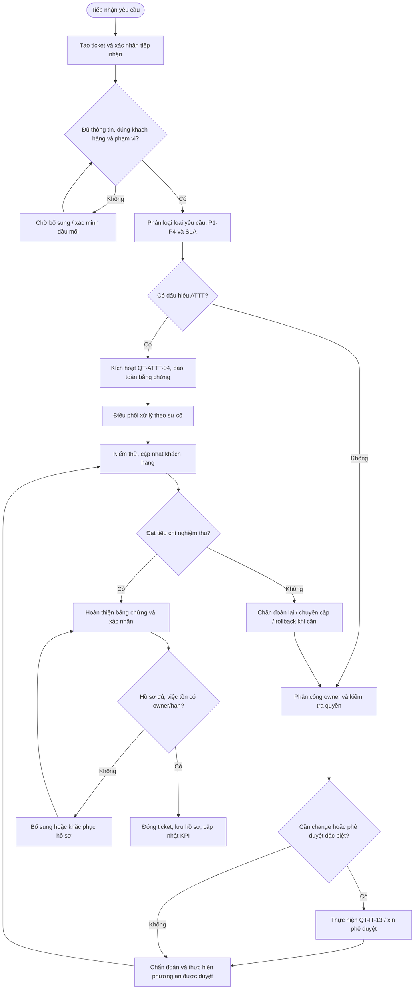

# QT-IT-08 — QUY TRÌNH HỖ TRỢ KHÁCH HÀNG

> **Trạng thái:** Dự thảo nâng cấp v0.2 — dùng để rà soát và chạy thử; chưa có hiệu lực ban hành cho đến khi được phê duyệt.  
> **Chủ sở hữu quy trình:** IT Lead / Service Delivery Manager.  
> **Tài liệu liên quan:** QT-IT-07 (phối hợp Sale–IT); QT-IT-11 (tài khoản và quyền truy cập); QT-IT-13 (quản lý thay đổi); QT-ATTT-04 (ứng cứu sự cố ATTT); QT-ISMS-04 (ngoại lệ); MA-01 (RACI); MA-02 (RBAC); phụ lục dịch vụ từng khách hàng.

## 1. Kiểm soát tài liệu

| Trường | Nội dung |
|---|---|
| Mã tài liệu | QT-IT-08 |
| Tên | Quy trình hỗ trợ khách hàng |
| Phiên bản | 0.2 — dự thảo nâng cấp |
| Đơn vị sở hữu | IT / Service Desk |
| Người soạn | Chủ sở hữu quy trình được phân công |
| Người rà soát | IT Lead và đầu mối ATTT khi có nội dung ATTT |
| Người phê duyệt | Người có thẩm quyền theo cơ chế quản trị tài liệu Mstar |
| Ngày hiệu lực | Chỉ điền sau khi được phê duyệt |
| Chu kỳ rà soát | Tối thiểu hằng năm và khi thay đổi hợp đồng, SLA, công cụ, rủi ro hoặc xảy ra sự cố nghiêm trọng |

**Nguyên tắc quản lý:** Bản được duyệt phải có phiên bản, ngày hiệu lực và nơi công bố rõ ràng. Bản nháp không được dùng để thay đổi SLA hoặc cam kết với khách hàng. Mọi sửa đổi phải ghi lịch sử thay đổi và được rà soát/phê duyệt trước khi áp dụng.

## 2. Mục đích

Thiết lập một cách làm thống nhất để tiếp nhận, phân loại, phân công, xử lý, cập nhật, chuyển cấp, xác minh và đóng yêu cầu hỗ trợ khách hàng. Mục tiêu là:
- Yêu cầu được ghi nhận và truy nguyên được từ lúc tiếp nhận đến khi đóng.
- Công việc được xử lý đúng phạm vi hợp đồng, đúng quyền được cấp và đúng SLA.
- Người yêu cầu nhận được cập nhật phù hợp; các rủi ro, thay đổi và sự cố ATTT được chuyển đúng quy trình.
- Kết quả có bằng chứng đủ để người khác kiểm tra lại, đánh giá SLA và phục vụ kiểm toán.

## 3. Phạm vi và trường hợp không áp dụng

Áp dụng cho yêu cầu hỗ trợ kỹ thuật mà Mstar tiếp nhận theo hợp đồng hoặc ủy quyền còn hiệu lực, bao gồm phần mềm, thiết bị đầu cuối, tài khoản, mạng, máy chủ, dịch vụ đám mây và các dịch vụ được ghi trong phụ lục khách hàng.

Không tự động bao gồm công việc ngoài hợp đồng, dự án triển khai mới, thay đổi lớn, mua sắm, tư vấn ngoài phạm vi hoặc thao tác trên hệ thống khách hàng chưa được ủy quyền. Các việc này phải được chuyển Sale/Service Owner xác nhận phạm vi và báo giá/phê duyệt trước khi cam kết thực hiện.

Mỗi khách hàng phải có phụ lục quy định tối thiểu: danh mục dịch vụ/hệ thống; kênh tiếp nhận; đầu mối yêu cầu và phê duyệt; giờ hỗ trợ; lịch nghỉ; ma trận P1–P4 và SLA; quy tắc tạm dừng SLA; cách thông báo; quyền truy cập được phép; yêu cầu bảo mật; cách nghiệm thu; thời hạn và nơi lưu hồ sơ. Nếu phụ lục khác quy trình chuẩn, phải xác định rõ nội dung áp dụng theo hợp đồng và được người có thẩm quyền rà soát.

## 4. Thuật ngữ và nguyên tắc bắt buộc

- **Ticket:** Hồ sơ chính thức cho một yêu cầu, sự cố hoặc công việc hỗ trợ; mọi cập nhật quan trọng phải được ghi vào ticket hoặc liên kết tới kho hồ sơ được duyệt.
- **Thời điểm tiếp nhận:** Thời gian yêu cầu đến qua kênh được công nhận; hệ thống ticket là nguồn thời gian ưu tiên nếu được cấu hình đúng.
- **SLA:** Cam kết về phản hồi, cập nhật, khôi phục hoặc giải quyết theo hợp đồng. Không tự đặt một con số SLA chung cho mọi khách hàng.
- **Chuyển cấp:** Chuyển xử lý lên người/nhóm có thẩm quyền hoặc chuyên môn cao hơn; phải nêu lý do, tác động, việc đã thử và hành động cần hỗ trợ.
- **Giải pháp tạm thời:** Biện pháp khôi phục dịch vụ hoặc giảm tác động nhưng chưa loại bỏ nguyên nhân gốc; phải ghi rõ rủi ro và việc tiếp theo.
- **Hoàn tất:** Kết quả đã được kiểm tra theo tiêu chí đã thống nhất, người yêu cầu được thông báo và hồ sơ đủ điều kiện đóng.

Các nguyên tắc không được bỏ qua:
1. Không thao tác trên hệ thống khi chưa xác minh khách hàng, tài sản, phạm vi hợp đồng và thẩm quyền.
2. Không dùng chung tài khoản cá nhân/quản trị nếu có thể dùng tài khoản định danh riêng; sử dụng MFA và kênh truy cập được duyệt.
3. Không yêu cầu khách gửi mật khẩu, token, khóa riêng hoặc mã khôi phục qua ticket/email thường; không ghi secret dạng rõ vào hồ sơ.
4. Không tự ý thay đổi cấu hình sản xuất nếu thay đổi cần phê duyệt theo QT-IT-13.
5. Khi có dấu hiệu mã độc, lộ tài khoản, truy cập trái phép, mất dữ liệu hoặc rò rỉ thông tin, phải kích hoạt QT-ATTT-04; không tiếp tục xử lý như ticket thông thường nếu việc đó có thể làm mất bằng chứng hoặc tăng thiệt hại.
6. Không đóng ticket chỉ vì đã chuyển cho nhóm khác, đã gửi hướng dẫn hoặc đã hết thời gian xử lý của người thực hiện.

## 5. Vai trò và trách nhiệm

| Vai trò | Trách nhiệm bắt buộc |
|---|---|
| Người yêu cầu | Mô tả vấn đề, cung cấp thông tin không nhạy cảm, phối hợp kiểm tra và xác nhận kết quả khi phù hợp. |
| Service Desk/người tiếp nhận | Tạo ticket, kiểm tra dữ liệu bắt buộc, xác nhận tiếp nhận, phân loại sơ bộ, theo dõi SLA và cập nhật người yêu cầu. |
| Kỹ thuật viên/owner xử lý | Chẩn đoán, ghi nhật ký thao tác, tuân thủ quyền được cấp, đưa ra phương án và bằng chứng kiểm tra. |
| Người kiểm tra/đầu mối kỹ thuật | Rà soát phương án rủi ro cao, kiểm tra kết quả, xác nhận bằng chứng và hỗ trợ chuyển cấp. Không phải ticket nào cũng cần duyệt trước; áp dụng theo ma trận thẩm quyền. |
| IT Lead/Service Owner | Điều phối nguồn lực, xử lý xung đột ưu tiên, quyết định chuyển cấp nội bộ, giám sát SLA và phê duyệt trong phạm vi được ủy quyền. |
| Đầu mối khách hàng | Xác nhận phạm vi/ảnh hưởng, phê duyệt thay đổi hoặc hành động cần quyền của khách hàng, nghiệm thu khi được quy định. |
| Đầu mối ATTT/Incident Lead | Tiếp nhận sự cố ATTT, điều phối bảo toàn bằng chứng, đánh giá thông báo và các nghĩa vụ liên quan. |
| Sale/Contract Owner | Xác nhận phạm vi hợp đồng, chi phí hoặc yêu cầu ngoài hợp đồng; không tự chỉ đạo kỹ thuật vượt quyền phê duyệt. |

**Tách biệt nhiệm vụ:** Người thực hiện không tự phê duyệt ngoại lệ hoặc chấp nhận rủi ro trọng yếu do chính công việc của mình tạo ra. Nếu nhân sự ít và không thể tách vai trò, IT Lead phải ghi nhận biện pháp kiểm soát bù trừ và người rà soát độc lập.

## 6. Điều kiện trước khi bắt đầu

Người tiếp nhận phải kiểm tra:
- Khách hàng và mã hợp đồng/dịch vụ có trong danh mục đang hiệu lực.
- Kênh tiếp nhận là kênh được công nhận; nếu nhận qua điện thoại/chat khẩn cấp, tạo ticket bổ sung ngay khi có thể và ghi lại thời điểm gốc.
- Xác định được người yêu cầu hoặc đầu mối được ủy quyền; với yêu cầu nhạy cảm như cấp quyền, trích xuất dữ liệu hoặc thay đổi sản xuất, phải xác minh theo quy định khách hàng.
- Có đủ thông tin để nhận diện hệ thống/tài sản, mô tả lỗi, thời điểm phát sinh, phạm vi ảnh hưởng, thông báo lỗi và bước đã thử.
- Xác định được SLA, giờ hỗ trợ, quy tắc tạm dừng SLA và người liên hệ khi chuyển cấp.

Nếu thiếu thông tin, tạo ticket ở trạng thái chờ thông tin, ghi rõ trường còn thiếu, người cần cung cấp và thời điểm nhắc lại. Không tự suy đoán danh tính, phạm vi hoặc phê duyệt. Nếu yêu cầu có dấu hiệu khẩn cấp hoặc ảnh hưởng diện rộng, chuyển cấp ngay theo phụ lục khách hàng trong khi bổ sung thông tin.

## 7. Trình tự thực hiện chi tiết

### Bước 1 — Tiếp nhận và tạo ticket

**Người thực hiện:** Service Desk/người trực kênh tiếp nhận.

1. Ghi nhận ngày giờ tiếp nhận, kênh tiếp nhận, khách hàng, người yêu cầu, thông tin liên hệ, dịch vụ/hệ thống/tài sản và mô tả vấn đề.
2. Ghi rõ triệu chứng quan sát được, thời điểm bắt đầu, số người/địa điểm bị ảnh hưởng, thông báo lỗi, thay đổi gần đây nếu người yêu cầu biết và các bước đã thử.
3. Đính kèm ảnh chụp/log phù hợp sau khi loại bỏ mật khẩu, token, dữ liệu cá nhân không cần thiết hoặc thông tin bí mật.
4. Gán mã ticket duy nhất; liên kết tài sản/CI, ticket cha, incident hoặc change có liên quan nếu đã biết.
5. Gửi xác nhận tiếp nhận và thông báo mã ticket, kênh cập nhật, thông tin còn thiếu (nếu có).

**Tiêu chí đạt:** Ticket có thể được một kỹ thuật viên khác hiểu vấn đề và biết liên hệ ai mà không cần hỏi lại các thông tin cơ bản.

**Nếu không đạt:** Chuyển trạng thái chờ thông tin, ghi cụ thể thông tin cần bổ sung và người chịu trách nhiệm. Không tự đóng ticket chỉ vì người yêu cầu chưa phản hồi; áp dụng quy tắc nhắc lại/đóng do không phản hồi theo phụ lục khách hàng đã được duyệt.

**Bằng chứng:** Ticket có thời điểm, người tiếp nhận, mã khách hàng/dịch vụ, mô tả, phân loại ban đầu và lịch sử liên lạc.

### Bước 2 — Phân loại loại yêu cầu, mức độ và SLA

**Người thực hiện:** Service Desk; kỹ thuật viên hoặc IT Lead xác nhận khi cần.

1. Chọn loại: sự cố (dịch vụ đang lỗi), yêu cầu dịch vụ (cấp phát/thao tác tiêu chuẩn), tư vấn, yêu cầu thay đổi hoặc sự cố ATTT.
2. Đánh giá **tác động**: số người/đơn vị/hệ thống bị ảnh hưởng; dịch vụ có trọng yếu không; có ảnh hưởng dữ liệu, an toàn hoặc hoạt động kinh doanh không.
3. Đánh giá **tính khẩn cấp**: có giải pháp thay thế không; mức độ gián đoạn; thời hạn kinh doanh; nguy cơ tác động tăng thêm nếu chờ.
4. Gán P1–P4 theo ma trận đã được phê duyệt trong phụ lục khách hàng. Không dùng mức ưu tiên để thay đổi cam kết hợp đồng một cách tùy ý.
5. Ghi mốc bắt đầu SLA, hạn phản hồi/cập nhật/khôi phục/giải quyết theo hợp đồng và quy tắc dừng/tiếp tục đồng hồ SLA.
6. Nếu người yêu cầu đề nghị mức ưu tiên cao hơn, ghi nhận lý do và nhờ người có thẩm quyền xác nhận; không tự hạ mức ưu tiên khi chưa ghi lý do.

**Nguyên tắc phân loại tham khảo (phải được khách hàng phê duyệt trước khi áp dụng):**
- **P1 — Nghiêm trọng:** Dịch vụ trọng yếu ngừng diện rộng, nhiều người không thể làm việc, có nguy cơ an toàn/dữ liệu nghiêm trọng hoặc không có giải pháp thay thế khả thi.
- **P2 — Cao:** Chức năng quan trọng suy giảm, nhiều người bị ảnh hưởng hoặc có giải pháp thay thế hạn chế.
- **P3 — Trung bình:** Ảnh hưởng một nhóm/người hoặc một chức năng nhưng công việc chính vẫn tiếp tục được bằng giải pháp thay thế.
- **P4 — Thấp:** Yêu cầu thông tin, thao tác thông thường, lỗi nhỏ hoặc yêu cầu có thể lên lịch.

**Tiêu chí đạt:** Ticket có loại, mức ưu tiên, lý do phân loại, SLA và người chịu trách nhiệm.

**Nếu có tranh chấp/thiếu ma trận:** Giữ trạng thái cần xác nhận, chuyển IT Lead/đầu mối khách hàng; với dấu hiệu sự cố nghiêm trọng, tạm thời xử lý theo hướng thận trọng và kích hoạt quy trình liên quan. Không tự phát minh thời hạn SLA.

### Bước 3 — Phân công và xác minh quyền

**Người thực hiện:** Service Desk/điều phối; kỹ thuật viên nhận việc.

1. Chọn nhóm xử lý theo dịch vụ, kỹ năng, lịch trực, tải công việc và mức ưu tiên.
2. Ghi người nhận, thời điểm phân công, hạn nội bộ và lý do chuyển nhóm nếu có.
3. Kỹ thuật viên đọc lại mô tả, xác nhận mình có kỹ năng và quyền cần thiết; kiểm tra hướng dẫn vận hành, sơ đồ, cấu hình chuẩn và lịch sử ticket liên quan.
4. Trước khi truy cập, xác minh hệ thống/tenant/địa chỉ đích, tài khoản được cấp, MFA/VPN/kênh truy cập, thời hạn ủy quyền và phạm vi thao tác.
5. Với cấp quyền, xóa dữ liệu, truy cập dữ liệu nhạy cảm, thay đổi sản xuất hoặc thao tác có khả năng gián đoạn, kiểm tra phê duyệt bắt buộc theo QT-IT-11/QT-IT-13 và phụ lục khách hàng.
6. Nếu không đủ quyền/năng lực, không mượn tài khoản người khác; chuyển người phù hợp hoặc xin phê duyệt đúng quy trình.

**Tiêu chí đạt:** Có owner rõ ràng; quyền và phê duyệt tương ứng đã được xác minh; không có thao tác ngoài phạm vi.

**Bằng chứng:** Lịch sử phân công, xác nhận phê duyệt, ticket liên kết, log truy cập khi có.

### Bước 4 — Chẩn đoán và lập phương án xử lý

**Người thực hiện:** Kỹ thuật viên; người kiểm tra/owner tham gia khi cần.

1. Ghi lại trạng thái ban đầu: dịch vụ nào lỗi, thời điểm, phạm vi, thông báo lỗi, kết quả kiểm tra và nguồn dữ liệu.
2. Thực hiện kiểm tra không gây thay đổi trước: kiểm tra kết nối, trạng thái dịch vụ, tài nguyên, log, cấu hình đọc, tình trạng nhà cung cấp và thay đổi gần đây.
3. Mỗi phép thử phải có giả thuyết, thao tác, kết quả và bước tiếp theo; không lặp thử vô hạn hoặc thực hiện thao tác có rủi ro mà không đánh giá tác động.
4. Phân biệt lỗi đơn lẻ với lỗi diện rộng; kiểm tra có ticket/incident trùng lặp để liên kết thay vì tạo nhiều hồ sơ rời.
5. Nếu cần khởi động lại, sửa cấu hình, vá lỗi, xóa dữ liệu, đổi quyền hoặc tác động người dùng, đánh giá rủi ro và xác định có phải change theo QT-IT-13 hay không.
6. Nếu nghi ngờ tấn công, mã độc, tài khoản bị chiếm, rò rỉ dữ liệu hoặc hành vi bất thường, dừng các thao tác có thể phá hủy bằng chứng; báo đầu mối ATTT và thực hiện QT-ATTT-04.
7. Nếu phụ thuộc nhà cung cấp, tạo/escalate hồ sơ theo kênh chính thức; ghi mã yêu cầu vendor, thời điểm gửi, phản hồi và người theo dõi.

**Tiêu chí đạt:** Có chẩn đoán dựa trên bằng chứng và phương án phù hợp, hoặc có lý do chuyển cấp rõ ràng.

**Nếu chưa xác định nguyên nhân:** Không ghi nguyên nhân phỏng đoán như kết luận. Nêu điều đã loại trừ, dữ liệu còn thiếu, giả thuyết đang kiểm tra, người hỗ trợ và thời điểm cập nhật tiếp theo.

### Bước 5 — Phê duyệt và thực hiện xử lý

**Người thực hiện:** Kỹ thuật viên; người có thẩm quyền phê duyệt theo loại thao tác.

1. Mô tả phương án: mục tiêu, phạm vi, các bước, thời gian dự kiến, ảnh hưởng người dùng, rủi ro, điều kiện dừng, phương án rollback và tiêu chí thành công.
2. Xác định có cần phê duyệt của khách hàng, IT Lead, chủ hệ thống, ATTT hoặc change approver không. Có thì phải ghi bằng chứng phê duyệt trước khi thao tác.
3. Thông báo lịch/ảnh hưởng cho các đầu mối cần thiết theo phụ lục khách hàng; không thông báo rộng hơn mức cần thiết.
4. Thực hiện đúng phương án đã duyệt, bằng tài khoản cá nhân được cấp; ghi mốc thời gian và kết quả của từng thao tác quan trọng.
5. Nếu tình hình khác dự kiến, phạm vi thay đổi, phát sinh downtime hoặc cần bước ngoài phương án, dừng ở điểm an toàn, đánh giá lại và xin duyệt bổ sung. Với tình huống khẩn cấp, áp dụng quy trình khẩn cấp đã được phê duyệt; hoàn thiện hồ sơ hậu kiểm theo thời hạn quy định.
6. Nếu thao tác thất bại hoặc chạm điều kiện rollback, dừng thay đổi tiếp theo và thực hiện rollback đã duyệt; ghi rõ kết quả rollback và tình trạng dịch vụ.

**Tiêu chí đạt:** Chỉ thực hiện hành động được phép; có phê duyệt đúng thẩm quyền; kết quả và thời gian thao tác có thể truy nguyên.

### Bước 6 — Kiểm thử, xác minh và cập nhật người yêu cầu

**Người thực hiện:** Kỹ thuật viên; người yêu cầu/đầu mối khách hàng xác nhận khi phù hợp.

1. Kiểm tra theo tiêu chí đã thống nhất: chức năng hoạt động, người dùng liên quan truy cập được, lỗi ban đầu không còn, log/monitoring bình thường và không có tác động phụ rõ ràng.
2. Với hệ thống trọng yếu hoặc thay đổi rủi ro cao, cần người kiểm tra độc lập hoặc chủ hệ thống xác nhận; lưu bằng chứng kiểm thử.
3. Ghi rõ giải pháp tạm thời hay giải pháp triệt để. Nếu chỉ khôi phục tạm thời, tạo việc tiếp theo có owner, hạn và rủi ro còn lại.
4. Cập nhật người yêu cầu bằng ngôn ngữ dễ hiểu: vấn đề, hành động đã làm, kết quả kiểm tra, việc cần người dùng thực hiện và giới hạn còn tồn tại.
5. Yêu cầu người dùng/đầu mối xác nhận kết quả khi quy trình hoặc hợp đồng yêu cầu. Nếu không nhận phản hồi, áp dụng thời gian nhắc lại và quy tắc đóng do không phản hồi đã được phê duyệt; không tự đặt thời hạn.
6. Nếu kiểm tra thất bại, ghi kết quả thực tế, mở lại bước chẩn đoán hoặc chuyển cấp; không đánh dấu hoàn tất.

**Tiêu chí đạt:** Có bằng chứng xác minh; người yêu cầu được cập nhật; các tồn tại còn lại có người phụ trách và hạn.

### Bước 7 — Chuyển cấp và xử lý quá hạn

Chuyển cấp ngay khi có một trong các điều kiện: nguy cơ vượt SLA; ảnh hưởng rộng hơn dự kiến; chưa có tiến triển sau các bước chẩn đoán hợp lý; cần quyền/phê duyệt ngoài thẩm quyền; phụ thuộc nhà cung cấp; có rủi ro ATTT/dữ liệu; hoặc người yêu cầu phản ánh mức độ nghiêm trọng tăng lên.

Khi chuyển cấp, ghi tối thiểu: mã ticket; mức ưu tiên và lý do; tác động hiện tại; thời gian/SLA còn lại; các bước đã làm và kết quả; log/bằng chứng liên quan; phương án đã thử; quyết định cần người nhận cấp cao hơn đưa ra; người chịu trách nhiệm cập nhật tiếp theo.

Người nhận chuyển cấp phải xác nhận tiếp nhận hoặc chỉ định owner khác. Việc chuyển cấp không tự động dừng SLA. Chỉ tạm dừng SLA nếu hợp đồng cho phép, điều kiện tạm dừng đã xảy ra và thời điểm/lý do được ghi rõ.

### Bước 8 — Đóng ticket và lưu hồ sơ

**Người thực hiện:** Kỹ thuật viên cập nhật; Service Desk/owner kiểm tra; người yêu cầu xác nhận khi cần.

Trước khi đóng, kiểm tra tất cả mục sau:
- Mô tả vấn đề, phạm vi, mức ưu tiên, SLA và lịch sử cập nhật đầy đủ.
- Các hành động quan trọng, mốc thời gian, người thực hiện và kết quả được ghi nhận.
- Có bằng chứng xác minh kết quả và xác nhận khách hàng nếu yêu cầu.
- Các change/incident/vendor ticket liên quan đã được liên kết.
- Việc tồn, giải pháp tạm thời, rủi ro chấp nhận và yêu cầu theo dõi có owner/hạn riêng.
- Hồ sơ không chứa secret dạng rõ hoặc dữ liệu nhạy cảm không cần thiết.
- Nơi lưu, phân loại, quyền truy cập và thời hạn lưu phù hợp với quy định lưu hồ sơ.

Nếu còn thiếu bằng chứng hoặc chưa đạt tiêu chí nghiệm thu, trả về người xử lý hoặc chuyển cấp; không đóng để làm đẹp KPI. Nếu khách hàng xác nhận chưa đạt sau khi đóng, mở lại hoặc tạo ticket liên kết theo quy định đã duyệt, giữ nguyên khả năng truy nguyên lịch sử.

## 8. Quy tắc chuyển sang quy trình khác

| Dấu hiệu/nhu cầu | Hành động bắt buộc |
|---|---|
| Cấp mới, đổi, khóa hoặc thu hồi quyền | Áp dụng QT-IT-11; phải có yêu cầu và phê duyệt hợp lệ. |
| Thay đổi cấu hình/sản xuất có rủi ro hoặc cần lịch triển khai | Áp dụng QT-IT-13; ticket hỗ trợ không thay thế hồ sơ change. |
| Nghi ngờ mã độc, chiếm tài khoản, truy cập trái phép, rò rỉ/mất dữ liệu | Kích hoạt QT-ATTT-04; bảo toàn bằng chứng và tuân thủ đầu mối/thời hạn thông báo của khách hàng. |
| Yêu cầu vượt hợp đồng hoặc phát sinh chi phí | Tạm dừng phần ngoài phạm vi; chuyển Contract Owner/Sale xác nhận và chỉ thực hiện sau khi được phê duyệt. |
| Không thể đáp ứng SLA hoặc thiếu nguồn lực | Báo IT Lead/Service Owner sớm; ghi phương án giảm tác động và lịch cập nhật cho khách hàng. |
| Ngoại lệ không thể tránh | Áp dụng QT-ISMS-04, đánh giá rủi ro, biện pháp bù trừ, người duyệt, owner và ngày hết hạn. |

## 9. Ma trận quyết định tối thiểu

| Tình huống | Nhân viên tiếp nhận/kỹ thuật viên được làm | Phải xin/chuyển cấp khi |
|---|---|---|
| Thu thập thông tin, đọc log hoặc kiểm tra trạng thái không gây thay đổi | Trong phạm vi quyền đã cấp | Có dữ liệu nhạy cảm, quyền chưa rõ hoặc kiểm tra có thể ảnh hưởng dịch vụ |
| Hướng dẫn người dùng thao tác tiêu chuẩn đã được phê duyệt | Theo hướng dẫn chuẩn | Có nguy cơ mất dữ liệu, cần quyền quản trị hoặc vượt hướng dẫn |
| Khởi động lại dịch vụ/thiết bị | Chỉ khi runbook/hợp đồng cho phép và tiêu chí đã xác định | Hệ thống trọng yếu, ảnh hưởng nhiều người hoặc chưa có phương án rollback |
| Sửa cấu hình, vá lỗi, đổi quyền, xóa dữ liệu | Theo change/quy trình chuyên biệt được duyệt | Khi chưa có phê duyệt hoặc phạm vi không rõ |
| Phát hiện dấu hiệu ATTT | Ghi nhận, bảo vệ an toàn, báo đầu mối | Ngay khi nghi ngờ; không tự điều tra vượt quyền hoặc xóa bằng chứng |
| Yêu cầu ngoài hợp đồng | Ghi nhận và chuyển xác nhận phạm vi | Luôn phải có xác nhận hợp đồng/chi phí trước khi cam kết thực hiện |

Bảng này là ngưỡng tối thiểu; phụ lục khách hàng và ma trận thẩm quyền có thể đặt kiểm soát chặt hơn.

## 10. Bằng chứng bắt buộc và nơi lưu

| Hồ sơ/bằng chứng | Nội dung tối thiểu | Nơi lưu/kiểm soát |
|---|---|---|
| Ticket gốc | Người yêu cầu, thời điểm, mô tả, loại, mức ưu tiên, SLA, owner | Hệ thống ticket chính thức |
| Lịch sử xử lý | Mốc thời gian, thao tác, kết quả, chuyển cấp, cập nhật khách hàng | Ticket hoặc kho hồ sơ liên kết |
| Phê duyệt | Người duyệt, thẩm quyền, phạm vi, thời điểm, điều kiện | Ticket/workflow/kho phê duyệt chính thức |
| Bằng chứng kỹ thuật | Log, ảnh, kết quả kiểm thử, cấu hình trước/sau nếu được phép | Kho được duyệt, quyền hạn chế theo phân loại |
| Xác nhận hoàn tất | Kết quả, xác nhận khách hàng/owner nếu cần, việc tồn | Ticket và biểu mẫu liên quan |
| Dữ liệu SLA | Mốc thời gian, điều kiện tạm dừng, lý do, báo cáo | Hệ thống ticket và báo cáo SLA |

Không dùng đường dẫn cá nhân hoặc kênh lưu trữ chưa được duyệt làm kho hồ sơ chính thức. Thời hạn lưu không tự ấn định trong quy trình này; áp dụng danh mục hồ sơ, yêu cầu pháp lý và hợp đồng khách hàng đã được rà soát. Chỉ lưu lượng dữ liệu cần thiết.

## 11. Giám sát và KPI

Chủ sở hữu quy trình phải thống nhất định nghĩa, công thức, nguồn dữ liệu, chu kỳ báo cáo, owner và ngưỡng cảnh báo trước khi đưa KPI vào vận hành.

| KPI | Cách tính/định nghĩa cần chốt | Nguồn |
|---|---|---|
| Tỷ lệ đáp ứng SLA | Ticket đạt chỉ tiêu SLA / ticket thuộc phạm vi đo × 100% | Hệ thống ticket, quy tắc SLA được duyệt |
| Thời gian phản hồi đầu tiên | Thời điểm phản hồi hợp lệ đầu tiên trừ thời điểm tiếp nhận | Lịch sử ticket |
| Thời gian giải quyết | Thời điểm đạt tiêu chí giải quyết trừ thời điểm bắt đầu theo quy tắc đã thống nhất | Ticket, lịch sử trạng thái |
| Tỷ lệ mở lại | Ticket mở lại / ticket đã đóng trong kỳ × 100% | Hệ thống ticket |
| Tỷ lệ đủ hồ sơ | Ticket đóng đạt checklist hồ sơ / tổng ticket đóng × 100% | Ticket và checklist |
| Tỷ lệ cập nhật đúng hạn | Ticket có cập nhật đúng mốc / ticket cần cập nhật × 100% | Ticket, SLA/phụ lục |
| Tỷ lệ chuyển cấp đúng lúc | Hồ sơ chuyển cấp trước ngưỡng cảnh báo / hồ sơ cần chuyển cấp × 100% | Ticket/escalation log |

Báo cáo định kỳ cần phân tích xu hướng, nhóm nguyên nhân, ticket lặp lại, khách hàng/dịch vụ có nguy cơ, SLA vi phạm, hồ sơ thiếu bằng chứng và hành động khắc phục. Không sửa mốc thời gian hoặc loại bỏ ticket khỏi mẫu đo nếu không có lý do và phê duyệt truy nguyên.

## 12. Đào tạo, kiểm tra và cải tiến

- Nhân sự mới phải được hướng dẫn cách tạo ticket, phân loại, kiểm tra phạm vi/quyền, cập nhật, chuyển cấp và đóng hồ sơ trước khi tự xử lý.
- IT Lead/Service Owner chọn mẫu ticket theo kỳ để kiểm tra chất lượng hồ sơ, tuân thủ quyền, SLA, bằng chứng và phản hồi khách hàng.
- Lỗi lặp lại hoặc vi phạm quy trình phải có phân tích nguyên nhân, hành động khắc phục, owner, hạn và kiểm tra hiệu lực.
- Khi có sự cố nghiêm trọng, thay đổi hợp đồng/công cụ hoặc kết quả audit không đạt, chủ sở hữu quy trình phải rà soát lại quy trình, biểu mẫu, đào tạo và kiểm soát liên quan.

## 13. Ngoại lệ và xử lý không phù hợp

Mọi trường hợp thiếu phê duyệt, thiếu quyền, vượt phạm vi hợp đồng, không đủ bằng chứng, nguy cơ vi phạm SLA hoặc không thể tuân thủ quy trình phải được ghi nhận. Hồ sơ ngoại lệ tối thiểu gồm: lý do; tác động/rủi ro; phương án thay thế; biện pháp bù trừ; người chịu trách nhiệm; người phê duyệt; thời hạn hiệu lực; điều kiện dừng; kế hoạch đưa về trạng thái chuẩn. Ngoại lệ phải được xử lý theo QT-ISMS-04 và không được xem là chấp thuận mặc định cho lần sau.

Nếu phát hiện vi phạm ATTT, mất dữ liệu hoặc thao tác trái phép, ưu tiên kiểm soát thiệt hại và kích hoạt quy trình sự cố; việc đánh giá trách nhiệm/cải tiến thực hiện sau khi tình huống được kiểm soát.

## 14. Phụ lục cấu hình bắt buộc theo từng khách hàng

Trước khi cung cấp dịch vụ, Service Owner cùng Contract Owner và đầu mối khách hàng phải hoàn thành phụ lục:
1. Danh mục dịch vụ, hệ thống, site/tenant và tài sản thuộc phạm vi.
2. Kênh tiếp nhận chính thức, lịch trực, giờ hỗ trợ và ngày nghỉ.
3. Ma trận P1–P4; thời hạn phản hồi, cập nhật, khôi phục/giải quyết; quy tắc tạm dừng SLA.
4. Đầu mối yêu cầu, người có quyền phê duyệt, người thay thế và kênh liên lạc khẩn cấp.
5. Quy tắc xác minh danh tính, truy cập từ xa, MFA, tài khoản đặc quyền và giới hạn thao tác.
6. Tiêu chí nghiệm thu, yêu cầu xác nhận đóng, quy tắc nhắc lại/đóng do không phản hồi.
7. Nghĩa vụ thông báo sự cố, yêu cầu bảo mật/dữ liệu và thời hạn lưu hồ sơ.
8. Danh sách nhà cung cấp/phụ thuộc, quy tắc chuyển cấp và trách nhiệm phối hợp.
9. Ngoại lệ, rủi ro tồn dư và phê duyệt tương ứng.

Không triển khai dịch vụ nếu các trường trọng yếu về phạm vi, đầu mối phê duyệt, SLA và quyền truy cập chưa được xác nhận; trường hợp triển khai chuyển tiếp phải có quyết định và thời hạn ngoại lệ được phê duyệt.

## 15. Lưu đồ

## 16. Biểu mẫu liên quan

- [Mở bộ biểu mẫu QT-IT-08](../../bieu-mau/QT-IT-08-Bieu-mau.md)
- Trong bộ biểu mẫu có phiếu tiếp nhận, ma trận P1–P4/SLA, phiếu chuyển cấp, xác nhận đóng ticket và báo cáo SLA. Chủ sở hữu quy trình phải xác nhận mã biểu mẫu chính thức, trường bắt buộc, nơi lưu và thời hạn lưu trước khi ban hành.

## 17. Điều kiện để ban hành

Chỉ trình ký sau khi hoàn thành:
- [ ] Điền người soạn, rà soát, phê duyệt và ngày hiệu lực.
- [ ] Đối chiếu với hợp đồng/phụ lục khách hàng đang cung cấp dịch vụ.
- [ ] Phê duyệt ma trận P1–P4/SLA và quy tắc tạm dừng SLA cho từng khách hàng.
- [ ] Xác định công cụ ticket, nơi lưu bằng chứng, phân quyền và thời hạn lưu hồ sơ.
- [ ] Chạy thử ít nhất một tình huống yêu cầu thông thường, một tình huống cần change và một tình huống chuyển cấp/ATTT.
- [ ] Đào tạo nhân sự liên quan; ghi nhận người tham dự và kết quả kiểm tra hiểu biết.
- [ ] Ghi nhận lỗi khi chạy thử, sửa quy trình/biểu mẫu và phê duyệt phiên bản cuối.

**Tuyên bố tuân thủ:** Tài liệu này được xây dựng theo định hướng quản trị dịch vụ và kiểm soát an toàn thông tin, nhưng không tự nó chứng minh Mstar hoặc khách hàng đã được chứng nhận ISO. Mapping điều khoản/kiểm soát phải được xác nhận theo phạm vi ISMS, đánh giá rủi ro, SoA, yêu cầu pháp lý và hợp đồng thực tế.
