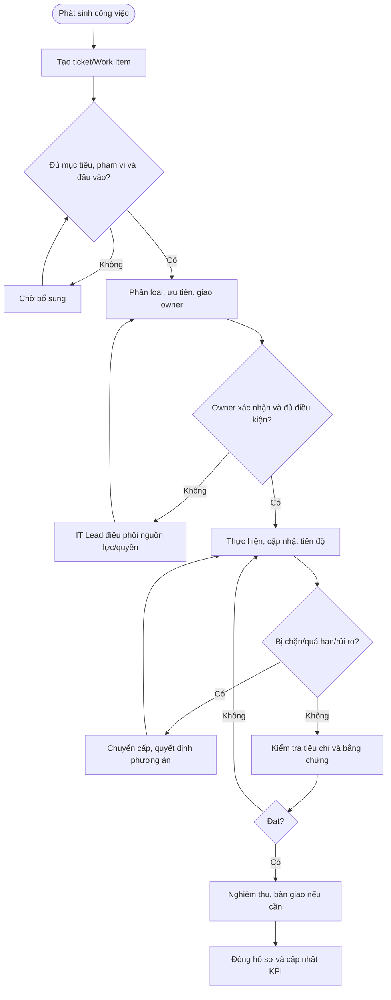

# QT-IT-09 — QUY TRÌNH QUẢN LÝ CÔNG VIỆC PHÒNG IT

> **Trạng thái:** Dự thảo nâng cấp v0.2; cần chạy thử và phê duyệt trước khi áp dụng.  
> **Chủ sở hữu:** IT Lead / Service Delivery Manager.  
> **Liên quan:** QT-IT-07, QT-IT-08, QT-IT-10, QT-IT-11, QT-IT-13, QT-IT-16, MA-01, MA-02.

## 1. Kiểm soát tài liệu

| Trường | Nội dung |
|---|---|
| Mã | QT-IT-09 |
| Phiên bản | 0.2 — dự thảo nâng cấp |
| Chủ sở hữu | IT Lead / Service Delivery Manager |
| Người rà soát | IT Lead và owner dịch vụ liên quan |
| Người phê duyệt | Người có thẩm quyền theo quy định quản trị tài liệu |
| Ngày hiệu lực | Điền sau khi được phê duyệt |
| Rà soát | Tối thiểu hằng năm hoặc khi thay đổi công cụ, cơ cấu, SLA hay phạm vi dịch vụ |

## 2. Mục đích và phạm vi

Quy định cách tiếp nhận, ghi nhận, phân loại, giao việc, theo dõi, bàn giao, kiểm tra và báo cáo toàn bộ công việc IT để tránh bỏ sót, trùng lặp, không rõ người chịu trách nhiệm hoặc thiếu bằng chứng hoàn thành.

Áp dụng cho công việc có ticket và công việc định kỳ/ngoài ticket như kiểm tra hệ thống, bảo trì, kiểm kê, lập tài liệu, dự án, họp kỹ thuật, hỗ trợ nội bộ và cải tiến. Công việc ảnh hưởng khách hàng phải liên kết ticket/đầu việc tương ứng. Công việc ngoài ticket vẫn phải có mã Work Item hoặc bản ghi trong công cụ chính thức; tin nhắn riêng không được là hồ sơ duy nhất.

## 3. Thuật ngữ và nguyên tắc

- **Ticket:** Hồ sơ cho yêu cầu/sự cố cụ thể, có người yêu cầu, thời gian, trạng thái và lịch sử.
- **Work Item:** Công việc không nhất thiết phát sinh từ ticket, có mục tiêu, người phụ trách, hạn, mức ưu tiên và bằng chứng.
- **Owner:** Người chịu trách nhiệm cuối cùng để công việc đạt kết quả; việc giao thao tác cho người khác không xóa trách nhiệm theo dõi.
- **Backlog:** Danh sách công việc chưa hoàn thành.
- **Blocked:** Công việc không thể tiếp tục do thiếu quyền, thông tin, phê duyệt, phụ thuộc hoặc nguồn lực.
- **Done:** Chỉ dùng khi tiêu chí hoàn thành đạt và bằng chứng đã cập nhật.

Nguyên tắc bắt buộc:
1. Mỗi công việc phải có mã hồ sơ, owner, trạng thái, ưu tiên, hạn hoặc lý do chưa xác định hạn.
2. Không giao việc chỉ bằng lời nói nếu có ảnh hưởng khách hàng, rủi ro, cam kết thời gian hoặc yêu cầu truy nguyên.
3. Công việc khách hàng phải theo hợp đồng, SLA và phạm vi ủy quyền. Không để công việc nội bộ làm ảnh hưởng ticket P1/P2 nếu chưa có quyết định điều phối.
4. Người nhận phải xác nhận đã hiểu đầu ra, thời hạn và điều kiện phụ thuộc.
5. Không đánh dấu hoàn tất chỉ vì đã thao tác; phải kiểm tra kết quả và cập nhật bằng chứng.
6. Thay đổi cấu hình, quyền hoặc hệ thống phải liên kết quy trình chuyên biệt; Work Item không thay thế phê duyệt change/access.
7. Khi quá hạn, bị chặn hoặc có nguy cơ vi phạm SLA, phải báo sớm.
8. Không sửa lịch sử/thời gian để làm đẹp KPI; sửa dữ liệu phải có lý do và người thực hiện truy nguyên được.

## 4. Vai trò

| Vai trò | Trách nhiệm |
|---|---|
| Người yêu cầu | Nêu mục tiêu, đầu ra, mức độ cần thiết và thông tin đầu vào. |
| Người điều phối/Service Desk | Ghi nhận, kiểm tra trường bắt buộc, phân loại, giao owner và theo dõi backlog. |
| Owner công việc | Chịu trách nhiệm về kế hoạch, tiến độ, phụ thuộc, cập nhật và kết quả cuối. |
| Người thực hiện | Làm theo phạm vi được giao, cập nhật tiến độ và lưu bằng chứng. |
| Người kiểm tra/nghiệm thu | Xác nhận kết quả theo tiêu chí; độc lập khi rủi ro yêu cầu. |
| IT Lead | Quyết định ưu tiên khi xung đột, phân bổ nguồn lực, xử lý quá hạn/escalation và rà soát báo cáo. |
| Service Owner/đầu mối khách hàng | Xác nhận phạm vi, ưu tiên và nghiệm thu theo thẩm quyền. |

## 5. Quy trình thực hiện

### Bước 1 — Ghi nhận công việc
Người điều phối tạo ticket hoặc Work Item trong công cụ chính thức. Ghi tối thiểu: mã; khách hàng/phòng ban; người yêu cầu; ngày nhận; mục tiêu; kết quả mong đợi; hệ thống/tài sản; mức ảnh hưởng; ưu tiên; hạn; owner; người nghiệm thu; phụ thuộc; liên kết tài liệu và bằng chứng ban đầu.

Nếu mô tả chưa rõ, chuyển trạng thái Chờ bổ sung, ghi câu hỏi cụ thể, người cần trả lời và thời điểm nhắc lại. Không giao việc với mô tả chung như “kiểm tra hệ thống” nếu chưa nêu hệ thống, mục tiêu và đầu ra cần báo cáo.

### Bước 2 — Phân loại và ưu tiên
Chọn loại phù hợp: hỗ trợ khách hàng, sự cố, yêu cầu dịch vụ, thay đổi, dự án, bảo trì định kỳ, kiểm soát ATTT, quản trị tài sản, tài liệu/cải tiến hoặc việc nội bộ. Nếu có nhiều đầu ra độc lập, tách thành các Work Item con và liên kết hồ sơ cha.

Đánh giá ưu tiên dựa trên tác động, tính khẩn cấp, SLA và kế hoạch đã duyệt. Không dùng thang ưu tiên nội bộ để ghi đè SLA hợp đồng. Nghi ngờ sự cố ATTT phải chuyển QT-ATTT-04.

### Bước 3 — Giao việc
Chọn owner theo năng lực, quyền, lịch trực và tải công việc. Ghi đầu ra, hạn, người hỗ trợ, tiêu chí nghiệm thu, phụ thuộc và quyền cần có. Owner phải xác nhận nhận việc hoặc phản hồi nếu thiếu năng lực, thời gian hay quyền.

Nếu không có người phù hợp, báo IT Lead để đổi ưu tiên, phân bổ nguồn lực, chuyển nhà cung cấp hoặc thương lượng lại hạn. Không giao việc mặc định mà không đánh giá tải và rủi ro.

### Bước 4 — Lập kế hoạch
Với công việc kéo dài, rủi ro cao hoặc nhiều phụ thuộc, owner chia thành các bước/mốc nhỏ. Mỗi mốc có đầu ra, người làm, hạn và tiêu chí hoàn thành. Với việc đơn giản, dùng checklist ngắn ngay trong hồ sơ.

### Bước 5 — Cập nhật tiến độ
Owner cập nhật khi thay đổi trạng thái, phát hiện rủi ro, phụ thuộc bị chậm, có kết quả trung gian hoặc đến mốc báo cáo. Mỗi cập nhật nêu: việc đã làm và bằng chứng; việc tiếp theo; trở ngại/phụ thuộc; tác động tới khách hàng/SLA; quyết định cần quản lý hoặc khách hàng đưa ra.

Không dùng câu “đang xử lý” lặp lại mà không có nội dung. Nếu chưa có tiến triển, nêu rõ điều đang chặn và phương án tháo gỡ.

### Bước 6 — Quản lý trạng thái
Các trạng thái tối thiểu: Mới; Đã phân công; Đang thực hiện; Chờ thông tin; Chờ phê duyệt; Bị chặn; Chờ nhà cung cấp; Chờ nghiệm thu; Hoàn tất; Hủy. Mỗi trạng thái phải có điều kiện vào/ra.

Chỉ chuyển sang Bị chặn khi ghi nguyên nhân, người có thể tháo gỡ, thời điểm bắt đầu và ngày cần xem lại. Bị chặn không tự động dừng SLA; chỉ dừng khi hợp đồng cho phép và hồ sơ chứng minh điều kiện tạm dừng.

## 6. Quá hạn, xung đột ưu tiên và chuyển cấp

Owner báo IT Lead khi có nguy cơ trễ hạn/vi phạm SLA, tác động lớn hơn dự kiến, thiếu quyền/phê duyệt, cần thay đổi phạm vi, phụ thuộc nhà cung cấp bị chậm hoặc có rủi ro ATTT/mất dữ liệu.

Thông tin chuyển cấp phải gồm mã hồ sơ, ưu tiên, tác động, thời gian còn lại, nguyên nhân, việc đã thử, phương án đề xuất và quyết định cần thiết. IT Lead quyết định đổi owner, đổi thứ tự, huy động hỗ trợ, chuyển cấp hoặc làm việc với khách hàng. Thay đổi hạn phải ghi người quyết định và lý do; không tự sửa hạn để tránh ghi nhận quá hạn.

Khi xung đột giữa việc nội bộ và ticket khách hàng, IT Lead cân nhắc SLA, tác động, nghĩa vụ hợp đồng, rủi ro ATTT, nguồn lực và hạn kinh doanh. Quyết định phải được ghi trong hồ sơ hoặc nhật ký điều phối.

## 7. Bàn giao công việc

Khi đổi ca, nghỉ phép, chuyển người hoặc chuyển nhóm, owner hiện tại bàn giao: mã hồ sơ; mục tiêu; trạng thái; kết quả và bằng chứng; việc chưa làm; bước tiếp theo; hạn/rủi ro; quyền/ủy quyền cần thiết; đầu mối khách hàng/vendor; phê duyệt/change/incident liên quan. Không bàn giao mật khẩu trong ghi chú.

Người nhận phải xác nhận. Owner cũ tiếp tục chịu trách nhiệm cho đến khi hồ sơ ghi nhận người nhận mới và thời điểm bàn giao. Nếu chưa có người nhận, báo IT Lead; không để công việc vô chủ.

## 8. Kiểm tra hoàn thành và đóng hồ sơ

Chỉ đề nghị hoàn tất khi:
- Đầu ra theo yêu cầu đã tạo.
- Tiêu chí nghiệm thu được kiểm tra.
- Bằng chứng/tài liệu liên quan được lưu.
- Việc tồn/rủi ro còn lại được tách thành Work Item mới hoặc được người có thẩm quyền chấp nhận.
- Người yêu cầu/đầu mối xác nhận khi quy định yêu cầu.
- Tài sản, CMDB, runbook, ticket hoặc change liên quan đã cập nhật.

Người kiểm tra phải trả lại hồ sơ nếu thiếu tiêu chí/bằng chứng và nêu phần cần bổ sung. Hủy công việc phải ghi lý do, người quyết định và tác động; không xóa hồ sơ.

## 9. Điều phối và báo cáo

IT Lead/điều phối rà soát backlog theo lịch quản trị đã duyệt. Báo cáo tối thiểu gồm: việc mới/đang làm/bị chặn/chờ khách hàng/vendor/quá hạn; ticket P1/P2 và nguy cơ vi phạm SLA; việc không có owner/hạn; việc sắp đến hạn; Work Item định kỳ thiếu bằng chứng; việc chờ nghiệm thu; tải theo nhân sự/nhóm; rủi ro và quyết định cần quản lý.

Mỗi hành động sau họp có owner, hạn và hồ sơ theo dõi. Báo cáo phải chỉ ra nguyên nhân và hành động, không chỉ tổng số lượng.

## 10. KPI

| KPI | Định nghĩa |
|---|---|
| Tỷ lệ đúng hạn | Work Item hoàn thành đúng hạn / tổng Work Item đến hạn trong kỳ theo quy tắc đã duyệt |
| Backlog quá hạn | Số và tỷ lệ công việc quá hạn chưa hoàn tất |
| Công việc không có owner | Hồ sơ đang mở nhưng chưa có owner |
| Tỷ lệ hồ sơ đủ | Hồ sơ hoàn tất có đủ bằng chứng/tiêu chí / hồ sơ hoàn tất được lấy mẫu |
| Tỷ lệ mở lại | Hồ sơ bị mở lại / hồ sơ đã hoàn tất |
| Work Item định kỳ có bằng chứng | Công việc định kỳ có bằng chứng hợp lệ / công việc định kỳ đến hạn |
| Tuổi backlog | Thời gian từ lúc tạo đến hiện tại của việc chưa hoàn tất, phân theo ưu tiên |

Công thức, nguồn dữ liệu, chu kỳ và ngưỡng cảnh báo phải được phê duyệt trước khi dùng đánh giá nhân sự. Không dùng KPI đơn lẻ để khuyến khích đóng nhanh nhưng thiếu chất lượng.

## 11. Bằng chứng và lưu hồ sơ

Lưu yêu cầu gốc, lịch sử giao việc, cập nhật, phê duyệt, kết quả, kiểm tra, bàn giao và đóng trên hệ thống ticket/Work Item được chỉ định. Liên kết tài liệu tại kho chính thức, áp dụng phân quyền theo nhu cầu công việc. Thời hạn lưu theo danh mục hồ sơ và hợp đồng; không lưu mật khẩu/token hoặc dữ liệu khách hàng không cần thiết trong ghi chú.

## 12. Lưu đồ

## 13. Điều kiện ban hành

- [ ] Chốt công cụ chính thức cho ticket và Work Item ngoài ticket.
- [ ] Chốt trạng thái, ưu tiên, owner, quy tắc hạn và quy tắc SLA.
- [ ] Chốt danh mục Work Item định kỳ và người chịu trách nhiệm.
- [ ] Kiểm tra biểu mẫu, dashboard và báo cáo backlog.
- [ ] Chạy thử việc khách hàng, công việc định kỳ, trường hợp bị chặn và bàn giao.
- [ ] Đào tạo nhân sự, lưu bằng chứng và xử lý lỗi chạy thử.
- [ ] Rà soát, phê duyệt và công bố phiên bản hiệu lực.

**Lưu ý:** Mọi SLA, KPI và thời hạn phải lấy từ cấu hình/hợp đồng được duyệt, không tự đặt cam kết chung.
