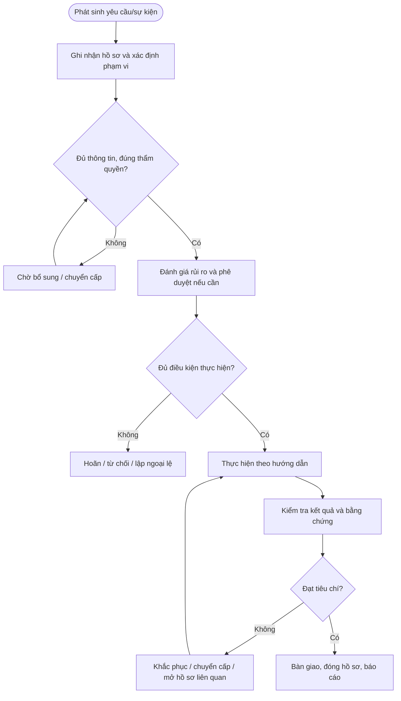

# QT-IT-10 — QUẢN LÝ TÀI SẢN CNTT

> **Trạng thái:** Dự thảo nâng cấp v0.2; cần rà soát, chạy thử và phê duyệt trước khi áp dụng chính thức.  
> **Chủ sở hữu:** IT Lead / Service Owner theo phân công.  
> **Tài liệu liên quan:** QT-IT-08, QT-IT-11, QT-IT-13, QT-ATTT-04, QT-IT-16, MA-01, MA-02 và phụ lục dịch vụ từng khách hàng khi áp dụng.

## 1. Kiểm soát tài liệu
| Trường | Nội dung |
|---|---|
| Mã | QT-IT-10 |
| Phiên bản | 0.2 — dự thảo nâng cấp |
| Chủ sở hữu | IT Lead / Service Owner được phân công |
| Người rà soát | IT Lead và các bên liên quan theo phạm vi |
| Người phê duyệt | Người có thẩm quyền theo quy định quản trị tài liệu |
| Ngày hiệu lực | Điền sau khi phê duyệt |
| Rà soát | Tối thiểu hằng năm hoặc khi thay đổi dịch vụ, công cụ, rủi ro, hợp đồng |

## 2. Mục đích và phạm vi
Quản lý vòng đời tài sản CNTT từ đề xuất/mua sắm, tiếp nhận, gắn mã, bàn giao, thay đổi vị trí/người dùng, kiểm kê, bảo trì, mất/hỏng đến thu hồi và thanh lý.

Áp dụng với tài sản/danh tính/dịch vụ thuộc Mstar hoặc thuộc khách hàng mà Mstar được ủy quyền theo hợp đồng. Không được tự mở rộng phạm vi chỉ vì có quyền kỹ thuật. Những trường phụ thuộc khách hàng phải được ghi trong phụ lục dịch vụ được phê duyệt.

## 3. Nguyên tắc bắt buộc
1. Mọi yêu cầu quan trọng phải có hồ sơ chính thức, người chịu trách nhiệm và lịch sử xử lý.
2. Phải xác minh phạm vi, danh tính, quyền và phê duyệt trước khi thực hiện hành động có rủi ro.
3. Người thực hiện không tự phê duyệt ngoại lệ hoặc chấp nhận rủi ro trọng yếu do chính mình tạo ra.
4. Khi phát hiện dấu hiệu sự cố ATTT, mất dữ liệu hoặc truy cập trái phép, kích hoạt QT-ATTT-04 và bảo toàn bằng chứng.
5. Không ghi mật khẩu, token, khóa riêng hoặc mã khôi phục dạng rõ vào ticket, biểu mẫu hay repository.
6. Thời hạn SLA, lưu hồ sơ, thông báo và rà soát phải lấy từ hợp đồng/chính sách được phê duyệt; không tự đặt số liệu chung.
7. Khi không đủ điều kiện, dừng ở trạng thái an toàn, ghi lý do và chuyển cấp; không bỏ qua bước kiểm soát để hoàn thành KPI.

## 4. Vai trò
| Vai trò | Trách nhiệm |
|---|---|
| Người yêu cầu/đầu mối | Cung cấp thông tin chính xác và xác nhận nhu cầu trong phạm vi được ủy quyền. |
| Người tiếp nhận/điều phối | Tạo hồ sơ, kiểm tra trường bắt buộc, theo dõi trạng thái và chuyển cấp. |
| Người thực hiện | Thực hiện đúng phạm vi, lưu nhật ký và báo rủi ro. |
| Owner hệ thống/dịch vụ | Xác nhận yêu cầu, tác động, tiêu chí đạt và rủi ro tồn dư. |
| IT Lead/Service Owner | Điều phối nguồn lực, xử lý xung đột và giám sát chất lượng. |
| Người phê duyệt | Phê duyệt đúng thẩm quyền, phạm vi và thời điểm. |
| Đầu mối ATTT/khách hàng/vendor | Tham gia khi nội dung liên quan đến bảo mật, hợp đồng hoặc phụ thuộc bên ngoài. |

## 5. Đầu vào và điều kiện bắt đầu
Hồ sơ phải xác định: người yêu cầu; đối tượng/hệ thống/tài sản/danh tính/dịch vụ; mục tiêu; phạm vi; mức độ ảnh hưởng; người chịu trách nhiệm; người phê duyệt; thời hạn; phụ thuộc; và nơi lưu bằng chứng. Nếu thiếu thông tin trọng yếu, chuyển Chờ bổ sung và nêu rõ nội dung cần có. Không bắt đầu hành động rủi ro cao khi chưa xác minh thẩm quyền.

## 6. Trình tự thực hiện chi tiết

### Bước 1 — Tiếp nhận tài sản mới
**Người thực hiện:** Owner quy trình/điều phối.

Đối chiếu yêu cầu mua/cấp phát, hợp đồng, đơn hàng, biên bản giao nhận và người nhận. Kiểm tra số lượng, model, serial, phụ kiện, tình trạng vật lý, bảo hành và quyền sở hữu (Mstar/khách hàng/nhà cung cấp). Không ghi nhận tài sản chưa xác định được chủ sở hữu hoặc nguồn gốc; lập biên bản sai lệch và báo người mua/owner.

**Điều kiện đạt:** Hồ sơ được cập nhật, người chịu trách nhiệm và kết quả có thể truy nguyên. **Nếu không đạt:** Không chuyển bước khi thiếu điều kiện trọng yếu; ghi lý do, người xử lý và hạn khắc phục.

### Bước 2 — Đăng ký và gắn mã
**Người thực hiện:** Người được phân công; người kiểm tra/phê duyệt theo ma trận thẩm quyền.

Tạo mã tài sản duy nhất; ghi loại, hãng/model, serial, ngày nhận, giá trị nếu được phép lưu, chủ sở hữu, đơn vị sử dụng, người giữ, địa điểm, trạng thái, bảo hành, nhà cung cấp và liên kết ticket/đơn hàng. Gắn nhãn khi phù hợp. Không dùng serial làm mã duy nhất nếu serial có thể trùng/không có.

**Điều kiện đạt:** Hồ sơ được cập nhật, người chịu trách nhiệm và kết quả có thể truy nguyên. **Nếu không đạt:** Không chuyển bước khi thiếu điều kiện trọng yếu; ghi lý do, người xử lý và hạn khắc phục.

### Bước 3 — Cấu hình và bàn giao
**Người thực hiện:** Người được phân công; người kiểm tra/phê duyệt theo ma trận thẩm quyền.

Trước khi giao, xác nhận cấu hình chuẩn, bản vá, mã hóa, endpoint protection, tài khoản định danh, MFA, chính sách quản lý và phần mềm được phép. Biên bản bàn giao ghi mã tài sản, tình trạng, phụ kiện, người giao/nhận, ngày giờ, trách nhiệm bảo quản và quy trình báo mất/hỏng. Không ghi mật khẩu vào biên bản.

**Điều kiện đạt:** Hồ sơ được cập nhật, người chịu trách nhiệm và kết quả có thể truy nguyên. **Nếu không đạt:** Không chuyển bước khi thiếu điều kiện trọng yếu; ghi lý do, người xử lý và hạn khắc phục.

### Bước 4 — Cập nhật vòng đời
**Người thực hiện:** Người được phân công; người kiểm tra/phê duyệt theo ma trận thẩm quyền.

Mọi đổi người dùng, địa điểm, cấu hình trọng yếu, trạng thái, sửa chữa hoặc chuyển quyền sở hữu phải cập nhật hồ sơ và liên kết ticket/change. Chỉ người có thẩm quyền mới được thay đổi trường chủ sở hữu hoặc thanh lý.

**Điều kiện đạt:** Hồ sơ được cập nhật, người chịu trách nhiệm và kết quả có thể truy nguyên. **Nếu không đạt:** Không chuyển bước khi thiếu điều kiện trọng yếu; ghi lý do, người xử lý và hạn khắc phục.

### Bước 5 — Kiểm kê
**Người thực hiện:** Người được phân công; người kiểm tra/phê duyệt theo ma trận thẩm quyền.

Lập kế hoạch theo chu kỳ đã duyệt và kiểm kê đột xuất khi có mất mát, thay đổi nhân sự hoặc nghi ngờ sai lệch. Đối chiếu hồ sơ với hiện vật/serial/người giữ/địa điểm; ghi rõ tài sản không tìm thấy, thừa, hỏng hoặc thông tin không khớp. Không tự sửa dữ liệu trước khi lưu kết quả đối chiếu.

**Điều kiện đạt:** Hồ sơ được cập nhật, người chịu trách nhiệm và kết quả có thể truy nguyên. **Nếu không đạt:** Không chuyển bước khi thiếu điều kiện trọng yếu; ghi lý do, người xử lý và hạn khắc phục.

### Bước 6 — Mất, hỏng, sửa chữa
**Người thực hiện:** Người được phân công; người kiểm tra/phê duyệt theo ma trận thẩm quyền.

Tiếp nhận báo cáo, ghi thời gian, tài sản, người giữ, hoàn cảnh và dữ liệu có thể bị ảnh hưởng. Nếu có nguy cơ lộ dữ liệu/thiết bị bị đánh cắp, kích hoạt QT-ATTT-04 và khóa/thu hồi phiên truy cập theo thẩm quyền. Sửa chữa phải có phiếu, vendor, tình trạng trước/sau và phê duyệt; theo dõi đến khi tài sản được trả lại hoặc thay thế.

**Điều kiện đạt:** Hồ sơ được cập nhật, người chịu trách nhiệm và kết quả có thể truy nguyên. **Nếu không đạt:** Không chuyển bước khi thiếu điều kiện trọng yếu; ghi lý do, người xử lý và hạn khắc phục.

### Bước 7 — Thu hồi và thanh lý
**Người thực hiện:** Người được phân công; người kiểm tra/phê duyệt theo ma trận thẩm quyền.

Khi nhân sự nghỉ việc/chuyển vị trí/kết thúc hợp đồng, đối chiếu danh sách tài sản và xác nhận nhận lại. Thu hồi quyền truy cập theo QT-IT-11; sao lưu/chuyển giao dữ liệu theo phê duyệt; xóa dữ liệu an toàn theo loại thiết bị và quy định khách hàng trước khi tái sử dụng/thanh lý. Biên bản thanh lý ghi phương pháp xử lý, người duyệt, vendor và bằng chứng; không thanh lý thiết bị khách hàng khi chưa có chấp thuận.

**Điều kiện đạt:** Hồ sơ được cập nhật, người chịu trách nhiệm và kết quả có thể truy nguyên. **Nếu không đạt:** Không chuyển bước khi thiếu điều kiện trọng yếu; ghi lý do, người xử lý và hạn khắc phục.

## 7. Xử lý ngoại lệ và sự cố
Kiểm kê phải đối chiếu thực tế với danh mục; mọi chênh lệch có hồ sơ điều tra và người duyệt sửa dữ liệu. Thiết bị lưu dữ liệu phải được xóa an toàn trước tái sử dụng/thanh lý.
Các trường hợp cần dừng/chuyển cấp gồm: không rõ quyền sở hữu hoặc phạm vi; thiếu phê duyệt bắt buộc; dữ liệu không khớp; phát hiện hành vi bất thường; có nguy cơ gián đoạn/mất dữ liệu; phụ thuộc vendor vượt hạn; hoặc không đạt tiêu chí nghiệm thu. Người xử lý ghi tình huống, thời điểm, tác động, việc đã làm, người nhận chuyển cấp và quyết định cần đưa ra. Ngoại lệ phải có lý do, rủi ro, biện pháp bù trừ, owner, hạn hết hiệu lực và người phê duyệt.

## 8. Bằng chứng vận hành tối thiểu
| Hồ sơ | Nội dung |
|---|---|
| Yêu cầu gốc | Người yêu cầu, thời gian, đối tượng, mục tiêu và phạm vi |
| Phê duyệt | Người duyệt, thẩm quyền, thời điểm, điều kiện |
| Nhật ký thực hiện | Người làm, thao tác, kết quả, thời gian và sai lệch |
| Kiểm tra/đối soát | Tiêu chí, kết quả thực tế, chênh lệch và cách xử lý |
| Bàn giao/nghiệm thu | Người giao/nhận, tình trạng, việc tồn, xác nhận |
| Đóng hồ sơ | Điều kiện đạt, liên kết hồ sơ, owner/hạn của việc tồn |

Lưu tại hệ thống chính thức, áp dụng quyền truy cập theo nhu cầu công việc và thời hạn lưu trong danh mục hồ sơ/hợp đồng. Không lưu secret dạng rõ. Mọi chênh lệch hoặc ngoại lệ phải truy nguyên được.

## 9. KPI và giám sát
| KPI | Định nghĩa cần chốt |
|---|---|
| Tỷ lệ hồ sơ đủ | Hồ sơ đạt checklist bắt buộc / tổng hồ sơ được kiểm tra |
| Tỷ lệ đúng hạn | Hồ sơ hoàn tất đúng hạn / tổng hồ sơ đến hạn |
| Hồ sơ thiếu phê duyệt | Số hồ sơ có hành động cần duyệt nhưng thiếu phê duyệt |
| Tỷ lệ sai lệch tồn đọng | Sai lệch chưa khắc phục / tổng sai lệch được ghi nhận |
| Tỷ lệ hành động khắc phục đúng hạn | Hành động hoàn thành đúng hạn / hành động đến hạn |

Owner phải xác định nguồn dữ liệu, chu kỳ, phạm vi mẫu và ngưỡng cảnh báo trước khi dùng KPI. Không tự loại hồ sơ lỗi khỏi mẫu đo nếu chưa có quy tắc loại trừ được phê duyệt.

## 10. Lưu đồ

## 11. Biểu mẫu liên quan
Dùng bộ biểu mẫu tương ứng trong thư mục bieu-mau. Trước khi ban hành, phải đối chiếu từng bước với biểu mẫu thực tế, xác nhận mã biểu mẫu, trường bắt buộc, người lập/kiểm tra/duyệt, nơi lưu và thời hạn lưu. Nếu thiếu mẫu nghiệp vụ cần thiết, bổ sung trước khi trình ký.

## 12. Điều kiện ban hành
- [ ] Xác nhận owner, người rà soát và người phê duyệt.
- [ ] Điền các giá trị phụ thuộc hợp đồng/chính sách; không để SLA/retention/quyền quan trọng ở trạng thái giả định.
- [ ] Kiểm tra biểu mẫu, đường dẫn, trạng thái và bằng chứng cần lưu.
- [ ] Chạy thử tình huống bình thường, thiếu thông tin/không đạt và tình huống chuyển cấp.
- [ ] Ghi nhận sai lệch, khắc phục và kiểm tra lại.
- [ ] Đào tạo người thực hiện và lưu bằng chứng đào tạo.
- [ ] Phê duyệt và công bố phiên bản hiệu lực.

**Lưu ý:** Đây là dự thảo vận hành, không tự chứng minh chứng nhận ISO. Phải rà soát theo phạm vi ISMS, đánh giá rủi ro, SoA, hợp đồng và quy định pháp luật áp dụng.
