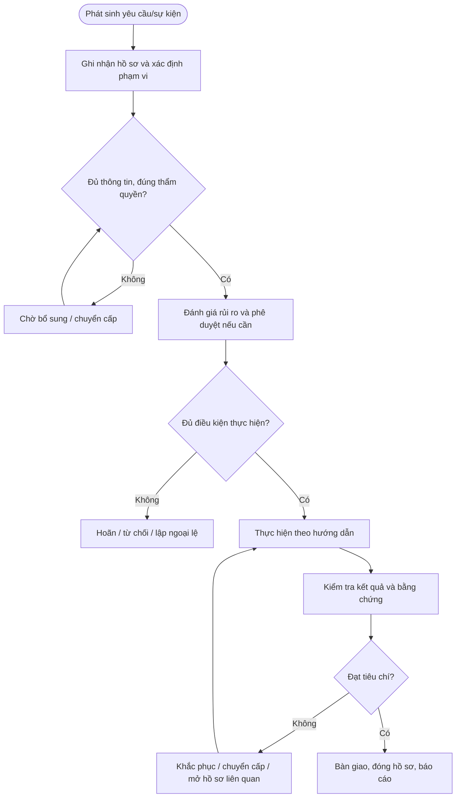

# QT-IT-11 — QUẢN LÝ TÀI KHOẢN VÀ QUYỀN TRUY CẬP

> **Trạng thái:** Dự thảo nâng cấp v0.2; cần rà soát, chạy thử và phê duyệt trước khi áp dụng chính thức.  
> **Chủ sở hữu:** IT Lead / Service Owner theo phân công.  
> **Tài liệu liên quan:** QT-IT-08, QT-IT-11, QT-IT-13, QT-ATTT-04, QT-IT-16, MA-01, MA-02 và phụ lục dịch vụ từng khách hàng khi áp dụng.

## 1. Kiểm soát tài liệu
| Trường | Nội dung |
|---|---|
| Mã | QT-IT-11 |
| Phiên bản | 0.2 — dự thảo nâng cấp |
| Chủ sở hữu | IT Lead / Service Owner được phân công |
| Người rà soát | IT Lead và các bên liên quan theo phạm vi |
| Người phê duyệt | Người có thẩm quyền theo quy định quản trị tài liệu |
| Ngày hiệu lực | Điền sau khi phê duyệt |
| Rà soát | Tối thiểu hằng năm hoặc khi thay đổi dịch vụ, công cụ, rủi ro, hợp đồng |

## 2. Mục đích và phạm vi
Bảo đảm danh tính được xác minh, quyền đúng nhu cầu và thời hạn, phê duyệt trước cấp, rà soát định kỳ và thu hồi kịp thời.

Áp dụng với tài sản/danh tính/dịch vụ thuộc Mstar hoặc thuộc khách hàng mà Mstar được ủy quyền theo hợp đồng. Không được tự mở rộng phạm vi chỉ vì có quyền kỹ thuật. Những trường phụ thuộc khách hàng phải được ghi trong phụ lục dịch vụ được phê duyệt.

## 3. Nguyên tắc bắt buộc
1. Mọi yêu cầu quan trọng phải có hồ sơ chính thức, người chịu trách nhiệm và lịch sử xử lý.
2. Phải xác minh phạm vi, danh tính, quyền và phê duyệt trước khi thực hiện hành động có rủi ro.
3. Người thực hiện không tự phê duyệt ngoại lệ hoặc chấp nhận rủi ro trọng yếu do chính mình tạo ra.
4. Khi phát hiện dấu hiệu sự cố ATTT, mất dữ liệu hoặc truy cập trái phép, kích hoạt QT-ATTT-04 và bảo toàn bằng chứng.
5. Không ghi mật khẩu, token, khóa riêng hoặc mã khôi phục dạng rõ vào ticket, biểu mẫu hay repository.
6. Thời hạn SLA, lưu hồ sơ, thông báo và rà soát phải lấy từ hợp đồng/chính sách được phê duyệt; không tự đặt số liệu chung.
7. Khi không đủ điều kiện, dừng ở trạng thái an toàn, ghi lý do và chuyển cấp; không bỏ qua bước kiểm soát để hoàn thành KPI.

## 4. Vai trò
| Vai trò | Trách nhiệm |
|---|---|
| Người yêu cầu/đầu mối | Cung cấp thông tin chính xác và xác nhận nhu cầu trong phạm vi được ủy quyền. |
| Người tiếp nhận/điều phối | Tạo hồ sơ, kiểm tra trường bắt buộc, theo dõi trạng thái và chuyển cấp. |
| Người thực hiện | Thực hiện đúng phạm vi, lưu nhật ký và báo rủi ro. |
| Owner hệ thống/dịch vụ | Xác nhận yêu cầu, tác động, tiêu chí đạt và rủi ro tồn dư. |
| IT Lead/Service Owner | Điều phối nguồn lực, xử lý xung đột và giám sát chất lượng. |
| Người phê duyệt | Phê duyệt đúng thẩm quyền, phạm vi và thời điểm. |
| Đầu mối ATTT/khách hàng/vendor | Tham gia khi nội dung liên quan đến bảo mật, hợp đồng hoặc phụ thuộc bên ngoài. |

## 5. Đầu vào và điều kiện bắt đầu
Hồ sơ phải xác định: người yêu cầu; đối tượng/hệ thống/tài sản/danh tính/dịch vụ; mục tiêu; phạm vi; mức độ ảnh hưởng; người chịu trách nhiệm; người phê duyệt; thời hạn; phụ thuộc; và nơi lưu bằng chứng. Nếu thiếu thông tin trọng yếu, chuyển Chờ bổ sung và nêu rõ nội dung cần có. Không bắt đầu hành động rủi ro cao khi chưa xác minh thẩm quyền.

## 6. Trình tự thực hiện chi tiết

### Bước 1 — Tiếp nhận yêu cầu
**Người thực hiện:** Owner quy trình/điều phối.

Ghi danh tính người dùng, đơn vị/khách hàng, hệ thống, loại yêu cầu (tạo/đổi quyền/khóa/thu hồi), vai trò cần có, lý do công việc, thời hạn nếu là quyền tạm thời, người quản lý/chủ hệ thống phê duyệt và ngày cần hoàn thành. Xác minh yêu cầu qua kênh chính thức; yêu cầu nhạy cảm phải xác minh người đề nghị theo quy định khách hàng.

**Điều kiện đạt:** Hồ sơ được cập nhật, người chịu trách nhiệm và kết quả có thể truy nguyên. **Nếu không đạt:** Không chuyển bước khi thiếu điều kiện trọng yếu; ghi lý do, người xử lý và hạn khắc phục.

### Bước 2 — Kiểm tra và phê duyệt
**Người thực hiện:** Người được phân công; người kiểm tra/phê duyệt theo ma trận thẩm quyền.

Đối chiếu vai trò công việc, ma trận RBAC, nguyên tắc quyền tối thiểu và xung đột nhiệm vụ. Chủ hệ thống/manager phê duyệt trước khi cấp; quyền đặc quyền cần phê duyệt bổ sung theo ma trận. Người thực hiện không tự duyệt yêu cầu của chính mình. Nếu thiếu người duyệt hoặc phạm vi không rõ, giữ trạng thái chờ.

**Điều kiện đạt:** Hồ sơ được cập nhật, người chịu trách nhiệm và kết quả có thể truy nguyên. **Nếu không đạt:** Không chuyển bước khi thiếu điều kiện trọng yếu; ghi lý do, người xử lý và hạn khắc phục.

### Bước 3 — Cấp tài khoản/quyền
**Người thực hiện:** Người được phân công; người kiểm tra/phê duyệt theo ma trận thẩm quyền.

Dùng danh tính riêng, không dùng tài khoản chung khi có thể. Cấu hình MFA, chính sách mật khẩu/SSO, nhóm/role đã duyệt, thời hạn và logging. Chỉ cấp đúng hệ thống, phạm vi và thời hạn; quyền tạm thời phải có ngày hết hạn hoặc cơ chế tự thu hồi. Không gửi mật khẩu/token dạng rõ qua email/ticket.

**Điều kiện đạt:** Hồ sơ được cập nhật, người chịu trách nhiệm và kết quả có thể truy nguyên. **Nếu không đạt:** Không chuyển bước khi thiếu điều kiện trọng yếu; ghi lý do, người xử lý và hạn khắc phục.

### Bước 4 — Kiểm tra sau cấp
**Người thực hiện:** Người được phân công; người kiểm tra/phê duyệt theo ma trận thẩm quyền.

Xác minh người dùng đăng nhập được và chỉ có quyền đã duyệt; kiểm tra quyền quản trị/nhóm không bị cấp rộng hơn. Ghi kết quả, người kiểm tra, thời điểm và bằng chứng. Nếu cấp sai, thu hồi/sửa ngay, đánh giá tác động và ghi sự cố nếu có truy cập trái phép.

**Điều kiện đạt:** Hồ sơ được cập nhật, người chịu trách nhiệm và kết quả có thể truy nguyên. **Nếu không đạt:** Không chuyển bước khi thiếu điều kiện trọng yếu; ghi lý do, người xử lý và hạn khắc phục.

### Bước 5 — Thay đổi quyền
**Người thực hiện:** Người được phân công; người kiểm tra/phê duyệt theo ma trận thẩm quyền.

Yêu cầu thay đổi phải nêu quyền hiện tại, quyền cần thêm/bỏ và lý do. Phê duyệt lại như yêu cầu mới; không giữ quyền cũ chỉ vì tiện. Khi đổi vị trí/nhóm/khách hàng, rà soát toàn bộ quyền liên quan và loại bỏ quyền không còn cần.

**Điều kiện đạt:** Hồ sơ được cập nhật, người chịu trách nhiệm và kết quả có thể truy nguyên. **Nếu không đạt:** Không chuyển bước khi thiếu điều kiện trọng yếu; ghi lý do, người xử lý và hạn khắc phục.

### Bước 6 — Rà soát định kỳ
**Người thực hiện:** Người được phân công; người kiểm tra/phê duyệt theo ma trận thẩm quyền.

Chủ hệ thống/manager xác nhận danh sách tài khoản đang hoạt động, quyền, owner, lần đăng nhập và nhu cầu còn hiệu lực theo chu kỳ được duyệt. Ưu tiên tài khoản đặc quyền, tài khoản dịch vụ, tài khoản vendor và người nghỉ/chuyển việc. Mỗi quyền bất thường phải có quyết định giữ/giảm/thu hồi, người duyệt và hạn xử lý.

**Điều kiện đạt:** Hồ sơ được cập nhật, người chịu trách nhiệm và kết quả có thể truy nguyên. **Nếu không đạt:** Không chuyển bước khi thiếu điều kiện trọng yếu; ghi lý do, người xử lý và hạn khắc phục.

### Bước 7 — Khóa/thu hồi
**Người thực hiện:** Người được phân công; người kiểm tra/phê duyệt theo ma trận thẩm quyền.

Kích hoạt khi nghỉ việc, hết hợp đồng, thay đổi vai trò, mất thiết bị, nghi lộ thông tin xác thực hoặc hết hạn quyền tạm thời. Thu hồi tài khoản/nhóm, phiên, token, khóa API, VPN, quyền bên thứ ba và phương thức khôi phục khi áp dụng. Phối hợp HR/manager/khách hàng; không chờ hết ngày nếu rủi ro yêu cầu thu hồi ngay.

**Điều kiện đạt:** Hồ sơ được cập nhật, người chịu trách nhiệm và kết quả có thể truy nguyên. **Nếu không đạt:** Không chuyển bước khi thiếu điều kiện trọng yếu; ghi lý do, người xử lý và hạn khắc phục.

### Bước 8 — Tài khoản khẩn cấp và dịch vụ
**Người thực hiện:** Người được phân công; người kiểm tra/phê duyệt theo ma trận thẩm quyền.

Tài khoản break-glass phải có owner, lý do, kho lưu secret được duyệt, MFA/kiểm soát bù trừ, cảnh báo sử dụng và kiểm tra sau mỗi lần dùng. Tài khoản dịch vụ phải có owner, mục đích, quyền tối thiểu, quản lý secret, chu kỳ xoay vòng và phương án khi owner rời đi; không dùng tài khoản người dùng để chạy dịch vụ nếu không được phê duyệt.

**Điều kiện đạt:** Hồ sơ được cập nhật, người chịu trách nhiệm và kết quả có thể truy nguyên. **Nếu không đạt:** Không chuyển bước khi thiếu điều kiện trọng yếu; ghi lý do, người xử lý và hạn khắc phục.

## 7. Xử lý ngoại lệ và sự cố
Quyền đặc quyền, tài khoản dịch vụ, vendor và break-glass phải được kiểm soát riêng; mọi lần sử dụng khẩn cấp cần hậu kiểm.
Các trường hợp cần dừng/chuyển cấp gồm: không rõ quyền sở hữu hoặc phạm vi; thiếu phê duyệt bắt buộc; dữ liệu không khớp; phát hiện hành vi bất thường; có nguy cơ gián đoạn/mất dữ liệu; phụ thuộc vendor vượt hạn; hoặc không đạt tiêu chí nghiệm thu. Người xử lý ghi tình huống, thời điểm, tác động, việc đã làm, người nhận chuyển cấp và quyết định cần đưa ra. Ngoại lệ phải có lý do, rủi ro, biện pháp bù trừ, owner, hạn hết hiệu lực và người phê duyệt.

## 8. Bằng chứng vận hành tối thiểu
| Hồ sơ | Nội dung |
|---|---|
| Yêu cầu gốc | Người yêu cầu, thời gian, đối tượng, mục tiêu và phạm vi |
| Phê duyệt | Người duyệt, thẩm quyền, thời điểm, điều kiện |
| Nhật ký thực hiện | Người làm, thao tác, kết quả, thời gian và sai lệch |
| Kiểm tra/đối soát | Tiêu chí, kết quả thực tế, chênh lệch và cách xử lý |
| Bàn giao/nghiệm thu | Người giao/nhận, tình trạng, việc tồn, xác nhận |
| Đóng hồ sơ | Điều kiện đạt, liên kết hồ sơ, owner/hạn của việc tồn |

Lưu tại hệ thống chính thức, áp dụng quyền truy cập theo nhu cầu công việc và thời hạn lưu trong danh mục hồ sơ/hợp đồng. Không lưu secret dạng rõ. Mọi chênh lệch hoặc ngoại lệ phải truy nguyên được.

## 9. KPI và giám sát
| KPI | Định nghĩa cần chốt |
|---|---|
| Tỷ lệ hồ sơ đủ | Hồ sơ đạt checklist bắt buộc / tổng hồ sơ được kiểm tra |
| Tỷ lệ đúng hạn | Hồ sơ hoàn tất đúng hạn / tổng hồ sơ đến hạn |
| Hồ sơ thiếu phê duyệt | Số hồ sơ có hành động cần duyệt nhưng thiếu phê duyệt |
| Tỷ lệ sai lệch tồn đọng | Sai lệch chưa khắc phục / tổng sai lệch được ghi nhận |
| Tỷ lệ hành động khắc phục đúng hạn | Hành động hoàn thành đúng hạn / hành động đến hạn |

Owner phải xác định nguồn dữ liệu, chu kỳ, phạm vi mẫu và ngưỡng cảnh báo trước khi dùng KPI. Không tự loại hồ sơ lỗi khỏi mẫu đo nếu chưa có quy tắc loại trừ được phê duyệt.

## 10. Lưu đồ

## 11. Biểu mẫu liên quan
Dùng bộ biểu mẫu tương ứng trong thư mục bieu-mau. Trước khi ban hành, phải đối chiếu từng bước với biểu mẫu thực tế, xác nhận mã biểu mẫu, trường bắt buộc, người lập/kiểm tra/duyệt, nơi lưu và thời hạn lưu. Nếu thiếu mẫu nghiệp vụ cần thiết, bổ sung trước khi trình ký.

## 12. Điều kiện ban hành
- [ ] Xác nhận owner, người rà soát và người phê duyệt.
- [ ] Điền các giá trị phụ thuộc hợp đồng/chính sách; không để SLA/retention/quyền quan trọng ở trạng thái giả định.
- [ ] Kiểm tra biểu mẫu, đường dẫn, trạng thái và bằng chứng cần lưu.
- [ ] Chạy thử tình huống bình thường, thiếu thông tin/không đạt và tình huống chuyển cấp.
- [ ] Ghi nhận sai lệch, khắc phục và kiểm tra lại.
- [ ] Đào tạo người thực hiện và lưu bằng chứng đào tạo.
- [ ] Phê duyệt và công bố phiên bản hiệu lực.

**Lưu ý:** Đây là dự thảo vận hành, không tự chứng minh chứng nhận ISO. Phải rà soát theo phạm vi ISMS, đánh giá rủi ro, SoA, hợp đồng và quy định pháp luật áp dụng.
