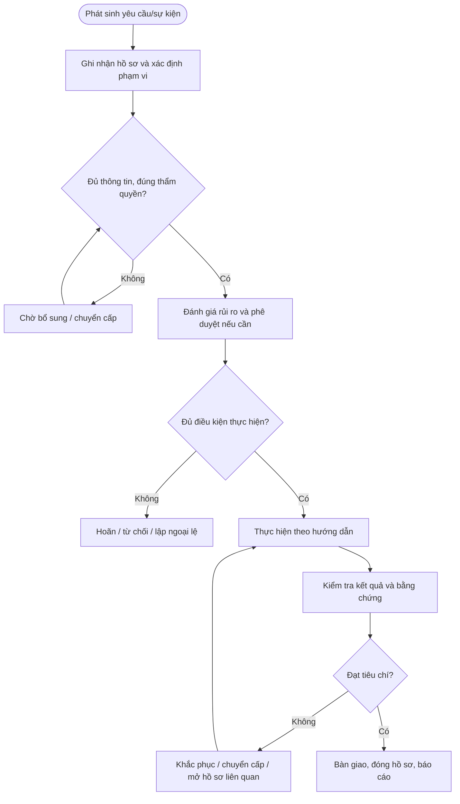

# QT-IT-12 — TIẾP NHẬN VÀ BÀN GIAO DỊCH VỤ KHÁCH HÀNG

> **Trạng thái:** Dự thảo nâng cấp v0.2; cần rà soát, chạy thử và phê duyệt trước khi áp dụng chính thức.  
> **Chủ sở hữu:** IT Lead / Service Owner theo phân công.  
> **Tài liệu liên quan:** QT-IT-08, QT-IT-11, QT-IT-13, QT-ATTT-04, QT-IT-16, MA-01, MA-02 và phụ lục dịch vụ từng khách hàng khi áp dụng.

## 1. Kiểm soát tài liệu
| Trường | Nội dung |
|---|---|
| Mã | QT-IT-12 |
| Phiên bản | 0.2 — dự thảo nâng cấp |
| Chủ sở hữu | IT Lead / Service Owner được phân công |
| Người rà soát | IT Lead và các bên liên quan theo phạm vi |
| Người phê duyệt | Người có thẩm quyền theo quy định quản trị tài liệu |
| Ngày hiệu lực | Điền sau khi phê duyệt |
| Rà soát | Tối thiểu hằng năm hoặc khi thay đổi dịch vụ, công cụ, rủi ro, hợp đồng |

## 2. Mục đích và phạm vi
Đảm bảo trước khi Mstar vận hành, phạm vi hợp đồng, hệ thống, SLA, đầu mối, quyền, hồ sơ, rủi ro và cơ chế khôi phục đều được xác nhận.

Áp dụng với tài sản/danh tính/dịch vụ thuộc Mstar hoặc thuộc khách hàng mà Mstar được ủy quyền theo hợp đồng. Không được tự mở rộng phạm vi chỉ vì có quyền kỹ thuật. Những trường phụ thuộc khách hàng phải được ghi trong phụ lục dịch vụ được phê duyệt.

## 3. Nguyên tắc bắt buộc
1. Mọi yêu cầu quan trọng phải có hồ sơ chính thức, người chịu trách nhiệm và lịch sử xử lý.
2. Phải xác minh phạm vi, danh tính, quyền và phê duyệt trước khi thực hiện hành động có rủi ro.
3. Người thực hiện không tự phê duyệt ngoại lệ hoặc chấp nhận rủi ro trọng yếu do chính mình tạo ra.
4. Khi phát hiện dấu hiệu sự cố ATTT, mất dữ liệu hoặc truy cập trái phép, kích hoạt QT-ATTT-04 và bảo toàn bằng chứng.
5. Không ghi mật khẩu, token, khóa riêng hoặc mã khôi phục dạng rõ vào ticket, biểu mẫu hay repository.
6. Thời hạn SLA, lưu hồ sơ, thông báo và rà soát phải lấy từ hợp đồng/chính sách được phê duyệt; không tự đặt số liệu chung.
7. Khi không đủ điều kiện, dừng ở trạng thái an toàn, ghi lý do và chuyển cấp; không bỏ qua bước kiểm soát để hoàn thành KPI.

## 4. Vai trò
| Vai trò | Trách nhiệm |
|---|---|
| Người yêu cầu/đầu mối | Cung cấp thông tin chính xác và xác nhận nhu cầu trong phạm vi được ủy quyền. |
| Người tiếp nhận/điều phối | Tạo hồ sơ, kiểm tra trường bắt buộc, theo dõi trạng thái và chuyển cấp. |
| Người thực hiện | Thực hiện đúng phạm vi, lưu nhật ký và báo rủi ro. |
| Owner hệ thống/dịch vụ | Xác nhận yêu cầu, tác động, tiêu chí đạt và rủi ro tồn dư. |
| IT Lead/Service Owner | Điều phối nguồn lực, xử lý xung đột và giám sát chất lượng. |
| Người phê duyệt | Phê duyệt đúng thẩm quyền, phạm vi và thời điểm. |
| Đầu mối ATTT/khách hàng/vendor | Tham gia khi nội dung liên quan đến bảo mật, hợp đồng hoặc phụ thuộc bên ngoài. |

## 5. Đầu vào và điều kiện bắt đầu
Hồ sơ phải xác định: người yêu cầu; đối tượng/hệ thống/tài sản/danh tính/dịch vụ; mục tiêu; phạm vi; mức độ ảnh hưởng; người chịu trách nhiệm; người phê duyệt; thời hạn; phụ thuộc; và nơi lưu bằng chứng. Nếu thiếu thông tin trọng yếu, chuyển Chờ bổ sung và nêu rõ nội dung cần có. Không bắt đầu hành động rủi ro cao khi chưa xác minh thẩm quyền.

## 6. Trình tự thực hiện chi tiết

### Bước 1 — Khởi tạo bàn giao
**Người thực hiện:** Owner quy trình/điều phối.

Sale/Contract Owner mở hồ sơ chuyển giao ngay sau khi hợp đồng/dịch vụ được xác nhận theo quy định nội bộ. Ghi khách hàng, dịch vụ, thời điểm dự kiến bắt đầu, người phụ trách thương mại, Service Owner, phạm vi hợp đồng, loại dịch vụ và các điều kiện tiên quyết.

**Điều kiện đạt:** Hồ sơ được cập nhật, người chịu trách nhiệm và kết quả có thể truy nguyên. **Nếu không đạt:** Không chuyển bước khi thiếu điều kiện trọng yếu; ghi lý do, người xử lý và hạn khắc phục.

### Bước 2 — Rà soát phạm vi
**Người thực hiện:** Người được phân công; người kiểm tra/phê duyệt theo ma trận thẩm quyền.

Đối chiếu hợp đồng, báo giá, SOW/phụ lục, loại trừ, SLA, giờ hỗ trợ, số lượng tài sản/người dùng, địa điểm, hệ thống và trách nhiệm Mstar/khách hàng/vendor. Mọi điểm mơ hồ phải đưa vào danh sách câu hỏi; không cam kết kỹ thuật hoặc thời hạn chưa có căn cứ.

**Điều kiện đạt:** Hồ sơ được cập nhật, người chịu trách nhiệm và kết quả có thể truy nguyên. **Nếu không đạt:** Không chuyển bước khi thiếu điều kiện trọng yếu; ghi lý do, người xử lý và hạn khắc phục.

### Bước 3 — Thu thập đầu mối và kênh
**Người thực hiện:** Người được phân công; người kiểm tra/phê duyệt theo ma trận thẩm quyền.

Lập danh sách người yêu cầu, người duyệt, đầu mối kỹ thuật, ATTT, quản lý dịch vụ, khẩn cấp và người thay thế. Xác nhận kênh ticket, email/điện thoại khẩn cấp, giờ hỗ trợ, ngày nghỉ, ngôn ngữ và quy tắc thông báo. Kiểm tra đầu mối bằng cách liên hệ thử theo phương thức được phép.

**Điều kiện đạt:** Hồ sơ được cập nhật, người chịu trách nhiệm và kết quả có thể truy nguyên. **Nếu không đạt:** Không chuyển bước khi thiếu điều kiện trọng yếu; ghi lý do, người xử lý và hạn khắc phục.

### Bước 4 — Khảo sát hệ thống và tài sản
**Người thực hiện:** Người được phân công; người kiểm tra/phê duyệt theo ma trận thẩm quyền.

Lập danh mục máy chủ, mạng, endpoint, cloud/tenant, ứng dụng, domain/SSL, backup, giám sát, vendor, license và phụ thuộc. Ghi chủ sở hữu, môi trường, mức độ trọng yếu, phiên bản, vị trí, sơ đồ, trạng thái hỗ trợ và khoảng trống thông tin. Gắn mức độ tin cậy của thông tin: đã xác minh/chưa xác minh/khách hàng cung cấp.

**Điều kiện đạt:** Hồ sơ được cập nhật, người chịu trách nhiệm và kết quả có thể truy nguyên. **Nếu không đạt:** Không chuyển bước khi thiếu điều kiện trọng yếu; ghi lý do, người xử lý và hạn khắc phục.

### Bước 5 — Xác nhận truy cập an toàn
**Người thực hiện:** Người được phân công; người kiểm tra/phê duyệt theo ma trận thẩm quyền.

Liệt kê quyền cần thiết, mục đích, người phê duyệt, phương thức truy cập, MFA, VPN/PAM, thời hạn và log. Yêu cầu cấp qua QT-IT-11; không nhận mật khẩu dùng chung qua chat/email. Kiểm tra truy cập bằng tài khoản định danh và phạm vi tối thiểu; ghi các quyền chưa cấp và ảnh hưởng đến khả năng vận hành.

**Điều kiện đạt:** Hồ sơ được cập nhật, người chịu trách nhiệm và kết quả có thể truy nguyên. **Nếu không đạt:** Không chuyển bước khi thiếu điều kiện trọng yếu; ghi lý do, người xử lý và hạn khắc phục.

### Bước 6 — Lập baseline dịch vụ
**Người thực hiện:** Người được phân công; người kiểm tra/phê duyệt theo ma trận thẩm quyền.

Xác định trạng thái ban đầu, monitoring, backup, patch, lỗ hổng, cấu hình, sự cố tồn, nợ kỹ thuật, license/domain/SSL sắp hết hạn và việc chưa hoàn tất. Phân loại rủi ro theo mức độ, đề xuất hành động giảm thiểu, owner, hạn và người chấp nhận rủi ro.

**Điều kiện đạt:** Hồ sơ được cập nhật, người chịu trách nhiệm và kết quả có thể truy nguyên. **Nếu không đạt:** Không chuyển bước khi thiếu điều kiện trọng yếu; ghi lý do, người xử lý và hạn khắc phục.

### Bước 7 — Cấu hình vận hành
**Người thực hiện:** Người được phân công; người kiểm tra/phê duyệt theo ma trận thẩm quyền.

Thiết lập hệ thống ticket, phân loại/ưu tiên, SLA, lịch trực, escalation, danh sách phân công, báo cáo, kho tài liệu, quy tắc lưu hồ sơ và liên kết tài sản. Các giá trị SLA/retention/thông báo phải lấy từ hợp đồng và phê duyệt; không điền mặc định nếu chưa xác minh.

**Điều kiện đạt:** Hồ sơ được cập nhật, người chịu trách nhiệm và kết quả có thể truy nguyên. **Nếu không đạt:** Không chuyển bước khi thiếu điều kiện trọng yếu; ghi lý do, người xử lý và hạn khắc phục.

### Bước 8 — Kiểm tra sẵn sàng và nghiệm thu
**Người thực hiện:** Người được phân công; người kiểm tra/phê duyệt theo ma trận thẩm quyền.

Dùng checklist để xác nhận đủ hợp đồng/phụ lục, danh mục hệ thống, đầu mối, quyền, runbook, backup/restore status, monitoring, SLA, vendor và rủi ro tồn. Chạy thử kịch bản tiếp nhận ticket, chuyển cấp, truy cập, cảnh báo và khôi phục phù hợp. Service Owner cùng đại diện khách hàng ký xác nhận phạm vi sẵn sàng hoặc lập ngoại lệ có thời hạn/biện pháp bù trừ.

**Điều kiện đạt:** Hồ sơ được cập nhật, người chịu trách nhiệm và kết quả có thể truy nguyên. **Nếu không đạt:** Không chuyển bước khi thiếu điều kiện trọng yếu; ghi lý do, người xử lý và hạn khắc phục.

### Bước 9 — Bàn giao sang vận hành
**Người thực hiện:** Người được phân công; người kiểm tra/phê duyệt theo ma trận thẩm quyền.

Tổ chức buổi bàn giao với Sale, triển khai, vận hành, ATTT và khách hàng khi cần. Chuyển giao tài liệu, quyết định, rủi ro, ticket mở, lịch bảo trì, vendor, lịch gia hạn và việc tồn. Mỗi việc tồn có owner/hạn; người nhận xác nhận. Không coi dịch vụ đã sẵn sàng chỉ vì hợp đồng đã ký.

**Điều kiện đạt:** Hồ sơ được cập nhật, người chịu trách nhiệm và kết quả có thể truy nguyên. **Nếu không đạt:** Không chuyển bước khi thiếu điều kiện trọng yếu; ghi lý do, người xử lý và hạn khắc phục.

### Bước 10 — Theo dõi sau tiếp nhận
**Người thực hiện:** Người được phân công; người kiểm tra/phê duyệt theo ma trận thẩm quyền.

Trong giai đoạn ổn định ban đầu theo kế hoạch đã duyệt, rà soát ticket, cảnh báo, sai lệch phạm vi, quyền, SLA và chất lượng dữ liệu. Ghi vấn đề phát sinh, sửa runbook/danh mục, xác nhận với khách hàng và chuyển sang vận hành thường lệ sau khi đạt tiêu chí.

**Điều kiện đạt:** Hồ sơ được cập nhật, người chịu trách nhiệm và kết quả có thể truy nguyên. **Nếu không đạt:** Không chuyển bước khi thiếu điều kiện trọng yếu; ghi lý do, người xử lý và hạn khắc phục.

## 7. Xử lý ngoại lệ và sự cố
Dịch vụ không được chuyển sang trạng thái vận hành chính thức nếu thiếu phạm vi, đầu mối, SLA hoặc quyền trọng yếu mà chưa có ngoại lệ được phê duyệt.
Các trường hợp cần dừng/chuyển cấp gồm: không rõ quyền sở hữu hoặc phạm vi; thiếu phê duyệt bắt buộc; dữ liệu không khớp; phát hiện hành vi bất thường; có nguy cơ gián đoạn/mất dữ liệu; phụ thuộc vendor vượt hạn; hoặc không đạt tiêu chí nghiệm thu. Người xử lý ghi tình huống, thời điểm, tác động, việc đã làm, người nhận chuyển cấp và quyết định cần đưa ra. Ngoại lệ phải có lý do, rủi ro, biện pháp bù trừ, owner, hạn hết hiệu lực và người phê duyệt.

## 8. Bằng chứng vận hành tối thiểu
| Hồ sơ | Nội dung |
|---|---|
| Yêu cầu gốc | Người yêu cầu, thời gian, đối tượng, mục tiêu và phạm vi |
| Phê duyệt | Người duyệt, thẩm quyền, thời điểm, điều kiện |
| Nhật ký thực hiện | Người làm, thao tác, kết quả, thời gian và sai lệch |
| Kiểm tra/đối soát | Tiêu chí, kết quả thực tế, chênh lệch và cách xử lý |
| Bàn giao/nghiệm thu | Người giao/nhận, tình trạng, việc tồn, xác nhận |
| Đóng hồ sơ | Điều kiện đạt, liên kết hồ sơ, owner/hạn của việc tồn |

Lưu tại hệ thống chính thức, áp dụng quyền truy cập theo nhu cầu công việc và thời hạn lưu trong danh mục hồ sơ/hợp đồng. Không lưu secret dạng rõ. Mọi chênh lệch hoặc ngoại lệ phải truy nguyên được.

## 9. KPI và giám sát
| KPI | Định nghĩa cần chốt |
|---|---|
| Tỷ lệ hồ sơ đủ | Hồ sơ đạt checklist bắt buộc / tổng hồ sơ được kiểm tra |
| Tỷ lệ đúng hạn | Hồ sơ hoàn tất đúng hạn / tổng hồ sơ đến hạn |
| Hồ sơ thiếu phê duyệt | Số hồ sơ có hành động cần duyệt nhưng thiếu phê duyệt |
| Tỷ lệ sai lệch tồn đọng | Sai lệch chưa khắc phục / tổng sai lệch được ghi nhận |
| Tỷ lệ hành động khắc phục đúng hạn | Hành động hoàn thành đúng hạn / hành động đến hạn |

Owner phải xác định nguồn dữ liệu, chu kỳ, phạm vi mẫu và ngưỡng cảnh báo trước khi dùng KPI. Không tự loại hồ sơ lỗi khỏi mẫu đo nếu chưa có quy tắc loại trừ được phê duyệt.

## 10. Lưu đồ

## 11. Biểu mẫu liên quan
Dùng bộ biểu mẫu tương ứng trong thư mục bieu-mau. Trước khi ban hành, phải đối chiếu từng bước với biểu mẫu thực tế, xác nhận mã biểu mẫu, trường bắt buộc, người lập/kiểm tra/duyệt, nơi lưu và thời hạn lưu. Nếu thiếu mẫu nghiệp vụ cần thiết, bổ sung trước khi trình ký.

## 12. Điều kiện ban hành
- [ ] Xác nhận owner, người rà soát và người phê duyệt.
- [ ] Điền các giá trị phụ thuộc hợp đồng/chính sách; không để SLA/retention/quyền quan trọng ở trạng thái giả định.
- [ ] Kiểm tra biểu mẫu, đường dẫn, trạng thái và bằng chứng cần lưu.
- [ ] Chạy thử tình huống bình thường, thiếu thông tin/không đạt và tình huống chuyển cấp.
- [ ] Ghi nhận sai lệch, khắc phục và kiểm tra lại.
- [ ] Đào tạo người thực hiện và lưu bằng chứng đào tạo.
- [ ] Phê duyệt và công bố phiên bản hiệu lực.

**Lưu ý:** Đây là dự thảo vận hành, không tự chứng minh chứng nhận ISO. Phải rà soát theo phạm vi ISMS, đánh giá rủi ro, SoA, hợp đồng và quy định pháp luật áp dụng.
