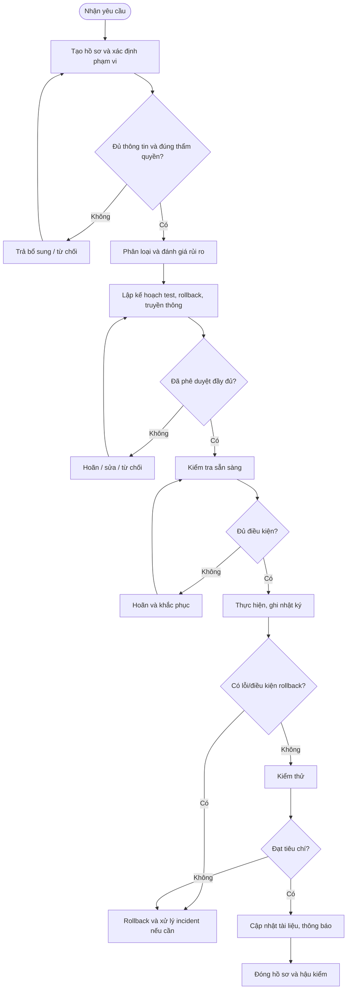

# QT-IT-13 — QUY TRÌNH QUẢN LÝ THAY ĐỔI HỆ THỐNG

> **Trạng thái:** Dự thảo nâng cấp v0.2; cần chạy thử và phê duyệt trước khi áp dụng chính thức.  
> **Chủ sở hữu:** IT Lead / Change Manager.  
> **Tài liệu liên quan:** QT-IT-08, QT-IT-10, QT-IT-11, QT-ATTT-04, QT-BCP-01/02, QT-ISMS-04, MA-01, MA-02.

## 1. Kiểm soát tài liệu

| Trường | Nội dung |
|---|---|
| Mã tài liệu | QT-IT-13 |
| Phiên bản | 0.2 — dự thảo nâng cấp |
| Chủ sở hữu | IT Lead / Change Manager |
| Người rà soát | Chủ hệ thống, đại diện ATTT và đầu mối khách hàng khi liên quan |
| Người phê duyệt | Theo ma trận thẩm quyền đã duyệt |
| Ngày hiệu lực | Điền sau khi phê duyệt |
| Chu kỳ rà soát | Tối thiểu hằng năm và sau change thất bại/sự cố nghiêm trọng |

## 2. Mục đích và phạm vi

Đảm bảo thay đổi đối với hệ thống, hạ tầng, mạng, ứng dụng, dữ liệu, tài khoản đặc quyền, cấu hình bảo mật và dịch vụ đám mây được yêu cầu, đánh giá, phê duyệt, lên lịch, thực hiện, kiểm thử, rollback khi cần và đóng hồ sơ có kiểm soát.

Áp dụng cho hệ thống Mstar quản lý hoặc hệ thống khách hàng thuộc phạm vi hợp đồng/ủy quyền. Có quyền kỹ thuật không đồng nghĩa có quyền tự quyết định thay đổi. Không thực hiện thay đổi khi chưa xác định đúng hệ thống, phạm vi và thẩm quyền.

## 3. Phân loại thay đổi

- **Tiêu chuẩn (Standard):** Thay đổi lặp lại, rủi ro thấp, có runbook đã được phê duyệt và nằm trong danh mục standard change. Không tự xếp thay đổi mới vào nhóm này.
- **Thông thường (Normal):** Phải đánh giá tác động/rủi ro, lập kế hoạch, xin phê duyệt và lên lịch trước khi thực hiện.
- **Khẩn cấp (Emergency):** Trì hoãn có thể làm tăng đáng kể thiệt hại hoặc ảnh hưởng nghiêm trọng. Phải theo cơ chế phê duyệt/playbook khẩn cấp; sau đó hoàn thiện hồ sơ và hậu kiểm.
- **Không phải change:** Thao tác hỗ trợ tiêu chuẩn không làm thay đổi cấu hình/dịch vụ và đã được quy trình khác cho phép. Nếu phát sinh thay đổi quyền, cấu hình, dữ liệu hoặc dịch vụ, phải phân loại lại.

## 4. Nguyên tắc bắt buộc

1. Không thực hiện change thông thường trước khi có phê duyệt hợp lệ.
2. Người thực hiện không tự phê duyệt change rủi ro cao do chính mình đề xuất/thực hiện.
3. Phê duyệt phải xác định phạm vi, thời gian, rủi ro và điều kiện; im lặng không được xem là đồng ý.
4. Change phải có tiêu chí thành công, kiểm thử, truyền thông, điều kiện dừng và rollback.
5. Với thay đổi có nguy cơ ảnh hưởng dữ liệu/dịch vụ trọng yếu, phải xác minh backup/khả năng phục hồi; không mặc định có backup là có thể restore.
6. Dùng tài khoản định danh được cấp đúng quyền, MFA và kênh truy cập được duyệt; không chia sẻ mật khẩu.
7. Nếu phát hiện dấu hiệu ATTT, dừng thao tác không cần thiết, bảo toàn bằng chứng và kích hoạt QT-ATTT-04.
8. Nếu kế hoạch/phạm vi thay đổi, dừng tại điểm an toàn và xin quyết định bổ sung; không tự mở rộng.
9. Tất cả hồ sơ liên kết change ID, ticket, hệ thống/tài sản và incident liên quan.

## 5. Vai trò và trách nhiệm

| Vai trò | Trách nhiệm |
|---|---|
| Người yêu cầu | Nêu lý do, mục tiêu, phạm vi, kết quả mong muốn và thời hạn. |
| Change Coordinator | Tạo hồ sơ, kiểm tra thông tin bắt buộc, theo dõi trạng thái/lịch. |
| Người thực hiện | Đánh giá kỹ thuật, lập kế hoạch, thực hiện và lưu nhật ký. |
| Chủ hệ thống/Service Owner | Đánh giá ảnh hưởng dịch vụ, phụ thuộc, downtime và tiêu chí nghiệm thu. |
| Đại diện ATTT | Rà soát rủi ro bảo mật, quyền, dữ liệu, logging và kiểm soát bù trừ. |
| Change Approver/CAB | Phê duyệt, từ chối, yêu cầu bổ sung hoặc hoãn trong phạm vi thẩm quyền. |
| Đầu mối khách hàng | Phê duyệt phạm vi/thời gian và nghiệm thu khi hợp đồng yêu cầu. |
| IT Lead/Change Manager | Điều phối lịch, giải quyết xung đột, giám sát change rủi ro cao/thất bại. |

Nếu không thể tách người thực hiện và người duyệt, phải có rà soát độc lập sau đó và ghi biện pháp kiểm soát bù trừ.

## 6. Điều kiện đầu vào bắt buộc

Hồ sơ change tối thiểu phải có:
- Mã hồ sơ, người yêu cầu, khách hàng, hệ thống/tài sản và lý do.
- Hiện trạng, trạng thái mong muốn, phạm vi bao gồm/loại trừ.
- Phân loại change, tác động tới người dùng, dịch vụ, bảo mật và dữ liệu.
- Các bước thực hiện, người làm, thời lượng và cửa sổ triển khai.
- Tiêu chí kiểm thử/thành công; điều kiện dừng và rollback.
- Đánh giá backup/restore khi áp dụng.
- Kế hoạch thông báo, đầu mối liên hệ và phương án escalation.
- Phê duyệt cần thiết theo loại change, rủi ro, hợp đồng và ma trận thẩm quyền.

Nếu thiếu trường bắt buộc, trả về người yêu cầu, ghi rõ nội dung cần bổ sung và giữ trạng thái chờ; không lên lịch thực hiện.

## 7. Trình tự thực hiện chi tiết

### Bước 1 — Ghi nhận yêu cầu
**Ai:** Người yêu cầu và Change Coordinator.

1. Tạo hồ sơ change trên hệ thống chính thức.
2. Ghi mục tiêu, lý do, hiện trạng, kết quả mong muốn, phạm vi, hệ thống/tài sản, người bị ảnh hưởng và thời hạn.
3. Liên kết ticket, incident, problem, tài sản hoặc nhà cung cấp liên quan.
4. Xác minh người yêu cầu có quyền đề xuất; yêu cầu không đồng nghĩa với phê duyệt.

**Đạt khi:** Có mã duy nhất, phạm vi rõ và người theo dõi. **Không đạt:** Trả yêu cầu bổ sung, chưa đánh giá hoặc triển khai.

### Bước 2 — Phân loại
**Ai:** Change Coordinator và người phụ trách kỹ thuật.

1. Xác định đây là change hay thao tác hỗ trợ tiêu chuẩn.
2. Đối chiếu danh mục standard change đã được phê duyệt; nếu không khớp, xử lý như normal change.
3. Xác định normal/emergency, ghi lý do và luồng phê duyệt.
4. Liên kết QT-IT-11 nếu có thay đổi quyền; liên kết QT-ATTT-04 nếu là hành động xử lý sự cố ATTT.

**Đạt khi:** Loại change và người có thẩm quyền được xác định.

### Bước 3 — Đánh giá tác động/rủi ro
**Ai:** Người thực hiện lập; chủ hệ thống/ATTT/IT Lead rà soát theo mức độ.

Đánh giá ít nhất: hệ thống/người dùng bị ảnh hưởng; downtime; phụ thuộc; dữ liệu có thể mất/sai lệch; thay đổi quyền hoặc bề mặt tấn công; backup/restore; khả năng tương thích; rủi ro thất bại; khả năng rollback; và tác động nếu hoãn.

Ghi biện pháp giảm thiểu, rủi ro tồn dư và người có quyền chấp nhận rủi ro. Nếu rủi ro chưa xác định hoặc vượt mức chấp nhận, yêu cầu thử nghiệm/bổ sung thông tin, hoãn hoặc từ chối.

### Bước 4 — Lập kế hoạch
**Ai:** Người thực hiện; chủ hệ thống rà soát.

Kế hoạch phải ghi theo thứ tự: điều kiện trước khi làm; các bước/lệnh/runbook; người làm từng bước; cửa sổ triển khai; thông báo; kiểm thử trước/sau; tiêu chí thành công; điều kiện dừng; rollback; người quyết định rollback; thời lượng dự kiến; cách giám sát; và bằng chứng cần lưu.

Không chấp nhận kế hoạch chỉ ghi “backup trước, lỗi thì rollback”. Phải chỉ rõ dữ liệu/cấu hình nào được backup, cách xác minh bản sao, bước rollback và cách kiểm tra sau rollback.

### Bước 5 — Phê duyệt
**Ai:** Người duyệt theo ma trận thẩm quyền; khách hàng nếu hợp đồng yêu cầu.

Người duyệt kiểm tra phạm vi, tác động, rủi ro, thời gian, kế hoạch test/rollback, backup, năng lực/quyền của người làm, truyền thông và xung đột lịch. Ghi kết quả **Phê duyệt / Từ chối / Yêu cầu bổ sung / Hoãn**, người duyệt, thời điểm, lý do và điều kiện. Không có phê duyệt bắt buộc thì không triển khai.

### Bước 6 — Lên lịch và thông báo
**Ai:** Change Coordinator/Service Owner.

Kiểm tra lịch bảo trì, thời điểm kinh doanh trọng yếu, change khác và người trực. Thông báo phạm vi, thời gian, ảnh hưởng, đầu mối và cách liên hệ theo phụ lục khách hàng. Nếu khách hàng phải xác nhận mà chưa xác nhận, hoãn; không coi im lặng là đồng ý.

### Bước 7 — Kiểm tra sẵn sàng
**Ai:** Người thực hiện và người kiểm tra khi yêu cầu.

Ngay trước khi làm, xác minh:
- Change ID và phê duyệt còn hiệu lực, đúng kế hoạch.
- Đúng hệ thống/tenant/tài sản, tài khoản và quyền.
- Tình trạng ban đầu, cảnh báo và phụ thuộc.
- Backup/snapshot/cấu hình trước thay đổi đã hoàn thành và có thể truy cập khi áp dụng.
- Cửa sổ, liên hệ, giám sát và phương án rollback sẵn sàng.

Nếu điều kiện bắt buộc không đạt, không bắt đầu; ghi lý do và xin dời lịch/khắc phục.

### Bước 8 — Thực hiện
**Ai:** Người thực hiện được chỉ định.

Thực hiện từng bước đã duyệt; ghi thời gian, hành động, kết quả và người thực hiện ngay trong quá trình. Không thực hiện lệnh ngoài kế hoạch. Nếu phạm vi khác dự kiến, dừng ở điểm an toàn và xin duyệt. Nếu có dấu hiệu ATTT, kích hoạt QT-ATTT-04.

### Bước 9 — Kiểm thử
**Ai:** Người thực hiện và người kiểm tra/chủ hệ thống.

Chạy các kiểm thử đã duyệt; lưu tiêu chí, kết quả thực tế, thời gian, người kiểm tra và bằng chứng. Kiểm tra chức năng chính, phụ thuộc, xác thực, log/monitoring và tác động bảo mật. Kết luận rõ: thành công; thành công có việc tồn; thất bại cần rollback; hoặc chưa đủ dữ liệu. Không tự ghi thành công nếu tiêu chí cốt lõi chưa đạt.

### Bước 10 — Rollback khi thất bại
Khi tiêu chí rollback xảy ra hoặc người có thẩm quyền quyết định dừng:
1. Báo Change/Incident Lead và đầu mối bị ảnh hưởng.
2. Ghi lý do, thời điểm, người quyết định và trạng thái trước rollback.
3. Thực hiện phương án đã duyệt; nếu không còn phù hợp, xin quyết định mới trừ trường hợp khẩn cấp theo playbook.
4. Kiểm tra dịch vụ/dữ liệu sau rollback.
5. Ghi kết quả, downtime, bằng chứng, việc tồn và liên kết incident/CAPA nếu cần.

Rollback không phải là change thành công; ghi trạng thái thất bại/đã rollback và thực hiện hậu kiểm.

### Bước 11 — Đóng hồ sơ
Chỉ đóng khi có kết quả kiểm thử, phê duyệt và thông báo cần thiết; tài liệu/CMDB/runbook đã cập nhật; ticket/incident liên quan được liên kết; việc tồn có owner/hạn; và bằng chứng được lưu đúng nơi. Nếu thiếu hồ sơ, trả lại bổ sung, không đóng chỉ vì đã hết cửa sổ triển khai.

### Bước 12 — Hậu kiểm
Change Manager rà soát change thất bại, rollback, khẩn cấp, phát sinh incident hoặc thiếu phê duyệt. Ghi mục tiêu đạt/chưa đạt, nguyên nhân, chất lượng kiểm thử, hiệu quả rollback, vấn đề thông báo, cập nhật tài liệu và hành động phòng ngừa. Mỗi hành động có owner, hạn, tiêu chí hoàn thành và bằng chứng kiểm tra hiệu lực.

## 8. Quy trình change khẩn cấp

Chỉ dùng khi trì hoãn có thể làm tăng đáng kể thiệt hại và đáp ứng tiêu chí khẩn cấp được phê duyệt. Ghi mã hồ sơ, tình huống, hệ thống, lý do, phạm vi tối thiểu, rủi ro, phương án, rollback và người phê duyệt khẩn cấp. Thực hiện hành động cần thiết để kiểm soát tình huống; sau ổn định, hoàn thiện phê duyệt/hồ sơ, kiểm thử, thông báo và hậu kiểm theo thời hạn nội bộ đã được duyệt. Không dùng luồng khẩn cấp để hợp thức hóa việc lập kế hoạch muộn.

## 9. Bảng quyết định nhanh

| Tình huống | Quyết định |
|---|---|
| Không rõ hệ thống/phạm vi | Trả bổ sung; không triển khai. |
| Thiếu phê duyệt bắt buộc | Dừng/hoãn; xin đúng thẩm quyền. |
| Backup quan trọng chưa xác minh | Hoãn change có nguy cơ dữ liệu hoặc xin biện pháp bù trừ được duyệt. |
| Không có tiêu chí test/rollback | Trả kế hoạch để hoàn thiện. |
| Phạm vi khác kế hoạch | Dừng ở điểm an toàn; xin duyệt bổ sung. |
| Tiêu chí rollback xảy ra | Rollback theo kế hoạch, thông báo và ghi bằng chứng. |
| Có dấu hiệu ATTT | Kích hoạt QT-ATTT-04. |
| Khách hàng chưa duyệt khi hợp đồng yêu cầu | Hoãn; im lặng không phải đồng ý. |

## 10. Bằng chứng cần lưu

| Hồ sơ | Nội dung |
|---|---|
| Yêu cầu change | Mục tiêu, phạm vi, người yêu cầu, hệ thống/tài sản |
| Đánh giá tác động/rủi ro | Dịch vụ, dữ liệu, ATTT, phụ thuộc, rủi ro tồn dư |
| Kế hoạch | Các bước, lịch, test, rollback, truyền thông |
| Phê duyệt | Người duyệt, thẩm quyền, thời gian, điều kiện |
| Checklist sẵn sàng | Quyền, backup, phạm vi, lịch, liên hệ |
| Nhật ký thực hiện | Mốc thời gian, thao tác, kết quả, sai khác |
| Kiểm thử/rollback | Tiêu chí, kết quả, bằng chứng, quyết định |
| Đóng/hậu kiểm | Nghiệm thu, cập nhật tài liệu, việc tồn, CAPA |

Lưu trong hệ thống change/ticket và kho được duyệt. Thời hạn lưu theo danh mục hồ sơ, hợp đồng và yêu cầu pháp lý; không lưu secret dạng rõ hoặc đưa dữ liệu khách hàng vào repository mã nguồn.

## 11. KPI

| KPI | Định nghĩa cần thống nhất |
|---|---|
| Tỷ lệ change thành công | Change đạt tiêu chí đã duyệt / tổng change thuộc mẫu đo |
| Tỷ lệ rollback | Change phải rollback / tổng change |
| Tỷ lệ change khẩn cấp | Change khẩn cấp / tổng change |
| Tỷ lệ hồ sơ đủ | Hồ sơ có đủ đánh giá, phê duyệt, test và đóng / tổng change đã đóng |
| Change thiếu phê duyệt | Số change thực hiện thiếu phê duyệt bắt buộc |
| Hậu kiểm đúng hạn | Hậu kiểm hoàn thành đúng hạn / change thuộc diện hậu kiểm |
| Incident do change | Incident có liên kết change, phân loại theo mức độ |

Change Manager phải xác định nguồn dữ liệu, kỳ đo, phạm vi và ngưỡng cảnh báo trước khi báo cáo.

## 12. Phụ lục khách hàng cần cấu hình

Xác nhận hệ thống thuộc phạm vi; người được yêu cầu change; người phê duyệt; cửa sổ bảo trì; thời hạn thông báo; tiêu chí cần CAB; backup/restore; quy tắc khẩn cấp; tiêu chí test/rollback; người nghiệm thu; nơi lưu bằng chứng và yêu cầu cập nhật CMDB/runbook.

## 13. Lưu đồ

## 14. Biểu mẫu liên quan

[Mở bộ biểu mẫu QT-IT-13](../../bieu-mau/QT-IT-13-Bieu-mau.md). Trước khi ban hành, kiểm tra bộ mẫu thực tế có yêu cầu change, đánh giá tác động/rủi ro, kế hoạch test/rollback, phê duyệt, checklist readiness, nhật ký thực hiện, kết quả kiểm thử, rollback, đóng change và hậu kiểm; thống nhất mã biểu mẫu chính thức.

## 15. Điều kiện ban hành

- [ ] Chỉ định Change Manager và người phê duyệt.
- [ ] Phê duyệt tiêu chí standard/normal/emergency.
- [ ] Chốt ma trận phê duyệt, bao gồm phê duyệt khách hàng.
- [ ] Xác định hệ thống change/ticket và kho bằng chứng.
- [ ] Kiểm tra biểu mẫu và liên kết.
- [ ] Chạy thử change tiêu chuẩn, thông thường và rollback; kiểm tra luồng khẩn cấp bằng diễn tập.
- [ ] Ghi nhận sai lệch, khắc phục và kiểm tra lại.
- [ ] Đào tạo người yêu cầu, người duyệt, người làm và người kiểm tra.
- [ ] Rà soát ATTT/hợp đồng, phê duyệt và công bố phiên bản hiệu lực.

**Tuyên bố:** Quy trình này hỗ trợ quản trị thay đổi có kiểm soát; không tự nó chứng minh chứng nhận ISO. Phải phù hợp phạm vi ISMS, đánh giá rủi ro, SoA, hợp đồng, yêu cầu pháp lý và ma trận thẩm quyền thực tế.
