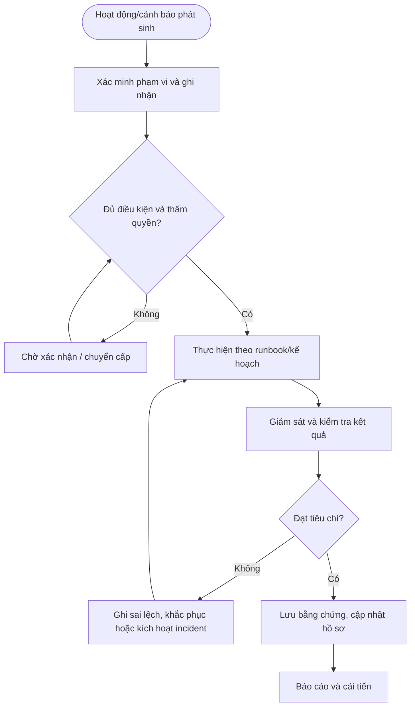

# QT-IT-14 — QUẢN LÝ CẤU HÌNH HỆ THỐNG

> **Trạng thái:** Dự thảo nâng cấp v0.2; cần rà soát, chạy thử và phê duyệt trước khi áp dụng.  
> **Chủ sở hữu:** IT Lead / Service Owner.  
> **Liên quan:** QT-IT-08, QT-IT-11, QT-IT-13, QT-ATTT-04, QT-IT-16, QT-ISMS-04, MA-01, MA-02.

## 1. Kiểm soát tài liệu
| Trường | Nội dung |
|---|---|
| Mã | QT-IT-14 |
| Phiên bản | 0.2 — dự thảo nâng cấp |
| Chủ sở hữu | IT Lead / Service Owner |
| Người rà soát | IT Lead và các owner liên quan |
| Người phê duyệt | Người có thẩm quyền theo quy định quản trị tài liệu |
| Ngày hiệu lực | Điền sau khi phê duyệt |
| Chu kỳ rà soát | Tối thiểu hằng năm và khi có thay đổi lớn/sự cố |

## 2. Mục đích và phạm vi
Duy trì hồ sơ cấu hình chính xác, baseline được duyệt, quan hệ phụ thuộc và lịch sử thay đổi để vận hành, khôi phục và điều tra.
Áp dụng cho hệ thống/dịch vụ Mstar quản lý hoặc khách hàng đã ủy quyền theo hợp đồng. Phạm vi, SLA, lịch trực, ngưỡng cảnh báo, thời hạn lưu và đầu mối phải được cấu hình trong phụ lục khách hàng; không tự đặt cam kết chung.

## 3. Nguyên tắc bắt buộc
1. Mọi hoạt động trọng yếu phải có hồ sơ, owner, tiêu chí hoàn thành và bằng chứng.
2. Cấu hình hoặc thao tác ảnh hưởng hệ thống phải có quyền và phê duyệt phù hợp.
3. Không bỏ qua cảnh báo, sai lệch hoặc vi phạm chỉ vì đã lặp lại nhiều lần.
4. Dấu hiệu ATTT phải chuyển QT-ATTT-04; thay đổi hệ thống phải liên kết QT-IT-13.
5. Không ghi secret dạng rõ vào ticket, tài liệu hoặc repository.
6. KPI phải dựa trên dữ liệu nguồn có thể kiểm chứng; không sửa lịch sử để làm đẹp báo cáo.

## 4. Vai trò
| Vai trò | Trách nhiệm |
|---|---|
| Người thực hiện/điều phối | Thực hiện theo runbook, ghi nhận và chuyển cấp khi cần. |
| Owner hệ thống/dịch vụ | Xác nhận phạm vi, mức độ trọng yếu, tiêu chí đạt và rủi ro tồn dư. |
| IT Lead/Service Owner | Điều phối nguồn lực, phê duyệt trong thẩm quyền, giám sát SLA/chất lượng. |
| Đầu mối ATTT | Rà soát rủi ro bảo mật, sự cố và bằng chứng. |
| Đầu mối khách hàng | Xác nhận cửa sổ, tác động, SLA và nghiệm thu theo hợp đồng. |
| Nhà cung cấp | Hỗ trợ theo hợp đồng và qua kênh được duyệt. |

## 5. Đầu vào và điều kiện bắt đầu
Xác định hệ thống/dịch vụ thuộc phạm vi, owner, quyền truy cập, lịch vận hành, tiêu chí/threshold đã duyệt, công cụ và nguồn dữ liệu. Nếu thiếu điều kiện quan trọng, không tự suy đoán; ghi khoảng trống, người cần xác nhận và hạn. Với hành động có thể gây gián đoạn, cần kế hoạch test/rollback và phê duyệt tương ứng.

## 6. Trình tự thực hiện chi tiết

### Bước 1 — Xác định đối tượng cấu hình
**Người thực hiện:** Người được phân công; owner hệ thống/IT Lead rà soát theo mức độ.

Lập danh sách hệ thống/dịch vụ thuộc phạm vi: máy chủ, máy trạm, network, firewall, cloud tenant, ứng dụng, cơ sở dữ liệu, thiết bị bảo mật và thành phần trọng yếu. Gán mã CI duy nhất, owner, môi trường, khách hàng, mức trọng yếu và quan hệ phụ thuộc. Không coi danh sách tài sản là đủ nếu thiếu phiên bản/cấu hình/quan hệ dịch vụ.

**Điều kiện đạt:** Kết quả được xác minh, hồ sơ có người chịu trách nhiệm và bằng chứng truy nguyên. **Nếu không đạt:** Giữ trạng thái chưa hoàn tất, ghi sai lệch, owner khắc phục và hạn xử lý.

### Bước 2 — Thu thập baseline ban đầu
**Người thực hiện:** Người được phân công; owner hệ thống/IT Lead rà soát theo mức độ.

Thu thập phiên bản OS/firmware/phần mềm, địa chỉ/hostname, role, cấu hình mạng, xác thực, logging, backup, patch và thông số quan trọng. Xác minh nguồn dữ liệu và thời điểm chụp; phân biệt cấu hình đã xác minh với thông tin do khách hàng cung cấp chưa kiểm chứng. Không đưa secret, private key hoặc mật khẩu vào hồ sơ cấu hình.

**Điều kiện đạt:** Kết quả được xác minh, hồ sơ có người chịu trách nhiệm và bằng chứng truy nguyên. **Nếu không đạt:** Giữ trạng thái chưa hoàn tất, ghi sai lệch, owner khắc phục và hạn xử lý.

### Bước 3 — Phê duyệt baseline
**Người thực hiện:** Người được phân công; owner hệ thống/IT Lead rà soát theo mức độ.

Chủ hệ thống và IT Lead/ATTT rà soát cấu hình chuẩn, giá trị bảo mật tối thiểu, cổng/dịch vụ được phép, quyền quản trị, logging, backup và phương án phục hồi. Ghi phiên bản, người duyệt, ngày hiệu lực, ngoại lệ và rủi ro tồn dư. Baseline chưa duyệt chỉ là bản tham khảo, không dùng làm chuẩn bắt buộc.

**Điều kiện đạt:** Kết quả được xác minh, hồ sơ có người chịu trách nhiệm và bằng chứng truy nguyên. **Nếu không đạt:** Giữ trạng thái chưa hoàn tất, ghi sai lệch, owner khắc phục và hạn xử lý.

### Bước 4 — Quản lý thay đổi cấu hình
**Người thực hiện:** Người được phân công; owner hệ thống/IT Lead rà soát theo mức độ.

Mọi thay đổi có ảnh hưởng phải liên kết QT-IT-13 và change ID. Ghi giá trị trước/sau, lý do, người thực hiện, phê duyệt, thời điểm và kết quả kiểm thử. Thay đổi khẩn cấp phải theo luồng khẩn cấp đã duyệt và được hậu kiểm; không sửa trực tiếp baseline để hợp thức hóa thay đổi trái phép.

**Điều kiện đạt:** Kết quả được xác minh, hồ sơ có người chịu trách nhiệm và bằng chứng truy nguyên. **Nếu không đạt:** Giữ trạng thái chưa hoàn tất, ghi sai lệch, owner khắc phục và hạn xử lý.

### Bước 5 — Phát hiện sai lệch
**Người thực hiện:** Người được phân công; owner hệ thống/IT Lead rà soát theo mức độ.

Định kỳ hoặc sau cảnh báo, so sánh cấu hình thực tế với baseline bằng công cụ/phương pháp được duyệt. Ghi CI, trường sai lệch, mức độ, nguồn phát hiện, khả năng ảnh hưởng và bằng chứng. Phân biệt sai lệch được phê duyệt với sai lệch không rõ nguồn; sai lệch không rõ phải được điều tra, không tự sửa trước khi lưu bằng chứng.

**Điều kiện đạt:** Kết quả được xác minh, hồ sơ có người chịu trách nhiệm và bằng chứng truy nguyên. **Nếu không đạt:** Giữ trạng thái chưa hoàn tất, ghi sai lệch, owner khắc phục và hạn xử lý.

### Bước 6 — Khắc phục và ngoại lệ
**Người thực hiện:** Người được phân công; owner hệ thống/IT Lead rà soát theo mức độ.

Lập hành động khắc phục có owner/hạn và change nếu cần. Nếu chưa thể đưa về baseline, đánh giá rủi ro, biện pháp bù trừ, thời hạn ngoại lệ và người chấp nhận rủi ro theo QT-ISMS-04. Ngoại lệ hết hạn phải được gia hạn có phê duyệt hoặc đóng bằng cách khôi phục cấu hình chuẩn.

**Điều kiện đạt:** Kết quả được xác minh, hồ sơ có người chịu trách nhiệm và bằng chứng truy nguyên. **Nếu không đạt:** Giữ trạng thái chưa hoàn tất, ghi sai lệch, owner khắc phục và hạn xử lý.

### Bước 7 — Sao lưu và khôi phục cấu hình
**Người thực hiện:** Người được phân công; owner hệ thống/IT Lead rà soát theo mức độ.

Với thiết bị/dịch vụ có thể export cấu hình, xác định lịch sao lưu, kho lưu, mã hóa, quyền truy cập, phiên bản và cách khôi phục. Kiểm tra khả năng đọc/khôi phục theo kế hoạch. Cấu hình backup cũng là dữ liệu nhạy cảm nếu chứa thông tin định tuyến, cấu trúc mạng hoặc secret.

**Điều kiện đạt:** Kết quả được xác minh, hồ sơ có người chịu trách nhiệm và bằng chứng truy nguyên. **Nếu không đạt:** Giữ trạng thái chưa hoàn tất, ghi sai lệch, owner khắc phục và hạn xử lý.

### Bước 8 — Rà soát hồ sơ cấu hình
**Người thực hiện:** Người được phân công; owner hệ thống/IT Lead rà soát theo mức độ.

Khi thay đổi hệ thống, vendor, owner, địa chỉ, phiên bản hoặc kết thúc dịch vụ, cập nhật CI và quan hệ phụ thuộc. Định kỳ đối chiếu hồ sơ với thực tế; ghi ngày xác minh, người xác minh và trường còn thiếu. CI không còn sử dụng phải chuyển trạng thái ngừng hoạt động/lưu trữ, không xóa lịch sử.

**Điều kiện đạt:** Kết quả được xác minh, hồ sơ có người chịu trách nhiệm và bằng chứng truy nguyên. **Nếu không đạt:** Giữ trạng thái chưa hoàn tất, ghi sai lệch, owner khắc phục và hạn xử lý.

## 7. Xử lý ngoại lệ và chuyển cấp
Chuyển cấp khi có nguy cơ vi phạm SLA, tác động rộng hơn dự kiến, không xác định được nguyên nhân, sai lệch cấu hình không rõ nguồn, cảnh báo lặp chưa được xử lý, thiếu quyền/phê duyệt, lỗi có thể gây mất dữ liệu hoặc phát hiện dấu hiệu ATTT. Hồ sơ chuyển cấp phải nêu mã đối tượng, mức độ, tác động, bằng chứng, việc đã làm, thời gian còn lại, quyết định cần thiết và người nhận.

Ngoại lệ phải có lý do, đánh giá rủi ro, biện pháp bù trừ, owner, ngày hết hạn và người chấp nhận theo QT-ISMS-04. Không coi ngoại lệ đã hết hạn là tự động được gia hạn.

## 8. Bằng chứng vận hành
| Hồ sơ | Nội dung tối thiểu |
|---|---|
| Danh mục phạm vi | Hệ thống/dịch vụ, owner, mức trọng yếu, phụ thuộc |
| Baseline/kế hoạch | Cấu hình, ngưỡng, lịch, runbook hoặc tiêu chí đã duyệt |
| Nhật ký hoạt động | Thời gian, người làm, thao tác, kết quả, cảnh báo |
| Phê duyệt | Người duyệt, thời điểm, phạm vi và điều kiện |
| Kiểm tra kết quả | Tiêu chí, kết quả thực tế, sai lệch và xử lý |
| Báo cáo/khắc phục | KPI, nguyên nhân, owner/hạn, kiểm tra hiệu lực |

Lưu trong hệ thống được phê duyệt, hạn chế quyền theo nguyên tắc cần biết và áp dụng thời hạn theo danh mục hồ sơ/hợp đồng. Không lưu dữ liệu nhạy cảm không cần thiết.

## 9. KPI và giám sát
| KPI | Cách xác định |
|---|---|
| Tỷ lệ hồ sơ đủ bằng chứng | Hồ sơ đạt checklist / hồ sơ được lấy mẫu |
| Tỷ lệ hoạt động đúng lịch | Hoạt động hoàn tất đúng lịch / hoạt động đến hạn |
| Số sai lệch/cảnh báo tồn | Sai lệch chưa xử lý theo mức độ và tuổi tồn |
| Tỷ lệ khắc phục đúng hạn | Hành động hoàn tất đúng hạn / hành động đến hạn |
| Tỷ lệ tái diễn | Sự kiện lặp cùng nguyên nhân / tổng sự kiện trong kỳ |

Chốt công thức, nguồn, chu kỳ và ngưỡng cảnh báo trước khi vận hành. Với KPI SLA, phải dùng hợp đồng và quy tắc tính đã phê duyệt.

## 10. Lưu đồ

## 11. Biểu mẫu và điều kiện ban hành
Dùng bộ biểu mẫu tương ứng trong thư mục bieu-mau; đối chiếu từng bước để bảo đảm có trường nghiệp vụ, phê duyệt, nhật ký và bằng chứng. Trước khi trình ký:
- [ ] Chốt owner, người duyệt, nguồn dữ liệu và công cụ chính thức.
- [ ] Xác nhận các giá trị phụ thuộc hợp đồng/chính sách.
- [ ] Kiểm tra biểu mẫu, link và phân quyền lưu hồ sơ.
- [ ] Chạy thử tình huống bình thường, cảnh báo/sai lệch và chuyển cấp.
- [ ] Khắc phục vấn đề chạy thử, đào tạo nhân sự và lưu bằng chứng.
- [ ] Phê duyệt và công bố phiên bản hiệu lực.

**Lưu ý:** Đây là dự thảo vận hành, không tự chứng minh chứng nhận ISO. Phải rà soát theo phạm vi ISMS, đánh giá rủi ro, SoA, hợp đồng và pháp luật áp dụng.
