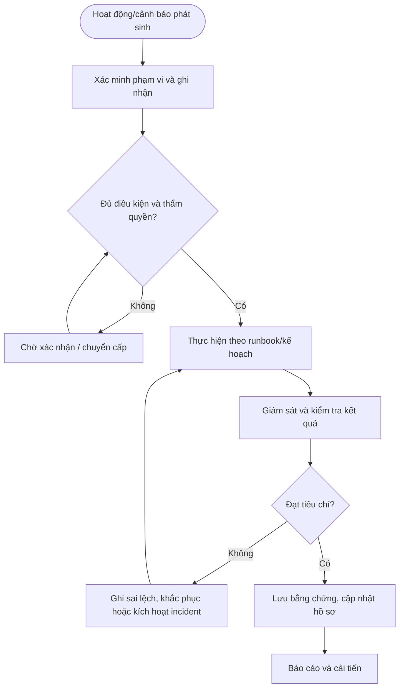

# QT-IT-15 — GIÁM SÁT VÀ BẢO TRÌ HỆ THỐNG

> **Trạng thái:** Dự thảo nâng cấp v0.2; cần rà soát, chạy thử và phê duyệt trước khi áp dụng.  
> **Chủ sở hữu:** IT Lead / Service Owner.  
> **Liên quan:** QT-IT-08, QT-IT-11, QT-IT-13, QT-ATTT-04, QT-IT-16, QT-ISMS-04, MA-01, MA-02.

## 1. Kiểm soát tài liệu
| Trường | Nội dung |
|---|---|
| Mã | QT-IT-15 |
| Phiên bản | 0.2 — dự thảo nâng cấp |
| Chủ sở hữu | IT Lead / Service Owner |
| Người rà soát | IT Lead và các owner liên quan |
| Người phê duyệt | Người có thẩm quyền theo quy định quản trị tài liệu |
| Ngày hiệu lực | Điền sau khi phê duyệt |
| Chu kỳ rà soát | Tối thiểu hằng năm và khi có thay đổi lớn/sự cố |

## 2. Mục đích và phạm vi
Phát hiện sớm sự cố/suy giảm hiệu năng, vận hành cảnh báo, thực hiện bảo trì an toàn và chứng minh kết quả bằng log/báo cáo.
Áp dụng cho hệ thống/dịch vụ Mstar quản lý hoặc khách hàng đã ủy quyền theo hợp đồng. Phạm vi, SLA, lịch trực, ngưỡng cảnh báo, thời hạn lưu và đầu mối phải được cấu hình trong phụ lục khách hàng; không tự đặt cam kết chung.

## 3. Nguyên tắc bắt buộc
1. Mọi hoạt động trọng yếu phải có hồ sơ, owner, tiêu chí hoàn thành và bằng chứng.
2. Cấu hình hoặc thao tác ảnh hưởng hệ thống phải có quyền và phê duyệt phù hợp.
3. Không bỏ qua cảnh báo, sai lệch hoặc vi phạm chỉ vì đã lặp lại nhiều lần.
4. Dấu hiệu ATTT phải chuyển QT-ATTT-04; thay đổi hệ thống phải liên kết QT-IT-13.
5. Không ghi secret dạng rõ vào ticket, tài liệu hoặc repository.
6. KPI phải dựa trên dữ liệu nguồn có thể kiểm chứng; không sửa lịch sử để làm đẹp báo cáo.

## 4. Vai trò
| Vai trò | Trách nhiệm |
|---|---|
| Người thực hiện/điều phối | Thực hiện theo runbook, ghi nhận và chuyển cấp khi cần. |
| Owner hệ thống/dịch vụ | Xác nhận phạm vi, mức độ trọng yếu, tiêu chí đạt và rủi ro tồn dư. |
| IT Lead/Service Owner | Điều phối nguồn lực, phê duyệt trong thẩm quyền, giám sát SLA/chất lượng. |
| Đầu mối ATTT | Rà soát rủi ro bảo mật, sự cố và bằng chứng. |
| Đầu mối khách hàng | Xác nhận cửa sổ, tác động, SLA và nghiệm thu theo hợp đồng. |
| Nhà cung cấp | Hỗ trợ theo hợp đồng và qua kênh được duyệt. |

## 5. Đầu vào và điều kiện bắt đầu
Xác định hệ thống/dịch vụ thuộc phạm vi, owner, quyền truy cập, lịch vận hành, tiêu chí/threshold đã duyệt, công cụ và nguồn dữ liệu. Nếu thiếu điều kiện quan trọng, không tự suy đoán; ghi khoảng trống, người cần xác nhận và hạn. Với hành động có thể gây gián đoạn, cần kế hoạch test/rollback và phê duyệt tương ứng.

## 6. Trình tự thực hiện chi tiết

### Bước 1 — Xác định phạm vi giám sát
**Người thực hiện:** Người được phân công; owner hệ thống/IT Lead rà soát theo mức độ.

Lập danh sách hệ thống/dịch vụ cần giám sát, owner, mức trọng yếu, nguồn metrics/log, dependency, lịch bảo trì, giờ hỗ trợ và người nhận cảnh báo. Phụ lục khách hàng phải xác định chỉ số, ngưỡng, giờ trực, kênh escalation và yêu cầu bảo mật log.

**Điều kiện đạt:** Kết quả được xác minh, hồ sơ có người chịu trách nhiệm và bằng chứng truy nguyên. **Nếu không đạt:** Giữ trạng thái chưa hoàn tất, ghi sai lệch, owner khắc phục và hạn xử lý.

### Bước 2 — Cấu hình chỉ số và cảnh báo
**Người thực hiện:** Người được phân công; owner hệ thống/IT Lead rà soát theo mức độ.

Chọn chỉ số theo loại hệ thống: availability, CPU/RAM, dung lượng, latency, lỗi dịch vụ, replication, backup, chứng thư SSL/domain, bảo mật và trạng thái agent. Ngưỡng phải dựa trên baseline, capacity và SLA đã duyệt; tránh đặt ngưỡng gây cảnh báo giả hoặc bỏ lọt. Ghi người duyệt, thời điểm, hành động khi cảnh báo và cách kiểm thử.

**Điều kiện đạt:** Kết quả được xác minh, hồ sơ có người chịu trách nhiệm và bằng chứng truy nguyên. **Nếu không đạt:** Giữ trạng thái chưa hoàn tất, ghi sai lệch, owner khắc phục và hạn xử lý.

### Bước 3 — Theo dõi và xác nhận cảnh báo
**Người thực hiện:** Người được phân công; owner hệ thống/IT Lead rà soát theo mức độ.

Khi cảnh báo phát sinh, xác minh nguồn, thời điểm, hệ thống, tác động và khả năng là cảnh báo giả. Tạo/liên kết ticket theo mức độ; ghi bằng chứng metrics/log và hành động ban đầu. Không bỏ qua hoặc xóa cảnh báo lặp lại chỉ vì thường xuyên xuất hiện; cần phân tích nguyên nhân.

**Điều kiện đạt:** Kết quả được xác minh, hồ sơ có người chịu trách nhiệm và bằng chứng truy nguyên. **Nếu không đạt:** Giữ trạng thái chưa hoàn tất, ghi sai lệch, owner khắc phục và hạn xử lý.

### Bước 4 — Xử lý cảnh báo
**Người thực hiện:** Người được phân công; owner hệ thống/IT Lead rà soát theo mức độ.

Kiểm tra trạng thái dịch vụ, log, tài nguyên, phụ thuộc và thay đổi gần đây. Chỉ thực hiện thao tác trong quyền/runbook được duyệt; thay đổi cấu hình cần QT-IT-13. Khi có dấu hiệu ATTT, chuyển QT-ATTT-04. Nếu vượt ngưỡng hoặc có nguy cơ vi phạm SLA, chuyển cấp theo phụ lục khách hàng.

**Điều kiện đạt:** Kết quả được xác minh, hồ sơ có người chịu trách nhiệm và bằng chứng truy nguyên. **Nếu không đạt:** Giữ trạng thái chưa hoàn tất, ghi sai lệch, owner khắc phục và hạn xử lý.

### Bước 5 — Lập kế hoạch bảo trì
**Người thực hiện:** Người được phân công; owner hệ thống/IT Lead rà soát theo mức độ.

Xác định mục tiêu, hệ thống, tác động, thời gian, người thực hiện, backup/restore, test, rollback và thông báo. Phê duyệt theo mức độ và hợp đồng. Không tiến hành bảo trì khi chưa có cửa sổ được duyệt hoặc điều kiện phục hồi bắt buộc chưa sẵn sàng.

**Điều kiện đạt:** Kết quả được xác minh, hồ sơ có người chịu trách nhiệm và bằng chứng truy nguyên. **Nếu không đạt:** Giữ trạng thái chưa hoàn tất, ghi sai lệch, owner khắc phục và hạn xử lý.

### Bước 6 — Thực hiện bảo trì
**Người thực hiện:** Người được phân công; owner hệ thống/IT Lead rà soát theo mức độ.

Kiểm tra readiness trước khi bắt đầu; ghi trạng thái trước bảo trì; thực hiện theo runbook; theo dõi log/metrics; ghi mốc thời gian và kết quả. Nếu kế hoạch khác thực tế, có lỗi vượt tiêu chí hoặc phát sinh nguy cơ dữ liệu, dừng an toàn, báo owner và rollback/chuyển incident.

**Điều kiện đạt:** Kết quả được xác minh, hồ sơ có người chịu trách nhiệm và bằng chứng truy nguyên. **Nếu không đạt:** Giữ trạng thái chưa hoàn tất, ghi sai lệch, owner khắc phục và hạn xử lý.

### Bước 7 — Kiểm thử sau bảo trì
**Người thực hiện:** Người được phân công; owner hệ thống/IT Lead rà soát theo mức độ.

Kiểm tra dịch vụ, kết nối, chức năng, hiệu năng, logging, backup/monitoring và nghiệp vụ quan trọng theo tiêu chí đã định. Ghi kết quả thực tế, lỗi còn tồn, người xác nhận và thời điểm. Không đóng hồ sơ chỉ vì máy chủ đã khởi động hoặc tiến trình đã chạy.

**Điều kiện đạt:** Kết quả được xác minh, hồ sơ có người chịu trách nhiệm và bằng chứng truy nguyên. **Nếu không đạt:** Giữ trạng thái chưa hoàn tất, ghi sai lệch, owner khắc phục và hạn xử lý.

### Bước 8 — Rà soát cảnh báo và cải tiến
**Người thực hiện:** Người được phân công; owner hệ thống/IT Lead rà soát theo mức độ.

Định kỳ phân tích availability, cảnh báo lặp, thời gian phát hiện, thời gian xử lý, capacity, bảo trì thất bại và cảnh báo không có owner. Điều chỉnh ngưỡng có kiểm soát, cập nhật runbook và tạo CAPA cho lỗi lặp. Mọi thay đổi ngưỡng ảnh hưởng SLA phải được rà soát/phê duyệt.

**Điều kiện đạt:** Kết quả được xác minh, hồ sơ có người chịu trách nhiệm và bằng chứng truy nguyên. **Nếu không đạt:** Giữ trạng thái chưa hoàn tất, ghi sai lệch, owner khắc phục và hạn xử lý.

## 7. Xử lý ngoại lệ và chuyển cấp
Chuyển cấp khi có nguy cơ vi phạm SLA, tác động rộng hơn dự kiến, không xác định được nguyên nhân, sai lệch cấu hình không rõ nguồn, cảnh báo lặp chưa được xử lý, thiếu quyền/phê duyệt, lỗi có thể gây mất dữ liệu hoặc phát hiện dấu hiệu ATTT. Hồ sơ chuyển cấp phải nêu mã đối tượng, mức độ, tác động, bằng chứng, việc đã làm, thời gian còn lại, quyết định cần thiết và người nhận.

Ngoại lệ phải có lý do, đánh giá rủi ro, biện pháp bù trừ, owner, ngày hết hạn và người chấp nhận theo QT-ISMS-04. Không coi ngoại lệ đã hết hạn là tự động được gia hạn.

## 8. Bằng chứng vận hành
| Hồ sơ | Nội dung tối thiểu |
|---|---|
| Danh mục phạm vi | Hệ thống/dịch vụ, owner, mức trọng yếu, phụ thuộc |
| Baseline/kế hoạch | Cấu hình, ngưỡng, lịch, runbook hoặc tiêu chí đã duyệt |
| Nhật ký hoạt động | Thời gian, người làm, thao tác, kết quả, cảnh báo |
| Phê duyệt | Người duyệt, thời điểm, phạm vi và điều kiện |
| Kiểm tra kết quả | Tiêu chí, kết quả thực tế, sai lệch và xử lý |
| Báo cáo/khắc phục | KPI, nguyên nhân, owner/hạn, kiểm tra hiệu lực |

Lưu trong hệ thống được phê duyệt, hạn chế quyền theo nguyên tắc cần biết và áp dụng thời hạn theo danh mục hồ sơ/hợp đồng. Không lưu dữ liệu nhạy cảm không cần thiết.

## 9. KPI và giám sát
| KPI | Cách xác định |
|---|---|
| Tỷ lệ hồ sơ đủ bằng chứng | Hồ sơ đạt checklist / hồ sơ được lấy mẫu |
| Tỷ lệ hoạt động đúng lịch | Hoạt động hoàn tất đúng lịch / hoạt động đến hạn |
| Số sai lệch/cảnh báo tồn | Sai lệch chưa xử lý theo mức độ và tuổi tồn |
| Tỷ lệ khắc phục đúng hạn | Hành động hoàn tất đúng hạn / hành động đến hạn |
| Tỷ lệ tái diễn | Sự kiện lặp cùng nguyên nhân / tổng sự kiện trong kỳ |

Chốt công thức, nguồn, chu kỳ và ngưỡng cảnh báo trước khi vận hành. Với KPI SLA, phải dùng hợp đồng và quy tắc tính đã phê duyệt.

## 10. Lưu đồ

## 11. Biểu mẫu và điều kiện ban hành
Dùng bộ biểu mẫu tương ứng trong thư mục bieu-mau; đối chiếu từng bước để bảo đảm có trường nghiệp vụ, phê duyệt, nhật ký và bằng chứng. Trước khi trình ký:
- [ ] Chốt owner, người duyệt, nguồn dữ liệu và công cụ chính thức.
- [ ] Xác nhận các giá trị phụ thuộc hợp đồng/chính sách.
- [ ] Kiểm tra biểu mẫu, link và phân quyền lưu hồ sơ.
- [ ] Chạy thử tình huống bình thường, cảnh báo/sai lệch và chuyển cấp.
- [ ] Khắc phục vấn đề chạy thử, đào tạo nhân sự và lưu bằng chứng.
- [ ] Phê duyệt và công bố phiên bản hiệu lực.

**Lưu ý:** Đây là dự thảo vận hành, không tự chứng minh chứng nhận ISO. Phải rà soát theo phạm vi ISMS, đánh giá rủi ro, SoA, hợp đồng và pháp luật áp dụng.
