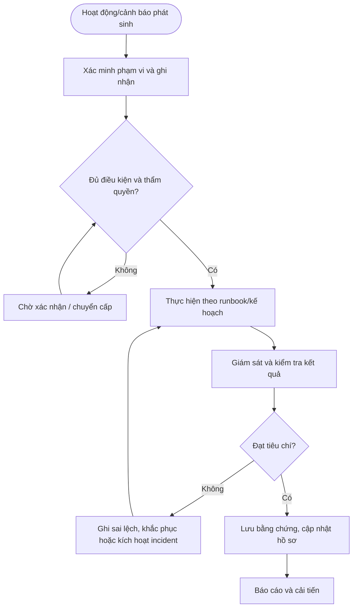

# QT-IT-16 — QUẢN LÝ SLA VÀ CHẤT LƯỢNG DỊCH VỤ

> **Trạng thái:** Dự thảo nâng cấp v0.2; cần rà soát, chạy thử và phê duyệt trước khi áp dụng.  
> **Chủ sở hữu:** IT Lead / Service Owner.  
> **Liên quan:** QT-IT-08, QT-IT-11, QT-IT-13, QT-ATTT-04, QT-IT-16, QT-ISMS-04, MA-01, MA-02.

## 1. Kiểm soát tài liệu
| Trường | Nội dung |
|---|---|
| Mã | QT-IT-16 |
| Phiên bản | 0.2 — dự thảo nâng cấp |
| Chủ sở hữu | IT Lead / Service Owner |
| Người rà soát | IT Lead và các owner liên quan |
| Người phê duyệt | Người có thẩm quyền theo quy định quản trị tài liệu |
| Ngày hiệu lực | Điền sau khi phê duyệt |
| Chu kỳ rà soát | Tối thiểu hằng năm và khi có thay đổi lớn/sự cố |

## 2. Mục đích và phạm vi
Đo lường chất lượng dịch vụ dựa trên dữ liệu ticket và hợp đồng; phát hiện nguy cơ vi phạm, báo cáo minh bạch và theo dõi hành động cải tiến.
Áp dụng cho hệ thống/dịch vụ Mstar quản lý hoặc khách hàng đã ủy quyền theo hợp đồng. Phạm vi, SLA, lịch trực, ngưỡng cảnh báo, thời hạn lưu và đầu mối phải được cấu hình trong phụ lục khách hàng; không tự đặt cam kết chung.

## 3. Nguyên tắc bắt buộc
1. Mọi hoạt động trọng yếu phải có hồ sơ, owner, tiêu chí hoàn thành và bằng chứng.
2. Cấu hình hoặc thao tác ảnh hưởng hệ thống phải có quyền và phê duyệt phù hợp.
3. Không bỏ qua cảnh báo, sai lệch hoặc vi phạm chỉ vì đã lặp lại nhiều lần.
4. Dấu hiệu ATTT phải chuyển QT-ATTT-04; thay đổi hệ thống phải liên kết QT-IT-13.
5. Không ghi secret dạng rõ vào ticket, tài liệu hoặc repository.
6. KPI phải dựa trên dữ liệu nguồn có thể kiểm chứng; không sửa lịch sử để làm đẹp báo cáo.

## 4. Vai trò
| Vai trò | Trách nhiệm |
|---|---|
| Người thực hiện/điều phối | Thực hiện theo runbook, ghi nhận và chuyển cấp khi cần. |
| Owner hệ thống/dịch vụ | Xác nhận phạm vi, mức độ trọng yếu, tiêu chí đạt và rủi ro tồn dư. |
| IT Lead/Service Owner | Điều phối nguồn lực, phê duyệt trong thẩm quyền, giám sát SLA/chất lượng. |
| Đầu mối ATTT | Rà soát rủi ro bảo mật, sự cố và bằng chứng. |
| Đầu mối khách hàng | Xác nhận cửa sổ, tác động, SLA và nghiệm thu theo hợp đồng. |
| Nhà cung cấp | Hỗ trợ theo hợp đồng và qua kênh được duyệt. |

## 5. Đầu vào và điều kiện bắt đầu
Xác định hệ thống/dịch vụ thuộc phạm vi, owner, quyền truy cập, lịch vận hành, tiêu chí/threshold đã duyệt, công cụ và nguồn dữ liệu. Nếu thiếu điều kiện quan trọng, không tự suy đoán; ghi khoảng trống, người cần xác nhận và hạn. Với hành động có thể gây gián đoạn, cần kế hoạch test/rollback và phê duyệt tương ứng.

## 6. Trình tự thực hiện chi tiết

### Bước 1 — Thiết lập bộ SLA
**Người thực hiện:** Người được phân công; owner hệ thống/IT Lead rà soát theo mức độ.

Trích SLA từ hợp đồng/phụ lục đã ký: phạm vi ticket, giờ hỗ trợ, lịch nghỉ, mức ưu tiên, thời gian phản hồi/cập nhật/khôi phục/giải quyết, cách tính giờ, điều kiện tạm dừng và loại trừ. Ghi phiên bản, ngày hiệu lực và người phê duyệt. Không tự suy diễn SLA từ tài liệu marketing hoặc thỏa thuận miệng.

**Điều kiện đạt:** Kết quả được xác minh, hồ sơ có người chịu trách nhiệm và bằng chứng truy nguyên. **Nếu không đạt:** Giữ trạng thái chưa hoàn tất, ghi sai lệch, owner khắc phục và hạn xử lý.

### Bước 2 — Cấu hình nguồn dữ liệu
**Người thực hiện:** Người được phân công; owner hệ thống/IT Lead rà soát theo mức độ.

Xác định hệ thống ticket chính thức, các trường thời gian, trạng thái, ưu tiên, khách hàng, loại ticket, owner, thời điểm phản hồi và đóng. Kiểm tra múi giờ, đồng bộ thời gian, quyền sửa dữ liệu và lịch sử trạng thái. Ghi rõ trường nào là nguồn sự thật cho mỗi phép đo.

**Điều kiện đạt:** Kết quả được xác minh, hồ sơ có người chịu trách nhiệm và bằng chứng truy nguyên. **Nếu không đạt:** Giữ trạng thái chưa hoàn tất, ghi sai lệch, owner khắc phục và hạn xử lý.

### Bước 3 — Kiểm tra chất lượng dữ liệu
**Người thực hiện:** Người được phân công; owner hệ thống/IT Lead rà soát theo mức độ.

Định kỳ phát hiện ticket thiếu khách hàng/ưu tiên/owner, mốc thời gian bất thường, trạng thái sai, ticket trùng, ticket đóng thiếu bằng chứng hoặc thời gian tạm dừng không có căn cứ. Giao người sửa dữ liệu với lý do truy nguyên; không tự xóa ticket lỗi khỏi mẫu đo.

**Điều kiện đạt:** Kết quả được xác minh, hồ sơ có người chịu trách nhiệm và bằng chứng truy nguyên. **Nếu không đạt:** Giữ trạng thái chưa hoàn tất, ghi sai lệch, owner khắc phục và hạn xử lý.

### Bước 4 — Tính toán và kiểm tra SLA
**Người thực hiện:** Người được phân công; owner hệ thống/IT Lead rà soát theo mức độ.

Tính theo công thức và lịch làm việc đã duyệt; phân biệt phản hồi, cập nhật, khôi phục và giải quyết. Xử lý thời gian tạm dừng chỉ khi đúng điều kiện hợp đồng và có ghi nhận. Đối chiếu mẫu thủ công với hệ thống, kiểm tra trường hợp qua ngày nghỉ, đổi ưu tiên, mở lại và chuyển vendor.

**Điều kiện đạt:** Kết quả được xác minh, hồ sơ có người chịu trách nhiệm và bằng chứng truy nguyên. **Nếu không đạt:** Giữ trạng thái chưa hoàn tất, ghi sai lệch, owner khắc phục và hạn xử lý.

### Bước 5 — Cảnh báo nguy cơ quá hạn
**Người thực hiện:** Người được phân công; owner hệ thống/IT Lead rà soát theo mức độ.

Thiết lập mốc cảnh báo theo SLA/ma trận nội bộ đã duyệt. Danh sách cảnh báo phải có ticket, owner, thời gian còn lại, tác động, bước tiếp theo và người cần chuyển cấp. IT Lead điều phối trước khi vi phạm; không đợi báo cáo cuối kỳ.

**Điều kiện đạt:** Kết quả được xác minh, hồ sơ có người chịu trách nhiệm và bằng chứng truy nguyên. **Nếu không đạt:** Giữ trạng thái chưa hoàn tất, ghi sai lệch, owner khắc phục và hạn xử lý.

### Bước 6 — Báo cáo khách hàng và quản lý
**Người thực hiện:** Người được phân công; owner hệ thống/IT Lead rà soát theo mức độ.

Báo cáo theo kỳ trong hợp đồng, gồm số lượng, phân bố ưu tiên, SLA đạt/trượt, backlog, ticket quá hạn, ticket mở lại, nguyên nhân, sự cố lớn, việc tồn và CAPA. Nêu rõ mẫu đo, quy tắc loại trừ, nguồn và giới hạn dữ liệu. Không trình bày tỷ lệ nếu mẫu số hoặc quy tắc tính chưa được xác minh.

**Điều kiện đạt:** Kết quả được xác minh, hồ sơ có người chịu trách nhiệm và bằng chứng truy nguyên. **Nếu không đạt:** Giữ trạng thái chưa hoàn tất, ghi sai lệch, owner khắc phục và hạn xử lý.

### Bước 7 — Xử lý vi phạm và khiếu nại
**Người thực hiện:** Người được phân công; owner hệ thống/IT Lead rà soát theo mức độ.

Mỗi SLA vi phạm phải có mã ticket, mốc thời gian, nguyên nhân, tác động, trách nhiệm xử lý, thông tin khách hàng và hành động khắc phục. Khi khách hàng khiếu nại số liệu, lưu ý kiến, kiểm tra dữ liệu nguồn, ghi kết quả đối soát và người phê duyệt điều chỉnh. Không sửa số liệu mà không có audit trail.

**Điều kiện đạt:** Kết quả được xác minh, hồ sơ có người chịu trách nhiệm và bằng chứng truy nguyên. **Nếu không đạt:** Giữ trạng thái chưa hoàn tất, ghi sai lệch, owner khắc phục và hạn xử lý.

### Bước 8 — Theo dõi cải tiến
**Người thực hiện:** Người được phân công; owner hệ thống/IT Lead rà soát theo mức độ.

Phân tích xu hướng theo khách hàng, dịch vụ, mức ưu tiên, nhóm nguyên nhân, vendor và owner; xác định điểm nghẽn hệ thống/quy trình/nhân lực. Mỗi hành động có owner, hạn, kết quả mong đợi và cách kiểm tra hiệu lực. Đóng CAPA sau khi có bằng chứng, không chỉ khi đã tổ chức họp.

**Điều kiện đạt:** Kết quả được xác minh, hồ sơ có người chịu trách nhiệm và bằng chứng truy nguyên. **Nếu không đạt:** Giữ trạng thái chưa hoàn tất, ghi sai lệch, owner khắc phục và hạn xử lý.

## 7. Xử lý ngoại lệ và chuyển cấp
Chuyển cấp khi có nguy cơ vi phạm SLA, tác động rộng hơn dự kiến, không xác định được nguyên nhân, sai lệch cấu hình không rõ nguồn, cảnh báo lặp chưa được xử lý, thiếu quyền/phê duyệt, lỗi có thể gây mất dữ liệu hoặc phát hiện dấu hiệu ATTT. Hồ sơ chuyển cấp phải nêu mã đối tượng, mức độ, tác động, bằng chứng, việc đã làm, thời gian còn lại, quyết định cần thiết và người nhận.

Ngoại lệ phải có lý do, đánh giá rủi ro, biện pháp bù trừ, owner, ngày hết hạn và người chấp nhận theo QT-ISMS-04. Không coi ngoại lệ đã hết hạn là tự động được gia hạn.

## 8. Bằng chứng vận hành
| Hồ sơ | Nội dung tối thiểu |
|---|---|
| Danh mục phạm vi | Hệ thống/dịch vụ, owner, mức trọng yếu, phụ thuộc |
| Baseline/kế hoạch | Cấu hình, ngưỡng, lịch, runbook hoặc tiêu chí đã duyệt |
| Nhật ký hoạt động | Thời gian, người làm, thao tác, kết quả, cảnh báo |
| Phê duyệt | Người duyệt, thời điểm, phạm vi và điều kiện |
| Kiểm tra kết quả | Tiêu chí, kết quả thực tế, sai lệch và xử lý |
| Báo cáo/khắc phục | KPI, nguyên nhân, owner/hạn, kiểm tra hiệu lực |

Lưu trong hệ thống được phê duyệt, hạn chế quyền theo nguyên tắc cần biết và áp dụng thời hạn theo danh mục hồ sơ/hợp đồng. Không lưu dữ liệu nhạy cảm không cần thiết.

## 9. KPI và giám sát
| KPI | Cách xác định |
|---|---|
| Tỷ lệ hồ sơ đủ bằng chứng | Hồ sơ đạt checklist / hồ sơ được lấy mẫu |
| Tỷ lệ hoạt động đúng lịch | Hoạt động hoàn tất đúng lịch / hoạt động đến hạn |
| Số sai lệch/cảnh báo tồn | Sai lệch chưa xử lý theo mức độ và tuổi tồn |
| Tỷ lệ khắc phục đúng hạn | Hành động hoàn tất đúng hạn / hành động đến hạn |
| Tỷ lệ tái diễn | Sự kiện lặp cùng nguyên nhân / tổng sự kiện trong kỳ |

Chốt công thức, nguồn, chu kỳ và ngưỡng cảnh báo trước khi vận hành. Với KPI SLA, phải dùng hợp đồng và quy tắc tính đã phê duyệt.

## 10. Lưu đồ

## 11. Biểu mẫu và điều kiện ban hành
Dùng bộ biểu mẫu tương ứng trong thư mục bieu-mau; đối chiếu từng bước để bảo đảm có trường nghiệp vụ, phê duyệt, nhật ký và bằng chứng. Trước khi trình ký:
- [ ] Chốt owner, người duyệt, nguồn dữ liệu và công cụ chính thức.
- [ ] Xác nhận các giá trị phụ thuộc hợp đồng/chính sách.
- [ ] Kiểm tra biểu mẫu, link và phân quyền lưu hồ sơ.
- [ ] Chạy thử tình huống bình thường, cảnh báo/sai lệch và chuyển cấp.
- [ ] Khắc phục vấn đề chạy thử, đào tạo nhân sự và lưu bằng chứng.
- [ ] Phê duyệt và công bố phiên bản hiệu lực.

**Lưu ý:** Đây là dự thảo vận hành, không tự chứng minh chứng nhận ISO. Phải rà soát theo phạm vi ISMS, đánh giá rủi ro, SoA, hợp đồng và pháp luật áp dụng.
