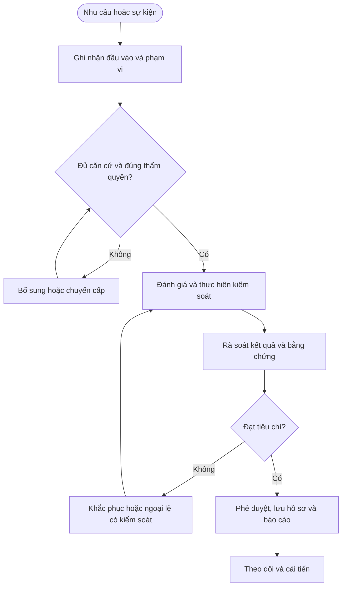

# QT-QL-01 — QUẢN LÝ KPI VÀ CẢI TIẾN DỊCH VỤ

> **Trạng thái:** Dự thảo nâng cấp v0.2; cần rà soát, chạy thử và phê duyệt trước khi áp dụng.  
> **Chủ sở hữu:** Owner quy trình / ISMS Owner / IT Lead theo phân công.  
> **Liên quan:** QT-ISMS-01 đến QT-ISMS-06, QT-ATTT-04, REG-01/02/03/04, MA-01, MA-02.

## 1. Kiểm soát tài liệu

| Trường | Nội dung |
|---|---|
| Mã | QT-QL-01 |
| Phiên bản | 0.2 — dự thảo nâng cấp |
| Chủ sở hữu | Owner quy trình được phân công |
| Người rà soát | IT Lead/ISMS Owner và bên liên quan |
| Người phê duyệt | Người có thẩm quyền theo quản trị tài liệu |
| Ngày hiệu lực | Điền sau khi phê duyệt |
| Rà soát | Tối thiểu hằng năm và khi có thay đổi trọng yếu |

## 2. Mục đích và phạm vi

QUẢN LÝ KPI VÀ CẢI TIẾN DỊCH VỤ. Áp dụng trong phạm vi ISMS và hoạt động Mstar/khách hàng liên quan. Các tiêu chí, nghĩa vụ, thời hạn và quyền phê duyệt phải lấy từ nguồn đã được xác minh; không tự đặt nghĩa vụ pháp lý hoặc cam kết hợp đồng.

## 3. Nguyên tắc bắt buộc

1. Xác định rõ owner, phạm vi, tiêu chí và người có thẩm quyền.
2. Dùng bằng chứng khách quan; phân biệt dữ kiện, giả định và nhận định.
3. Không coi tài liệu được viết là bằng chứng kiểm soát đã vận hành.
4. Người thực hiện không tự chấp nhận rủi ro trọng yếu do mình tạo ra.
5. Mọi hành động khắc phục có owner, hạn, tiêu chí hoàn thành và kiểm tra hiệu lực.
6. Không sửa/xóa hồ sơ để che giấu sai lệch; mọi sửa đổi phải truy nguyên được.

## 4. Vai trò

| Vai trò | Trách nhiệm |
|---|---|
| Owner quy trình | Duy trì quy trình, biểu mẫu, hồ sơ và cải tiến. |
| Người thực hiện | Thu thập thông tin, thực hiện kiểm soát và lưu bằng chứng. |
| Người rà soát | Kiểm tra căn cứ, rủi ro, tính đầy đủ và hiệu lực. |
| Người phê duyệt | Quyết định trong phạm vi thẩm quyền, ghi điều kiện và lý do. |
| ISMS Owner/IT Lead | Điều phối, theo dõi tuân thủ và báo cáo. |
| Khách hàng/Legal/Sale/HR | Tham gia khi liên quan đến hợp đồng, pháp lý, nhân sự hoặc thương mại. |

## 5. Đầu vào và điều kiện bắt đầu

Hồ sơ phải xác định mục tiêu, phạm vi, dữ liệu nguồn, người chịu trách nhiệm, tiêu chí đánh giá, người phê duyệt và nơi lưu. Nếu thiếu căn cứ hoặc có xung đột giữa quy trình, hợp đồng và yêu cầu pháp lý, ghi điểm cần xác minh và chuyển người có thẩm quyền; không tự chọn cách diễn giải thuận tiện.

## 6. Trình tự thực hiện chi tiết

### Bước 1 — Xác định mục tiêu và định nghĩa
**Người thực hiện:** Owner quy trình và các vai trò được chỉ định.

Mỗi KPI phải có mục tiêu, công thức, đơn vị, mẫu số, phạm vi, nguồn dữ liệu, owner, chu kỳ, ngưỡng và quy tắc loại trừ. KPI SLA lấy từ hợp đồng/phụ lục; KPI nội bộ không được ghi đè cam kết khách hàng.

**Điều kiện đạt:** Có căn cứ, người chịu trách nhiệm, quyết định và bằng chứng truy nguyên. **Nếu không đạt:** Ghi sai lệch, giao owner/hạn và chuyển cấp theo thẩm quyền.

### Bước 2 — Kiểm tra dữ liệu nguồn
**Người thực hiện:** Owner quy trình và các vai trò được chỉ định.

Xác định hệ thống nguồn, quyền sửa, lịch sử, múi giờ và trường bắt buộc. Rà soát ticket trùng, thiếu dữ liệu, trạng thái sai và mốc thời gian bất thường; sửa có audit trail và người duyệt.

**Điều kiện đạt:** Có căn cứ, người chịu trách nhiệm, quyết định và bằng chứng truy nguyên. **Nếu không đạt:** Ghi sai lệch, giao owner/hạn và chuyển cấp theo thẩm quyền.

### Bước 3 — Tính toán và đối soát
**Người thực hiện:** Owner quy trình và các vai trò được chỉ định.

Chạy báo cáo theo công thức đã duyệt; kiểm tra mẫu thủ công và các trường hợp biên như ngày nghỉ, tạm dừng SLA, ticket mở lại, chuyển nhóm và thay đổi ưu tiên. Ghi phiên bản công thức và thời điểm chạy.

**Điều kiện đạt:** Có căn cứ, người chịu trách nhiệm, quyết định và bằng chứng truy nguyên. **Nếu không đạt:** Ghi sai lệch, giao owner/hạn và chuyển cấp theo thẩm quyền.

### Bước 4 — Phân tích kết quả
**Người thực hiện:** Owner quy trình và các vai trò được chỉ định.

So sánh với mục tiêu, kỳ trước, khách hàng/dịch vụ/nhóm nguyên nhân. Tách biến động do dữ liệu sai, thay đổi phạm vi, năng lực, vendor hoặc quy trình. Không kết luận hiệu suất cá nhân chỉ dựa trên một KPI đơn lẻ.

**Điều kiện đạt:** Có căn cứ, người chịu trách nhiệm, quyết định và bằng chứng truy nguyên. **Nếu không đạt:** Ghi sai lệch, giao owner/hạn và chuyển cấp theo thẩm quyền.

### Bước 5 — Lập hành động cải tiến
**Người thực hiện:** Owner quy trình và các vai trò được chỉ định.

Với KPI không đạt, ghi nguyên nhân, hành động, owner, hạn, nguồn lực, tiêu chí thành công và cách kiểm tra. Ưu tiên vấn đề ảnh hưởng khách hàng, ATTT, SLA và tái diễn.

**Điều kiện đạt:** Có căn cứ, người chịu trách nhiệm, quyết định và bằng chứng truy nguyên. **Nếu không đạt:** Ghi sai lệch, giao owner/hạn và chuyển cấp theo thẩm quyền.

### Bước 6 — Báo cáo và kiểm tra hiệu lực
**Người thực hiện:** Owner quy trình và các vai trò được chỉ định.

Báo cáo đúng kỳ, ghi giới hạn dữ liệu và việc tồn. Sau hành động, đo lại trong kỳ phù hợp; chỉ đóng khi có bằng chứng hiệu lực hoặc người có thẩm quyền chấp nhận rủi ro còn lại.

**Điều kiện đạt:** Có căn cứ, người chịu trách nhiệm, quyết định và bằng chứng truy nguyên. **Nếu không đạt:** Ghi sai lệch, giao owner/hạn và chuyển cấp theo thẩm quyền.

## 7. Ngoại lệ và chuyển cấp

Chuyển cấp khi thiếu thẩm quyền, rủi ro vượt ngưỡng, nghĩa vụ chưa rõ, bằng chứng thiếu/bị can thiệp, hành động quá hạn hoặc kiểm soát không hiệu lực. Ghi căn cứ, tác động, người nhận, quyết định cần thiết và hạn phản hồi. Ngoại lệ phải có rủi ro, biện pháp bù trừ, owner, ngày hết hạn và người phê duyệt.

## 8. Bằng chứng và lưu hồ sơ

| Hồ sơ | Nội dung tối thiểu |
|---|---|
| Yêu cầu/đầu vào | Mục tiêu, phạm vi, nguồn và người yêu cầu |
| Đánh giá/rà soát | Tiêu chí, căn cứ, phát hiện và người rà soát |
| Quyết định/phê duyệt | Người quyết định, thời điểm, điều kiện và lý do |
| Nhật ký thực hiện | Hoạt động, kết quả, sai lệch và việc tiếp theo |
| Báo cáo/khắc phục | Trạng thái, owner, hạn, kiểm tra hiệu lực |

Lưu theo danh mục hồ sơ, hợp đồng và pháp luật đã được rà soát. Không xóa hồ sơ thuộc điều tra/tranh chấp/legal hold; không lưu secret dạng rõ.

## 9. KPI và giám sát

| KPI | Định nghĩa |
|---|---|
| Tỷ lệ hồ sơ đủ | Hồ sơ đáp ứng checklist / hồ sơ được lấy mẫu |
| Hành động quá hạn | Số hành động đến hạn chưa hoàn tất |
| Tỷ lệ rà soát đúng hạn | Hồ sơ/tài liệu được rà soát đúng hạn / số đến hạn |
| Tỷ lệ tái diễn | Sai lệch lặp lại cùng nguyên nhân |
| Tỷ lệ khắc phục hiệu lực | Hành động có bằng chứng hiệu lực / hành động được kiểm tra |

Chốt công thức, nguồn, kỳ đo và ngưỡng cảnh báo trước khi áp dụng; không dùng chỉ số tổng hợp để che khuất rủi ro nghiêm trọng.

## 10. Lưu đồ

## 11. Điều kiện ban hành

- [ ] Xác định owner, thẩm quyền và phạm vi.
- [ ] Xác nhận tiêu chí/thời hạn theo nguồn được duyệt.
- [ ] Đối chiếu biểu mẫu, danh mục và nơi lưu bằng chứng.
- [ ] Chạy thử tình huống thường lệ và ngoại lệ.
- [ ] Khắc phục sai lệch, đào tạo người liên quan và lưu bằng chứng.
- [ ] Phê duyệt và công bố phiên bản hiệu lực.

**Lưu ý:** Dự thảo hỗ trợ quản trị ISMS/vận hành nhưng không tự chứng minh chứng nhận ISO; cần rà soát theo phạm vi ISMS, đánh giá rủi ro, SoA, hợp đồng và pháp luật áp dụng.